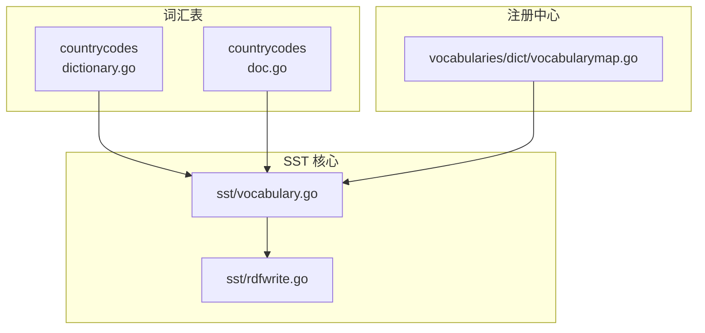
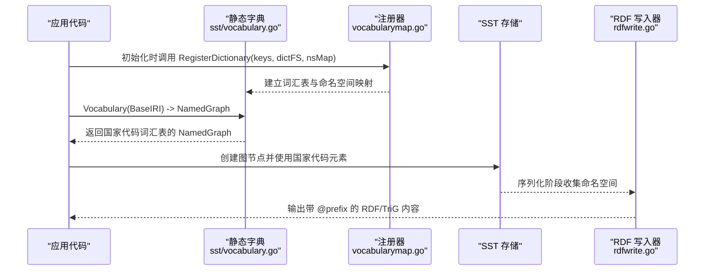
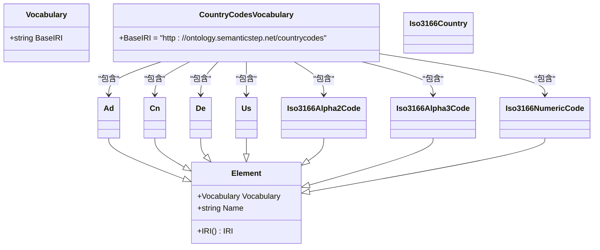
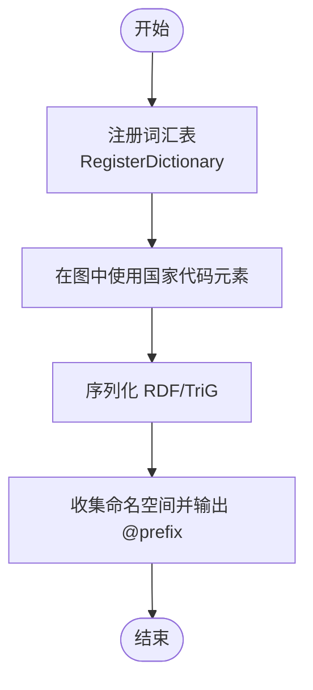
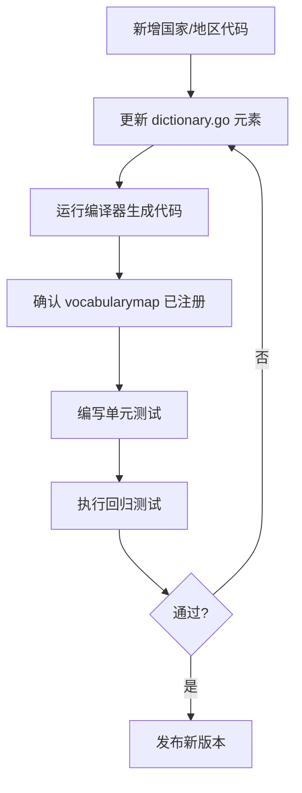
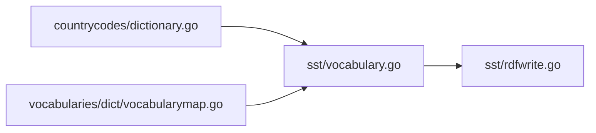

# 国家代码词汇表

<cite>
**本文引用的文件**
- [vocabularies/countrycodes/dictionary.go](file://vocabularies/countrycodes/dictionary.go)
- [vocabularies/countrycodes/doc.go](file://vocabularies/countrycodes/doc.go)
- [sst/vocabulary.go](file://sst/vocabulary.go)
- [vocabularies/dict/vocabularymap.go](file://vocabularies/dict/vocabularymap.go)
- [sst/rdfwrite.go](file://sst/rdfwrite.go)
- [sst_test/rdftrig_test.go](file://sst_test/rdftrig_test.go)
- [sst_test/ephemeralStageBasic_test.go](file://sst_test/ephemeralStageBasic_test.go)
</cite>

## 目录
1. [简介](#简介)
2. [项目结构](#项目结构)
3. [核心组件](#核心组件)
4. [架构总览](#架构总览)
5. [详细组件分析](#详细组件分析)
6. [依赖关系分析](#依赖关系分析)
7. [性能考虑](#性能考虑)
8. [故障排查指南](#故障排查指南)
9. [结论](#结论)
10. [附录](#附录)

## 简介
本文件面向使用 SST Core 的国家代码词汇表（ISO 3166）的开发者，系统说明：
- 词汇表包含的 ISO 国家代码标准与 IRI 映射
- 如何使用预定义的国家代码元素（如 cn、de、us 等）
- 在产品信息、地理位置描述中的典型用法
- BaseIRI 配置与命名空间管理
- 如何在 SST 存储中引用国家代码词汇表
- 版本管理与更新机制
- 扩展方法：如何添加新的国家或地区代码

## 项目结构
国家代码词汇表位于 vocabularies/countrycodes 包，提供：
- 词汇表基 IRI（BaseIRI）
- 每个 ISO 3166 国家/地区的预定义元素（Element）
- 包级信息（doc.go）

SST 运行时通过全局词汇表注册机制将各词汇表（含国家代码）纳入静态字典，并在序列化时自动处理命名空间前缀。

图表来源
- [vocabularies/countrycodes/dictionary.go:11-273](file://vocabularies/countrycodes/dictionary.go#L11-L273)
- [vocabularies/countrycodes/doc.go:1-5](file://vocabularies/countrycodes/doc.go#L1-L5)
- [sst/vocabulary.go:15-123](file://sst/vocabulary.go#L15-L123)
- [vocabularies/dict/vocabularymap.go:3798-3816](file://vocabularies/dict/vocabularymap.go#L3798-L3816)
- [sst/rdfwrite.go:973-1002](file://sst/rdfwrite.go#L973-L1002)

章节来源
- [vocabularies/countrycodes/dictionary.go:11-273](file://vocabularies/countrycodes/dictionary.go#L11-L273)
- [vocabularies/countrycodes/doc.go:1-5](file://vocabularies/countrycodes/doc.go#L1-L5)
- [sst/vocabulary.go:15-123](file://sst/vocabulary.go#L15-L123)
- [vocabularies/dict/vocabularymap.go:3798-3816](file://vocabularies/dict/vocabularymap.go#L3798-L3816)
- [sst/rdfwrite.go:973-1002](file://sst/rdfwrite.go#L973-L1002)

## 核心组件
- 词汇表与元素
  - 词汇表：COUNTRYCODESVocabulary，BaseIRI 为 http://ontology.semanticstep.net/countrycodes
  - 元素：每个 ISO 3166 国家/地区对应一个 Element（例如 ad、cn、de、us 等），以及属性 iso3166Alpha2Code、iso3166Alpha3Code、iso3166NumericCode
- 静态字典与命名空间
  - 通过 sst.RegisterDictionary 将国家代码词汇表注册到 SST 静态字典
  - 命名空间到前缀映射由 vocabularymap 维护，输出 RDF/Turtle 时自动生成 @prefix
- 使用方式
  - 在数据图中以国家代码元素作为对象节点参与三元组表达
  - 可通过 StaticDictionary().Element(...) 获取 IBNode 并写入图

章节来源
- [vocabularies/countrycodes/dictionary.go:11-130](file://vocabularies/countrycodes/dictionary.go#L11-L130)
- [vocabularies/dict/vocabularymap.go:3798-3816](file://vocabularies/dict/vocabularymap.go#L3798-L3816)
- [sst/vocabulary.go:15-123](file://sst/vocabulary.go#L15-L123)

## 架构总览
下图展示国家代码词汇表从“定义”到“注册”，再到“读写”的整体流程。

图表来源
- [vocabularies/dict/vocabularymap.go:3798-3816](file://vocabularies/dict/vocabularymap.go#L3798-L3816)
- [sst/vocabulary.go:15-123](file://sst/vocabulary.go#L15-L123)
- [sst/rdfwrite.go:973-1002](file://sst/rdfwrite.go#L973-L1002)

## 详细组件分析

### 国家代码词汇表定义与元素
- BaseIRI：http://ontology.semanticstep.net/countrycodes
- 元素集合：覆盖 ISO 3166-1 alpha-2 的所有国家/地区代码（例如 ad、ae、af ... us、uz、va ... zw），并提供三类属性元素用于描述代码类型
- 设计要点：
  - 每个元素绑定到 COUNTRYCODESVocabulary，便于统一解析与序列化
  - 元素名称与 ISO 代码一致，降低认知成本

图表来源
- [vocabularies/countrycodes/dictionary.go:11-130](file://vocabularies/countrycodes/dictionary.go#L11-L130)

章节来源
- [vocabularies/countrycodes/dictionary.go:11-130](file://vocabularies/countrycodes/dictionary.go#L11-L130)

### 在 SST 中引用国家代码词汇表
- 注册阶段：vocabularymap 在 init 中调用 sst.RegisterDictionary，将国家代码词汇表的 BaseIRI 与前缀映射注册到 SST
- 读取阶段：通过 StaticDictionary().Vocabulary(COUNTRYCODESVocabulary) 获取 NamedGraph；通过 Element 获取 IBNode
- 写入阶段：RDF 写入器会收集所有使用的命名空间，并输出对应的 @prefix

图表来源
- [vocabularies/dict/vocabularymap.go:3798-3816](file://vocabularies/dict/vocabularymap.go#L3798-L3816)
- [sst/vocabulary.go:15-123](file://sst/vocabulary.go#L15-L123)
- [sst/rdfwrite.go:973-1002](file://sst/rdfwrite.go#L973-L1002)

章节来源
- [vocabularies/dict/vocabularymap.go:3798-3816](file://vocabularies/dict/vocabularymap.go#L3798-L3816)
- [sst/vocabulary.go:15-123](file://sst/vocabulary.go#L15-L123)
- [sst/rdfwrite.go:973-1002](file://sst/rdfwrite.go#L973-L1002)

### 使用示例：产品信息与地理位置描述
- 地理位置描述：将人物或实体的“所在国家”属性指向国家代码元素（如 cn、de）
- 产品信息：在产品元数据中标注生产地、销售区域、原产地等，使用国家代码元素保持一致性

参考测试用例展示了在图中使用国家代码元素进行地理归属建模，并正确序列化为 TriG。

章节来源
- [sst_test/rdftrig_test.go:326-334](file://sst_test/rdftrig_test.go#L326-L334)
- [sst_test/rdftrig_test.go:336-362](file://sst_test/rdftrig_test.go#L336-L362)

### BaseIRI 配置与命名空间管理
- BaseIRI：国家代码词汇表的 BaseIRI 固定为 http://ontology.semanticstep.net/countrycodes
- 命名空间前缀：由 vocabularymap 维护，序列化时自动输出 @prefix
- 查询前缀：NamespaceToPrefix(iri) 可判断某 IRI 是否来自字典阶段并获取前缀

章节来源
- [vocabularies/countrycodes/dictionary.go:11](file://vocabularies/countrycodes/dictionary.go#L11)
- [vocabularies/dict/vocabularymap.go:3798-3816](file://vocabularies/dict/vocabularymap.go#L3798-L3816)
- [sst/vocabulary.go:115-123](file://sst/vocabulary.go#L115-L123)
- [sst/rdfwrite.go:973-1002](file://sst/rdfwrite.go#L973-L1002)

### 在 SST 存储中引用国家代码词汇表
- 创建 NamedGraph 后，直接使用国家代码元素作为对象节点
- 通过 StaticDictionary 获取 IBNode 并写入三元组
- 写入 TriG/Turtle 时会自动带上命名空间前缀

章节来源
- [sst_test/rdftrig_test.go:326-334](file://sst_test/rdftrig_test.go#L326-L334)
- [sst_test/ephemeralStageBasic_test.go:860-870](file://sst_test/ephemeralStageBasic_test.go#L860-L870)
- [sst/rdfwrite.go:973-1002](file://sst/rdfwrite.go#L973-L1002)

### 版本管理与更新机制
- 词汇表生成：countrycodes 包由编译器生成，变更需通过更新源模型并重新编译
- 注册时机：init 中完成注册，确保运行期可用
- 建议策略：
  - 对新增国家/地区代码，更新词汇表定义并重新编译
  - 通过语义化版本号管理发布物，确保下游依赖一致性
  - 在 CI 中验证词汇表与测试用例兼容性

章节来源
- [vocabularies/countrycodes/dictionary.go:1-2](file://vocabularies/countrycodes/dictionary.go#L1-L2)
- [vocabularies/dict/vocabularymap.go:3798-3816](file://vocabularies/dict/vocabularymap.go#L3798-L3816)

### 扩展方法：添加新的国家或地区代码
步骤概览：
1. 更新词汇表定义：在 countrycodes 包中添加新元素的 Element 声明
2. 重新编译：运行编译器生成最新代码
3. 注册映射：确保 vocabularymap 已将 BaseIRI 与前缀映射注册
4. 编写测试：覆盖新增代码的使用场景
5. 回归验证：运行相关测试，确保序列化与查询正常

[此图为概念流程图，不直接映射具体源码]

## 依赖关系分析
- 国家代码词汇表依赖 SST 核心词汇表基础设施（Vocabulary、Element、StaticDictionary）
- vocabularymap 集中注册所有词汇表，包括国家代码
- RDF 写入器依赖命名空间映射，输出 @prefix

图表来源
- [vocabularies/countrycodes/dictionary.go:11-130](file://vocabularies/countrycodes/dictionary.go#L11-L130)
- [vocabularies/dict/vocabularymap.go:3798-3816](file://vocabularies/dict/vocabularymap.go#L3798-L3816)
- [sst/vocabulary.go:15-123](file://sst/vocabulary.go#L15-L123)
- [sst/rdfwrite.go:973-1002](file://sst/rdfwrite.go#L973-L1002)

章节来源
- [vocabularies/countrycodes/dictionary.go:11-130](file://vocabularies/countrycodes/dictionary.go#L11-L130)
- [vocabularies/dict/vocabularymap.go:3798-3816](file://vocabularies/dict/vocabularymap.go#L3798-L3816)
- [sst/vocabulary.go:15-123](file://sst/vocabulary.go#L15-L123)
- [sst/rdfwrite.go:973-1002](file://sst/rdfwrite.go#L973-L1002)

## 性能考虑
- 静态字典在进程启动时一次性加载，后续访问为 O(1) 查找
- 命名空间收集在序列化阶段进行，通常开销较小
- 建议在大数据量写入时批量提交，减少频繁序列化

[本节为通用指导，不直接分析具体文件]

## 故障排查指南
- 现象：无法找到元素或命名空间未生效
  - 检查是否在应用初始化时调用了 RegisterDictionary
  - 确认 vocabularymap 已将国家代码 BaseIRI 映射到前缀
- 现象：序列化输出缺少 @prefix
  - 检查是否使用了国家代码元素，并确保其所在的 NamedGraph 被写入
  - 查看 rdfwrite 的命名空间收集逻辑
- 现象：读取静态字典时报错
  - 确认静态字典已正确初始化，且未被重复覆盖

章节来源
- [vocabularies/dict/vocabularymap.go:3798-3816](file://vocabularies/dict/vocabularymap.go#L3798-L3816)
- [sst/vocabulary.go:15-123](file://sst/vocabulary.go#L15-L123)
- [sst/rdfwrite.go:973-1002](file://sst/rdfwrite.go#L973-L1002)

## 结论
国家代码词汇表为 SST 提供了标准化的 ISO 3166 国家/地区标识能力。通过统一的 BaseIRI、预定义元素和静态字典注册机制，可在产品信息与地理位置描述中稳定、一致地使用国家代码。配合 SST 的命名空间管理，可在 RDF/TriG 输出中自动携带前缀，提升可读性与互操作性。遵循本文的版本管理与扩展流程，可安全地演进词汇表以满足业务需求。

## 附录
- 常用国家代码元素示例路径
  - 中国：cn
  - 德国：de
  - 美国：us
  - 安道尔：ad
- 相关测试用例
  - 地理归属建模与 TriG 输出验证
  - 静态字典与元素访问行为验证

章节来源
- [sst_test/rdftrig_test.go:326-362](file://sst_test/rdftrig_test.go#L326-L362)
- [sst_test/ephemeralStageBasic_test.go:860-870](file://sst_test/ephemeralStageBasic_test.go#L860-L870)