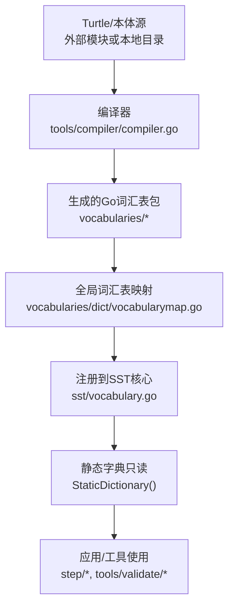
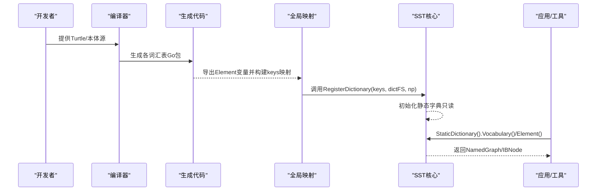
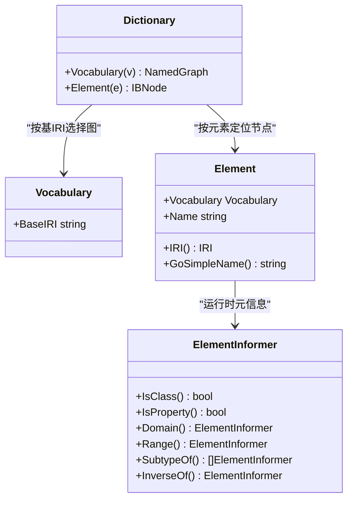
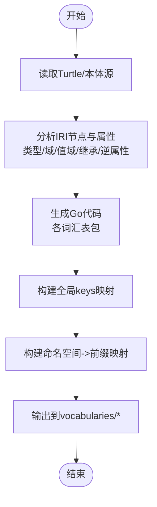
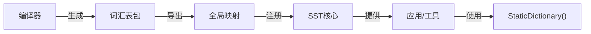

# 自定义词汇表

<cite>
**本文引用的文件**
- [vocabulary.go](file://sst/vocabulary.go)
- [vocabularymap.go](file://vocabularies/dict/vocabularymap.go)
- [compiler.go](file://tools/compiler/compiler.go)
- [dictionary.go（颜色）](file://vocabularies/color/dictionary.go)
- [dictionary.go（国家代码）](file://vocabularies/countrycodes/dictionary.go)
- [dictionary.go（货币代码）](file://vocabularies/currencycodes/dictionary.go)
- [doc.go（词汇表包）](file://vocabularies/doc.go)
- [doc.go（颜色）](file://vocabularies/color/doc.go)
- [doc.go（国家代码）](file://vocabularies/countrycodes/doc.go)
- [doc.go（货币代码）](file://vocabularies/currencycodes/doc.go)
- [p21.go](file://step/p21/p21.go)
- [ap242xmlexport.go](file://step/ap242xmlexport/ap242xmlexport.go)
- [ap242xmlimport.go](file://step/ap242xmlimport/ap242xmlimport.go)
- [shaclSstRules.go](file://tools/validate/shaclSstRules.go)
- [validate.go](file://tools/validate/validate.go)
</cite>

## 目录
1. [简介](#简介)
2. [项目结构](#项目结构)
3. [核心组件](#核心组件)
4. [架构总览](#架构总览)
5. [详细组件分析](#详细组件分析)
6. [依赖关系分析](#依赖关系分析)
7. [性能考虑](#性能考虑)
8. [故障排查指南](#故障排查指南)
9. [结论](#结论)
10. [附录](#附录)

## 简介
本指南面向需要在 SST Core 中创建、注册和使用自定义词汇表的开发者。内容涵盖：
- 如何定义并生成新的自定义词汇表，以及如何将其集成到 SST 的静态字典与命名空间前缀映射中
- 标准格式与最佳实践（IRI、命名空间、元素命名、类型约束等）
- 内置词汇表（颜色、国家代码、货币代码）的使用示例与路径指引
- 版本控制与发布流程（基于编译器与嵌入资源）
- 测试与验证方法（单元测试、SHACL 校验、运行时访问）
- 与标准词汇表的集成方式
- 性能优化与缓存策略
- 维护与更新指导原则

## 项目结构
SST 的词汇表体系由“编译期生成 + 运行期静态字典”两部分组成：
- 编译期：通过工具将 Turtle/Ontology 源转换为 Go 代码，生成每个词汇表的常量与类型，并汇总到全局映射
- 运行期：通过静态字典提供只读访问，支持按词汇表获取 NamedGraph 和 IBNode

图表来源
- [compiler.go:1-24](file://tools/compiler/compiler.go#L1-L24)
- [vocabularymap.go:1-30](file://vocabularies/dict/vocabularymap.go#L1-L30)
- [vocabulary.go:15-107](file://sst/vocabulary.go#L15-L107)

章节来源
- [vocabulary.go:15-107](file://sst/vocabulary.go#L15-L107)
- [vocabularymap.go:1-30](file://vocabularies/dict/vocabularymap.go#L1-L30)
- [compiler.go:1-24](file://tools/compiler/compiler.go#L1-L24)

## 核心组件
- 词汇表与元素
  - Vocabulary：表示一个外部定义的ontology，包含 BaseIRI
  - Element：表示某个 Vocabulary 下的具体 IRI 节点（名称片段）
  - ElementInformer / ElementInfo：提供类型信息（类、属性、数据类型、个体等）及关系查询（域、值域、子类、子属性、逆属性等）
- 静态字典
  - Dictionary：扩展 Stage，提供 Vocabulary() 与 Element() 的只读访问
  - StaticDictionary()：返回全局只读字典实例
  - RegisterDictionary()：注册词汇表映射、命名空间到前缀映射，并初始化静态字典提供者
- 编译器
  - 读取本体源，生成 Go 代码（每个词汇表包），并生成全局 keys 映射
  - 管理命名空间与前缀映射，以及需要编译的词汇表集合

章节来源
- [vocabulary.go:125-212](file://sst/vocabulary.go#L125-L212)
- [vocabulary.go:214-308](file://sst/vocabulary.go#L214-L308)
- [vocabulary.go:82-107](file://sst/vocabulary.go#L82-L107)
- [compiler.go:46-157](file://tools/compiler/compiler.go#L46-L157)

## 架构总览
下图展示从本体源到运行期使用的完整链路：

图表来源
- [compiler.go:502-760](file://tools/compiler/compiler.go#L502-L760)
- [vocabularymap.go:27-31](file://vocabularies/dict/vocabularymap.go#L27-L31)
- [vocabulary.go:94-107](file://sst/vocabulary.go#L94-L107)

## 详细组件分析

### 组件A：静态字典与词汇表访问
- 关键接口与方法
  - Dictionary.Vocabulary(v): 根据 Vocabulary 获取只读 NamedGraph
  - Dictionary.Element(e): 根据 Element 获取 IBNode
  - StaticDictionary(): 获取全局只读字典
  - NamespaceToPrefix(iri): 将 IRI 解析为前缀，用于判断是否来自字典阶段
- 典型用法
  - 在 step/p21 与 ap242* 工具中，通过 StaticDictionary().Vocabulary(qau.QAUVocabulary) 获取量纲单位图
  - 在 validate 工具中，通过 StaticDictionary() 提取 SHACL Shapes 或进行校验

图表来源
- [vocabulary.go:44-80](file://sst/vocabulary.go#L44-L80)
- [vocabulary.go:125-212](file://sst/vocabulary.go#L125-L212)
- [vocabulary.go:214-308](file://sst/vocabulary.go#L214-L308)

章节来源
- [vocabulary.go:44-80](file://sst/vocabulary.go#L44-L80)
- [vocabulary.go:115-123](file://sst/vocabulary.go#L115-L123)
- [p21.go:660-854](file://step/p21/p21.go#L660-L854)
- [ap242xmlexport.go:831-990](file://step/ap242xmlexport/ap242xmlexport.go#L831-L990)
- [ap242xmlimport.go:1712](file://step/ap242xmlimport/ap242xmlimport.go#L1712)
- [shaclSstRules.go:27](file://tools/validate/shaclSstRules.go#L27)
- [validate.go:200](file://tools/validate/validate.go#L200)

### 组件B：编译器与生成流程
- 输入：Turtle/本体源（可从外部模块或本地 fs.FS 加载）
- 处理：
  - 收集所有 IRI 节点及其属性（类型、域、值域、继承关系、逆属性等）
  - 生成每个词汇表的 Go 包（常量、类型、接口实现）
  - 生成全局 keys 映射（Element -> ElementInformer）
  - 生成命名空间到前缀的映射
- 输出：
  - vocabularies/* 下各词汇表包
  - vocabularies/dict/vocabularymap.go 中的 keys 与 embed.FS

图表来源
- [compiler.go:237-412](file://tools/compiler/compiler.go#L237-L412)
- [compiler.go:478-760](file://tools/compiler/compiler.go#L478-L760)

章节来源
- [compiler.go:1-24](file://tools/compiler/compiler.go#L1-L24)
- [compiler.go:46-157](file://tools/compiler/compiler.go#L46-L157)
- [compiler.go:502-760](file://tools/compiler/compiler.go#L502-L760)

### 组件C：内置词汇表使用示例
- 颜色词汇表（SVG 颜色）
  - 包：vocabularies/color
  - 用途：标准化颜色关键词，便于可视化与样式
  - 参考文档：[doc.go（颜色）](file://vocabularies/color/doc.go)
- 国家代码词汇表（ISO 3166）
  - 包：vocabularies/countrycodes
  - 用途：国家/地区代码标准化
  - 参考文档：[doc.go（国家代码）](file://vocabularies/countrycodes/doc.go)
- 货币代码词汇表（ISO 4217）
  - 包：vocabularies/currencycodes
  - 用途：货币代码标准化
  - 参考文档：[doc.go（货币代码）](file://vocabularies/currencycodes/doc.go)

使用路径指引（不直接粘贴代码）：
- 颜色：参见 [dictionary.go（颜色）](file://vocabularies/color/dictionary.go)
- 国家代码：参见 [dictionary.go（国家代码）](file://vocabularies/countrycodes/dictionary.go)
- 货币代码：参见 [dictionary.go（货币代码）](file://vocabularies/currencycodes/dictionary.go)

章节来源
- [dictionary.go（颜色）:11-166](file://vocabularies/color/dictionary.go#L11-L166)
- [dictionary.go（国家代码）:11-272](file://vocabularies/countrycodes/dictionary.go#L11-L272)
- [dictionary.go（货币代码）:11-205](file://vocabularies/currencycodes/dictionary.go#L11-L205)
- [doc.go（颜色）:1-5](file://vocabularies/color/doc.go#L1-L5)
- [doc.go（国家代码）:1-5](file://vocabularies/countrycodes/doc.go#L1-L5)
- [doc.go（货币代码）:1-5](file://vocabularies/currencycodes/doc.go#L1-L5)

### 组件D：版本控制与发布流程
- 本体源位于独立模块（如 sst-ontologies），通过编译器读取
- 更新步骤（依据编译器注释）：
  1) 发布本体变更到外部模块
  2) 在本仓库执行依赖更新与整理
  3) 重新运行编译器以生成最新代码
- 生成的词汇表包会被嵌入到 vocabularies/dict/vocabularymap.go 的 embed.FS 中，供运行期静态字典使用

章节来源
- [compiler.go:1-24](file://tools/compiler/compiler.go#L1-L24)
- [vocabularymap.go:27-31](file://vocabularies/dict/vocabularymap.go#L27-L31)

### 组件E：测试与验证方法
- 单元测试
  - 通过 StaticDictionary() 访问内置词汇表，验证 NamedGraph 与 IBNode 的可用性
  - 示例路径：
    - [p21.go:660-854](file://step/p21/p21.go#L660-L854)
    - [ap242xmlexport.go:831-990](file://step/ap242xmlexport/ap242xmlexport.go#L831-L990)
    - [ap242xmlimport.go:1712](file://step/ap242xmlimport/ap242xmlimport.go#L1712)
- SHACL 校验
  - 从静态字典中提取 Shapes，用于数据一致性校验
  - 参考路径：[shaclSstRules.go:27](file://tools/validate/shaclSstRules.go#L27)
- 运行时访问
  - 通过 NamespaceToPrefix() 判断命名空间是否来自字典阶段
  - 参考路径：[vocabulary.go:115-123](file://sst/vocabulary.go#L115-L123)

章节来源
- [p21.go:660-854](file://step/p21/p21.go#L660-L854)
- [ap242xmlexport.go:831-990](file://step/ap242xmlexport/ap242xmlexport.go#L831-L990)
- [ap242xmlimport.go:1712](file://step/ap242xmlimport/ap242xmlimport.go#L1712)
- [shaclSstRules.go:27](file://tools/validate/shaclSstRules.go#L27)
- [validate.go:200](file://tools/validate/validate.go#L200)
- [vocabulary.go:115-123](file://sst/vocabulary.go#L115-L123)

### 组件F：与标准词汇表的集成
- 编译器维护了标准词汇表（RDF、RDFS、OWL、XSD、SKOS、SSMeta、LCI、SSO、REP、SH、QAU、EED）的导入与依赖关系
- 新增自定义词汇表时，需在编译器的 urlPackageMap、urlImportsMap、neededCompileDictTTL 等配置中登记，以便正确生成代码与依赖
- 参考路径：
  - [compiler.go:46-157](file://tools/compiler/compiler.go#L46-L157)

章节来源
- [compiler.go:46-157](file://tools/compiler/compiler.go#L46-L157)

## 依赖关系分析
- 编译器依赖
  - 读取本体源（可来自外部模块或本地 fs.FS）
  - 依赖 SST Core 的类型与接口（Element、ElementInformer、Vocabulary 等）
- 生成代码依赖
  - 各词汇表包依赖 sst 核心类型
  - 全局映射（vocabularymap.go）聚合所有词汇表元素
- 运行期依赖
  - 应用/工具通过 StaticDictionary() 访问只读字典
  - 校验工具通过 StaticDictionary() 提取 Shapes 并进行验证

图表来源
- [compiler.go:502-760](file://tools/compiler/compiler.go#L502-L760)
- [vocabularymap.go:27-31](file://vocabularies/dict/vocabularymap.go#L27-L31)
- [vocabulary.go:82-107](file://sst/vocabulary.go#L82-L107)

章节来源
- [compiler.go:502-760](file://tools/compiler/compiler.go#L502-L760)
- [vocabularymap.go:27-31](file://vocabularies/dict/vocabularymap.go#L27-L31)
- [vocabulary.go:82-107](file://sst/vocabulary.go#L82-L107)

## 性能考虑
- 静态字典只读且全局共享，避免重复解析与加载开销
- 命名空间到前缀映射一次性构建，提升 IRI 解析效率
- 编译器在生成阶段完成类型推断与继承关系计算，减少运行期推理成本
- 建议：
  - 尽量复用 StaticDictionary()，避免多次初始化
  - 对频繁访问的词汇表元素，优先使用编译期生成的常量（Element）而非字符串拼接

[本节为通用性能建议，不直接引用具体文件]

## 故障排查指南
- 常见问题
  - 未注册字典导致命名空间到前缀映射为空：检查是否在应用启动时调用了 RegisterDictionary()
  - 找不到 ElementInformer：确认 Element 是否正确注册到全局 keys 映射
  - 运行时访问失败：确保静态字典已初始化，并通过 StaticDictionary() 访问
- 诊断要点
  - 查看日志警告（当命名空间到前缀映射未设置时）
  - 通过单元测试验证 StaticDictionary().Vocabulary() 与 .Element() 的可用性
  - 使用 SHACL 校验发现数据不一致问题

章节来源
- [vocabulary.go:115-123](file://sst/vocabulary.go#L115-L123)
- [vocabulary.go:214-223](file://sst/vocabulary.go#L214-L223)
- [shaclSstRules.go:27](file://tools/validate/shaclSstRules.go#L27)

## 结论
SST 的词汇表体系通过“编译期生成 + 运行期静态字典”实现了高效、类型安全的语义建模与访问。开发者可以：
- 基于 Turtle/本体源快速生成自定义词汇表
- 通过全局映射与静态字典安全地访问标准与自定义词汇
- 借助编译器与测试工具完成版本管理与质量保障
- 遵循最佳实践与性能优化策略，确保系统稳定与可扩展

[本节为总结性内容，不直接引用具体文件]

## 附录
- 标准词汇表包说明
  - 词汇表包入口：[doc.go（词汇表包）](file://vocabularies/doc.go)
- 常用路径索引
  - 编译器：[compiler.go](file://tools/compiler/compiler.go)
  - 全局映射：[vocabularymap.go](file://vocabularies/dict/vocabularymap.go)
  - 静态字典：[vocabulary.go](file://sst/vocabulary.go)
  - 内置词汇表：color、countrycodes、currencycodes
  - 工具使用示例：step/*、tools/validate/*

[本节为索引性内容，不直接引用具体文件]