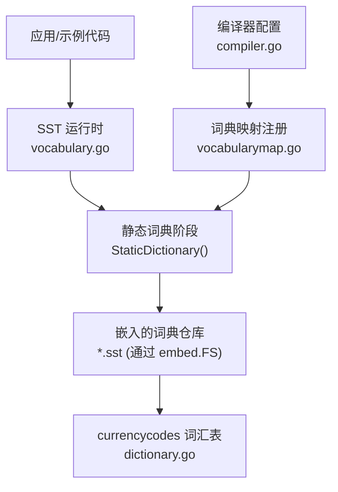
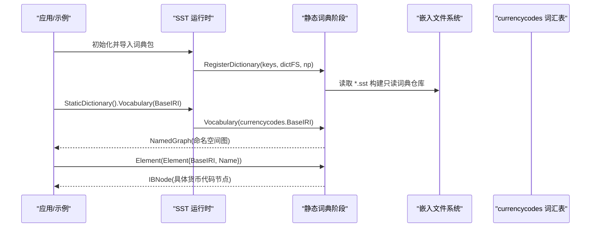
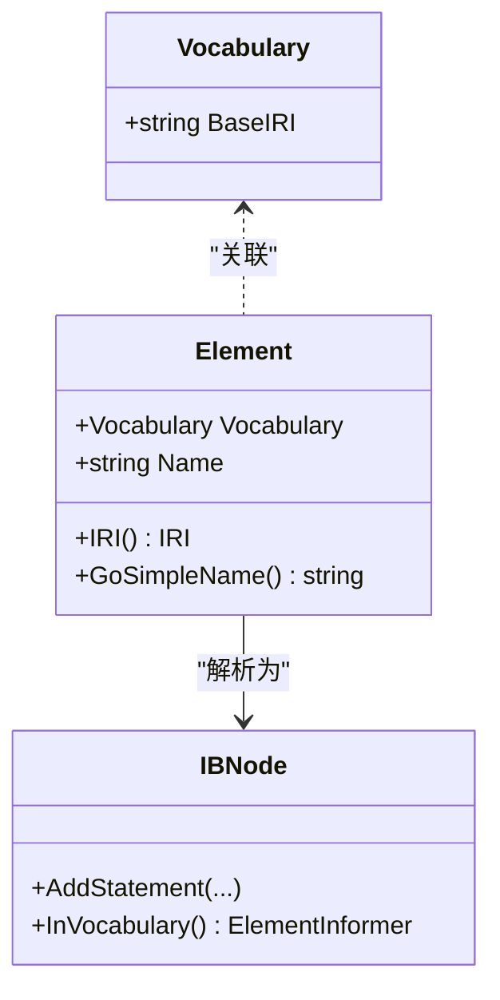
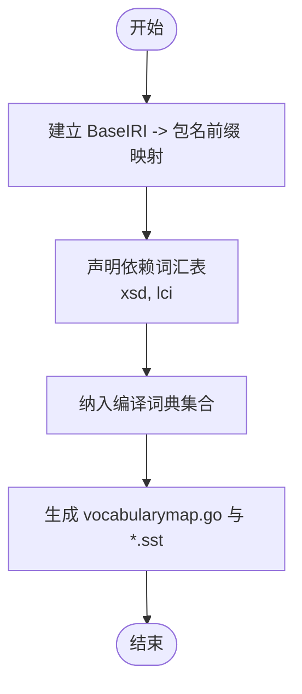
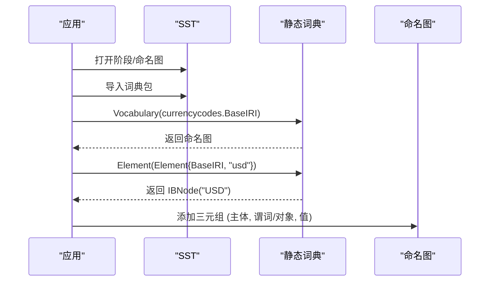
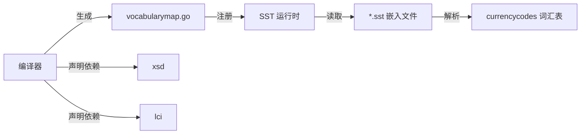

# 货币代码词汇表

<cite>
**本文引用的文件**
- [vocabularies/currencycodes/dictionary.go](file://vocabularies/currencycodes/dictionary.go)
- [vocabularies/currencycodes/doc.go](file://vocabularies/currencycodes/doc.go)
- [tools/compiler/compiler.go](file://tools/compiler/compiler.go)
- [vocabularies/dict/vocabularymap.go](file://vocabularies/dict/vocabularymap.go)
- [sst/vocabulary.go](file://sst/vocabulary.go)
- [examples/helloworldwrite/helloworldwrite.go](file://examples/helloworldwrite/helloworldwrite.go)
</cite>

## 目录
1. [简介](#简介)
2. [项目结构](#项目结构)
3. [核心组件](#核心组件)
4. [架构总览](#架构总览)
5. [详细组件分析](#详细组件分析)
6. [依赖关系分析](#依赖关系分析)
7. [性能考虑](#性能考虑)
8. [故障排查指南](#故障排查指南)
9. [结论](#结论)
10. [附录](#附录)

## 简介
本文件为“货币代码词汇表”的详细使用文档，聚焦于以下目标：
- 说明词汇表包含的 ISO 4217 货币代码标准与 IRI 映射。
- 介绍如何使用预定义的货币代码元素（如 USD、EUR、CNY 等）。
- 展示货币代码在价格信息、财务数据中的典型应用方式。
- 解释 BaseIRI 配置与命名空间管理。
- 展示如何在 SST 存储中引用货币代码词汇表。
- 说明版本管理与更新机制。
- 提供扩展方法以添加新的货币或地区代码。

## 项目结构
货币代码词汇表位于 vocabularies/currencycodes 包中，由编译器生成 Go 常量与词汇表对象，并通过统一的词典注册机制集成到 SST 运行时。

图表来源
- [sst/vocabulary.go:15-107](file://sst/vocabulary.go#L15-L107)
- [vocabularies/dict/vocabularymap.go:27-30](file://vocabularies/dict/vocabularymap.go#L27-L30)
- [vocabularies/currencycodes/dictionary.go:11-20](file://vocabularies/currencycodes/dictionary.go#L11-L20)
- [tools/compiler/compiler.go:90-156](file://tools/compiler/compiler.go#L90-L156)

章节来源
- [vocabularies/currencycodes/dictionary.go:11-20](file://vocabularies/currencycodes/dictionary.go#L11-L20)
- [tools/compiler/compiler.go:90-156](file://tools/compiler/compiler.go#L90-L156)
- [vocabularies/dict/vocabularymap.go:27-30](file://vocabularies/dict/vocabularymap.go#L27-L30)
- [sst/vocabulary.go:15-107](file://sst/vocabulary.go#L15-L107)

## 核心组件
- 词汇表定义与 BaseIRI
  - 词汇表对象定义了唯一的 BaseIRI，用于标识该词汇表的命名空间。
  - 每个货币代码对应一个 Element，名称即 ISO 4217 代码片段。
- 预定义元素
  - 包含大量 ISO 4217 货币代码元素（如 aed、afn、...、usd、eur、cny 等），以及若干元数据元素（如 Iso4217Currency、currencyCode、minorUnit 等）。
- 编译器与词典注册
  - 编译器将词汇表 BaseIRI 与包名、前缀建立映射，并声明其依赖的其他词汇表。
  - 词典映射文件将所有词汇表元素注册到全局字典，供 SST 运行时查找。
- SST 运行时访问
  - 通过 StaticDictionary().Vocabulary(BaseIRI) 获取命名图，再通过 Element(IRI) 获取具体 IBNode。

章节来源
- [vocabularies/currencycodes/dictionary.go:11-20](file://vocabularies/currencycodes/dictionary.go#L11-L20)
- [vocabularies/currencycodes/dictionary.go:18-205](file://vocabularies/currencycodes/dictionary.go#L18-L205)
- [tools/compiler/compiler.go:90-156](file://tools/compiler/compiler.go#L90-L156)
- [vocabularies/dict/vocabularymap.go:27-30](file://vocabularies/dict/vocabularymap.go#L27-L30)
- [sst/vocabulary.go:44-58](file://sst/vocabulary.go#L44-L58)

## 架构总览
下图展示了从应用代码到 SST 静态词典再到 currencycodes 词汇表的调用链。

图表来源
- [sst/vocabulary.go:15-107](file://sst/vocabulary.go#L15-L107)
- [vocabularies/dict/vocabularymap.go:27-30](file://vocabularies/dict/vocabularymap.go#L27-L30)
- [vocabularies/currencycodes/dictionary.go:11-20](file://vocabularies/currencycodes/dictionary.go#L11-L20)

## 详细组件分析

### 词汇表与元素模型
- 词汇表对象
  - 包含 BaseIRI 字段，唯一标识命名空间。
- 元素对象
  - 每个元素由 Vocabulary + Name 组成，Name 通常为 ISO 4217 三字母代码。
- IRI 构造
  - 元素的完整 IRI 由 BaseIRI + "#" + Name 构成。

图表来源
- [sst/vocabulary.go:155-173](file://sst/vocabulary.go#L155-L173)
- [sst/vocabulary.go:356-363](file://sst/vocabulary.go#L356-L363)
- [sst/vocabulary.go:2339-2372](file://sst/vocabulary.go#L2339-L2372)

章节来源
- [vocabularies/currencycodes/dictionary.go:11-20](file://vocabularies/currencycodes/dictionary.go#L11-L20)
- [sst/vocabulary.go:155-173](file://sst/vocabulary.go#L155-L173)
- [sst/vocabulary.go:356-363](file://sst/vocabulary.go#L356-L363)

### 编译器与命名空间映射
- 编译器维护词汇表 BaseIRI 与包名前缀的映射，便于生成可读的短名。
- 声明 currencycodes 词汇表依赖 xsd 与 lci，确保编译期类型与约束可用。
- 将 currencycodes 加入需编译的词典集合，以便生成对应的 SST 词典文件。

图表来源
- [tools/compiler/compiler.go:90-156](file://tools/compiler/compiler.go#L90-L156)

章节来源
- [tools/compiler/compiler.go:90-156](file://tools/compiler/compiler.go#L90-L156)

### 在 SST 存储中引用货币代码
- 步骤概览
  - 引入词典包以完成初始化。
  - 通过 StaticDictionary().Vocabulary(BaseIRI) 获取命名图。
  - 通过 Element(Element{BaseIRI, Name}) 获取具体货币代码 IBNode。
  - 使用该 IBNode 作为三元组的谓词或对象，表达价格、币种等信息。

图表来源
- [examples/helloworldwrite/helloworldwrite.go:26-37](file://examples/helloworldwrite/helloworldwrite.go#L26-L37)
- [sst/vocabulary.go:44-58](file://sst/vocabulary.go#L44-L58)
- [vocabularies/currencycodes/dictionary.go:11-20](file://vocabularies/currencycodes/dictionary.go#L11-L20)

章节来源
- [examples/helloworldwrite/helloworldwrite.go:26-37](file://examples/helloworldwrite/helloworldwrite.go#L26-L37)
- [sst/vocabulary.go:44-58](file://sst/vocabulary.go#L44-L58)

### 价格与财务数据中的应用示例
- 常见用法
  - 以货币代码 IBNode 作为属性或分类，标注金额数值。
  - 结合单位或数量概念（如 qau 或 lci）表达价格、成本、收入等。
- 建议建模
  - 主体：产品或服务实例
  - 谓词：价格/成本/收入等
  - 对象：数值 + 货币代码（IBNode）
  - 可选：时间范围、币种小数位（minorUnit）、国家/地区上下文

[本节为概念性说明，不直接分析具体文件]

### BaseIRI 配置与命名空间管理
- BaseIRI
  - 词汇表通过 BaseIRI 唯一标识命名空间，所有元素 IRI 均基于此拼接。
- 命名空间到前缀
  - 编译器维护 namespace-to-prefix 映射，便于输出可读的短前缀。
- 运行时查询
  - 可通过 NamespaceToPrefix(iri) 反向获取前缀，辅助调试与序列化。

章节来源
- [vocabularies/currencycodes/dictionary.go:11](file://vocabularies/currencycodes/dictionary.go#L11)
- [tools/compiler/compiler.go:104-123](file://tools/compiler/compiler.go#L104-L123)
- [sst/vocabulary.go:115-123](file://sst/vocabulary.go#L115-L123)

### 版本管理与更新机制
- 生成式更新
  - 词汇表由编译器生成，更新流程通常包括：
    - 更新源数据（ISO 4217 列表）。
    - 重新运行编译器以生成新的 dictionary.go 与 vocabularymap.go。
    - 提交生成的 *.sst 与 Go 源码。
- 变更影响
  - BaseIRI 保持不变，新增/移除元素不影响已有 IRI。
  - 若需破坏性变更，应评估下游依赖并制定迁移策略。

[本节为通用实践说明，不直接分析具体文件]

### 扩展方法：添加新货币或地区代码
- 步骤建议
  - 在编译器配置中确认 currencycodes 已纳入编译词典集合。
  - 更新源数据（如 ISO 4217 列表）后重新编译。
  - 验证 vocabularymap.go 是否包含新元素键值对。
  - 在应用中通过 Element(Element{BaseIRI, "新代码"}) 引用新元素。
- 注意事项
  - 保持 BaseIRI 不变，避免破坏已有 IRI。
  - 如需新增元数据属性（如 minorUnit），请同步更新相关词汇表与约束。

章节来源
- [tools/compiler/compiler.go:137-156](file://tools/compiler/compiler.go#L137-L156)
- [vocabularies/dict/vocabularymap.go:27-30](file://vocabularies/dict/vocabularymap.go#L27-L30)

## 依赖关系分析
- 编译器依赖
  - 编译器将 currencycodes 词汇表与 xsd、lci 建立依赖关系，确保类型与约束可用。
- 运行时依赖
  - 运行时通过静态词典阶段访问嵌入的 *.sst 文件，再解析出 currencycodes 命名图与元素。
- 包级依赖
  - vocabularymap.go 显式导入 currencycodes 包，并将元素注册到全局字典。

图表来源
- [tools/compiler/compiler.go:90-156](file://tools/compiler/compiler.go#L90-L156)
- [vocabularies/dict/vocabularymap.go:27-30](file://vocabularies/dict/vocabularymap.go#L27-L30)
- [sst/vocabulary.go:15-107](file://sst/vocabulary.go#L15-L107)

章节来源
- [tools/compiler/compiler.go:90-156](file://tools/compiler/compiler.go#L90-L156)
- [vocabularies/dict/vocabularymap.go:27-30](file://vocabularies/dict/vocabularymap.go#L27-L30)
- [sst/vocabulary.go:15-107](file://sst/vocabulary.go#L15-L107)

## 性能考虑
- 静态词典阶段为只读且单例化，首次加载后复用，减少重复开销。
- 元素解析为 IBNode 后，后续操作均为内存内图操作，性能较高。
- 建议在批量写入时合并三元组，减少频繁 I/O。

[本节为通用指导，不直接分析具体文件]

## 故障排查指南
- 常见问题
  - 未导入词典包导致静态词典未初始化：检查是否在应用入口导入了词典包。
  - 命名空间到前缀映射为空：确认已调用 RegisterDictionary 并传入正确的 map[string]string。
  - 找不到元素：核对 Element.Name 是否为有效的 ISO 4217 代码。
- 定位方法
  - 使用 StaticDictionary().Vocabulary(BaseIRI) 获取命名图，检查是否存在预期节点。
  - 使用 Element(Element{BaseIRI, Name}) 获取 IBNode，确认非空。

章节来源
- [examples/helloworldwrite/helloworldwrite.go:26-37](file://examples/helloworldwrite/helloworldwrite.go#L26-L37)
- [sst/vocabulary.go:15-107](file://sst/vocabulary.go#L15-L107)

## 结论
货币代码词汇表通过编译器生成与 SST 静态词典机制，提供了稳定、可追溯的 ISO 4217 货币代码支持。借助 BaseIRI 与命名空间管理，可在 SST 存储中以语义化的方式表达价格与财务数据。通过规范的版本管理与扩展流程，可安全地新增货币或地区代码，满足业务演进需求。

[本节为总结性内容，不直接分析具体文件]

## 附录
- 快速参考
  - BaseIRI：http://ontology.semanticstep.net/currencycodes
  - 常用元素：usd、eur、cny、gbp、jpy 等（均为小写片段）
  - 元数据元素：Iso4217Currency、currencyCode、minorUnit、countryName 等
- 使用要点
  - 始终通过 Element(Element{BaseIRI, Name}) 获取 IBNode，避免硬编码字符串。
  - 在价格建模中，将货币代码与数值组合，必要时附加时间与地区上下文。

[本节为补充信息，不直接分析具体文件]