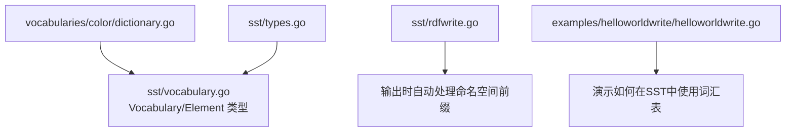
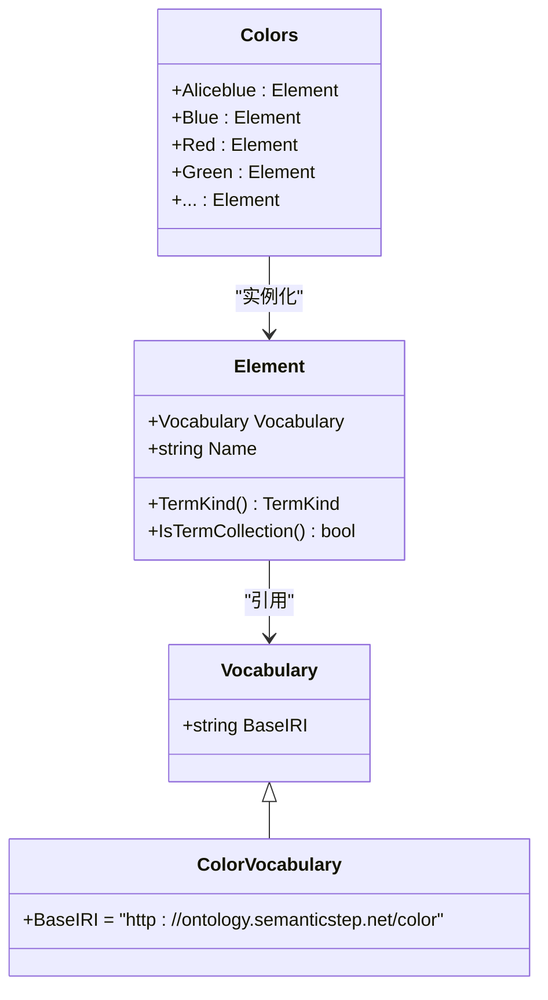
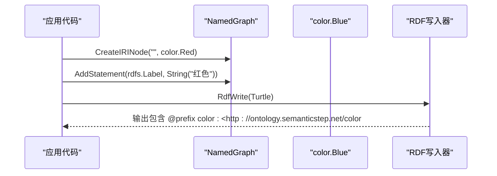
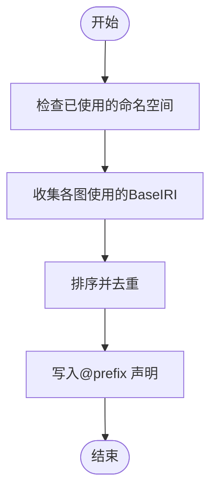
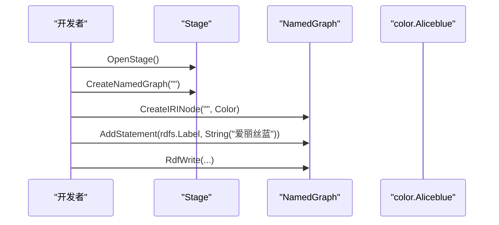
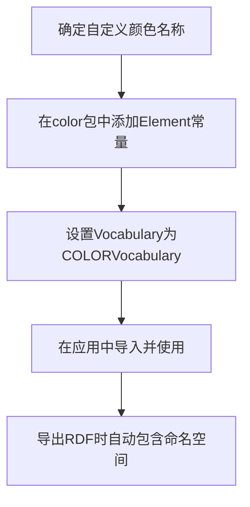
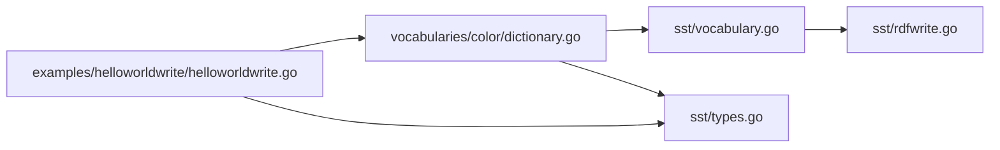

# 颜色词汇表

<cite>
**本文引用的文件**
- [vocabularies/color/dictionary.go](file://vocabularies/color/dictionary.go)
- [vocabularies/color/doc.go](file://vocabularies/color/doc.go)
- [sst/types.go](file://sst/types.go)
- [sst/vocabulary.go](file://sst/vocabulary.go)
- [sst/rdfwrite.go](file://sst/rdfwrite.go)
- [examples/helloworldwrite/helloworldwrite.go](file://examples/helloworldwrite/helloworldwrite.go)
</cite>

## 目录
1. [简介](#简介)
2. [项目结构](#项目结构)
3. [核心组件](#核心组件)
4. [架构总览](#架构总览)
5. [详细组件分析](#详细组件分析)
6. [依赖关系分析](#依赖关系分析)
7. [性能考虑](#性能考虑)
8. [故障排查指南](#故障排查指南)
9. [结论](#结论)
10. [附录](#附录)

## 简介
本文件为“颜色词汇表”的详细使用文档，面向需要在SST（Semantic STEP Technology）中引用标准颜色IRI的开发者。内容涵盖：
- 颜色词汇表包含的标准颜色名称与IRI定义
- 如何使用预定义的颜色元素常量（如 COLORVocabulary、Aliceblue、Blue 等）
- 在RDF数据中的使用方式与命名空间管理
- 在SST存储中引用颜色值的方法
- 版本信息与更新策略
- 扩展方法：如何添加自定义颜色定义

## 项目结构
颜色词汇表位于 vocabularies/color 包下，由编译器生成，提供一组标准SVG颜色关键词对应的IRI节点。核心文件包括：
- dictionary.go：定义词汇表BaseIRI与各颜色的Element常量
- doc.go：说明该词汇表基于W3C SVG颜色关键词规范

图表来源
- [vocabularies/color/dictionary.go:11-166](file://vocabularies/color/dictionary.go#L11-L166)
- [sst/vocabulary.go:155-168](file://sst/vocabulary.go#L155-L168)
- [sst/types.go:209-227](file://sst/types.go#L209-L227)
- [sst/rdfwrite.go:973-1002](file://sst/rdfwrite.go#L973-L1002)
- [examples/helloworldwrite/helloworldwrite.go:39-97](file://examples/helloworldwrite/helloworldwrite.go#L39-L97)

章节来源
- [vocabularies/color/dictionary.go:11-166](file://vocabularies/color/dictionary.go#L11-L166)
- [vocabularies/color/doc.go:1-5](file://vocabularies/color/doc.go#L1-L5)

## 核心组件
- 词汇表对象：COLORVocabulary，定义了基础IRI（BaseIRI），用于拼接具体颜色IRI
- 颜色元素：每个标准颜色对应一个 sst.Element 常量，例如 Aliceblue、Blue、Red、Green 等
- 底层类型：sst.Vocabulary 与 sst.Element，提供命名空间与片段组合能力

要点
- BaseIRI 固定为 http://ontology.semanticstep.net/color
- 每个颜色元素的 Name 字段为小写的SVG颜色关键词
- Element 通过 Vocabulary + Name 形成完整IRI

章节来源
- [vocabularies/color/dictionary.go:11-166](file://vocabularies/color/dictionary.go#L11-L166)
- [sst/vocabulary.go:155-168](file://sst/vocabulary.go#L155-L168)

## 架构总览
颜色词汇表作为SST词汇体系的一部分，遵循统一的词汇模型：
- 词汇表（Vocabulary）提供基础IRI
- 元素（Element）表示词汇表中的一个具体概念（此处为标准颜色）
- 写入RDF/TriG时，系统根据BaseIRI自动分配或复用命名空间前缀

图表来源
- [sst/vocabulary.go:155-168](file://sst/vocabulary.go#L155-L168)
- [vocabularies/color/dictionary.go:11-166](file://vocabularies/color/dictionary.go#L11-L166)

## 详细组件分析

### 颜色词汇表定义与常量
- BaseIRI：http://ontology.semanticstep.net/color
- 颜色常量：每个标准颜色都映射为一个 Element，Name 为小写关键词
- 示例常量：Aliceblue、Antiquewhite、Aqua、Aquamarine、Azure、Beige、Bisque、Black、Blanchedalmond、Blue、Blueviolet、Brown、Burlywood、Cadetblue、Chartreuse、Chocolate、Coral、Cornflowerblue、Cornsilk、Crimson、Cyan、Darkblue、Darkcyan、Darkgoldenrod、Darkgray、Darkgreen、Darkgrey、Darkkhaki、Darkmagenta、Darkolivegreen、Darkorange、Darkorchid、Darkred、Darksalmon、Darkseagreen、Darkslateblue、Darkslategray、Darkslategrey、Darkturquoise、Darkviolet、Deeppink、Deepskyblue、Dimgray、Dimgrey、Dodgerblue、Firebrick、Floralwhite、Forestgreen、Fuchsia、Gainsboro、Ghostwhite、Gold、Goldenrod、Gray、Green、Greenyellow、Grey、Honeydew、Hotpink、Indianred、Indigo、Ivory、Khaki、Lavender、Lavenderblush、Lawngreen、Lemonchiffon、Lightblue、Lightcoral、Lightcyan、Lightgoldenrodyellow、Lightgray、Lightgreen、Lightgrey、Lightpink、Lightsalmon、Lightseagreen、Lightskyblue、Lightslategray、Lightslategrey、Lightsteelblue、Lightyellow、Lime、Limegreen、Linen、Magenta、Maroon、Mediumaquamarine、Mediumblue、Mediumorchid、Mediumpurple、Mediumseagreen、Mediumslateblue、Mediumspringgreen、Mediumturquoise、Mediumvioletred、Midnightblue、Mintcream、Mistyrose、Moccasin、Navajowhite、Navy、Oldlace、Olive、Olivedrab、Orange、Orangered、Orchid、Palegoldenrod、Palegreen、Paleturquoise、Palevioletred、Papayawhip、Peachpuff、Peru、Pink、Plum、Powderblue、Purple、Red、Rosybrown、Royalblue、Saddlebrown、Salmon、Sandybrown、Seagreen、Seashell、Sienna、Silver、Skyblue、Slateblue、Slategray、Slategrey、Snow、Springgreen、Steelblue、Tan、Teal、Thistle、Tomato、Turquoise、Violet、Wheat、White、Whitesmoke、Yellow、Yellowgreen

章节来源
- [vocabularies/color/dictionary.go:11-166](file://vocabularies/color/dictionary.go#L11-L166)

### 在RDF数据中的使用示例
- 使用 AddStatement 将颜色IRI作为对象加入三元组
- 可结合 rdfs:label 或其他属性描述颜色资源
- 导出Turtle时，系统会自动识别并声明命名空间前缀

图表来源
- [examples/helloworldwrite/helloworldwrite.go:39-97](file://examples/helloworldwrite/helloworldwrite.go#L39-L97)
- [sst/rdfwrite.go:973-1002](file://sst/rdfwrite.go#L973-L1002)

### 命名空间管理与BaseIRI配置
- 词汇表的BaseIRI决定IRI前缀
- 写入RDF时，系统会收集所有使用的BaseIRI并生成相应的前缀声明
- 若未显式指定前缀，系统将自动生成并保持唯一性

图表来源
- [sst/rdfwrite.go:973-1002](file://sst/rdfwrite.go#L973-L1002)

章节来源
- [sst/rdfwrite.go:973-1002](file://sst/rdfwrite.go#L973-L1002)

### 在SST存储中引用颜色值
- 通过 color 包的常量创建IBNode或作为对象添加到语句中
- 可在查询或验证规则中引用这些颜色IRI
- 建议在导入外部数据时将字符串颜色映射到标准IRI，以保证一致性

图表来源
- [examples/helloworldwrite/helloworldwrite.go:39-97](file://examples/helloworldwrite/helloworldwrite.go#L39-L97)
- [vocabularies/color/dictionary.go:11-166](file://vocabularies/color/dictionary.go#L11-L166)

### 版本信息与更新策略
- 颜色词汇表基于W3C SVG颜色关键词规范，确保与标准一致
- 词汇表由编译器生成，建议通过更新词汇集源来同步新版本
- 如需引入新颜色，应优先确认其是否在SVG规范中新增；否则考虑扩展机制

章节来源
- [vocabularies/color/doc.go:1-5](file://vocabularies/color/doc.go#L1-L5)

### 扩展方法：添加自定义颜色定义
- 若需添加非标准颜色，可在现有词汇表基础上扩展新的Element
- 保持BaseIRI不变，新增Name字段为自定义标识符
- 注意避免与现有标准颜色冲突，并在文档中明确标注为自定义扩展

[此图为概念流程示意，不直接映射具体源码文件]

## 依赖关系分析
- 颜色词汇表依赖 sst/vocabulary.go 中的 Vocabulary 与 Element 类型
- 写入RDF时依赖 sst/rdfwrite.go 的命名空间处理逻辑
- 示例代码展示了如何在SST中创建节点并写入RDF

图表来源
- [vocabularies/color/dictionary.go:11-166](file://vocabularies/color/dictionary.go#L11-L166)
- [sst/vocabulary.go:155-168](file://sst/vocabulary.go#L155-L168)
- [sst/types.go:209-227](file://sst/types.go#L209-L227)
- [sst/rdfwrite.go:973-1002](file://sst/rdfwrite.go#L973-L1002)
- [examples/helloworldwrite/helloworldwrite.go:39-97](file://examples/helloworldwrite/helloworldwrite.go#L39-L97)

章节来源
- [vocabularies/color/dictionary.go:11-166](file://vocabularies/color/dictionary.go#L11-L166)
- [sst/vocabulary.go:155-168](file://sst/vocabulary.go#L155-L168)
- [sst/types.go:209-227](file://sst/types.go#L209-L227)
- [sst/rdfwrite.go:973-1002](file://sst/rdfwrite.go#L973-L1002)
- [examples/helloworldwrite/helloworldwrite.go:39-97](file://examples/helloworldwrite/helloworldwrite.go#L39-L97)

## 性能考虑
- 颜色词汇表为静态常量集合，内存占用极小，访问开销低
- 在大量三元组写入时，建议使用批量操作以减少I/O次数
- 命名空间前缀在写入时一次性收集与排序，对整体性能影响有限

[本节提供一般性指导，不直接分析具体文件]

## 故障排查指南
- 若导出的T文件中缺少颜色命名空间前缀，请检查是否使用了颜色Element且成功写入RDF
- 若出现IRI解析错误，请确认BaseIRI与Name拼接是否正确
- 若颜色值未生效，请确认在创建节点或添加语句时正确引用了color包常量

章节来源
- [sst/rdfwrite.go:973-1002](file://sst/rdfwrite.go#L973-L1002)
- [vocabularies/color/dictionary.go:11-166](file://vocabularies/color/dictionary.go#L11-L166)

## 结论
颜色词汇表提供了标准化的SVG颜色IRI集合，便于在SST中进行语义化建模与数据交换。通过统一的词汇模型与命名空间管理，开发者可以安全、高效地在RDF数据中引用颜色值。建议遵循标准规范进行扩展，并确保命名空间的一致性。

[本节为总结性内容，不直接分析具体文件]

## 附录
- 标准颜色列表：参见 vocabularies/color/dictionary.go 中的常量定义
- 参考规范：W3C SVG颜色关键词（见 vocabularies/color/doc.go）
- 使用示例：参见 examples/helloworldwrite/helloworldwrite.go 中的RDF写入流程

章节来源
- [vocabularies/color/dictionary.go:11-166](file://vocabularies/color/dictionary.go#L11-L166)
- [vocabularies/color/doc.go:1-5](file://vocabularies/color/doc.go#L1-L5)
- [examples/helloworldwrite/helloworldwrite.go:39-97](file://examples/helloworldwrite/helloworldwrite.go#L39-L97)