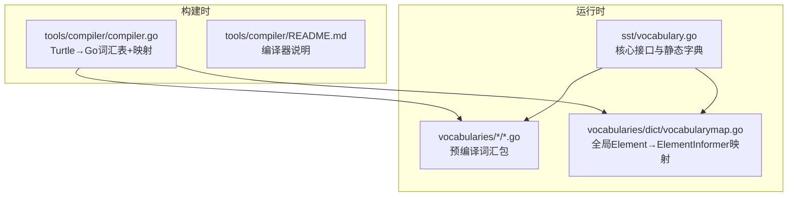
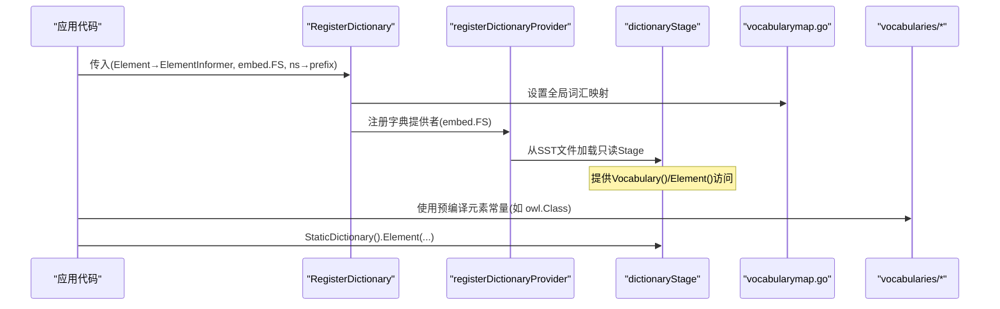
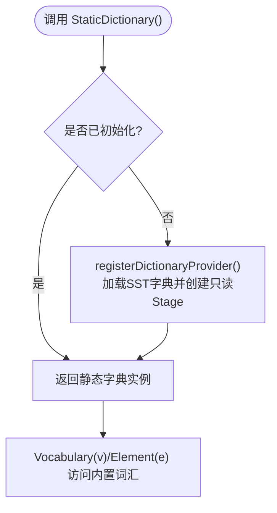
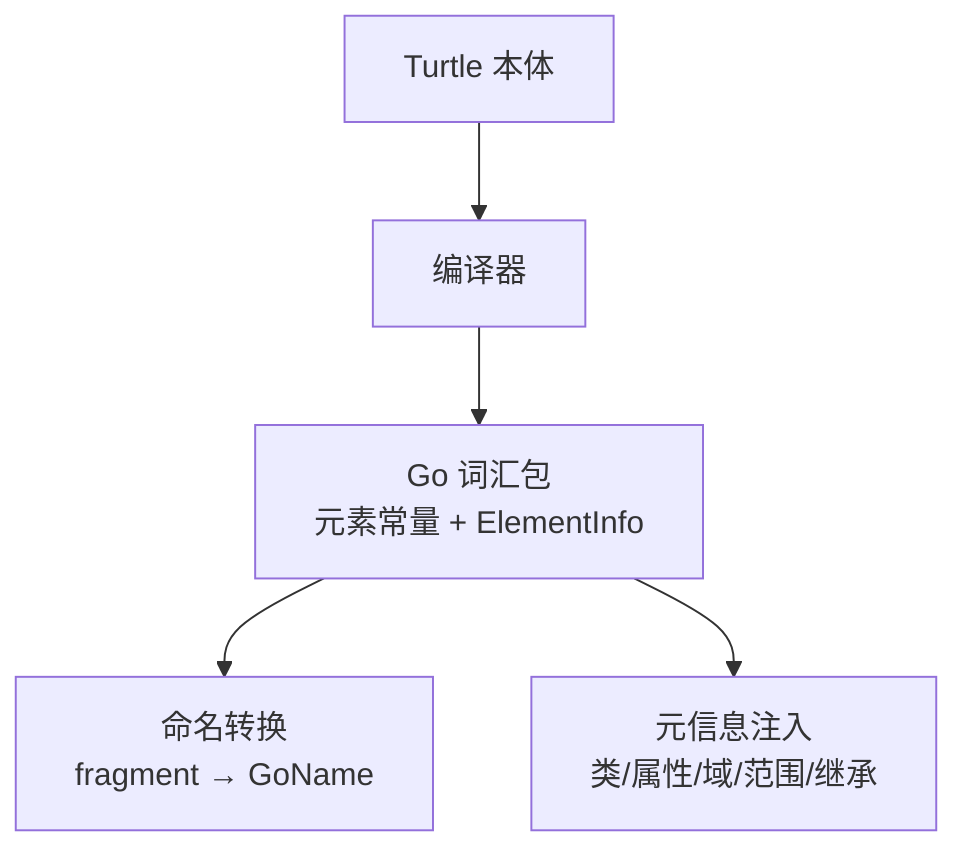
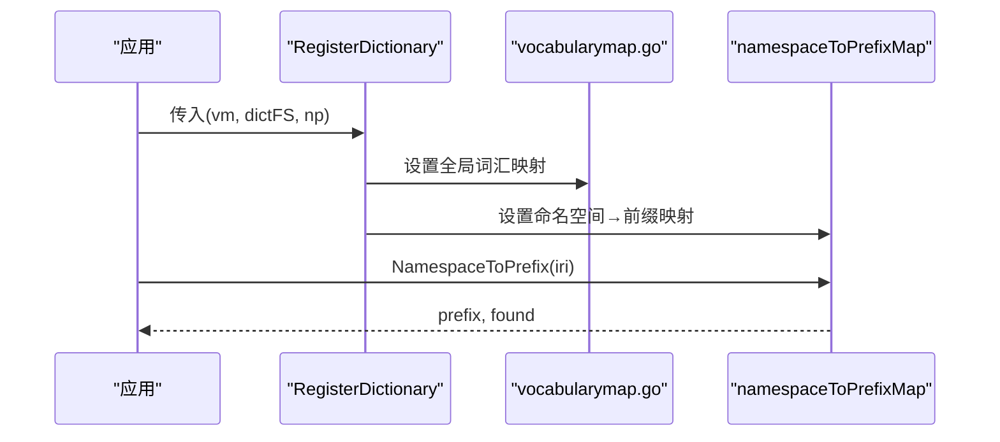
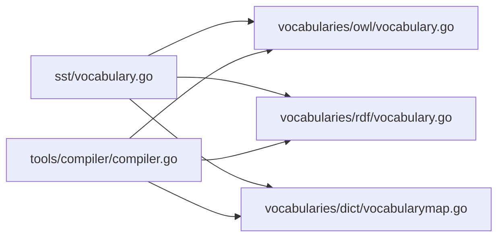

# 词汇表概述

<cite>
**本文引用的文件**
- [vocabulary.go](file://sst/vocabulary.go)
- [vocabularymap.go](file://vocabularies/dict/vocabularymap.go)
- [vocabulary.go (owl)](file://vocabularies/owl/vocabulary.go)
- [vocabulary.go (rdf)](file://vocabularies/rdf/vocabulary.go)
- [compiler.go](file://tools/compiler/compiler.go)
- [README.md (编译器)](file://tools/compiler/README.md)
- [doc.go (vocabularies)](file://vocabularies/doc.go)
- [README.md (项目根)](file://README.md)
</cite>

## 目录
1. [简介](#简介)
2. [项目结构](#项目结构)
3. [核心组件](#核心组件)
4. [架构总览](#架构总览)
5. [详细组件分析](#详细组件分析)
6. [依赖关系分析](#依赖关系分析)
7. [性能与缓存](#性能与缓存)
8. [故障排查指南](#故障排查指南)
9. [结论](#结论)
10. [附录：使用模式与最佳实践](#附录使用模式与最佳实践)

## 简介
本概述文档面向SST（Semantic STEP Technology）的词汇表系统，解释其在语义网与RDF数据管理中的核心作用，并围绕“预编译词汇表”的优势、组织结构与命名约定、映射机制与动态注册、版本管理与兼容性策略、性能优化与缓存机制，以及基本使用模式与最佳实践进行系统化说明。

在SST中，词汇表将RDF/OWL本体术语以Go类型和常量形式暴露给应用层，实现“早期绑定”访问，从而在编译期获得更强的类型安全与可维护性；同时通过内置的只读字典阶段，提供对标准与领域词汇表的运行时查询能力。

## 项目结构
- sst 包：定义词汇表核心接口与数据结构（Vocabulary、Element、ElementInformer、Dictionary等），并提供静态字典访问与全局注册机制。
- vocabularies 包：由编译器生成的各词汇表Go包（如 owl、rdf、rdfs、xsd、lci、qau、ssmeta、sso、rep、sh、skos、color、countrycodes、currencycodes 等），每个包导出对应词汇表的元素常量与元信息。
- tools/compiler：将上游Turtle本体编译为上述Go词汇包，并生成全局词汇映射与嵌入式字典SST文件。
- README 与工具文档：说明整体结构与编译器工作流。



图表来源
- [vocabulary.go:15-120](file://sst/vocabulary.go#L15-L120)
- [vocabularymap.go:1-120](file://vocabularies/dict/vocabularymap.go#L1-L120)
- [compiler.go:1-157](file://tools/compiler/compiler.go#L1-L157)
- [README.md (编译器):1-136](file://tools/compiler/README.md#L1-L136)

章节来源
- [README.md (项目根):1-15](file://README.md#L1-L15)
- [doc.go (vocabularies):1-6](file://vocabularies/doc.go#L1-L6)

## 核心组件
- Vocabulary/Element/ElementInfo：表示词汇表、元素及元素的元信息（类/属性/数据类型/个体、域/范围、子类型/逆属性等）。
- ElementInformer：扩展了元素的可查询能力（IsClass/IsProperty/Domain/Range/SubtypeOf/InverseOf等）。
- Dictionary/StaticDictionary：提供只读的内置词汇表访问，支持按Vocabulary获取NamedGraph或按Element获取IBNode。
- RegisterDictionary：初始化全局词汇映射、命名空间到前缀映射，并注册嵌入式字典提供者。
- 编译器产物：每个词汇表包包含元素常量、ElementInfo、AsIs_*与AsKind_*方法，用于运行时类型/kind检查。

章节来源
- [vocabulary.go:125-212](file://sst/vocabulary.go#L125-L212)
- [vocabulary.go:214-308](file://sst/vocabulary.go#L214-L308)
- [vocabulary.go:351-403](file://sst/vocabulary.go#L351-L403)
- [vocabulary.go:15-107](file://sst/vocabulary.go#L15-L107)
- [vocabulary.go (owl):15-80](file://vocabularies/owl/vocabulary.go#L15-L80)
- [vocabulary.go (rdf):12-48](file://vocabularies/rdf/vocabulary.go#L12-L48)

## 架构总览
SST词汇表系统采用“构建期编译 + 运行期静态字典”的双层架构：
- 构建期：编译器读取上游Turtle本体，生成Go词汇包与全局映射，并产出嵌入式SST字典文件。
- 运行期：应用通过RegisterDictionary完成全局注册；通过StaticDictionary访问内置词汇表；通过ElementInformer进行类型判断与关系查询；通过IRI/Fragment解析与命名空间前缀映射进行序列化/反序列化。



图表来源
- [vocabulary.go:15-107](file://sst/vocabulary.go#L15-L107)
- [vocabularymap.go:1-120](file://vocabularies/dict/vocabularymap.go#L1-L120)
- [compiler.go:1-157](file://tools/compiler/compiler.go#L1-L157)

## 详细组件分析

### 词汇表核心模型与接口
- Vocabulary：携带BaseIRI，标识一个外部定义的词汇表。
- Element：由Vocabulary与Name组成，代表某个IRI节点；提供IRI()构造完整IRI、GoSimpleName()生成Go变量名等。
- ElementInfo：承载本体元信息（是否类/属性/数据类型/个体、主类覆盖关系、域/范围、子类型链、逆属性、集合成员类型等）。
- ElementInformer：提供丰富的查询方法（IsClass/IsProperty/IsDatatypeProperty/IsObjectProperty/IsDatatype/IsIndividual/IsMainClass/Domain/Range/SubtypeOf/SubPropertyOf/InverseOf/CollectionMember）。

```mermaid
classDiagram
class Vocabulary {
+string BaseIRI
}
class Element {
+Vocabulary Vocabulary
+string Name
+IRI() IRI
+GoSimpleName() string
+TermKind() TermKind
+IsTermCollection() bool
+VocabularyElement() Element
}
class ElementInfo {
+bool AClass
+bool AnOptionClass
+bool AnAbstractClass
+bool ARootClass
+bool AProperty
+bool ADatatypeProperty
+bool AnObjectProperty
+bool ADatatype
+bool AnIndividual
+AMainClassSupersedure map[Element]struct{}
+ADomain ElementInformer
+ARange ElementInformer
+ACollectionMemberType ElementInformer
+ASubtypeOf []ElementInformer
+ASubPropertyOf ElementInformer
+AnInverseOf ElementInformer
}
class ElementInformer {
+IsClass() bool
+IsProperty() bool
+IsDatatypeProperty() bool
+IsObjectProperty() bool
+IsDatatype() bool
+IsIndividual() bool
+IsMainClass(prevMainClass Element) bool
+Domain() ElementInformer
+Range() ElementInformer
+SubtypeOf() []ElementInformer
+SubPropertyOf() ElementInformer
+InverseOf() ElementInformer
+CollectionMember() ElementInformer
}
Element --> Vocabulary : "包含"
ElementInfo --> ElementInformer : "实现"
```

图表来源
- [vocabulary.go:125-212](file://sst/vocabulary.go#L125-L212)
- [vocabulary.go:214-308](file://sst/vocabulary.go#L214-L308)

章节来源
- [vocabulary.go:125-308](file://sst/vocabulary.go#L125-L308)

### 静态字典与运行时访问
- dictionaryStage：封装只读Stage，支持按Vocabulary获取NamedGraph，按Element获取IBNode。
- StaticDictionary()：返回全局只读字典实例。
- registerDictionaryProvider：基于嵌入的文件系统加载SST字典，建立只读仓库与Stage。



图表来源
- [vocabulary.go:15-85](file://sst/vocabulary.go#L15-L85)

章节来源
- [vocabulary.go:15-85](file://sst/vocabulary.go#L15-L85)

### 预编译词汇表与命名约定
- 每个词汇表包（如 owl、rdf）导出Vocabulary变量与各元素常量（如 Class、Property、Thing 等）。
- 编译器根据命名规则生成Go名称（例如将连字符分隔的片段转换为驼峰式Go标识符，并对常见首字母缩略词进行规范化）。
- 每个元素附带ElementInfo，描述其本体角色与关系。



图表来源
- [compiler.go:159-220](file://tools/compiler/compiler.go#L159-L220)
- [vocabulary.go (owl):15-80](file://vocabularies/owl/vocabulary.go#L15-L80)
- [vocabulary.go (rdf):12-48](file://vocabularies/rdf/vocabulary.go#L12-L48)

章节来源
- [compiler.go:159-220](file://tools/compiler/compiler.go#L159-L220)
- [vocabulary.go (owl):15-80](file://vocabularies/owl/vocabulary.go#L15-L80)
- [vocabulary.go (rdf):12-48](file://vocabularies/rdf/vocabulary.go#L12-L48)

### 词汇表映射机制与动态注册
- vocabularymap.go：维护全局Element→ElementInformer映射，供运行时查找元素元信息。
- RegisterDictionary：一次性初始化映射、命名空间到前缀映射，并注册字典提供者。
- NamespaceToPrefix：根据IRI获取前缀，也可用于判断图是否来自字典阶段。



图表来源
- [vocabulary.go:94-123](file://sst/vocabulary.go#L94-L123)
- [vocabularymap.go:1-120](file://vocabularies/dict/vocabularymap.go#L1-L120)

章节来源
- [vocabulary.go:94-123](file://sst/vocabulary.go#L94-L123)
- [vocabularymap.go:1-120](file://vocabularies/dict/vocabularymap.go#L1-L120)

### 版本管理与兼容性策略
- 编译器从上游本体源（Turtle）生成Go代码，因此词汇表版本与上游本体同步更新。
- 当上游本体变更时，需拉取最新版本并重新运行编译器以生成新的Go词汇包与映射。
- 由于生成代码包含强类型常量与元信息，升级后应确保应用侧引用一致，避免断言或类型不匹配。

章节来源
- [compiler.go:1-24](file://tools/compiler/compiler.go#L1-L24)
- [README.md (编译器):1-59](file://tools/compiler/README.md#L1-L59)

### 性能优化与缓存机制
- 静态字典阶段使用sync.Once保证仅初始化一次，避免重复加载SST字典与仓库。
- 全局词汇映射与命名空间前缀映射在进程内常驻，减少运行时查找成本。
- 预编译词汇表消除了运行期解析Turtle的开销，提升启动与查询性能。
- 编译器在构建期完成推理（类包含关系、逆属性、域/范围等），运行期通过反射检查AsKind_*方法存在性，避免复杂推理带来的性能损耗。

章节来源
- [vocabulary.go:15-33](file://sst/vocabulary.go#L15-L33)
- [vocabulary.go:89-107](file://sst/vocabulary.go#L89-L107)
- [README.md (编译器):87-127](file://tools/compiler/README.md#L87-L127)

## 依赖关系分析
- sst/vocabulary.go 依赖 vocabularies/* 包导出的元素常量与ElementInformer实现。
- vocabularies/dict/vocabularymap.go 聚合所有词汇包的元素常量，形成全局映射。
- tools/compiler 依赖上游本体与sst核心类型，生成vocabularies与dict产物。



图表来源
- [vocabulary.go:15-120](file://sst/vocabulary.go#L15-L120)
- [vocabularymap.go:1-120](file://vocabularies/dict/vocabularymap.go#L1-L120)
- [compiler.go:1-157](file://tools/compiler/compiler.go#L1-L157)

章节来源
- [vocabulary.go:15-120](file://sst/vocabulary.go#L15-L120)
- [vocabularymap.go:1-120](file://vocabularies/dict/vocabularymap.go#L1-L120)
- [compiler.go:1-157](file://tools/compiler/compiler.go#L1-L157)

## 性能与缓存
- 构建期推理：编译器在生成词汇包时计算类的包含关系与属性关系，运行期无需重复推理。
- 运行期快速检查：通过反射检查AsKind_*方法是否存在，等价于类成员/包含判断，避免昂贵推理。
- 静态字典只读访问：内置词汇表以只读Stage提供，避免写操作开销。
- 全局映射常驻：Element→ElementInformer与命名空间→前缀映射在进程生命周期内有效，降低重复查找成本。

章节来源
- [README.md (编译器):87-127](file://tools/compiler/README.md#L87-L127)
- [vocabulary.go:15-33](file://sst/vocabulary.go#L15-L33)
- [vocabulary.go:89-123](file://sst/vocabulary.go#L89-L123)

## 故障排查指南
- 未注册字典：若NamespaceToPrefix提示未设置命名空间到前缀映射，请确认已在应用启动时调用RegisterDictionary。
- 元素未找到：ElementInformer(name)可能返回ErrElementInformerNotFound，检查Element是否正确且已在vocabularymap.go中注册。
- 字典阶段无效：访问StaticDictionary().Element()时若返回错误，检查embed.FS是否正确包含SST字典文件。
- 编译期警告：编译器会输出未知节点或循环继承警告，需修正上游Turtle本体定义。

章节来源
- [vocabulary.go:115-123](file://sst/vocabulary.go#L115-L123)
- [vocabulary.go:214-223](file://sst/vocabulary.go#L214-L223)
- [compiler.go:502-570](file://tools/compiler/compiler.go#L502-L570)

## 结论
SST词汇表系统通过“构建期编译 + 运行期静态字典”的设计，将RDF/OWL本体术语以强类型方式暴露给应用，既保证了类型安全与可维护性，又提供了高效的运行时查询能力。预编译词汇表减少了运行期开销，全局映射与命名空间前缀机制简化了IRI处理，而只读字典阶段则确保了内置词汇表的稳定访问。遵循本文的使用模式与最佳实践，可在语义网与RDF数据管理中高效、可靠地使用SST词汇表。

## 附录：使用模式与最佳实践
- 初始化：在应用启动时调用RegisterDictionary，传入全局Element→ElementInformer映射、嵌入的SST字典文件系统与命名空间→前缀映射。
- 使用预编译元素：直接引用vocabularies/*包中的元素常量（如 owl.Class、rdf.Property），避免字符串拼接错误。
- 运行时查询：通过StaticDictionary().Element()获取IBNode，或通过ElementInformer的方法进行类型与关系判断。
- 命名规范：遵循编译器生成的Go名称规范，避免自定义命名导致的不一致。
- 版本管理：上游本体变更后，拉取最新依赖并重新运行编译器，确保Go词汇包与映射同步更新。
- 性能建议：充分利用预编译词汇表与静态字典，避免运行期解析Turtle；合理使用ElementInformer进行类型检查，减少反射开销。

章节来源
- [vocabulary.go:94-123](file://sst/vocabulary.go#L94-L123)
- [vocabulary.go (owl):15-80](file://vocabularies/owl/vocabulary.go#L15-L80)
- [vocabulary.go (rdf):12-48](file://vocabularies/rdf/vocabulary.go#L12-L48)
- [README.md (编译器):1-59](file://tools/compiler/README.md#L1-L59)