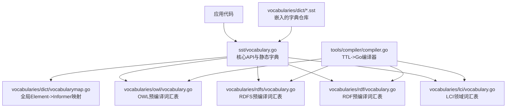
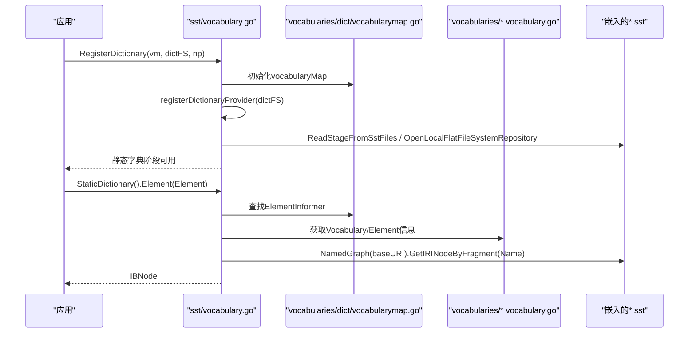
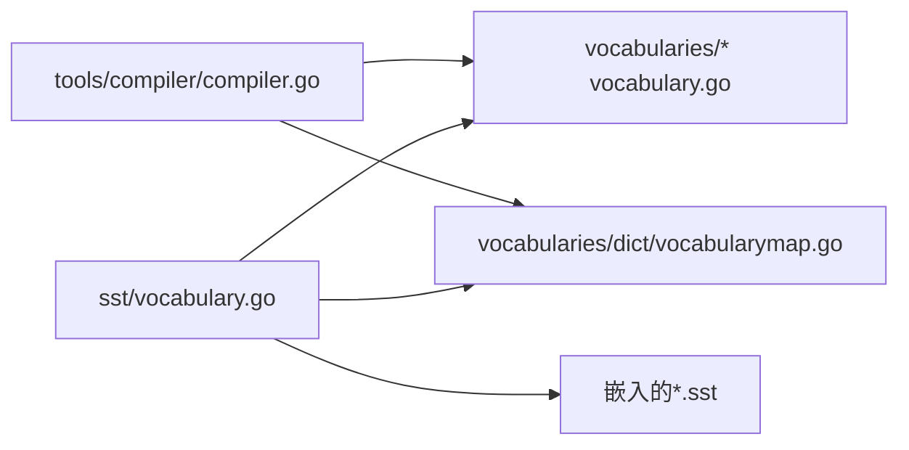

# 词汇表系统

<cite>
**本文引用的文件**
- [sst/vocabulary.go](file://sst/vocabulary.go)
- [vocabularies/doc.go](file://vocabularies/doc.go)
- [vocabularies/owl/vocabulary.go](file://vocabularies/owl/vocabulary.go)
- [vocabularies/rdfs/vocabulary.go](file://vocabularies/rdfs/vocabulary.go)
- [vocabularies/lci/vocabulary.go](file://vocabularies/lci/vocabulary.go)
- [vocabularies/rdf/vocabulary.go](file://vocabularies/rdf/vocabulary.go)
- [vocabularies/dict/vocabularymap.go](file://vocabularies/dict/vocabularymap.go)
- [tools/compiler/compiler.go](file://tools/compiler/compiler.go)
</cite>

## 目录
1. [简介](#简介)
2. [项目结构](#项目结构)
3. [核心组件](#核心组件)
4. [架构总览](#架构总览)
5. [详细组件分析](#详细组件分析)
6. [依赖关系分析](#依赖关系分析)
7. [性能与缓存](#性能与缓存)
8. [故障排查指南](#故障排查指南)
9. [结论](#结论)
10. [附录：使用示例与最佳实践](#附录使用示例与最佳实践)

## 简介
本文件系统性阐述SST（Semantic STEP Technology）中的词汇表系统，重点说明其在语义网中的作用、预编译词汇表的组织与使用方法、标准词汇表（OWL、RDFS、LCI等）的特性与应用、自定义词汇表的创建与注册机制、词汇表映射与转换工具、版本管理与兼容性考量、实际使用示例与最佳实践，以及性能优化与缓存策略。

在语义网中，词汇表用于为命名空间下的概念与属性提供稳定、可共享的标识与类型信息。SST通过“预编译+嵌入”的方式，将标准与领域词汇表以Go代码形式内嵌到运行时，既保证了类型安全与早期绑定，又提供了对底层RDF/OWL/RDFS语义的访问能力。

## 项目结构
SST词汇表系统由三部分组成：
- 核心接口与运行时：位于 sst/vocabulary.go，定义词汇表、元素、元素信息器、静态字典阶段等。
- 预编译词汇表：位于 vocabularies/*，每个子包对应一个词汇表（如 owl、rdfs、rdf、lci），由编译器生成。
- 编译器与映射：位于 tools/compiler/compiler.go 与 vocabularies/dict/vocabularymap.go，负责从TTL源生成Go代码并构建全局映射与嵌入文件系统。

图表来源
- [sst/vocabulary.go:15-107](file://sst/vocabulary.go#L15-L107)
- [vocabularies/dict/vocabularymap.go:27-30](file://vocabularies/dict/vocabularymap.go#L27-L30)
- [tools/compiler/compiler.go:137-156](file://tools/compiler/compiler.go#L137-L156)

章节来源
- [vocabularies/doc.go:1-6](file://vocabularies/doc.go#L1-L6)
- [tools/compiler/compiler.go:5-24](file://tools/compiler/compiler.go#L5-L24)

## 核心组件
- 词汇表 Vocabulary：表示外部定义的ontology，包含BaseIRI。
- 元素 Element：词汇表中某个IRI节点的早期绑定表示，可通过IRI()获取完整IRI字符串。
- 元素信息器 ElementInformer：扩展了Elementer和Node，提供IsClass/IsProperty/Domain/Range/SubtypeOf等语义查询方法。
- 元素信息 ElementInfo：承载元素的元数据（是否类/属性/数据类型/个体、主类覆盖关系、域/范围、子类链等）。
- 静态字典阶段 Dictionary：只读Stage，支持按Vocabulary获取NamedGraph，或按Element获取IBNode。
- 全局注册 RegisterDictionary：初始化vocabularyMap、namespaceToPrefixMap，并注册嵌入的字典提供者。

关键行为
- StaticDictionary()：返回全局只读字典阶段，用于运行时根据Element查找对应的RDF节点。
- NamespaceToPrefix(iri)：根据IRI返回前缀，也可用于判断NameGraph是否来自字典阶段。
- ElementInformer(name)：通过Vocabulary.ElementInformer(name)查找元素信息，未找到时返回错误。

章节来源
- [sst/vocabulary.go:15-107](file://sst/vocabulary.go#L15-L107)
- [sst/vocabulary.go:125-223](file://sst/vocabulary.go#L125-L223)
- [sst/vocabulary.go:238-308](file://sst/vocabulary.go#L238-L308)
- [sst/vocabulary.go:351-402](file://sst/vocabulary.go#L351-L402)

## 架构总览
SST词汇表系统的运行期流程如下：
- 编译期：编译器读取TTL源，生成各词汇表包的Go代码（owl、rdfs、rdf、lci等），并在vocabularies/dict/vocabularymap.go中建立Element->ElementInformer的全局映射；同时嵌入*.sst字典仓库。
- 启动期：应用调用RegisterDictionary(vm, dictFS, np)，完成词汇表映射、命名空间前缀映射与静态字典阶段的初始化。
- 运行期：应用通过StaticDictionary().Element(Element)或Vocabulary.ElementInformer(name)获取元素信息与RDF节点，进行读写与推理辅助。

图表来源
- [sst/vocabulary.go:15-107](file://sst/vocabulary.go#L15-L107)
- [vocabularies/dict/vocabularymap.go:27-30](file://vocabularies/dict/vocabularymap.go#L27-L30)

## 详细组件分析

### 预编译词汇表组织结构
- 每个词汇表包（owl、rdfs、rdf、lci等）均包含：
  - Vocabulary常量（BaseIRI）
  - 每个IRI节点对应的类型与变量（如 owl.Class、rdfs.Label、lci.Activity）
  - ElementInfo字段描述其语义角色（类/属性/数据类型/个体）、继承关系（ASubtypeOf）、属性约束（ADomain/ARange）、主类覆盖（AMainClassSupersedure）等
- 这些文件由 tools/compiler/compiler.go 从TTL源自动生成，保证与上游词汇表一致。

章节来源
- [vocabularies/owl/vocabulary.go:17-80](file://vocabularies/owl/vocabulary.go#L17-L80)
- [vocabularies/rdfs/vocabulary.go:15-49](file://vocabularies/rdfs/vocabulary.go#L15-L49)
- [vocabularies/rdf/vocabulary.go:14-48](file://vocabularies/rdf/vocabulary.go#L14-L48)
- [vocabularies/lci/vocabulary.go:18-87](file://vocabularies/lci/vocabulary.go#L18-L87)
- [tools/compiler/compiler.go:137-156](file://tools/compiler/compiler.go#L137-L156)

### 标准词汇表特性与应用
- OWL：提供本体建模能力（类、属性、限制、公理等），如 Class、ObjectProperty、Restriction、Thing、Nothing 等。
- RDFS：提供基础分类与属性描述（Class、Resource、Datatype、label、comment、domain、range、subClassOf、subPropertyOf）。
- RDF：语法容器与字面量类型（Alt、Bag、List、PlainLiteral、HTML、JSON等）。
- LCI：领域词汇表，涵盖物质、物理对象、活动、时间、数量等复杂概念，具备丰富的类层次与主类覆盖关系，便于表达工程与生命周期信息。

章节来源
- [vocabularies/owl/vocabulary.go:230-800](file://vocabularies/owl/vocabulary.go#L230-L800)
- [vocabularies/rdfs/vocabulary.go:169-467](file://vocabularies/rdfs/vocabulary.go#L169-L467)
- [vocabularies/rdf/vocabulary.go:21-200](file://vocabularies/rdf/vocabulary.go#L21-L200)
- [vocabularies/lci/vocabulary.go:25-800](file://vocabularies/lci/vocabulary.go#L25-L800)

### 自定义词汇表的创建与注册机制
- 创建：编写TTL源（遵循RDF/OWL/RDFS约定），通过 tools/compiler/compiler.go 编译为Go代码，输出至 vocabularies/<your-vocab>/vocabulary.go。
- 注册：在 vocabularies/dict/vocabularymap.go 中将新词汇表的Element->ElementInformer加入全局keys映射；确保*.sst字典文件被嵌入（go:embed *.sst）。
- 初始化：应用启动时调用 RegisterDictionary(vm, dictFS, np)，其中vm为Element->ElementInformer映射，dictFS为嵌入的文件系统，np为命名空间到前缀的映射。

章节来源
- [tools/compiler/compiler.go:5-24](file://tools/compiler/compiler.go#L5-L24)
- [vocabularies/dict/vocabularymap.go:27-30](file://vocabularies/dict/vocabularymap.go#L27-L30)
- [sst/vocabulary.go:94-107](file://sst/vocabulary.go#L94-L107)

### 词汇表映射与转换工具使用方法
- 编译器：tools/compiler/compiler.go 将TTL转换为Go代码，维护urlPackageMap、urlImportsMap、neededCompileTTL等配置，控制包名、导入与编译清单。
- 字典映射：vocabularies/dict/vocabularymap.go 集中管理所有Element->ElementInformer映射，供运行时查找。
- 命名空间前缀：通过 namespaceToPrefixMap 实现IRI到前缀的转换，便于序列化与可读性。

章节来源
- [tools/compiler/compiler.go:104-156](file://tools/compiler/compiler.go#L104-L156)
- [vocabularies/dict/vocabularymap.go:30-800](file://vocabularies/dict/vocabularymap.go#L30-L800)
- [sst/vocabulary.go:115-123](file://sst/vocabulary.go#L115-L123)

### 版本管理与兼容性考虑
- 编译器维护 neededCompileTTL 与 urlPackageMap，确保不同词汇表版本的兼容性与正确导入。
- 更新流程：升级上游词汇表后，重新执行 go run ./tools/compiler 生成最新代码，再提交变更。
- 主类覆盖：ElementInfo.AMainClassSupersedure 用于声明主类的替代关系，有助于演进时的向后兼容。

章节来源
- [tools/compiler/compiler.go:137-156](file://tools/compiler/compiler.go#L137-L156)
- [vocabularies/lci/vocabulary.go:80-87](file://vocabularies/lci/vocabulary.go#L80-L87)
- [sst/vocabulary.go:198-211](file://sst/vocabulary.go#L198-L211)

### 实际使用示例与最佳实践
- 使用静态字典获取RDF节点：
  - 通过 StaticDictionary().Element(Element) 获取IBNode，再进行遍历或断言。
- 使用元素信息器进行类型检查：
  - 通过 ElementInformer.IsClass()/IsProperty()/Domain()/Range() 等方法进行语义校验。
- 命名空间前缀转换：
  - 使用 NamespaceToPrefix(iri) 将IRI转换为前缀形式，提升可读性或用于序列化。

章节来源
- [sst/vocabulary.go:44-58](file://sst/vocabulary.go#L44-L58)
- [sst/vocabulary.go:115-123](file://sst/vocabulary.go#L115-L123)
- [sst/vocabulary.go:238-308](file://sst/vocabulary.go#L238-L308)

## 依赖关系分析
- 编译器依赖：
  - 读取TTL源（来自独立模块或本地fs.FS），生成Go代码与字典映射。
- 运行时依赖：
  - sst/vocabulary.go 依赖 vocabularies/* 生成的词汇表包与 vocabularies/dict/vocabularymap.go 的全局映射。
  - 静态字典阶段依赖嵌入的*.sst文件，作为只读的数据源。

图表来源
- [tools/compiler/compiler.go:137-156](file://tools/compiler/compiler.go#L137-L156)
- [vocabularies/dict/vocabularymap.go:27-30](file://vocabularies/dict/vocabularymap.go#L27-L30)
- [sst/vocabulary.go:15-33](file://sst/vocabulary.go#L15-L33)

章节来源
- [tools/compiler/compiler.go:5-24](file://tools/compiler/compiler.go#L5-L24)
- [vocabularies/dict/vocabularymap.go:30-800](file://vocabularies/dict/vocabularymap.go#L30-L800)
- [sst/vocabulary.go:15-33](file://sst/vocabulary.go#L15-L33)

## 性能与缓存
- 一次性初始化：dictionaryStage.stageOnce 确保静态字典阶段仅初始化一次，避免重复开销。
- 内存映射：vocabularyMap 与 namespaceToPrefixMap 为全局哈希表，查找复杂度近似O(1)。
- 嵌入文件系统：*.sst通过go:embed嵌入，减少IO延迟，提高启动后的访问速度。
- 建议：
  - 合理划分词汇表粒度，避免过大单一包导致编译与加载成本上升。
  - 对频繁访问的词汇表元素，尽量复用ElementInformer实例，减少重复查找。
  - 在批量处理场景下，优先使用静态字典的NamedGraph批量操作，降低多次IRI解析开销。

章节来源
- [sst/vocabulary.go:15-33](file://sst/vocabulary.go#L15-L33)
- [sst/vocabulary.go:89-107](file://sst/vocabulary.go#L89-L107)
- [vocabularies/dict/vocabularymap.go:27-30](file://vocabularies/dict/vocabularymap.go#L27-L30)

## 故障排查指南
- 常见错误：
  - ErrElementInformerNotFound：尝试访问未注册的Element，需检查RegisterDictionary是否已调用且vm包含该Element。
  - 命名空间前缀未设置：NamespaceToPrefix警告提示未设置映射，需确认np参数是否正确传入。
  - 静态字典阶段无效：ErrInvalidDictionaryStage，通常因未正确初始化或嵌入文件缺失。
- 排查步骤：
  - 确认应用启动时调用了RegisterDictionary(vm, dictFS, np)。
  - 检查vocabularies/dict/vocabularymap.go中是否包含目标Element->ElementInformer映射。
  - 验证*.sst文件是否被正确嵌入（go:embed *.sst）。
  - 使用StaticDictionary().Dump()或调试日志查看字典内容。

章节来源
- [sst/vocabulary.go:42-43](file://sst/vocabulary.go#L42-L43)
- [sst/vocabulary.go:87-123](file://sst/vocabulary.go#L87-L123)
- [vocabularies/dict/vocabularymap.go:27-30](file://vocabularies/dict/vocabularymap.go#L27-L30)

## 结论
SST词汇表系统通过“编译器生成+嵌入字典+静态字典阶段”的设计，实现了高性能、类型安全的词汇表访问。它覆盖了标准词汇表（OWL、RDFS、RDF）与领域词汇表（LCI等），并提供完善的注册、映射与转换工具。通过合理的版本管理与性能优化策略，可在大规模语义数据处理场景中保持稳定与高效。

## 附录：使用示例与最佳实践
- 示例流程：
  - 启动时调用 RegisterDictionary(vm, dictFS, np)。
  - 使用 StaticDictionary().Element(Element) 获取IBNode，并进行遍历或断言。
  - 使用 ElementInformer 的方法进行类型与关系检查。
  - 使用 NamespaceToPrefix(iri) 进行IRI到前缀的转换。
- 最佳实践：
  - 将常用词汇表元素定义为全局常量，减少重复构造。
  - 在批量处理中使用NamedGraph的迭代方法，避免逐条查询。
  - 定期更新上游词汇表并重新编译，保持与标准同步。
  - 对新增词汇表，完善Element->ElementInformer映射与*.sst嵌入。

章节来源
- [sst/vocabulary.go:44-58](file://sst/vocabulary.go#L44-L58)
- [sst/vocabulary.go:115-123](file://sst/vocabulary.go#L115-L123)
- [vocabularies/dict/vocabularymap.go:30-800](file://vocabularies/dict/vocabularymap.go#L30-L800)