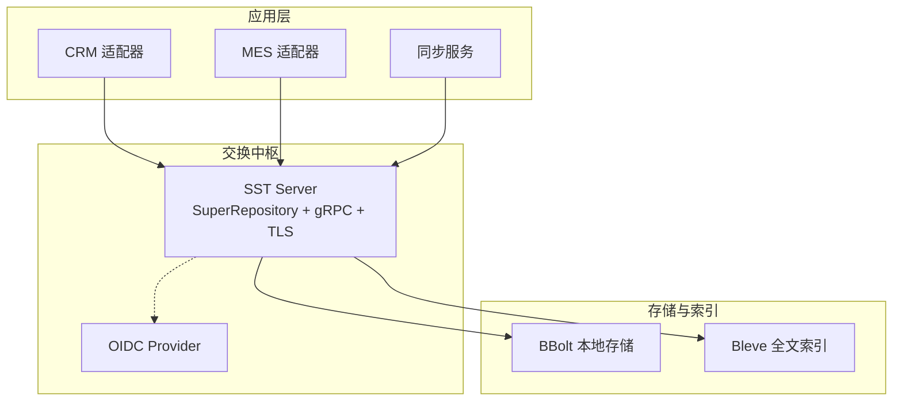
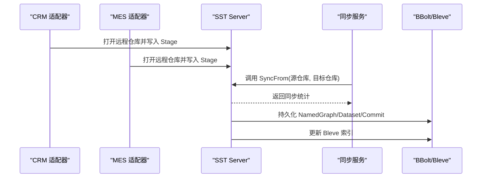
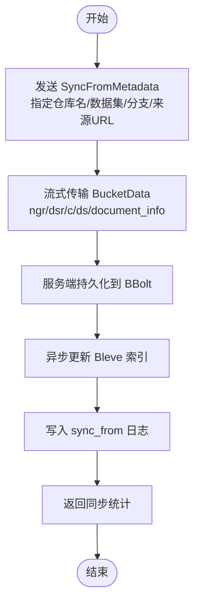
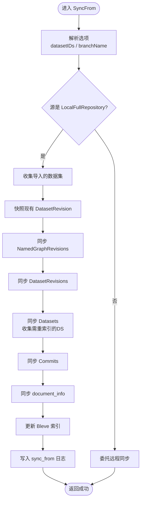
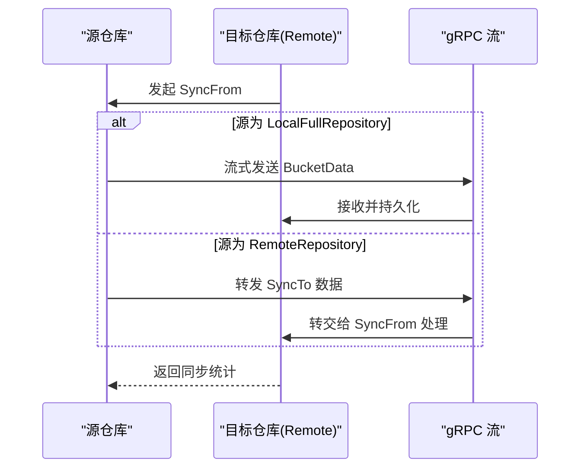
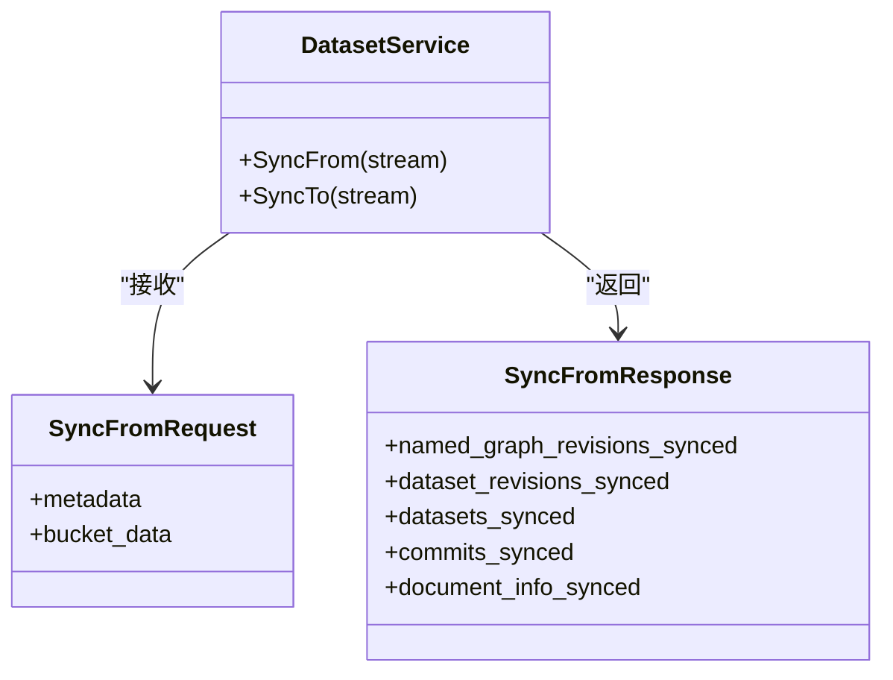
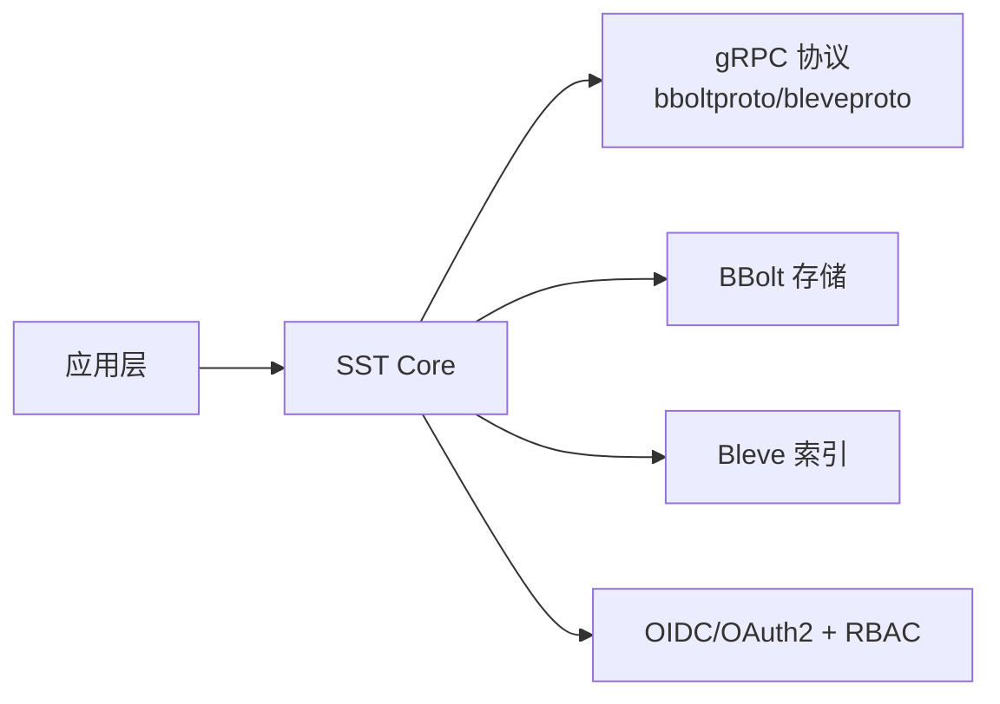

# CRM与MES系统数据交换方案

<cite>
**本文引用的文件**   
- [CRM_MES_数据交换技术方案_sst_core.md](file://docs/CRM_MES_数据交换技术方案_sst_core.md)
- [README.md](file://README.md)
- [repository.proto](file://bboltproto/repository.proto)
- [index.proto](file://bleveproto/index.proto)
- [repolocalfull.go](file://sst/repolocalfull.go)
- [reporemote.go](file://sst/reporemote.go)
- [reporemoteds.go](file://sst/reporemoteds.go)
- [session.go](file://mcp/cmd/session.go)
</cite>

## 目录
1. [引言](#引言)
2. [项目结构](#项目结构)
3. [核心组件](#核心组件)
4. [架构总览](#架构总览)
5. [详细组件分析](#详细组件分析)
6. [依赖关系分析](#依赖关系分析)
7. [性能与可靠性](#性能与可靠性)
8. [故障排查指南](#故障排查指南)
9. [结论](#结论)
10. [附录：关键API速查](#附录关键api速查)

## 引言
本方案基于 SST Core 构建企业级 CRM 与 MES 数据交换平台，以 RDF 语义图作为统一数据模型，结合类 Git 的版本控制、gRPC 流式同步、OIDC/OAuth2 认证与 Bleve 全文索引，实现跨系统数据的语义化建模、版本可追溯、近实时同步与细粒度权限控制。该方案解决传统 ETL/ESB 在模型异构、关联复杂、审计困难、实时性不足等方面的痛点，提供开放标准（Turtle/TriG）与 AI 友好（MCP Server）的扩展能力。

## 项目结构
仓库采用多包分层组织，面向应用开发者的主要包包括：
- sst：SST 核心 API，包含仓库、Stage、数据集、命名图、提交、同步等能力
- examples：示例程序，演示读写本地/远程仓库
- vocabularies：预编译本体词汇表，便于早期绑定
- defaultderive：高级用户自定义 Bleve 索引映射
- cmd/cli：命令行工具集
- bboltproto/bleveproto：gRPC 协议定义（仓库管理与索引查询）
- mcp：MCP Server，供 AI 直接操作 SST 数据

图表来源
- [CRM_MES_数据交换技术方案_sst_core.md:31-74](file://docs/CRM_MES_数据交换技术方案_sst_core.md#L31-L74)
- [README.md:1-15](file://README.md#L1-L15)

章节来源
- [README.md:1-15](file://README.md#L1-L15)

## 核心组件
- 统一数据模型：RDF 三元组，支持 Turtle/TriG 序列化
- 仓库抽象：LocalFullRepository、RemoteRepository、LocalBasicRepository、LocalFlatRepository
- 版本控制：Commit/Branch/Dataset/NamedGraph 修订链
- 同步机制：SyncFrom/SyncTo 双向流式传输，支持按数据集与分支选择性同步
- 认证授权：OIDC/OAuth2 + RBAC，支持 per-repo 访问控制
- 检索能力：Bleve 全文索引
- AI 接口：MCP Server 暴露 open_remote_repository、stage_trig、repository_sync_from 等工具

章节来源
- [CRM_MES_数据交换技术方案_sst_core.md:77-153](file://docs/CRM_MES_数据交换技术方案_sst_core.md#L77-L153)
- [CRM_MES_数据交换技术方案_sst_core.md:449-507](file://docs/CRM_MES_数据交换技术方案_sst_core.md#L449-L507)
- [CRM_MES_数据交换技术方案_sst_core.md:511-581](file://docs/CRM_MES_数据交换技术方案_sst_core.md#L511-L581)

## 架构总览
整体架构分为数据源层、适配层、交换中枢、通信层、服务层与监控层。CRM/MES 业务数据经适配器转换为 RDF 三元组写入 SST Stage，通过 SuperRepository 统一管理多个 Repository，使用 gRPC + OIDC 进行安全通信，并通过 SyncFrom 实现近实时增量同步；Bleve 提供全文检索，MCP Server 为 AI 提供工具调用能力。

图表来源
- [CRM_MES_数据交换技术方案_sst_core.md:159-285](file://docs/CRM_MES_数据交换技术方案_sst_core.md#L159-L285)
- [CRM_MES_数据交换技术方案_sst_core.md:287-363](file://docs/CRM_MES_数据交换技术方案_sst_core.md#L287-L363)

## 详细组件分析

### 数据建模与命名图策略
- 将 CRM 订单/客户/产品与 MES 工单/设备/工序统一建模为 RDF 图，通过 IRI 引用建立跨系统关联
- 使用 NamedGraph 按业务域划分数据图，并通过 owl:imports 建立引用关系
- 建议定义共享本体词汇表，明确公共概念与属性，提升互操作性

章节来源
- [CRM_MES_数据交换技术方案_sst_core.md:77-153](file://docs/CRM_MES_数据交换技术方案_sst_core.md#L77-L153)

### 数据适配器（CRM/MES 写入 SST）
- CRM 适配器连接远程 SST 仓库，创建或获取 NamedGraph，将业务对象转为 RDF 三元组并提交 Commit
- MES 适配器通过 IRI 直接引用 CRM 订单节点，建立跨系统数据关联后提交
- 适配器需遵循 SST 的 Stage/NamedGraph/IBNode 工作流

章节来源
- [CRM_MES_数据交换技术方案_sst_core.md:159-285](file://docs/CRM_MES_数据交换技术方案_sst_core.md#L159-L285)

### 仓库间数据同步（SyncFrom/SyncTo）
- 同步内容包含 NamedGraph 修订、Dataset 修订、Commit 记录与文档信息
- 支持按数据集 IRIs 与分支名进行选择性同步
- 服务端通过 gRPC 双向流式传输 Bucket 数据，客户端/服务端分别处理元数据与数据块

图表来源
- [repository.proto:669-703](file://bboltproto/repository.proto#L669-L703)
- [reporemoteds.go:808-924](file://sst/reporemoteds.go#L808-L924)

章节来源
- [CRM_MES_数据交换技术方案_sst_core.md:287-363](file://docs/CRM_MES_数据交换技术方案_sst_core.md#L287-L363)
- [repository.proto:669-703](file://bboltproto/repository.proto#L669-L703)
- [reporemoteds.go:808-924](file://sst/reporemoteds.go#L808-L924)

### 本地全量仓库同步实现（LocalFullRepository.SyncFrom）
- 解析同步选项（数据集ID、分支名）
- 若源为 LocalFullRepository：依次同步 NamedGraphRevisions → DatasetRevisions → Datasets → Commits → document_info，并在 master 分支变更时触发 Bleve 重索引
- 若源为 RemoteRepository：委托远程同步流程
- 完成后写入 sync_from 日志

图表来源
- [repolocalfull.go:3407-3490](file://sst/repolocalfull.go#L3407-L3490)

章节来源
- [repolocalfull.go:3407-3490](file://sst/repolocalfull.go#L3407-L3490)

### 远程仓库同步实现（RemoteRepository.SyncFrom）
- 根据源类型分派：localFullRepository → syncFromLocal；remoteRepository → syncFromRemote
- 从本地到远程：通过 gRPC 流式传输 Bucket 数据
- 从远程到远程：中继 SyncTo 数据到当前仓库的 SyncFrom

图表来源
- [reporemote.go:2007-2039](file://sst/reporemote.go#L2007-L2039)

章节来源
- [reporemote.go:2007-2039](file://sst/reporemote.go#L2007-L2039)

### gRPC 协议与服务端处理
- DatasetService 提供 SyncFrom/SyncTo 流式 RPC，用于仓库间数据同步
- SyncFromRequest 携带元数据与 BucketData，SyncFromResponse 返回同步统计
- 服务端在处理过程中进行 per-repo 鉴权、持久化、索引更新与日志记录

图表来源
- [repository.proto:88-131](file://bboltproto/repository.proto#L88-L131)
- [repository.proto:669-703](file://bboltproto/repository.proto#L669-L703)

章节来源
- [repository.proto:88-131](file://bboltproto/repository.proto#L88-L131)
- [repository.proto:669-703](file://bboltproto/repository.proto#L669-L703)
- [reporemoteds.go:808-924](file://sst/reporemoteds.go#L808-L924)

### MCP 接口赋能 AI 应用
- MCP Session 暴露 repository_sync_from 工具，允许 AI 调用目标仓库从源仓库同步数据
- 支持按分支与数据集 IRIs 过滤，返回同步结果摘要

章节来源
- [session.go:754-820](file://mcp/cmd/session.go#L754-L820)

### 查询与导出
- Bleve 全文检索：在仓库中搜索关键词，返回匹配文档
- Turtle/TriG 标准格式导出：将 Stage 或 NamedGraph 导出为标准 RDF 格式
- 图遍历查询：遍历节点的所有三元组，辅助数据分析

章节来源
- [CRM_MES_数据交换技术方案_sst_core.md:371-408](file://docs/CRM_MES_数据交换技术方案_sst_core.md#L371-L408)

### 版本控制与审计
- 每次 Commit 生成不可篡改的版本记录，支持查看提交历史、分支指针与提交详情
- 同步过程自动记录 sync_from 日志，包含影响的数据集列表与来源仓库 URL

章节来源
- [CRM_MES_数据交换技术方案_sst_core.md:410-445](file://docs/CRM_MES_数据交换技术方案_sst_core.md#L410-L445)
- [reporemoteds.go:910-924](file://sst/reporemoteds.go#L910-L924)

## 依赖关系分析
- 应用层（CRM/MES 适配器、同步服务）依赖 SST Core 提供的仓库与同步 API
- 通信层依赖 gRPC 协议（bboltproto/bleveproto）
- 存储层依赖 BBolt 事务型 KV 存储
- 索引层依赖 Bleve 全文检索
- 安全层依赖 OIDC/OAuth2 与 RBAC

图表来源
- [README.md:1-15](file://README.md#L1-L15)
- [repository.proto:1-24](file://bboltproto/repository.proto#L1-L24)
- [index.proto:1-21](file://bleveproto/index.proto#L1-L21)

章节来源
- [README.md:1-15](file://README.md#L1-L15)
- [repository.proto:1-24](file://bboltproto/repository.proto#L1-L24)
- [index.proto:1-21](file://bleveproto/index.proto#L1-L21)

## 性能与可靠性
- 增量同步：仅传输新增/修改的 Bucket 数据，避免全量拷贝
- 选择性同步：WithDatasetIRIs() 仅同步特定数据集，减少传输量
- 异步索引：Bleve 索引更新与数据写入解耦，不阻塞主流程
- 流式传输：gRPC 双向流式传输大数据集，避免内存溢出
- 事务保证：LocalFullRepository 基于 BBolt 事务，确保写入原子性
- 幂等同步：基于 Hash 比对，重复同步不会产生重复数据
- 版本回退：支持 CheckoutCommit 回到任意历史版本
- 同步日志：每次 SyncFrom 自动记录同步日志，包含影响的数据集列表
- Pre-Commit 条件：支持注册 preCommitCondition 钩子，在提交前执行校验

章节来源
- [CRM_MES_数据交换技术方案_sst_core.md:611-633](file://docs/CRM_MES_数据交换技术方案_sst_core.md#L611-L633)

## 故障排查指南
- 同步失败常见原因
  - 未先发送 SyncFromMetadata 即发送 BucketData：服务端会返回 FailedPrecondition
  - 权限不足：per-repo 鉴权失败，检查 OIDC Token 与 RBAC 配置
  - 源仓库类型不支持：RemoteRepository.SyncFrom 仅支持 localFullRepository 与 remoteRepository
- 索引不一致
  - master 分支变更后未触发 Bleve 重索引：确认 updateAfterSync 是否被调用
- 文档缺失
  - document_info 已同步但文件不在 vault：服务端会发出警告，不影响同步完成
- 版本冲突
  - 分支 diverge：可通过 CompareCommits 与 FindCommonParentRevision 定位共同父提交

章节来源
- [reporemoteds.go:875-887](file://sst/reporemoteds.go#L875-L887)
- [reporemoteds.go:890-908](file://sst/reporemoteds.go#L890-L908)
- [reporemote.go:2021-2028](file://sst/reporemote.go#L2021-L2028)

## 结论
本方案以 SST Core 为核心，通过 RDF 语义模型、类 Git 版本控制、gRPC 流式同步与 OIDC/RBAC 安全体系，构建了高内聚、低耦合、可扩展的 CRM-MES 数据交换平台。其优势在于标准化、可审计、近实时与 AI 友好，适合在企业级场景中替代传统 ETL/ESB，降低集成复杂度并提升数据质量与可观测性。

## 附录：关键API速查
- sst.OpenRemoteRepository：打开远程仓库
- sst.NewLocalSuperRepository：创建本地 SuperRepository
- repo.OpenStage：打开 Stage 工作区
- stage.CreateNamedGraph：创建命名图
- ng.CreateIRINode：创建 IRI 节点
- node.AddStatement：添加 RDF 三元组
- stage.Commit：提交变更到仓库
- repo.SyncFrom：从另一个仓库同步数据
- dataset.CheckoutBranch：检出分支到 Stage
- repo.Bleve：获取全文索引
- ng.RdfWrite：导出为 Turtle/TriG
- sst.RdfRead：从 Turtle/TriG 导入
- repo.DocumentSet：上传文档
- repo.Log：查看仓库日志

章节来源
- [CRM_MES_数据交换技术方案_sst_core.md:687-704](file://docs/CRM_MES_数据交换技术方案_sst_core.md#L687-L704)