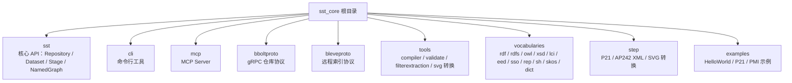
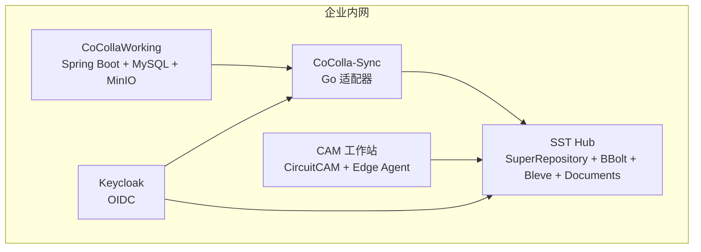
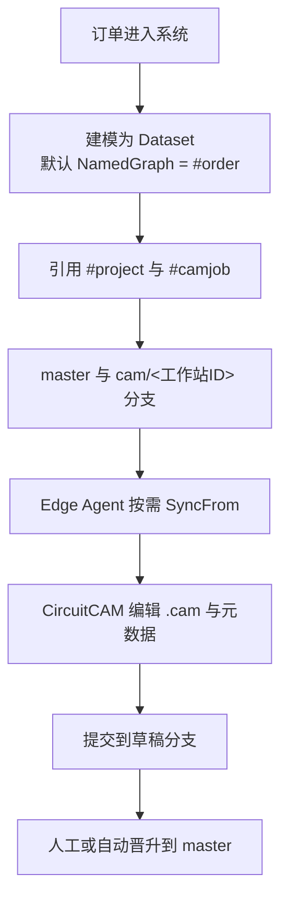
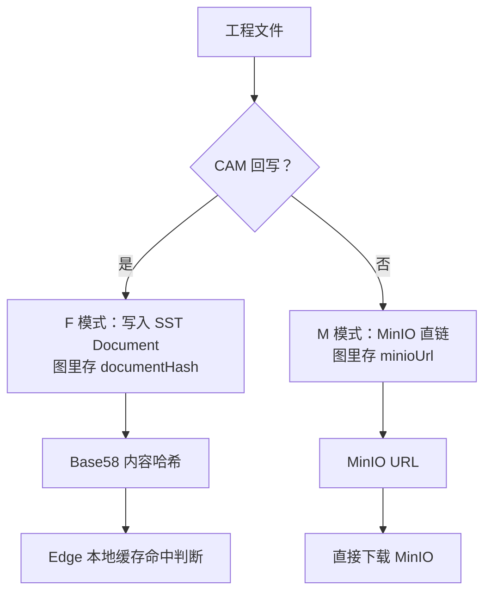
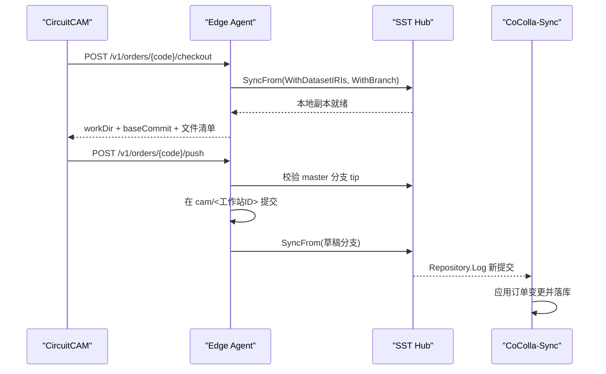
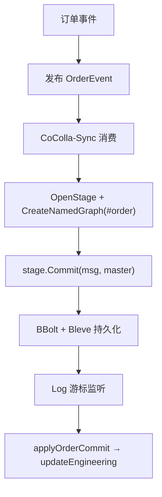
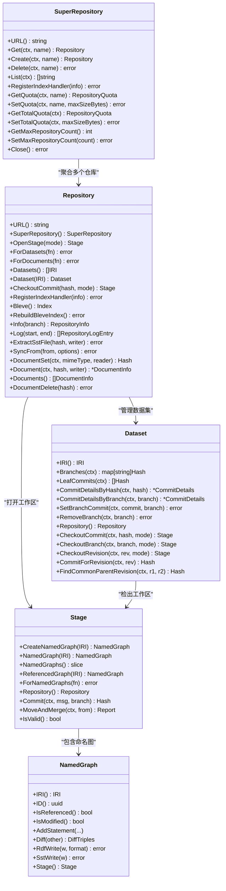
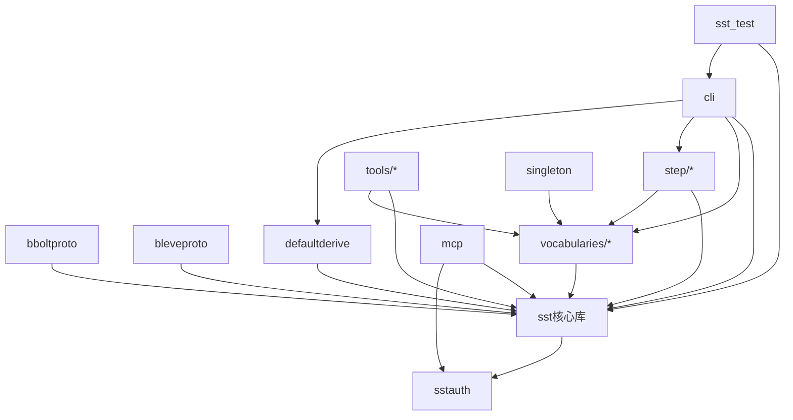

# CircuitCAM与CoCollaWorking集成方案

<cite>
**本文引用的文件**   
- [README.md](file://README.md)
- [基于sst-core的CiurcuitCAM与CoCollaWorking数据交换方案.md](file://docs/基于sst-core的CiurcuitCAM与CoCollaWorking数据交换方案.md)
- [sst-core系统架构图.md](file://docs/sst-core系统架构图.md)
- [sst API 说明（sst/README.md）](file://sst/README.md)
- [Repository 接口定义（sst/repository.go）](file://sst/repository.go)
- [SuperRepository 接口定义（sst/superlocalrepository.go）](file://sst/superlocalrepository.go)
- [Dataset 接口定义（sst/dataset.go）](file://sst/dataset.go)
</cite>

## 目录
1. [引言](#引言)
2. [项目结构](#项目结构)
3. [核心组件](#核心组件)
4. [架构总览](#架构总览)
5. [详细组件分析](#详细组件分析)
6. [依赖关系分析](#依赖关系分析)
7. [性能与容量规划](#性能与容量规划)
8. [故障排查指南](#故障排查指南)
9. [结论](#结论)

## 引言
本方案面向三个系统的协同：CoCollaWorking（订单与工程资料管理后端）、CircuitCAM（PCB CAM 桌面工程软件）与 SST Core（RDF 图仓库、版本控制与二进制交换格式）。目标是让 CircuitCAM 能获取 CoCollaWorking 的订单数据，编辑对应工程资料并回写；同时把两侧的数据存储与交换统一建立在 sst-core 之上，实现可追溯、可离线、可增量同步的工程资料协作。

SST Core 的定位不是替代业务数据库，而是跨系统数据交换层与工程资料版本库：CoColla 的 MySQL 仍承载订单状态机、审批流等事务型业务；SST 承载订单快照、工程资料清单、文件指纹与版本历史，并通过 Dataset / NamedGraph / Document / Commit 提供语义化、内容寻址的交换载体。

**章节来源**
- [README.md:1-15](file://README.md#L1-L15)
- [基于sst-core的CiurcuitCAM与CoCollaWorking数据交换方案.md:33-60](file://docs/基于sst-core的CiurcuitCAM与CoCollaWorking数据交换方案.md#L33-L60)

## 项目结构
从仓库视角看，sst-core 是一个单 Go Module 多包结构：`sst` 是核心 API，`cli` 提供类 Git 命令行工具，`mcp` 提供模型上下文协议服务，`bboltproto` 与 `bleveproto` 定义远程协议，`tools` 包含本体编译器与校验器，`vocabularies` 提供预编译词汇包，`step` 提供 STEP/SVG 等外部格式转换能力。

**图表来源**
- [sst-core系统架构图.md:8-54](file://docs/sst-core系统架构图.md#L8-L54)

**章节来源**
- [sst-core系统架构图.md:8-54](file://docs/sst-core系统架构图.md#L8-L54)
- [README.md:1-15](file://README.md#L1-L15)

## 核心组件
围绕 CircuitCAM 与 CoCollaWorking 的集成，核心组件包括：

| 组件 | 职责 | 在方案中的角色 |
|---|---|---|
| **SST Hub** | SuperRepository 服务端，托管多个 Repository，提供 gRPC 同步、全文检索、Document 保险库 | 跨系统交换中枢 |
| **CoColla-Sync** | 连接 MySQL 与 SST Hub 的双向适配器，发布订单事件、监听新提交并落库 | 业务系统与 SST 的桥接 |
| **Edge Agent** | 每台 CAM 工作站的本地边车进程，维护 LocalFullRepository 副本，暴露 HTTP/JSON 给 C++ | CircuitCAM 的零重依赖接入点 |
| **SstBridge** | CircuitCAM 内的 C++ 模块，调用 Edge Agent 完成订单浏览、检出、保存钩子与批量导入导出编排 | 桌面端集成入口 |
| **ccam 本体** | Turtle 本体 + 生成的 Go 词汇包，定义订单、工程资料、CAM 作业、同步事件的统一语义契约 | 跨团队类型化契约 |
| **Repository / Dataset / NamedGraph / Document** | SST 的核心抽象：仓库、数据集、命名图、内容寻址文档 | 所有交换数据的唯一载体 |

**章节来源**
- [基于sst-core的CiurcuitCAM与CoCollaWorking数据交换方案.md:116-126](file://docs/基于sst-core的CiurcuitCAM与CoCollaWorking数据交换方案.md#L116-L126)
- [基于sst-core的CiurcuitCAM与CoCollaWorking数据交换方案.md:139-184](file://docs/基于sst-core的CiurcuitCAM与CoCollaWorking数据交换方案.md#L139-L184)

## 架构总览
整体架构由企业内网中的 CoCollaWorking、SST Hub、CoColla-Sync、CAM 工作站以及 Keycloak OIDC 组成。CoColla 通过 CoColla-Sync 把订单快照写入 SST Hub；CAM 工作站通过 Edge Agent 拉取订单与工程资料；工程师在 CircuitCAM 中编辑后，变更经 Edge Agent 提交到 Hub，再由 CoColla-Sync 回写到现有业务接口。

**图表来源**
- [基于sst-core的CiurcuitCAM与CoCollaWorking数据交换方案.md:79-114](file://docs/基于sst-core的CiurcuitCAM与CoCollaWorking数据交换方案.md#L79-L114)

**章节来源**
- [基于sst-core的CiurcuitCAM与CoCollaWorking数据交换方案.md:77-126](file://docs/基于sst-core的CiurcuitCAM与CoCollaWorking数据交换方案.md#L77-L126)

## 详细组件分析

### 一订单一 Dataset 的建模决策
方案把“一个订单”映射为 SST 的一个 Dataset，默认 NamedGraph 承载订单主数据，再通过 `owl:imports` 引用工程资料图与 CAM 作业摘要图。这样做的直接好处是：

- 可按订单 IRI 做按需同步，避免全仓下发；
- 冲突半径限制在单个订单，合并与三方 diff 更可控；
- 权限隔离天然落在 Dataset 级别；
- 订单归档只是分支指针移动，历史仍可回放。

代价是 Dataset 数量会随订单增长，因此需要按年份或业务域切分 Repository Entry，避免单仓库过大。

**图表来源**
- [基于sst-core的CiurcuitCAM与CoCollaWorking数据交换方案.md:139-177](file://docs/基于sst-core的CiurcuitCAM与CoCollaWorking数据交换方案.md#L139-L177)

**章节来源**
- [基于sst-core的CiurcuitCAM与CoCollaWorking数据交换方案.md:139-184](file://docs/基于sst-core的CiurcuitCAM与CoCollaWorking数据交换方案.md#L139-L184)

### 工程文件双模式存储
方案定义了两种二进制存储模式：

| 模式 | 二进制位置 | 图里存什么 | 适用场景 |
|---|---|---|---|
| M 模式 | MinIO | `fileName / minioUrl / checksum / size / mime` | 客户上传的大体积原始文件，沿用现有前端 |
| F 模式 | SST Document | `documentHash` | `.cam` 等关键交付物的逐版本快照，支持离线回放 |

判定规则是：由 CAM 侧回写的 `.cam` / `.cam-pkg` / `.cam-ft` 强制走 F 模式；客户上传的 Gerber/ODB++ 用 M 模式。F 模式下，`Repository.DocumentSet` 以流式写入返回内容哈希，重复内容天然幂等；`Repository.Document` 可只取 `DocumentInfo` 判断本地缓存是否命中。

**图表来源**
- [基于sst-core的CiurcuitCAM与CoCollaWorking数据交换方案.md:150-160](file://docs/基于sst-core的CiurcuitCAM与CoCollaWorking数据交换方案.md#L150-L160)

**章节来源**
- [基于sst-core的CiurcuitCAM与CoCollaWorking数据交换方案.md:150-160](file://docs/基于sst-core的CiurcuitCAM与CoCollaWorking数据交换方案.md#L150-L160)

### CircuitCAM 通过本机 Edge Agent 接入
CircuitCAM 是 32 位 MFC 程序，不引入 Go runtime、cgo、gRPC。方案选择 Edge Agent 作为独立 64 位 Go 进程，CircuitCAM 通过本机 HTTP/JSON 调用 Edge Agent，复用现有 WinINet 客户端，保持进程隔离与离线能力。

Edge Agent 暴露 `/v1/orders/{code}/checkout` 与 `/v1/orders/{code}/push` 等接口，内部执行：

1. 保证本地副本已包含目标 Dataset；
2. 检出 master 版本的 Stage；
3. 记录 base commit 用于乐观并发；
4. 解析工程资料清单并拉取二进制；
5. 回写时检查 hub 上 master 是否仍有效；
6. 在草稿分支提交，再上行同步到 Hub；
7. 可选自动晋升到 master。

**图表来源**
- [基于sst-core的CiurcuitCAM与CoCollaWorking数据交换方案.md:431-610](file://docs/基于sst-core的CiurcuitCAM与CoCollaWorking数据交换方案.md#L431-L610)

**章节来源**
- [基于sst-core的CiurcuitCAM与CoCollaWorking数据交换方案.md:130-137](file://docs/基于sst-core的CiurcuitCAM与CoCollaWorking数据交换方案.md#L130-L137)
- [基于sst-core的CiurcuitCAM与CoCollaWorking数据交换方案.md:431-610](file://docs/基于sst-core的CiurcuitCAM与CoCollaWorking数据交换方案.md#L431-L610)

### CoColla-Sync 的事件驱动与游标监听
CoColla-Sync 在订单创建或状态流转处发布 Spring 应用事件，消费后打开 Stage、创建 NamedGraph 并提交到 SST；回写方向则使用 `Repository.Log` 的单调 logKey 游标增量拉取新提交，避免全仓扫描。幂等性通过 commit hash 作为外部键实现，CoColla 侧记录 `sst_commit_id`。

**图表来源**
- [基于sst-core的CiurcuitCAM与CoCollaWorking数据交换方案.md:161-166](file://docs/基于sst-core的CiurcuitCAM与CoCollaWorking数据交换方案.md#L161-L166)
- [基于sst-core的CiurcuitCAM与CoCollaWorking数据交换方案.md:612-661](file://docs/基于sst-core的CiurcuitCAM与CoCollaWorking数据交换方案.md#L612-L661)

**章节来源**
- [基于sst-core的CiurcuitCAM与CoCollaWorking数据交换方案.md:161-166](file://docs/基于sst-core的CiurcuitCAM与CoCollaWorking数据交换方案.md#L161-L166)
- [基于sst-core的CiurcuitCAM与CoCollaWorking数据交换方案.md:612-661](file://docs/基于sst-core的CiurcuitCAM与CoCollaWorking数据交换方案.md#L612-L661)

### SST Core 核心对象模型
从代码层面，SST 的核心对象是 `Repository`、`SuperRepository`、`Dataset`、`Stage`、`NamedGraph`。`Repository` 提供仓库级操作，包括打开 Stage、列举 Dataset、检出 Commit、注册 Bleve 索引、查询 Log、同步、读写 Document；`SuperRepository` 管理多个 Repository Entry，并提供配额与最大仓库数量控制；`Dataset` 表示一个业务数据集，支持分支、提交详情、检出与三方合并；`Stage` 是内存暂存区，`NamedGraph` 是三元组容器。

**图表来源**
- [Repository 接口定义（sst/repository.go:50-179）:50-179](file://sst/repository.go#L50-L179)
- [SuperRepository 接口定义（sst/superlocalrepository.go:36-88）:36-88](file://sst/superlocalrepository.go#L36-L88)
- [Dataset 接口定义（sst/dataset.go:30-94）:30-94](file://sst/dataset.go#L30-L94)

**章节来源**
- [Repository 接口定义（sst/repository.go:50-179）:50-179](file://sst/repository.go#L50-L179)
- [SuperRepository 接口定义（sst/superlocalrepository.go:36-88）:36-88](file://sst/superlocalrepository.go#L36-L88)
- [Dataset 接口定义（sst/dataset.go:30-94）:30-94](file://sst/dataset.go#L30-L94)
- [sst API 说明（sst/README.md:41-179）:41-179](file://sst/README.md#L41-L179)

## 依赖关系分析
从仓库依赖角度看，`sst` 是核心库，其他包单向依赖它；`bboltproto` 与 `bleveproto` 被 `sst` 的远程实现消费；`tools/compiler` 生成 `vocabularies/ccam` 这类类型化词汇包；`step` 负责外部格式转换；CLI 与 MCP 是上层接入方式。

**图表来源**
- [sst-core系统架构图.md:391-426](file://docs/sst-core系统架构图.md#L391-L426)

**章节来源**
- [sst-core系统架构图.md:391-426](file://docs/sst-core系统架构图.md#L391-L426)

## 性能与容量规划
SST Core 不适合承载高并发列表查询与事务型业务，因此方案明确不把 SST 当查询库使用：CAM 端的订单列表筛选仍由 CoColla REST 提供，SST 只负责“给定订单的完整交换上下文”。若确需在 Edge 侧离线检索，可用内置 Bleve 做模糊搜索，不做聚合统计。

容量方面，方案建议对 `cam-deliverables-*` 单独设置配额，例如 200 GiB，并对 SuperRepository 设置最大仓库数量。Dataset 数量随订单增长不构成 BBolt key 的性能问题，但 Repository Entry 应按年份或业务域切分，避免单仓库过大。

**章节来源**
- [基于sst-core的CiurcuitCAM与CoCollaWorking数据交换方案.md:178-184](file://docs/基于sst-core的CiurcuitCAM与CoCollaWorking数据交换方案.md#L178-L184)
- [基于sst-core的CiurcuitCAM与CoCollaWorking数据交换方案.md:326-328](file://docs/基于sst-core的CiurcuitCAM与CoCollaWorking数据交换方案.md#L326-L328)
- [基于sst-core的CiurcuitCAM与CoCollaWorking数据交换方案.md:737-748](file://docs/基于sst-core的CiurcuitCAM与CoCollaWorking数据交换方案.md#L737-L748)

## 故障排查指南
常见故障与排查要点如下：

| 现象 | 可能原因 | 排查建议 |
|---|---|---|
| CircuitCAM 无法列出订单 | Edge Agent 未启动、Hub 不可达、OIDC token 无效 | 先调 `/v1/health`，确认 Edge 存活与 Hub 连接状态 |
| 检出工程资料失败 | Dataset 未同步、文件存储模式不匹配、MinIO 或 Document 不可读 | 检查 `storageMode` 是 MINIO 还是 SST_DOCUMENT，分别验证 URL 或 hash |
| 回写提示冲突 | hub 上 master 分支 tip 与本地 baseCommit 不一致 | 重新 checkout，刷新 baseCommit 后再 push |
| CoColla 页面看不到回写结果 | CoColla-Sync 游标未推进、commit 已处理但未幂等识别 | 检查 `logKey` 游标与 `sst_commit_id` 去重逻辑 |
| 离线环境无法同步 | Edge 本地仓库与 Hub 分支不同步 | 恢复网络后执行 `SyncFrom(hub)`，必要时反向 `hubRepo.SyncFrom(edge)` |
| 本体字段拼写错误 | Turtle 本体未编译或未注册全局词汇表 | 运行 `tools/compiler` 生成 `vocabularies/ccam/vocabulary.go`，并确保 import `_ "vocabularies/dict"` |

**章节来源**
- [基于sst-core的CiurcuitCAM与CoCollaWorking数据交换方案.md:431-610](file://docs/基于sst-core的CiurcuitCAM与CoCollaWorking数据交换方案.md#L431-L610)
- [基于sst-core的CiurcuitCAM与CoCollaWorking数据交换方案.md:612-670](file://docs/基于sst-core的CiurcuitCAM与CoCollaWorking数据交换方案.md#L612-L670)
- [基于sst-core的CiurcuitCAM与CoCollaWorking数据交换方案.md:287-305](file://docs/基于sst-core的CiurcuitCAM与CoCollaWorking数据交换方案.md#L287-L305)

## 结论
本方案以 SST Core 为统一交换层，把 CoCollaWorking 的订单与工程资料、CircuitCAM 的工程编辑过程、以及 CAM 工作站的离线能力串联起来。核心设计原则是：不替代业务数据库、不改造 CircuitCAM 的 `.cam` 文件格式、桌面端零重依赖、一订单一 Dataset、工程文件双模式存储、事件驱动发布与游标监听回写、本体编译期类型化。通过这些约束，方案在保持现有业务稳定性的同时，提供了可追溯、可离线、可增量同步的工程资料协作能力。