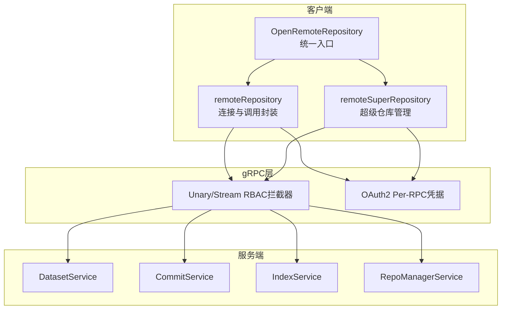
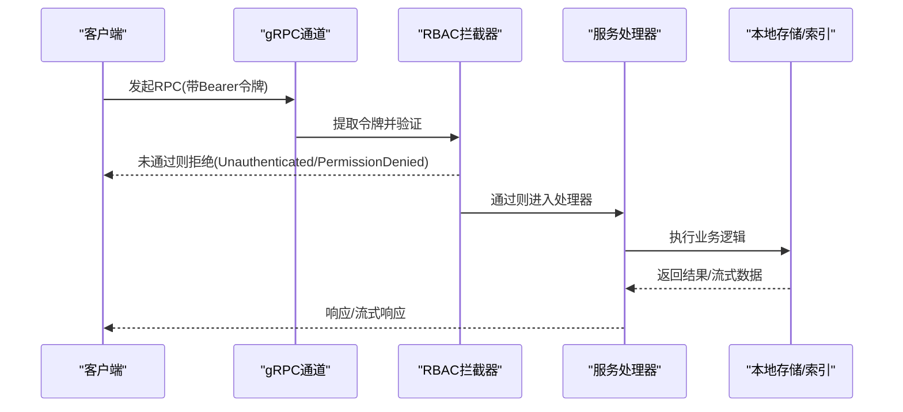
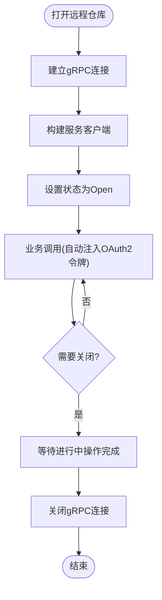
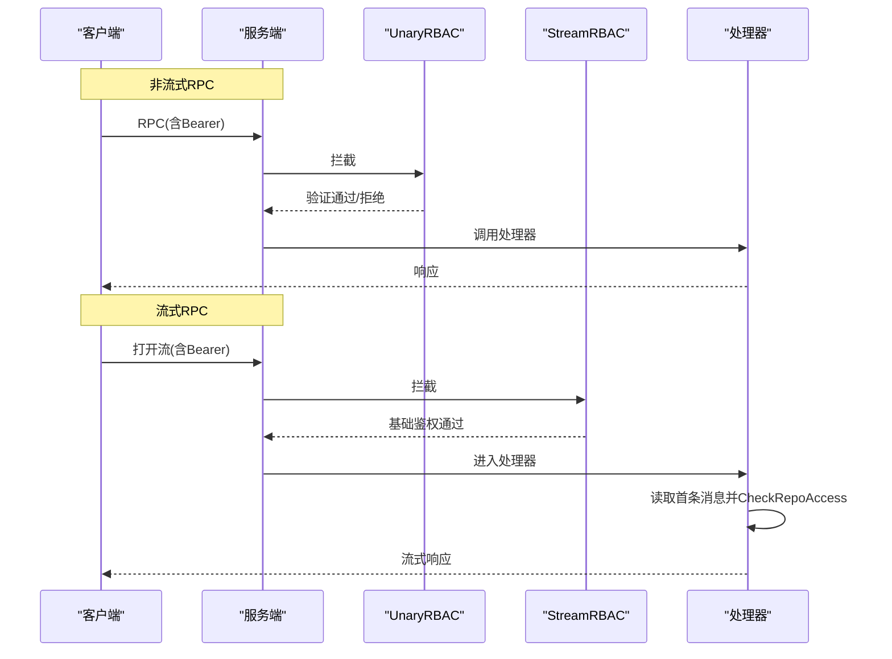
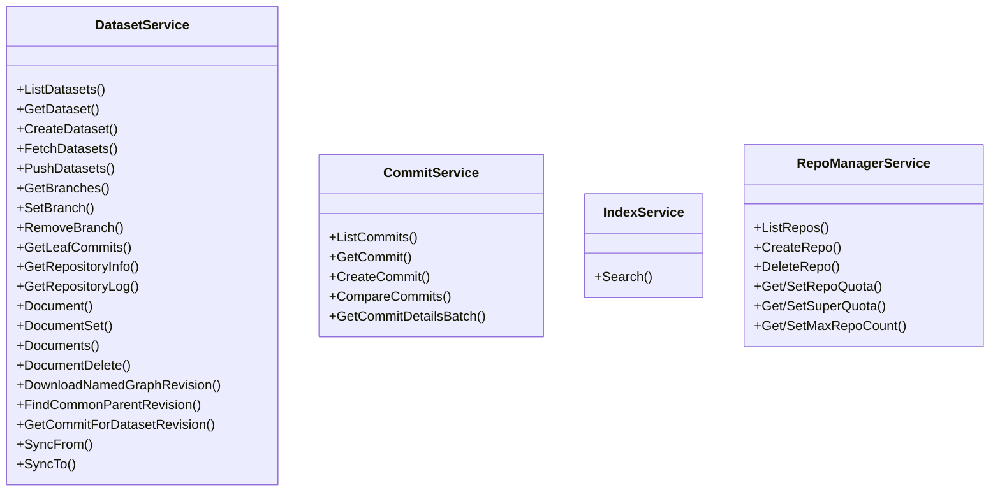
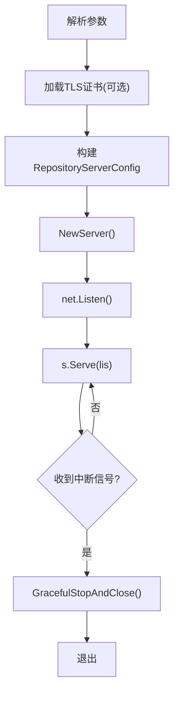
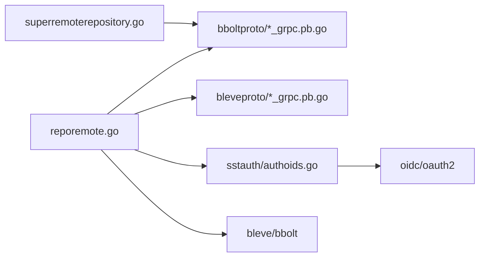

# gRPC服务器架构

<cite>
**本文引用的文件**
- [repository.proto](file://bboltproto/repository.proto)
- [index.proto](file://bleveproto/index.proto)
- [reporemote.go](file://sst/reporemote.go)
- [superremoterepository.go](file://sst/superremoterepository.go)
- [repository.go](file://sst/repository.go)
- [stagefsremoterepo.go](file://sst/stagefsremoterepo.go)
- [authoids.go](file://sstauth/authoids.go)
- [auth.go](file://sstauth/auth.go)
- [ACCESS_RIGHTS.md](file://sstauth/ACCESS_RIGHTS.md)
- [main.go](file://examples/helloworldreporemote/main.go)
- [errrecovery.go](file://sst/errrecovery.go)
</cite>

## 目录
1. [简介](#简介)
2. [项目结构](#项目结构)
3. [核心组件](#核心组件)
4. [架构总览](#架构总览)
5. [详细组件分析](#详细组件分析)
6. [依赖关系分析](#依赖关系分析)
7. [性能考虑](#性能考虑)
8. [故障排查指南](#故障排查指南)
9. [结论](#结论)
10. [附录](#附录)

## 简介
本文件面向SST的gRPC远程仓库客户端-服务器通信机制，系统性阐述连接管理、服务注册与协议设计，并重点说明DatasetService、CommitService和IndexService三大核心服务的职责与接口。文档还覆盖gRPC层面的认证授权（OAuth2令牌传递与RBAC）、服务器启动配置、连接复用与错误处理策略，以及流式传输、连接池与负载均衡等性能优化建议，并提供服务端端点示例与客户端集成要点。

## 项目结构
- 协议定义
  - bboltproto/repository.proto：定义RepoManagerService、DatasetService、RefService、CommitService及大量消息类型，涵盖数据集、分支、提交、同步、文档等能力。
  - bleveproto/index.proto：定义ssquery.IndexService用于全文检索。
- 客户端实现
  - sst/reporemote.go：远程仓库客户端封装，负责gRPC连接建立、调用选项注入（含OAuth2令牌）、分页与流式调用、请求缓存与错误转换。
  - sst/superremoterepository.go：超级仓库客户端，提供仓库列表、配额、数量限制等管理能力。
  - sst/repository.go：统一入口OpenRemoteRepository，支持单仓库与超级仓库场景。
- 认证与授权
  - sstauth/authoids.go：gRPC拦截器（Unary/Stream RBAC）、OIDC令牌校验、受众与角色检查、上下文Principal注入。
  - sstauth/auth.go：认证提供者接口与上下文存取。
  - sstauth/ACCESS_RIGHTS.md：各方法所需访问模式（只读/读写）与服务端配置说明。
- 服务器示例
  - examples/helloworldreporemote/main.go：最小可运行的SST仓库服务器示例，展示监听、TLS、配置与优雅关闭。
- 其他
  - sst/stagefsremoterepo.go：远程仓库在阶段文件系统上的抽象，便于以FS风格读取/写入命名图。
  - sst/errrecovery.go：panic恢复与堆栈收集，提升健壮性。

**图表来源**
- [reporemote.go:264-285](file://sst/reporemote.go#L264-L285)
- [superremoterepository.go:50-72](file://sst/superremoterepository.go#L50-L72)
- [repository.go:257-274](file://sst/repository.go#L257-L274)
- [authoids.go:375-422](file://sstauth/authoids.go#L375-L422)
- [authoids.go:445-461](file://sstauth/authoids.go#L445-L461)

**章节来源**
- [repository.proto:13-131](file://bboltproto/repository.proto#L13-L131)
- [index.proto:9-21](file://bleveproto/index.proto#L9-L21)
- [reporemote.go:264-285](file://sst/reporemote.go#L264-L285)
- [superremoterepository.go:50-72](file://sst/superremoterepository.go#L50-L72)
- [repository.go:257-274](file://sst/repository.go#L257-L274)
- [authoids.go:375-422](file://sstauth/authoids.go#L375-L422)
- [authoids.go:445-461](file://sstauth/authoids.go#L445-L461)

## 核心组件
- DatasetService
  - 功能：数据集生命周期管理、分支操作、日志查询、文档上传/下载、批量拉取/推送、同步（SyncFrom/SyncTo）等。
  - 关键接口：ListDatasets、GetDataset、CreateDataset、FetchDatasets、PushDatasets、GetBranches/SetBranch/RemoveBranch、GetLeafCommits、GetRepositoryInfo/Log、Document/DocumentSet/Documents/Delete、DownloadNamedGraphRevision、FindCommonParentRevision、GetCommitForDatasetRevision、SyncFrom/SyncTo。
- CommitService
  - 功能：提交元数据查询、比较、批量详情获取、创建提交。
  - 关键接口：ListCommits、GetCommit、CompareCommits、GetCommitDetailsBatch、CreateCommit。
- IndexService
  - 功能：基于Bleve的全文检索，通过流式请求返回结果。
  - 关键接口：Search（流式）。
- RepoManagerService（超级仓库）
  - 功能：仓库列表、创建/删除、配额与数量限制管理。
  - 关键接口：ListRepos、CreateRepo、DeleteRepo、Get/SetRepoQuota、Get/SetSuperQuota、Get/SetMaxRepoCount。

**章节来源**
- [repository.proto:13-131](file://bboltproto/repository.proto#L13-L131)
- [repository.proto:384-458](file://bboltproto/repository.proto#L384-L458)
- [index.proto:9-21](file://bleveproto/index.proto#L9-L21)
- [ACCESS_RIGHTS.md:260-312](file://sstauth/ACCESS_RIGHTS.md#L260-L312)

## 架构总览
SST采用“客户端-服务器”模型，客户端通过gRPC与远端仓库交互；所有RPC均携带OAuth2 Bearer令牌，由服务端拦截器进行OIDC签名验证、受众（aud）校验与方法级RBAC权限控制。对于流式RPC，首次鉴权仅做基础校验，具体仓库级受众与角色在处理器内进一步确认。

**图表来源**
- [authoids.go:375-422](file://sstauth/authoids.go#L375-L422)
- [authoids.go:445-461](file://sstauth/authoids.go#L445-L461)
- [reporemote.go:157-207](file://sst/reporemote.go#L157-L207)

## 详细组件分析

### 连接管理与客户端封装
- 连接建立
  - 使用grpc.NewClient建立连接，构造DatasetServiceClient、CommitServiceClient与IndexServiceClient。
  - OpenRemoteRepository统一入口，支持单仓库URL或超级仓库片段形式（如addr#repo）。
- 认证注入
  - 从上下文中取出AuthProvider，生成oauth2.Token并通过PerRPCCredentials附加到每次调用。
- 状态与生命周期
  - remoteRepository维护stateControl，确保并发安全与优雅关闭；Close时等待进行中操作完成并关闭gRPC连接。
- 请求缓存
  - 对GetDataset等流式请求进行消息预编码缓存，减少重复序列化开销。

**图表来源**
- [reporemote.go:264-285](file://sst/reporemote.go#L264-L285)
- [reporemote.go:655-670](file://sst/reporemote.go#L655-L670)
- [repository.go:257-274](file://sst/repository.go#L257-L274)

**章节来源**
- [reporemote.go:264-285](file://sst/reporemote.go#L264-L285)
- [reporemote.go:655-670](file://sst/reporemote.go#L655-L670)
- [reporemote.go:157-207](file://sst/reporemote.go#L157-L207)
- [reporemote.go:296-347](file://sst/reporemote.go#L296-L347)
- [reporemote.go:470-536](file://sst/reporemote.go#L470-L536)
- [superremoterepository.go:50-72](file://sst/superremoterepository.go#L50-L72)
- [repository.go:257-274](file://sst/repository.go#L257-L274)

### 认证与授权（gRPC层面）
- 令牌传递
  - 客户端从上下文中的AuthProvider获取OAuth2令牌，并以PerRPCCredentials附加到每个RPC。
- 服务端拦截器
  - UnaryRBACInterceptor：对非流式RPC在处理器前完成令牌验证、受众校验与方法级RBAC。
  - StreamRBACInterceptor：对流式RPC先做基础鉴权，处理器读取首条消息后执行CheckRepoAccess完成仓库级受众与角色校验。
- 访问模式
  - 各方法按只读/读写划分，服务端依据Keycloak资源访问角色推导AccessMode并比对。

**图表来源**
- [authoids.go:375-422](file://sstauth/authoids.go#L375-L422)
- [authoids.go:445-461](file://sstauth/authoids.go#L445-L461)
- [ACCESS_RIGHTS.md:52-128](file://sstauth/ACCESS_RIGHTS.md#L52-L128)

**章节来源**
- [authoids.go:294-337](file://sstauth/authoids.go#L294-L337)
- [authoids.go:375-422](file://sstauth/authoids.go#L375-L422)
- [authoids.go:445-461](file://sstauth/authoids.go#L445-L461)
- [ACCESS_RIGHTS.md:52-128](file://sstauth/ACCESS_RIGHTS.md#L52-L128)
- [ACCESS_RIGHTS.md:260-312](file://sstauth/ACCESS_RIGHTS.md#L260-L312)

### 协议设计与服务接口
- DatasetService
  - 分页与掩码：ListDatasets支持page_size/page_token与FieldMask按需返回字段。
  - 流式拉取/推送：FetchDatasets/PushDatasets双向流，适合大数据集增量同步。
  - 同步：SyncFrom（客户端向服务端推数据）、SyncTo（服务端向客户端拉数据），用于跨库同步。
- CommitService
  - 批处理：GetCommitDetailsBatch批量获取提交详情，降低往返次数。
  - 比较：CompareCommits支持多数据集成对的提交关系判断。
- IndexService
  - Search流式：将搜索请求序列化为字节流发送，服务端返回搜索结果对象。

**图表来源**
- [repository.proto:13-131](file://bboltproto/repository.proto#L13-L131)
- [repository.proto:384-458](file://bboltproto/repository.proto#L384-L458)
- [index.proto:9-21](file://bleveproto/index.proto#L9-L21)

**章节来源**
- [repository.proto:88-131](file://bboltproto/repository.proto#L88-L131)
- [repository.proto:384-458](file://bboltproto/repository.proto#L384-L458)
- [index.proto:9-21](file://bleveproto/index.proto#L9-L21)

### 服务器启动配置与运行
- 基本步骤
  - 解析命令行参数（绑定地址、仓库目录、OIDC发行者、客户端ID、TLS证书等）。
  - 加载TLS证书（可选）。
  - 构建RepositoryServerConfig并创建SST服务器实例。
  - 监听端口并Serve，同时注册信号处理以实现优雅停止。
- 关键配置项
  - RepoDir：仓库数据目录。
  - Issuer/ClientID：OIDC发行者与客户端ID，启用RBAC拦截器。
  - ServerCert：可选的TLS证书，保障传输安全。
  - Verbose/DeriveInfo：调试与派生信息。

**图表来源**
- [main.go:28-115](file://examples/helloworldreporemote/main.go#L28-L115)

**章节来源**
- [main.go:28-115](file://examples/helloworldreporemote/main.go#L28-L115)
- [ACCESS_RIGHTS.md:314-335](file://sstauth/ACCESS_RIGHTS.md#L314-L335)

### 错误处理与恢复
- 错误包装与日志
  - wrapError在错误中附加文件与行号信息，便于定位。
- Panic恢复
  - errrecovery.go提供handleWithRecovery，捕获panic并转换为结构化错误，支持堆栈输出。
- gRPC状态映射
  - 客户端将部分gRPC状态码映射为领域错误（如NotFound→ErrDatasetNotFound），提升上层可读性。

**章节来源**
- [reporemote.go:41-61](file://sst/reporemote.go#L41-L61)
- [reporemote.go:517-527](file://sst/reporemote.go#L517-L527)
- [errrecovery.go:81-93](file://sst/errrecovery.go#L81-L93)

## 依赖关系分析
- 客户端依赖
  - reporemote.go依赖bboltproto与bleveproto生成的gRPC客户端，并通过sstauth.Provider注入OAuth2令牌。
  - superremoterepository.go依赖bboltproto.RepoManagerServiceClient进行超级仓库管理。
- 服务端依赖
  - 通过拦截器依赖OIDC验证器与Keycloak角色映射，结合methodRoles进行RBAC。
- 外部依赖
  - grpc、oauth2、oidc、bleve、bbolt等。

**图表来源**
- [reporemote.go:5-37](file://sst/reporemote.go#L5-L37)
- [superremoterepository.go:50-72](file://sst/superremoterepository.go#L50-L72)
- [authoids.go:375-422](file://sstauth/authoids.go#L375-L422)

**章节来源**
- [reporemote.go:5-37](file://sst/reporemote.go#L5-L37)
- [superremoterepository.go:50-72](file://sst/superremoterepository.go#L50-L72)
- [authoids.go:375-422](file://sstauth/authoids.go#L375-L422)

## 性能考虑
- 流式传输
  - FetchDatasets/PushDatasets、SyncFrom/SyncTo、Search等流式接口适合大数据量与长连接场景，降低内存峰值与往返次数。
- 连接复用
  - 使用单一grpc.ClientConn复用多个服务客户端，避免频繁握手；合理设置KeepAlive与超时。
- 分页与掩码
  - ListDatasets/ListCommits/ListRefs等支持分页与FieldMask，减少不必要数据传输。
- 请求预编码
  - 对高频流式请求（如GetDataset）进行PreparedMsg缓存，减少序列化成本。
- 负载均衡
  - 在多实例部署时，可在gRPC之上引入负载均衡（如DNS轮询或代理），配合健康检查与重试策略。
- 索引重建
  - 服务端支持重建Bleve索引，建议在低峰期执行以避免影响在线查询。

[本节为通用性能指导，不直接分析具体文件]

## 故障排查指南
- 常见错误
  - Unauthenticated：缺少或无效Bearer令牌；检查客户端是否注入AuthProvider且服务端Issuer/ClientID配置正确。
  - PermissionDenied：令牌受众或角色不足；核对Keycloak资源访问角色与方法所需AccessMode。
  - NotFound/ResourceExhausted：数据集不存在或配额超限；检查仓库配额与资源上限。
- 诊断手段
  - 开启Verbose输出，查看gRPC调用日志与错误堆栈。
  - 使用errrecovery的堆栈输出定位panic位置。
  - 检查拦截器日志，确认令牌验证与RBAC决策路径。

**章节来源**
- [authoids.go:294-337](file://sstauth/authoids.go#L294-L337)
- [authoids.go:375-422](file://sstauth/authoids.go#L375-L422)
- [reporemote.go:517-527](file://sst/reporemote.go#L517-L527)
- [errrecovery.go:81-93](file://sst/errrecovery.go#L81-L93)

## 结论
SST的gRPC架构以清晰的协议定义、严格的认证授权与高效的流式传输为核心，提供了稳定可靠的远程仓库访问能力。通过统一的客户端封装与拦截器机制，开发者可以专注于业务逻辑，而无需关心底层连接与鉴权细节。在生产环境中，建议结合TLS、RBAC、连接复用与流式接口，以获得最佳的性能与安全性。

[本节为总结性内容，不直接分析具体文件]

## 附录

### 服务端端点示例
- 启动命令与参数
  - 绑定地址、仓库目录、OIDC发行者、客户端ID、TLS证书、是否重建索引等。
- 参考实现
  - 见示例程序，包含监听、配置、优雅关闭等完整流程。

**章节来源**
- [main.go:28-115](file://examples/helloworldreporemote/main.go#L28-L115)

### 客户端集成要点
- 上下文注入
  - 使用ContextWithAuthProvider将OAuth2令牌注入上下文。
- 打开仓库
  - OpenRemoteRepository支持单仓库与超级仓库片段形式。
- 调用服务
  - 通过DatasetService/CommitService/IndexService客户端进行分页、流式与批处理调用。
- 错误处理
  - 将gRPC状态码映射为领域错误，记录日志并向上抛出。

**章节来源**
- [reporemote.go:157-207](file://sst/reporemote.go#L157-L207)
- [reporemote.go:296-347](file://sst/reporemote.go#L296-L347)
- [reporemote.go:470-536](file://sst/reporemote.go#L470-L536)
- [superremoterepository.go:50-72](file://sst/superremoterepository.go#L50-L72)
- [repository.go:257-274](file://sst/repository.go#L257-L274)