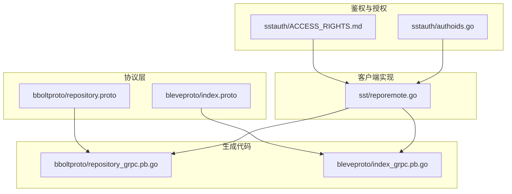
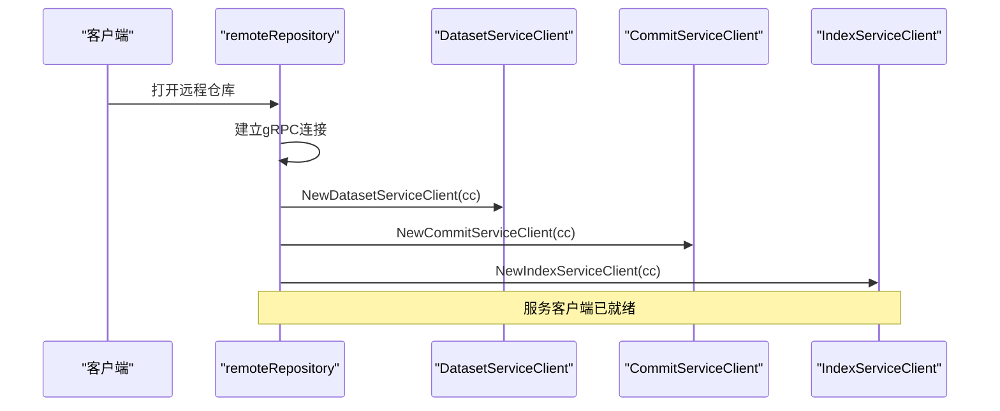
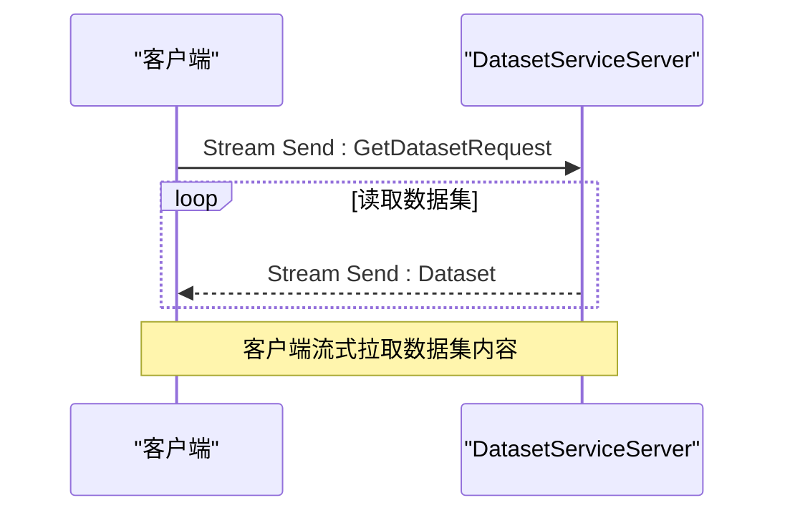
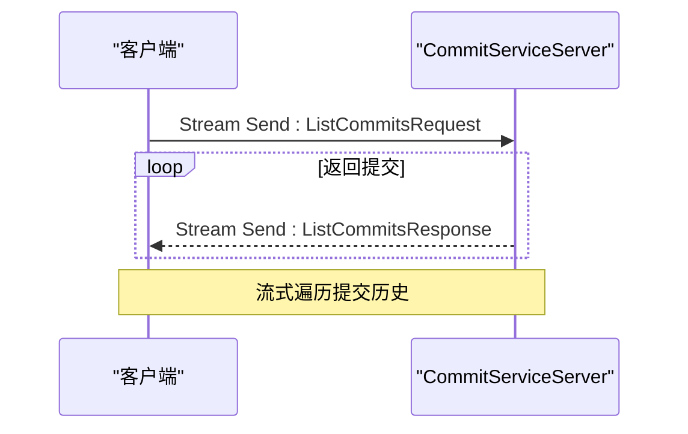
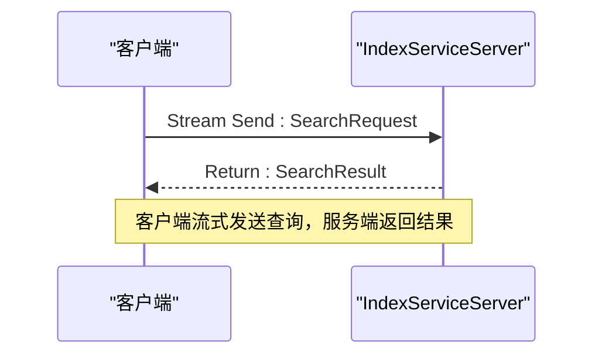
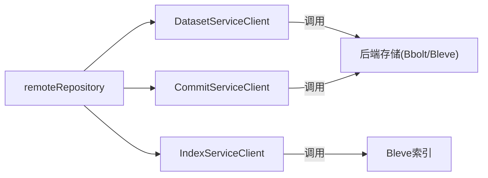

# gRPC服务设计

<cite>
**本文引用的文件**
- [repository.proto](file://bboltproto/repository.proto)
- [index.proto](file://bleveproto/index.proto)
- [repository_grpc.pb.go](file://bboltproto/repository_grpc.pb.go)
- [index_grpc.pb.go](file://bleveproto/index_grpc.pb.go)
- [reporemote.go](file://sst/reporemote.go)
- [ACCESS_RIGHTS.md](file://sstauth/ACCESS_RIGHTS.md)
- [authoids.go](file://sstauth/authoids.go)
</cite>

## 目录
1. [简介](#简介)
2. [项目结构](#项目结构)
3. [核心组件](#核心组件)
4. [架构总览](#架构总览)
5. [详细组件分析](#详细组件分析)
6. [依赖关系分析](#依赖关系分析)
7. [性能考虑](#性能考虑)
8. [故障排查指南](#故障排查指南)
9. [结论](#结论)
10. [附录](#附录)

## 简介
本文件面向SST的gRPC服务设计，聚焦三个核心服务：DatasetService、CommitService与IndexService。文档从协议定义（Protocol Buffers）、服务接口与方法签名、消息格式与流式协议、服务职责边界、服务间依赖与数据流向、服务注册机制、版本控制与向后兼容性策略等方面展开说明，并提供服务端实现模式与调用序列图，帮助读者快速理解并正确集成。

## 项目结构
SST将gRPC协议与服务生成代码按领域拆分：
- bboltproto：仓库与数据集相关的gRPC协议与生成代码（DatasetService、CommitService、RefService等）
- bleveproto：索引查询相关协议与生成代码（IndexService）
- sst：客户端侧通过gRPC访问远程仓库的实现（如remoteRepository）
- sstauth：鉴权与访问控制（基于Keycloak令牌与方法级权限）

图表来源
- [repository.proto:88-131](file://bboltproto/repository.proto#L88-L131)
- [index.proto:9-11](file://bleveproto/index.proto#L9-L11)
- [repository_grpc.pb.go:1163-1268](file://bboltproto/repository_grpc.pb.go#L1163-L1268)
- [index_grpc.pb.go:101-116](file://bleveproto/index_grpc.pb.go#L101-L116)
- [reporemote.go:264-284](file://sst/reporemote.go#L264-L284)

章节来源
- [repository.proto:88-131](file://bboltproto/repository.proto#L88-L131)
- [index.proto:9-11](file://bleveproto/index.proto#L9-L11)
- [repository_grpc.pb.go:1163-1268](file://bboltproto/repository_grpc.pb.go#L1163-L1268)
- [index_grpc.pb.go:101-116](file://bleveproto/index_grpc.pb.go#L101-L116)
- [reporemote.go:264-284](file://sst/reporemote.go#L264-L284)

## 核心组件
- DatasetService：负责数据集、分支、提交、日志、文档、同步等仓库级操作，包含大量流式RPC以支持大数据量传输与增量同步。
- CommitService：专注提交的创建、查询、比较与批量详情获取，提供流式遍历历史的能力。
- IndexService：对外暴露搜索能力，采用客户端流式请求，便于发送复杂查询对象。

各服务的职责边界清晰：
- DatasetService：数据面（数据集、命名图、文档、同步）
- CommitService：版本面（提交元数据、关系比较、历史遍历）
- IndexService：检索面（全文/结构化搜索）

章节来源
- [repository.proto:88-131](file://bboltproto/repository.proto#L88-L131)
- [repository.proto:448-458](file://bboltproto/repository.proto#L448-L458)
- [index.proto:9-11](file://bleveproto/index.proto#L9-L11)

## 架构总览
SST的远程仓库通过gRPC暴露能力，客户端在连接建立时初始化DatasetServiceClient、CommitServiceClient与IndexServiceClient，后续通过流式与非流式RPC完成读写与查询。

图表来源
- [reporemote.go:264-284](file://sst/reporemote.go#L264-L284)
- [repository_grpc.pb.go:485-487](file://bboltproto/repository_grpc.pb.go#L485-L487)
- [repository_grpc.pb.go:1427-1429](file://bboltproto/repository_grpc.pb.go#L1427-L1429)
- [index_grpc.pb.go:38-40](file://bleveproto/index_grpc.pb.go#L38-L40)

## 详细组件分析

### DatasetService
- 职责边界
  - 数据集管理：创建、列举、拉取（GetDataset/FetchDatasets）
  - 分支管理：设置、删除、列举、叶子提交
  - 仓库信息：仓库统计、日志、Bleve信息
  - 文档管理：上传、下载、列表、删除
  - 同步：双向流式SyncFrom/SyncTo，用于远端到本地或本地到远端的增量同步
- 关键方法与参数要点
  - GetBranches(GetBranchesRequest) -> GetBranchesResponse
  - SetBranch(SetBranchRequest) -> SetBranchResponse
  - RemoveBranch(RemoveBranchRequest) -> RemoveBranchResponse
  - ListDatasets(ListDatasetsRequest) -> ListDatasetsResponse
  - GetDataset(stream GetDatasetRequest) -> stream Dataset
  - FetchDatasets(stream DatasetInquiry) -> stream DatasetObject
  - PushDatasets(stream DatasetSuggestion) -> stream DatasetInquiry
  - CreateDataset(CreateDatasetRequest) -> Dataset
  - GetRepositoryInfo(GetRepositoryInfoRequest) -> GetRepositoryInfoResponse
  - GetRepositoryLog(GetRepositoryLogRequest) -> GetRepositoryLogResponse
  - DocumentSet(stream DocumentSetRequest) -> stream DocumentSetResponse
  - Document(DocumentRequest) -> stream DocumentResponse
  - Documents(DocumentsListRequest) -> DocumentsListResponse
  - DocumentDelete(DocumentDeleteRequest) -> DocumentDeleteResponse
  - DownloadNamedGraphRevision(DownloadNamedGraphRevisionRequest) -> stream DownloadNamedGraphRevisionResponse
  - FindCommonParentRevision(FindCommonParentRevisionRequest) -> FindCommonParentRevisionResponse
  - GetCommitForDatasetRevision(GetCommitForDatasetRevisionRequest) -> GetCommitForDatasetRevisionResponse
  - SyncFrom(stream SyncFromRequest) -> stream SyncFromResponse
  - SyncTo(SyncToRequest) -> stream SyncToResponse
- 流式协议说明
  - 客户端流：GetDataset、DocumentSet、PushDatasets、SyncFrom
  - 服务端流：Document、DownloadNamedGraphRevision、SyncTo
  - 双向流：FetchDatasets
- 权限要求（读/写）
  - 读：GetBranches、GetLeafCommits、GetBleveInfo、ListDatasets、GetDataset、FetchDatasets、GetRepositoryInfo、GetRepositoryLog、Document、Documents、DownloadNamedGraphRevision、FindCommonParentRevision、GetCommitForDatasetRevision、SyncTo
  - 写：CreateDataset、SetBranch、RemoveBranch、PushDatasets、DocumentSet、SyncFrom、DocumentDelete

图表来源
- [repository.proto:101-101](file://bboltproto/repository.proto#L101-L101)
- [repository_grpc.pb.go:970-974](file://bboltproto/repository_grpc.pb.go#L970-L974)

章节来源
- [repository.proto:88-131](file://bboltproto/repository.proto#L88-L131)
- [repository.proto:210-382](file://bboltproto/repository.proto#L210-L382)
- [repository.proto:613-742](file://bboltproto/repository.proto#L613-L742)
- [ACCESS_RIGHTS.md:260-289](file://sstauth/ACCESS_RIGHTS.md#L260-L289)

### CommitService
- 职责边界
  - 提交创建：CreateCommit（含标志位、父提交覆盖、签名校验等）
  - 提交查询：ListCommits（流式遍历）、GetCommit（流式获取）
  - 提交比较：CompareCommits（多数据集对的多组比较）
  - 批量详情：GetCommitDetailsBatch
- 关键方法与参数要点
  - ListCommits(stream ListCommitsRequest) -> stream ListCommitsResponse
  - GetCommit(stream GetCommitRequest) -> Commit
  - CreateCommit(CreateCommitRequest) -> CreateCommitResponse
  - CompareCommits(CompareCommitsRequest) -> CompareCommitsResponse
  - GetCommitDetailsBatch(GetCommitDetailsBatchRequest) -> GetCommitDetailsBatchResponse
- 权限要求
  - 读：ListCommits、GetCommit、CompareCommits、GetCommitDetailsBatch
  - 写：CreateCommit

图表来源
- [repository.proto:448-458](file://bboltproto/repository.proto#L448-L458)
- [repository_grpc.pb.go:1542-1547](file://bboltproto/repository_grpc.pb.go#L1542-L1547)

章节来源
- [repository.proto:448-458](file://bboltproto/repository.proto#L448-L458)
- [repository.proto:460-610](file://bboltproto/repository.proto#L460-L610)
- [ACCESS_RIGHTS.md:298-306](file://sstauth/ACCESS_RIGHTS.md#L298-L306)

### IndexService
- 职责边界
  - 搜索：Search（客户端流式发送查询对象），返回搜索结果
- 关键方法与参数要点
  - Search(stream SearchRequest) -> SearchResult
- 权限要求
  - 读：Search

图表来源
- [index.proto:9-11](file://bleveproto/index.proto#L9-L11)
- [index_grpc.pb.go:101-116](file://bleveproto/index_grpc.pb.go#L101-L116)

章节来源
- [index.proto:9-11](file://bleveproto/index.proto#L9-L11)
- [index_grpc.pb.go:27-50](file://bleveproto/index_grpc.pb.go#L27-L50)
- [ACCESS_RIGHTS.md:308-312](file://sstauth/ACCESS_RIGHTS.md#L308-L312)

## 依赖关系分析
- 客户端依赖
  - remoteRepository在连接建立时同时实例化DatasetServiceClient、CommitServiceClient与IndexServiceClient，形成统一的远程仓库访问入口。
- 服务间耦合
  - DatasetService与CommitService共享提交与数据集引用模型（如RefName、Commit、DatasetRevision等），但职责分离明确。
  - IndexService独立于仓库数据面，仅接收序列化后的查询对象，解耦了搜索实现细节。
- 外部依赖
  - 鉴权：通过Keycloak令牌进行认证，结合方法级访问控制（ReadOnly/ReadWrite）。
  - 存储：底层使用Bbolt/Bleve等存储，但这些细节对上层gRPC透明。

图表来源
- [reporemote.go:264-284](file://sst/reporemote.go#L264-L284)
- [repository_grpc.pb.go:485-487](file://bboltproto/repository_grpc.pb.go#L485-L487)
- [repository_grpc.pb.go:1427-1429](file://bboltproto/repository_grpc.pb.go#L1427-L1429)
- [index_grpc.pb.go:38-40](file://bleveproto/index_grpc.pb.go#L38-L40)

章节来源
- [reporemote.go:264-284](file://sst/reporemote.go#L264-L284)

## 性能考虑
- 流式RPC优先
  - 大数据集拉取与同步使用流式接口（GetDataset、FetchDatasets、SyncFrom/SyncTo），避免一次性加载导致内存峰值过高。
- 分页与掩码
  - 列表接口支持page_size/page_token与FieldMask，减少不必要字段传输。
- 批处理
  - 提交详情批量获取（GetCommitDetailsBatch）降低往返次数。
- 连接复用
  - 通过单一gRPC连接复用多个服务客户端，减少握手开销。
- 缓存
  - 客户端可引入请求缓存（如remote request cache）以减少重复查询。

[本节为通用指导，不直接分析具体文件]

## 故障排查指南
- 认证失败
  - 检查Authorization头是否包含Bearer token，且token非空。
  - 确认客户端ID与目标仓库匹配，权限范围满足方法所需模式。
- 权限不足
  - 对照方法所需的ReadOnly/ReadWrite模式，确保令牌角色足够。
- 流式错误
  - 检查客户端是否正确关闭发送端（CloseSend），服务端是否正确结束流。
- 版本兼容
  - 若新增字段，保持向后兼容；客户端忽略未知字段，服务端需兼容旧版请求。

章节来源
- [authoids.go:294-325](file://sstauth/authoids.go#L294-L325)
- [ACCESS_RIGHTS.md:260-312](file://sstauth/ACCESS_RIGHTS.md#L260-L312)

## 结论
SST的gRPC服务设计以清晰的职责划分与丰富的流式接口为核心，DatasetService承担数据面与同步，CommitService专注版本面，IndexService提供独立检索能力。通过Protocol Buffers定义与生成代码，配合客户端统一封装与鉴权控制，实现了可扩展、高性能且易维护的远程仓库访问方案。建议在实际部署中遵循流式优先、分页与掩码、批处理与连接复用的最佳实践，并确保向后兼容与严格的访问控制。

[本节为总结性内容，不直接分析具体文件]

## 附录

### 服务注册机制
- 服务端通过Register*Service函数将服务描述注册到gRPC服务器，例如：
  - RegisterDatasetServiceServer
  - RegisterCommitServiceServer
  - RegisterIndexServiceServer
- 这些注册函数会绑定方法处理器与流处理器，使gRPC框架能够路由请求到具体实现。

章节来源
- [repository_grpc.pb.go:850-859](file://bboltproto/repository_grpc.pb.go#L850-L859)
- [repository_grpc.pb.go:1531-1540](file://bboltproto/repository_grpc.pb.go#L1531-L1540)
- [index_grpc.pb.go:83-92](file://bleveproto/index_grpc.pb.go#L83-L92)

### 版本控制与向后兼容性策略
- 使用protobuf的可选字段与oneof，保证新增字段不影响旧客户端解析。
- 在服务描述中保留未实现方法的默认行为（Unimplemented*Server），便于逐步演进。
- 客户端应忽略未知字段，服务端应能处理缺失字段的请求。

章节来源
- [repository_grpc.pb.go:164-199](file://bboltproto/repository_grpc.pb.go#L164-L199)
- [repository_grpc.pb.go:843-859](file://bboltproto/repository_grpc.pb.go#L843-L859)
- [index_grpc.pb.go:63-74](file://bleveproto/index_grpc.pb.go#L63-L74)

### Protocol Buffers定义示例路径
- DatasetService、CommitService、RefService等定义位于：
  - [repository.proto:88-131](file://bboltproto/repository.proto#L88-L131)
  - [repository.proto:448-458](file://bboltproto/repository.proto#L448-L458)
- IndexService定义位于：
  - [index.proto:9-11](file://bleveproto/index.proto#L9-L11)

### 服务端实现模式
- 嵌入Unimplemented*Server以获得向前兼容的默认行为。
- 实现对应接口方法，处理流式请求与响应。
- 在应用启动时注册服务到gRPC服务器。

章节来源
- [repository_grpc.pb.go:843-859](file://bboltproto/repository_grpc.pb.go#L843-L859)
- [repository_grpc.pb.go:1531-1540](file://bboltproto/repository_grpc.pb.go#L1531-L1540)
- [index_grpc.pb.go:63-92](file://bleveproto/index_grpc.pb.go#L63-L92)