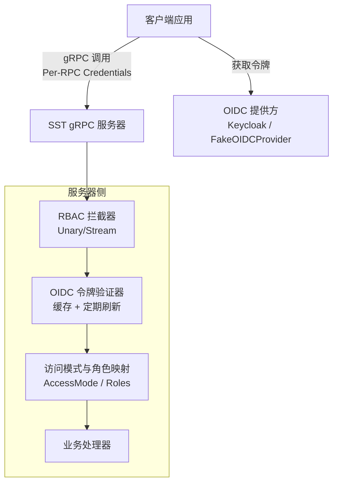
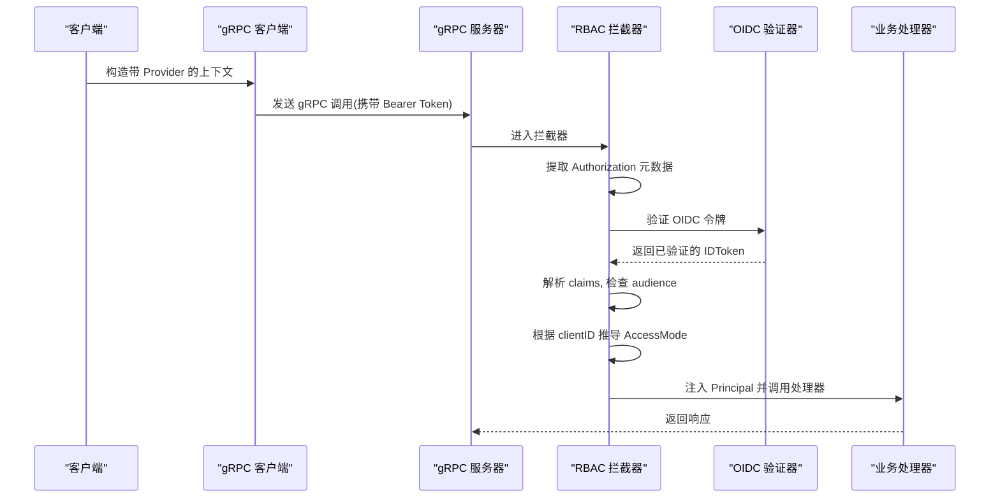
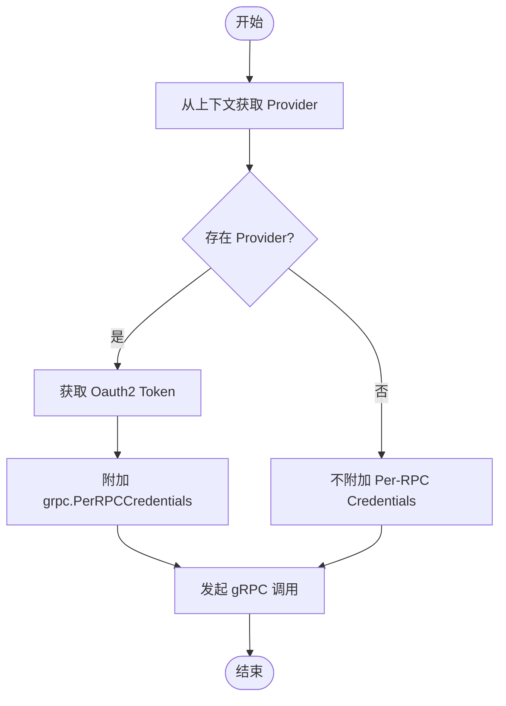
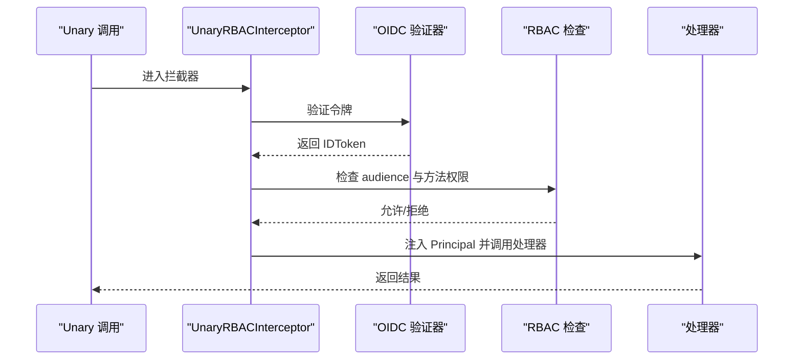
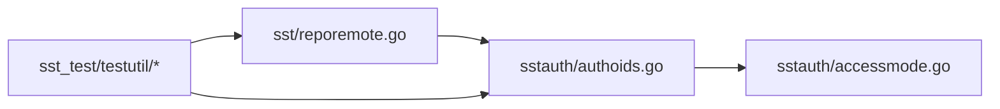

# 认证授权机制

<cite>
**本文引用的文件**
- [auth.go](file://sstauth/auth.go)
- [accessmode.go](file://sstauth/accessmode.go)
- [authoids.go](file://sstauth/authoids.go)
- [ACCESS_RIGHTS.md](file://sstauth/ACCESS_RIGHTS.md)
- [reporemote.go](file://sst/reporemote.go)
- [oidc_provider.go](file://sst_test/testutil/oidc_provider.go)
- [testauth.go](file://sst_test/testutil/testauth.go)
- [per_repo_auth_test.go](file://sst_test/per_repo_auth_test.go)
</cite>

## 目录
1. [简介](#简介)
2. [项目结构](#项目结构)
3. [核心组件](#核心组件)
4. [架构总览](#架构总览)
5. [详细组件分析](#详细组件分析)
6. [依赖关系分析](#依赖关系分析)
7. [性能考虑](#性能考虑)
8. [故障排除指南](#故障排除指南)
9. [结论](#结论)
10. [附录](#附录)

## 简介
本文件系统性说明 SST 在 gRPC 层面的 OAuth2/OIDC 认证与授权实现，覆盖令牌传递、权限验证与会话管理；详解 Per-RPC Credentials 的使用方式与最佳实践；阐述访问控制模型（数据集级、命名图级、操作级）；提供认证配置示例、错误处理策略与安全最佳实践，并给出常见认证场景与故障排除指引。

## 项目结构
SST 的认证与授权能力集中在 sstauth 包中，并通过 gRPC 拦截器在服务器端执行 OIDC 令牌校验与 RBAC 鉴权；客户端通过 Per-RPC Credentials 将 OAuth2 Bearer Token 注入到每个 gRPC 调用中。测试工具提供了可运行的 Fake OIDC Provider 与证书生成能力，便于端到端验证。



图表来源
- [authoids.go:71-92](file://sstauth/authoids.go#L71-L92)
- [authoids.go:375-423](file://sstauth/authoids.go#L375-L423)
- [authoids.go:445-510](file://sstauth/authoids.go#L445-L510)
- [oidc_provider.go:167-235](file://sst_test/testutil/oidc_provider.go#L167-L235)

章节来源
- [auth.go:9-53](file://sstauth/auth.go#L9-L53)
- [accessmode.go:7-129](file://sstauth/accessmode.go#L7-L129)
- [authoids.go:25-561](file://sstauth/authoids.go#L25-L561)
- [ACCESS_RIGHTS.md:1-360](file://sstauth/ACCESS_RIGHTS.md#L1-L360)

## 核心组件
- 认证提供者接口与上下文传播：定义 AuthProvider 接口，支持从上下文中提取用户信息并注入到请求链路。
- OIDC 令牌验证与缓存：基于 go-oidc 的 IDToken 验证，使用可过期缓存减少外部调用开销，并周期性更新验证器。
- gRPC 拦截器：UnaryRBACInterceptor 与 StreamRBACInterceptor 分别处理单方法与流式调用的认证与鉴权。
- 访问控制模型：AccessMode 有序枚举，结合 Keycloak resource_access.<clientID>.roles 推导有效权限，并与方法所需权限比较。
- 客户端 Per-RPC Credentials：通过 oauth.NewOauthAccess 将 Bearer Token 附加到每个 gRPC 调用元数据中。

章节来源
- [auth.go:9-53](file://sstauth/auth.go#L9-L53)
- [authoids.go:71-92](file://sstauth/authoids.go#L71-L92)
- [authoids.go:206-288](file://sstauth/authoids.go#L206-L288)
- [authoids.go:375-510](file://sstauth/authoids.go#L375-L510)
- [accessmode.go:7-129](file://sstauth/accessmode.go#L7-L129)
- [reporemote.go:429-481](file://sst/reporemote.go#L429-L481)

## 架构总览
SST 采用“服务端拦截器 + OIDC 验证 + RBAC 鉴权”的分层架构：
- 客户端：通过 ContextWithAuthProvider 注入 Provider，并在每次 RPC 调用时以 Per-RPC Credentials 携带 Bearer Token。
- 服务端：拦截器从 gRPC 元数据中提取 Authorization 头，验证 OIDC 令牌，解析 claims，检查 audience 与 roles，并将 Principal 注入上下文供后续处理器使用。
- 流式调用：由于目标仓库名在首条消息中到达，拦截器仅做初步校验，处理器读取首条消息后调用 CheckRepoAccess 完成精确的 per-repo 鉴权。



图表来源
- [authoids.go:71-92](file://sstauth/authoids.go#L71-L92)
- [authoids.go:375-423](file://sstauth/authoids.go#L375-L423)
- [authoids.go:445-510](file://sstauth/authoids.go#L445-L510)

## 详细组件分析

### 令牌传递与会话管理
- 客户端侧：
  - 通过 ContextWithAuthProvider 将包含 access token 的 Provider 放入上下文。
  - 远程仓库客户端在发起 gRPC 调用时，若检测到 Provider，则使用 grpc.PerRPCCredentials(oauth.NewOauthAccess(token)) 将 Bearer Token 附加到每个调用。
- 服务端侧：
  - 拦截器从 incoming context 的 metadata 中读取 authorization 字段，期望格式为 “Bearer <token>”。
  - 使用 OIDC 验证器校验签名与有效期，解析 claims，并将 Principal（含 email、name、claims、audience）注入上下文。
  - 对流式调用，处理器在读取首条消息后调用 CheckRepoAccess 完成 per-repo 的 audience 与 roles 校验。



图表来源
- [reporemote.go:429-481](file://sst/reporemote.go#L429-L481)
- [authoids.go:290-312](file://sstauth/authoids.go#L290-L312)

章节来源
- [reporemote.go:429-481](file://sst/reporemote.go#L429-L481)
- [authoids.go:290-312](file://sstauth/authoids.go#L290-L312)

### 权限验证与访问控制模型
- 访问模式：AccessMode 为有序整数，None < ReadOnly < ReadWrite < Admin < SuperAdmin，便于直接比较。
- 角色来源：Keycloak 的 resource_access.<clientID>.roles，通过 AccessModeFromRoles 推导最高权限。
- 方法级 RBAC：为每个 gRPC 全限定方法指定最低所需 AccessMode，拦截器在执行前进行比对。
- 两种授权模型：
  - 单仓库服务器（PerRepoAuth = false）：要求 token 的 aud 等于服务器配置的 ClientID。
  - 超级仓库服务器（PerRepoAuth = true）：管理方法使用 superClientID；其他方法使用 per-repo clientID（superClientID#repoName）。

```mermaid
classDiagram
class AccessMode {
+int value
+String() string
+MarshalText() []byte
+UnmarshalText([]byte) error
}
class KCClaims {
+string Email
+string Name
+map~string,struct{Roles []string}~ ResourceAccess
}
class Principal {
+string Email
+string Name
+KCClaims Claims
+[]string Audience
}
AccessMode <.. KCClaims : "推导最高权限"
Principal --> KCClaims : "持有"
```

图表来源
- [accessmode.go:7-129](file://sstauth/accessmode.go#L7-L129)
- [authoids.go:235-253](file://sstauth/authoids.go#L235-L253)
- [authoids.go:425-443](file://sstauth/authoids.go#L425-L443)

章节来源
- [accessmode.go:7-129](file://sstauth/accessmode.go#L7-L129)
- [authoids.go:235-253](file://sstauth/authoids.go#L235-L253)
- [authoids.go:327-373](file://sstauth/authoids.go#L327-L373)
- [ACCESS_RIGHTS.md:130-171](file://sstauth/ACCESS_RIGHTS.md#L130-L171)

### gRPC 拦截器实现
- UnaryRBACInterceptor：
  - 从 incoming context 提取 token，验证 OIDC，解析 claims。
  - 根据 fullMethod 与 perRepoAuth 决定 expectedClientID（superClientID 或 per-repo clientID）。
  - 校验 audience 与 method 所需 AccessMode，通过后注入 Principal 并调用处理器。
- StreamRBACInterceptor：
  - 先验证 token 与基本 audience（super 或任意 per-repo），再在处理器中读取首条消息后调用 CheckRepoAccess 完成精确 per-repo 校验。



图表来源
- [authoids.go:375-423](file://sstauth/authoids.go#L375-L423)
- [authoids.go:445-510](file://sstauth/authoids.go#L445-L510)

章节来源
- [authoids.go:375-423](file://sstauth/authoids.go#L375-L423)
- [authoids.go:445-510](file://sstauth/authoids.go#L445-L510)

### 会话管理与上下文传播
- 认证信息通过上下文传播：ContextWithSstUserInfo 与 SstUserInfoFromContext 用于存储和提取用户信息。
- 更完整的主体信息通过 WithPrincipal 与 PrincipalFromContext 在拦截器中注入，供后续逻辑使用。
- HTTP 中间件 ProviderFromHeader 可从 HTTP 请求头提取 Bearer Token 并注入上下文，便于混合协议场景。

章节来源
- [auth.go:19-53](file://sstauth/auth.go#L19-L53)
- [authoids.go:118-140](file://sstauth/authoids.go#L118-L140)
- [authoids.go:436-443](file://sstauth/authoids.go#L436-L443)

### 客户端 Per-RPC Credentials 使用与最佳实践
- 使用方式：
  - 在上下文中设置 Provider（ContextWithAuthProvider），远程仓库客户端会自动在每个 gRPC 调用中附加 Bearer Token。
  - 测试工具提供 TestDialPerRPCOauthCreds 与 TestCallPerRPCOauthCreds，便于在测试中注入固定 token。
- 最佳实践：
  - 确保 token 的 aud 与服务器期望一致（单仓库或 per-repo）。
  - 避免在长连接中复用过期 token；必要时实现 refresh 逻辑。
  - 在流式调用中，处理器需尽早读取首条消息并调用 CheckRepoAccess 完成精确鉴权。

章节来源
- [reporemote.go:429-481](file://sst/reporemote.go#L429-L481)
- [testauth.go:129-144](file://sst_test/testutil/testauth.go#L129-L144)
- [ACCESS_RIGHTS.md:52-101](file://sstauth/ACCESS_RIGHTS.md#L52-L101)

### 认证配置示例
- 单仓库服务器（PerRepoAuth = false）：
  - Issuer 指向 Keycloak realm。
  - ClientID 必须与 token 的 aud 一致。
  - 方法权限从 resource_access.<ClientID>.roles 推导。
- 超级仓库服务器（PerRepoAuth = true）：
  - 管理方法使用 superClientID。
  - 其他方法使用 per-repo clientID（superClientID#repoName）。
  - 方法权限从对应 clientID 的 roles 推导。

章节来源
- [ACCESS_RIGHTS.md:173-238](file://sstauth/ACCESS_RIGHTS.md#L173-L238)
- [ACCESS_RIGHTS.md:314-335](file://sstauth/ACCESS_RIGHTS.md#L314-L335)

### 错误处理策略
- Unauthenticated：
  - 缺少 metadata、authorization 头为空或格式不正确。
  - OIDC 令牌验证失败或 claims 解析失败。
- PermissionDenied：
  - audience 不匹配（无效受众）。
  - 角色不足（方法所需权限高于当前 AccessMode）。
- 流式调用：
  - 拦截器只做初步校验，处理器需在读取首条消息后调用 CheckRepoAccess 完成精确鉴权，否则可能绕过 per-repo 限制。

章节来源
- [authoids.go:290-312](file://sstauth/authoids.go#L290-L312)
- [authoids.go:375-423](file://sstauth/authoids.go#L375-L423)
- [authoids.go:445-510](file://sstauth/authoids.go#L445-L510)

### 安全最佳实践
- 强制 TLS 传输，防止令牌泄露。
- 严格配置 OIDC issuer 与 clientID，启用 audience 校验。
- 最小权限原则：为每个 clientID 分配最小必要角色。
- 定期轮换密钥与刷新验证器，避免使用过期公钥。
- 对敏感操作（如删除仓库、配额修改）要求更高权限（SuperAdmin/Admin）。

[本节为通用安全建议，不直接分析具体文件]

## 依赖关系分析
- 客户端依赖：
  - sst/reporemote.go 在检测到 Provider 时附加 Per-RPC Credentials。
- 服务端依赖：
  - sstauth/authoids.go 提供拦截器、验证器、RBAC 逻辑。
  - sstauth/accessmode.go 提供访问模式与角色推导。
- 测试依赖：
  - sst_test/testutil/oidc_provider.go 提供 Fake OIDC Provider 与证书生成。
  - sst_test/testutil/testauth.go 提供测试用 Per-RPC 凭证与服务器启动辅助。



图表来源
- [reporemote.go:429-481](file://sst/reporemote.go#L429-L481)
- [authoids.go:25-561](file://sstauth/authoids.go#L25-L561)
- [accessmode.go:7-129](file://sstauth/accessmode.go#L7-L129)
- [oidc_provider.go:167-235](file://sst_test/testutil/oidc_provider.go#L167-L235)
- [testauth.go:129-144](file://sst_test/testutil/testauth.go#L129-L144)

章节来源
- [reporemote.go:429-481](file://sst/reporemote.go#L429-L481)
- [authoids.go:25-561](file://sstauth/authoids.go#L25-L561)
- [accessmode.go:7-129](file://sstauth/accessmode.go#L7-L129)
- [oidc_provider.go:167-235](file://sst_test/testutil/oidc_provider.go#L167-L235)
- [testauth.go:129-144](file://sst_test/testutil/testauth.go#L129-L144)

## 性能考虑
- 令牌验证缓存：使用 expirable-cache 缓存已验证的 IDToken，减少 OIDC 网络开销；缓存过期时间略小于令牌有效期，避免边界问题。
- 验证器周期更新：定时刷新 OIDC provider 与公钥，降低因密钥轮换导致的验证失败。
- 流式调用优化：拦截器只做必要校验，将精确 per-repo 校验推迟到处理器，减少握手阶段的复杂度。

章节来源
- [authoids.go:25-33](file://sstauth/authoids.go#L25-L33)
- [authoids.go:167-198](file://sstauth/authoids.go#L167-L198)
- [authoids.go:445-510](file://sstauth/authoids.go#L445-L510)

## 故障排除指南
- 常见问题与定位：
  - 未携带 Authorization 头：检查客户端是否设置了 Provider 并附加了 Per-RPC Credentials。
  - audience 不匹配：确认 token 的 aud 与服务器期望一致（单仓库或 per-repo）。
  - 角色不足：检查 Keycloak 中 resource_access.<clientID>.roles 是否正确配置。
  - 流式调用越权：确保处理器在读取首条消息后调用 CheckRepoAccess。
- 测试与复现：
  - 使用 FakeOIDCProvider 签发带不同 audience 与角色的 token，验证拦截器行为。
  - 使用 per_repo_auth_test.go 中的用例验证 per-repo 隔离与向后兼容。

章节来源
- [authoids.go:290-312](file://sstauth/authoids.go#L290-L312)
- [authoids.go:375-423](file://sstauth/authoids.go#L375-L423)
- [per_repo_auth_test.go:23-190](file://sst_test/per_repo_auth_test.go#L23-L190)
- [oidc_provider.go:78-129](file://sst_test/testutil/oidc_provider.go#L78-L129)

## 结论
SST 在 gRPC 层面实现了基于 OAuth2/OIDC 的认证与基于 Keycloak 角色的细粒度授权。通过 Per-RPC Credentials 将令牌透明地传递到服务端，由拦截器完成令牌验证与 RBAC 鉴权，支持单仓库与 per-repo 两种授权模型。配合缓存与周期更新的验证器，系统在安全性与性能之间取得平衡。建议在部署中严格配置 issuer、clientID 与 roles，并结合流式调用的处理器级校验，确保访问控制的完整性。

[本节为总结性内容，不直接分析具体文件]

## 附录

### 常见认证场景
- 单仓库只读访问：
  - 客户端获取 ReadOnly 角色 token，aud 为服务器 ClientID。
  - 拦截器校验通过，处理器允许读取数据集、提交日志等。
- 超级仓库管理：
  - 客户端获取 SuperAdmin 角色 token，aud 为 superClientID。
  - 管理方法（创建/删除仓库、配额设置）需要 SuperAdmin。
- per-repo 读写隔离：
  - 客户端获取 per-repo 的 ReadWrite token，aud 为 superClientID#repoName。
  - 仅能访问对应仓库，跨仓库访问将被拒绝。

章节来源
- [ACCESS_RIGHTS.md:240-313](file://sstauth/ACCESS_RIGHTS.md#L240-L313)
- [per_repo_auth_test.go:23-190](file://sst_test/per_repo_auth_test.go#L23-L190)

### 数据集级、命名图级、操作级权限控制
- 数据集级：通过 DatasetService 的方法（如 ListDatasets、CreateDataset）控制对数据集集合的访问。
- 命名图级：通过 NamedGraph 相关操作（如 CreateNamedGraph、写入三元组）控制对特定命名图的访问。
- 操作级：通过 gRPC 方法级别的 RBAC（ReadOnly/ReadWrite/Admin/SuperAdmin）控制具体操作的权限。

章节来源
- [ACCESS_RIGHTS.md:240-313](file://sstauth/ACCESS_RIGHTS.md#L240-L313)