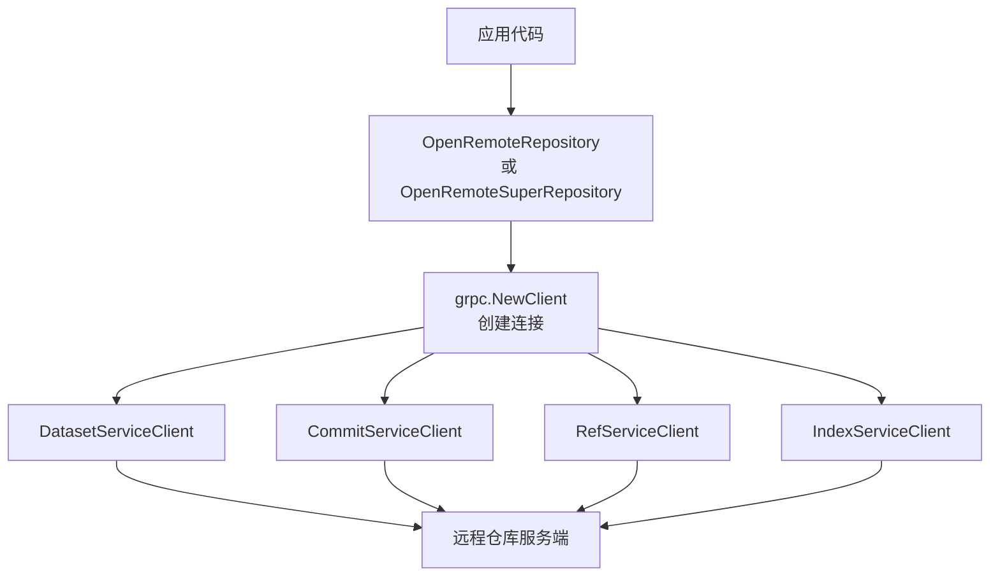
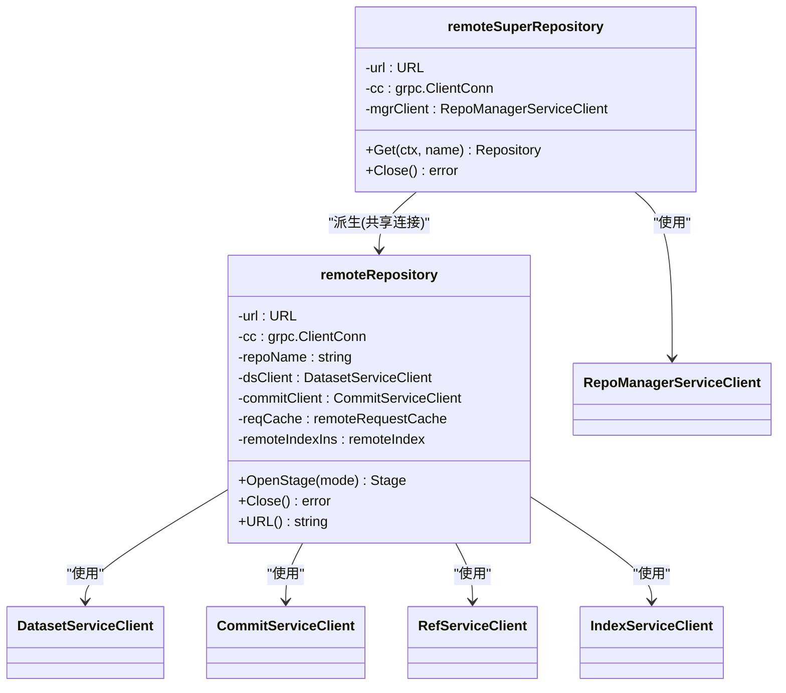
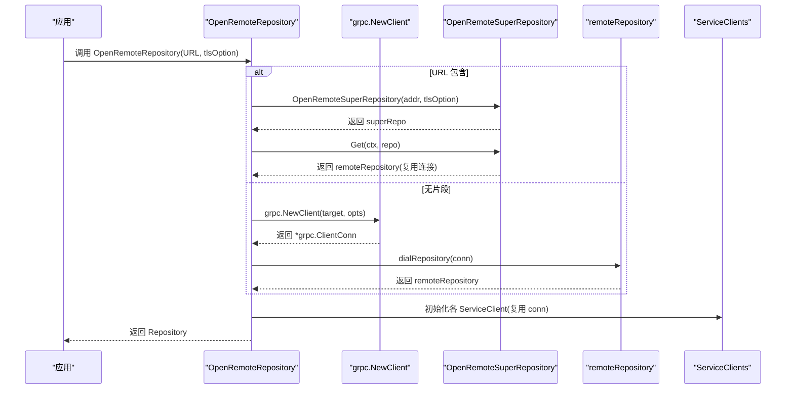
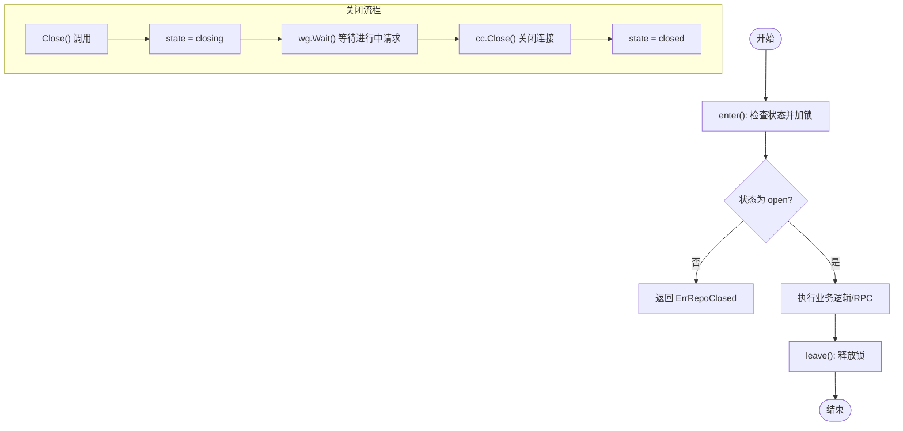
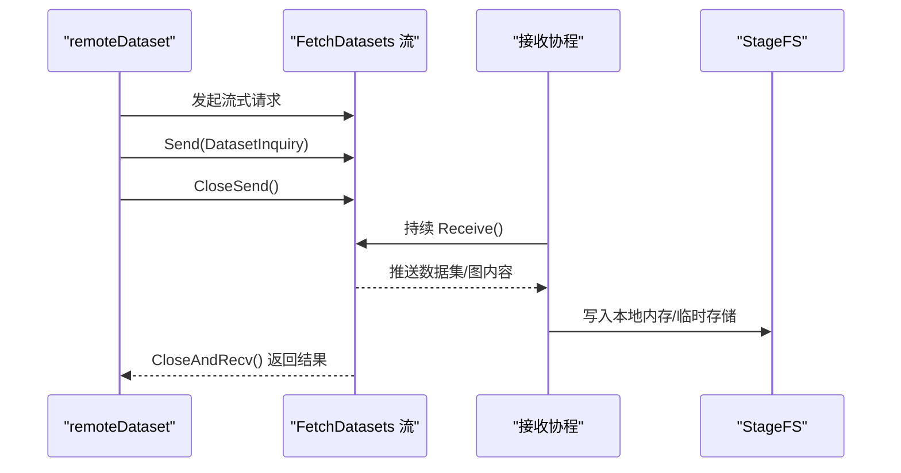
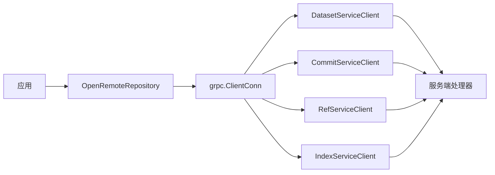

# 连接管理

<cite>
**本文引用的文件**
- [reporemote.go](file://sst/reporemote.go)
- [superremoterepository.go](file://sst/superremoterepository.go)
- [repository.go](file://sst/repository.go)
- [repository_grpc.pb.go](file://bboltproto/repository_grpc.pb.go)
- [index_grpc.pb.go](file://bleveproto/index_grpc.pb.go)
- [ACCESS_RIGHTS.md](file://sstauth/ACCESS_RIGHTS.md)
- [main.go](file://examples/helloworldreporemote/main.go)
</cite>

## 目录
1. [简介](#简介)
2. [项目结构](#项目结构)
3. [核心组件](#核心组件)
4. [架构总览](#架构总览)
5. [详细组件分析](#详细组件分析)
6. [依赖关系分析](#依赖关系分析)
7. [性能考量](#性能考量)
8. [故障排查指南](#故障排查指南)
9. [结论](#结论)
10. [附录](#附录)

## 简介
本文件聚焦于 SST gRPC 连接管理的实现与使用，覆盖客户端连接复用、生命周期管理（建立、维护、监控、关闭）、配置选项（超时、重试、并发限制）以及性能优化建议。同时提供连接状态监控与错误恢复策略的完整示例指引。

## 项目结构
SST 通过 gRPC 与远程仓库通信，关键路径如下：
- 客户端入口：OpenRemoteRepository / OpenRemoteSuperRepository
- 连接创建：grpc.NewClient
- 服务客户端：DatasetServiceClient、CommitServiceClient、RefServiceClient、IndexServiceClient
- 认证与鉴权：上下文中的 OAuth2 Token 注入到每个 RPC 调用
- 连接生命周期：remoteRepository/stateControl 控制打开、关闭与并发安全

图表来源
- [repository.go:257-309](file://sst/repository.go#L257-L309)
- [superremoterepository.go:26-47](file://sst/superremoterepository.go#L26-L47)
- [reporemote.go:264-285](file://sst/reporemote.go#L264-L285)
- [repository_grpc.pb.go:456-739](file://bboltproto/repository_grpc.pb.go#L456-L739)
- [index_grpc.pb.go:1275-1300](file://bleveproto/index_grpc.pb.go#L1275-L1300)

章节来源
- [repository.go:257-309](file://sst/repository.go#L257-L309)
- [superremoterepository.go:26-47](file://sst/superremoterepository.go#L26-L47)
- [reporemote.go:264-285](file://sst/reporemote.go#L264-L285)

## 核心组件
- remoteRepository：封装单个仓库的 gRPC 连接与客户端，负责进入/离开锁、阶段管理与资源释放
- stateControl：原子状态 + WaitGroup 保证并发安全与优雅关闭
- remoteSuperRepository：超级仓库管理客户端，可派生具体仓库实例并共享底层连接
- 各 Service Client：DatasetServiceClient、CommitServiceClient、RefServiceClient、IndexServiceClient
- 认证中间层：perRPCCallOpts 从上下文提取 OAuth2 Token 并附加到每次 RPC

章节来源
- [reporemote.go:83-99](file://sst/reporemote.go#L83-L99)
- [reporemote.go:109-124](file://sst/reporemote.go#L109-L124)
- [superremoterepository.go:20-47](file://sst/superremoterepository.go#L20-L47)
- [superremoterepository.go:49-59](file://sst/superremoterepository.go#L49-L59)

## 架构总览
SST 客户端以“单连接多客户端”的方式组织：
- 一个 grpc.ClientConn 被多个 ServiceClient 复用
- 超级仓库与具体仓库共享同一连接，减少握手开销
- 所有 RPC 调用通过 perRPCCallOpts 注入认证信息
- 连接的生命周期由 remoteRepository.Close 统一管控

图表来源
- [reporemote.go:88-99](file://sst/reporemote.go#L88-L99)
- [superremoterepository.go:20-24](file://sst/superremoterepository.go#L20-L24)
- [repository_grpc.pb.go:456-739](file://bboltproto/repository_grpc.pb.go#L456-L739)
- [index_grpc.pb.go:1275-1300](file://bleveproto/index_grpc.pb.go#L1275-L1300)

## 详细组件分析

### 连接建立与复用
- 连接创建：OpenRemoteRepository 根据 URL 片段判断是否走 SuperRepository 分支；否则直接 dialRepository 创建 grpc.ClientConn
- 连接复用：dialRepository 将单一连接分配给 DatasetServiceClient、CommitServiceClient、IndexServiceClient；SuperRepository.Get 复用已有连接构造具体仓库实例
- 认证注入：perRPCCallOpts 从上下文获取 OAuth2 Token，附加为 PerRPCCredentials

图表来源
- [repository.go:257-309](file://sst/repository.go#L257-L309)
- [superremoterepository.go:26-47](file://sst/superremoterepository.go#L26-L47)
- [reporemote.go:264-285](file://sst/reporemote.go#L264-L285)

章节来源
- [repository.go:257-309](file://sst/repository.go#L257-L309)
- [reporemote.go:264-285](file://sst/reporemote.go#L264-L285)
- [superremoterepository.go:26-47](file://sst/superremoterepository.go#L26-L47)

### 连接生命周期管理
- 建立：OpenRemoteRepository/OpenRemoteSuperRepository -> grpc.NewClient -> 初始化各客户端
- 维护：所有方法通过 enter()/leave() 进行并发保护；流式操作在 goroutine 中接收响应
- 监控：GlobalLogger 记录关键步骤与错误；context 支持取消与超时
- 关闭：Close() 设置状态为 closing，等待所有 in-flight 请求完成，再关闭连接

图表来源
- [reporemote.go:109-124](file://sst/reporemote.go#L109-L124)
- [reporemote.go:655-670](file://sst/reporemote.go#L655-L670)

章节来源
- [reporemote.go:109-124](file://sst/reporemote.go#L109-L124)
- [reporemote.go:655-670](file://sst/reporemote.go#L655-L670)

### 负载均衡与故障转移
- 负载均衡：当前实现未内置客户端侧负载均衡；连接基于目标地址直连
- 故障转移：未实现自动重连或多目标切换；建议在应用层对目标地址做轮询或健康检查，并在失败时切换到备用地址
- 高可用建议：结合外部负载均衡器（如反向代理或服务网格）或使用多连接池包装上层调用

[本节为概念性说明，不直接分析具体文件]

### 连接配置选项
- TLS：OpenRemoteRepository/OpenRemoteSuperRepository 接受 grpc.DialOption 用于 TLS 配置
- 超时：通过 context.WithTimeout 控制单次 RPC 超时；也可在 DialOption 中配置连接级超时
- 重试：当前未内置重试策略；可在应用层封装重试逻辑
- 并发限制：通过 enter()/leave() 与 WaitGroup 控制并发访问；可按需在上层限制并发度

章节来源
- [repository.go:257-309](file://sst/repository.go#L257-L309)
- [superremoterepository.go:26-47](file://sst/superremoterepository.go#L26-L47)
- [reporemote.go:109-124](file://sst/reporemote.go#L109-L124)

### 认证与鉴权
- 认证：OAuth2 Token 通过 ContextWithAuthProvider 注入，perRPCCallOpts 在每个 RPC 调用前附加
- 鉴权：服务端拦截器校验 Token 的 aud 与角色，区分 SuperRepository 与按仓库权限

章节来源
- [ACCESS_RIGHTS.md:52-128](file://sstauth/ACCESS_RIGHTS.md#L52-L128)
- [superremoterepository.go:49-59](file://sst/superremoterepository.go#L49-L59)

### 流式操作与数据同步
- FetchDatasets/GetDataset/SyncFrom/SyncTo 等流式接口用于大数据量传输
- 客户端发送请求后，goroutine 接收响应，避免阻塞
- 错误处理：流式错误在 CloseAndRecv 或 SendMsg 时捕获

图表来源
- [reporemote.go:960-1040](file://sst/reporemote.go#L960-L1040)
- [reporemote.go:1058-1122](file://sst/reporemote.go#L1058-L1122)
- [reporemote.go:2034-2093](file://sst/reporemote.go#L2034-L2093)

章节来源
- [reporemote.go:960-1040](file://sst/reporemote.go#L960-L1040)
- [reporemote.go:1058-1122](file://sst/reporemote.go#L1058-L1122)
- [reporemote.go:2034-2093](file://sst/reporemote.go#L2034-L2093)

## 依赖关系分析
- 客户端与服务端通过 protobuf 定义的 gRPC 接口交互
- 连接复用：多个 ServiceClient 共享同一 grpc.ClientConn
- 认证链路：Context -> perRPCCallOpts -> PerRPCCredentials -> 服务端拦截器

图表来源
- [repository_grpc.pb.go:456-739](file://bboltproto/repository_grpc.pb.go#L456-L739)
- [index_grpc.pb.go:1275-1300](file://bleveproto/index_grpc.pb.go#L1275-L1300)

章节来源
- [repository_grpc.pb.go:456-739](file://bboltproto/repository_grpc.pb.go#L456-L739)
- [index_grpc.pb.go:1275-1300](file://bleveproto/index_grpc.pb.go#L1275-L1300)

## 性能考量
- 连接数调优
  - 复用连接：优先复用单一 grpc.ClientConn，避免频繁握手
  - 多仓库场景：通过 SuperRepository 派生多个仓库实例，共享连接
- 内存管理
  - 流式处理：使用 FetchDatasets/SyncFrom 等流式接口，避免一次性加载全部数据
  - 请求缓存：利用 reqCache 缓存重复请求消息，减少序列化开销
- 网络优化
  - TLS 配置：合理设置证书与协议版本，降低握手成本
  - 上下文超时：为长耗时操作设置合理的超时，避免资源泄漏
  - 并发控制：通过 enter()/leave() 与 WaitGroup 控制并发，防止过载

[本节为通用指导，不直接分析具体文件]

## 故障排查指南
- 常见错误
  - 连接关闭：ErrRepoClosed；确保在 Close 之前不发起新请求
  - 阶段过期：ErrStageExpired；检查是否在关闭过程中访问
  - 仓库不存在：ErrRepoNotFound；确认 URL 与仓库名正确
- 诊断步骤
  - 查看日志：GlobalLogger 输出关键步骤与错误
  - 检查上下文：确认超时与取消信号是否正确设置
  - 验证认证：确认 OAuth2 Token 有效且 aud 匹配
- 恢复策略
  - 重试：在应用层对幂等操作实施重试
  - 降级：当远端不可用时，回退到本地或只读模式
  - 健康检查：定期探测连接可用性，必要时重建连接

章节来源
- [reporemote.go:69-81](file://sst/reporemote.go#L69-L81)
- [reporemote.go:655-670](file://sst/reporemote.go#L655-L670)

## 结论
SST 的 gRPC 连接管理采用简洁而高效的设计：单一连接复用、严格的并发控制、完善的认证注入与流式数据传输。虽然未内置负载均衡与自动重连，但可通过应用层策略与外部基础设施实现高可用。建议在生产环境中结合上下文超时、连接复用、流式处理与日志监控，以获得稳定与高性能的连接体验。

## 附录

### 示例：连接建立与关闭
- 启动远程仓库服务器：参考示例程序
- 客户端连接：使用 OpenRemoteRepository 传入 URL 与 TLS 选项
- 关闭连接：调用 Repository.Close() 确保资源释放

章节来源
- [main.go:52-110](file://examples/helloworldreporemote/main.go#L52-L110)
- [repository.go:257-309](file://sst/repository.go#L257-L309)
- [reporemote.go:655-670](file://sst/reporemote.go#L655-L670)

### 示例：流式同步与错误处理
- 同步流程：SyncFrom/SyncTo 流式传输数据，注意 Send/Receive 的错误处理
- 错误恢复：捕获流式错误并记录日志，必要时重试或降级

章节来源
- [reporemote.go:2034-2093](file://sst/reporemote.go#L2034-L2093)

### 示例：认证与鉴权
- 客户端：通过 ContextWithAuthProvider 注入 Token
- 服务端：拦截器校验 Token 的 aud 与角色，确保访问控制

章节来源
- [ACCESS_RIGHTS.md:52-128](file://sstauth/ACCESS_RIGHTS.md#L52-L128)
- [superremoterepository.go:49-59](file://sst/superremoterepository.go#L49-L59)