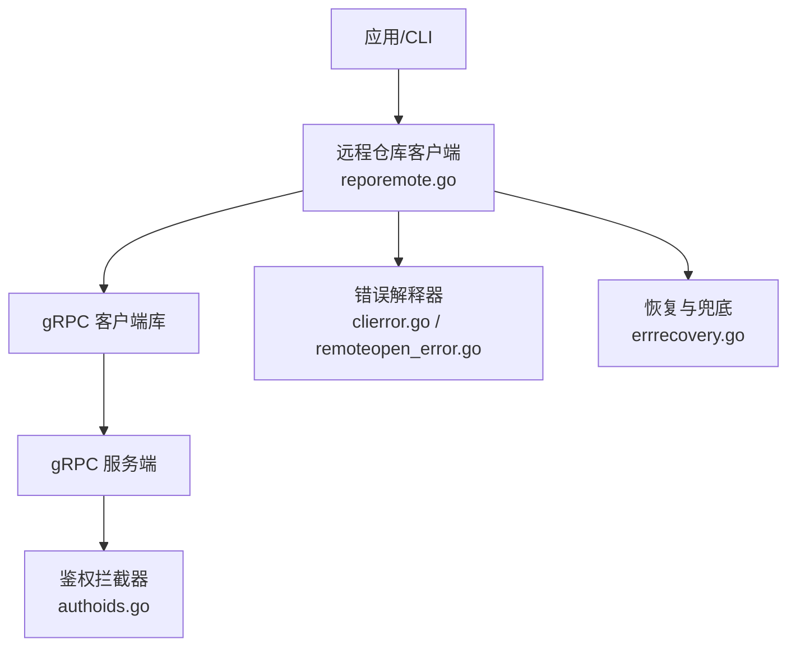
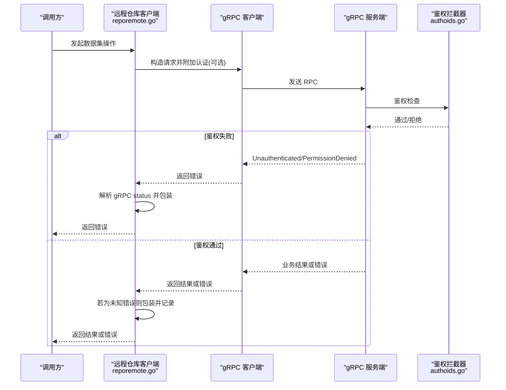
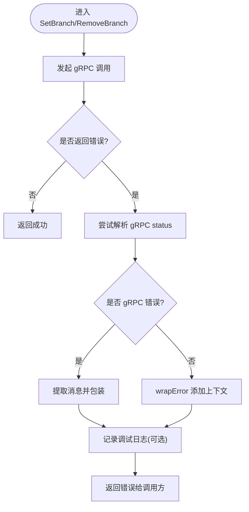
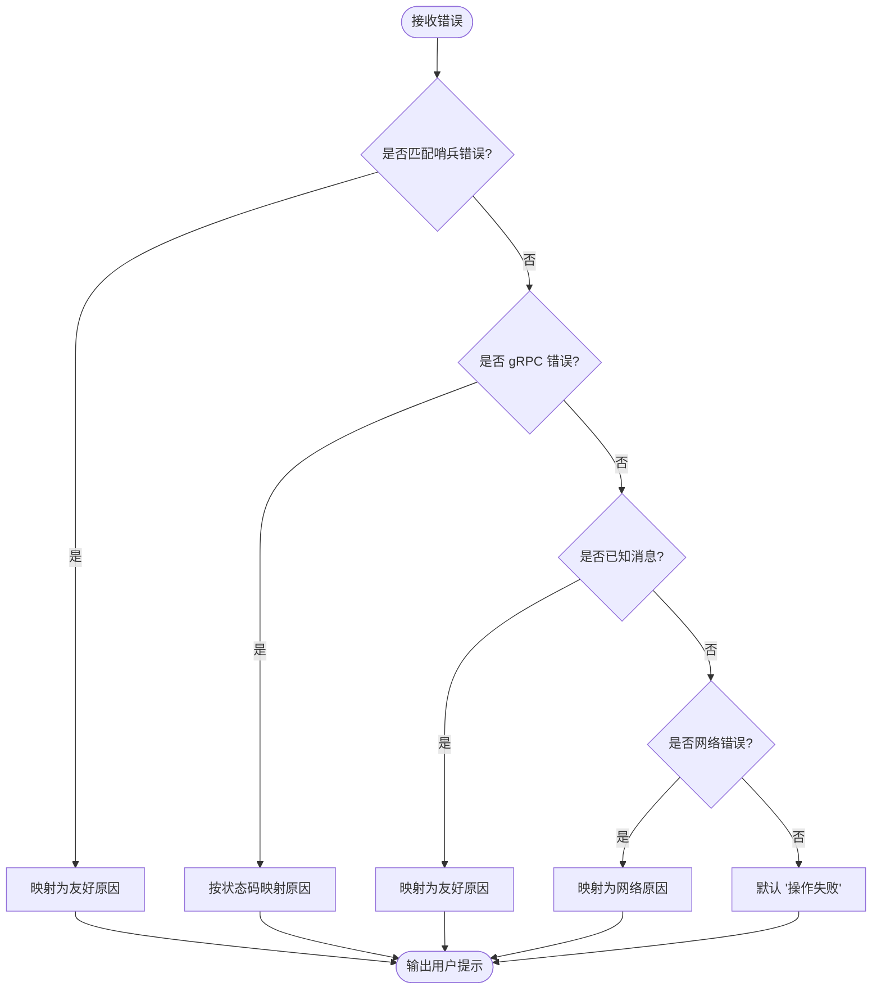
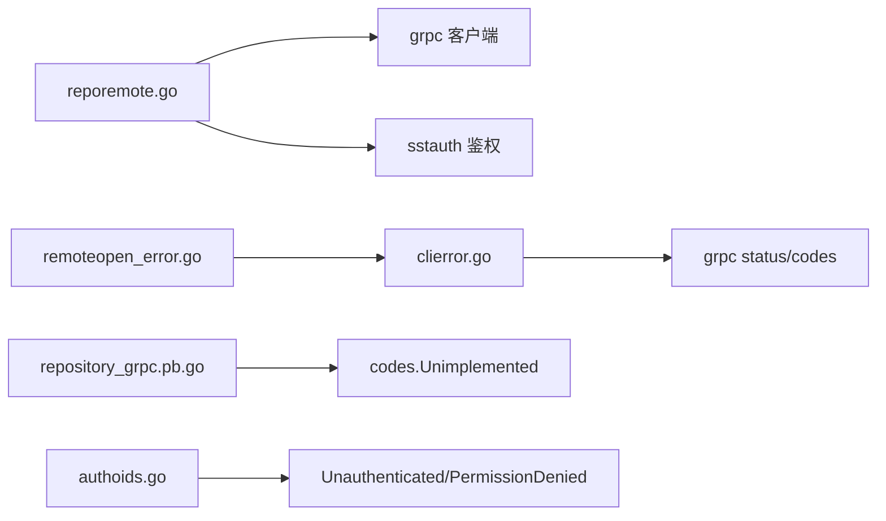

# 错误处理策略

<cite>
**本文引用的文件**
- [clierror.go](file://cli/cmd/utils/clierror.go)
- [remoteopen_error.go](file://cli/cmd/utils/remoteopen_error.go)
- [reporemote.go](file://sst/reporemote.go)
- [errrecovery.go](file://sst/errrecovery.go)
- [repository_grpc.pb.go](file://bboltproto/repository_grpc.pb.go)
- [authoids.go](file://sstauth/authoids.go)
</cite>

## 目录
1. [简介](#简介)
2. [项目结构](#项目结构)
3. [核心组件](#核心组件)
4. [架构总览](#架构总览)
5. [详细组件分析](#详细组件分析)
6. [依赖关系分析](#依赖关系分析)
7. [性能考量](#性能考量)
8. [故障排查指南](#故障排查指南)
9. [结论](#结论)
10. [附录](#附录)

## 简介
本文件聚焦 SST gRPC 错误处理策略，覆盖以下方面：
- gRPC 状态码使用规范与自定义错误类型设计
- 错误传播机制（客户端包装、服务端日志与调试信息）
- 重试策略与熔断机制（指数退避、断路器模式）
- 错误分类指南（可重试错误、业务错误、系统错误）
- 完整示例与最佳实践建议

## 项目结构
SST 的错误处理贯穿“客户端调用层”“gRPC 传输层”“CLI 用户提示层”以及“恢复与兜底层”。关键位置如下：
- 客户端远程仓库实现：负责发起 gRPC 调用、附加认证、记录日志、转换错误
- CLI 错误解释器：将底层错误映射为用户可读的失败原因
- 恢复机制：捕获 panic 并转换为结构化错误，便于上层统一处理
- 服务端未实现接口：返回 Unimplemented 以明确能力边界
- 鉴权拦截：对缺失或非法授权头返回明确的 Unauthenticated/PermissionDenied

**图示来源**
- [reporemote.go:150-207](file://sst/reporemote.go#L150-L207)
- [clierror.go:31-75](file://cli/cmd/utils/clierror.go#L31-L75)
- [remoteopen_error.go:14-68](file://cli/cmd/utils/remoteopen_error.go#L14-L68)
- [errrecovery.go:81-92](file://sst/errrecovery.go#L81-L92)
- [authoids.go:294-312](file://sstauth/authoids.go#L294-L312)

**章节来源**
- [reporemote.go:150-207](file://sst/reporemote.go#L150-L207)
- [clierror.go:31-75](file://cli/cmd/utils/clierror.go#L31-L75)
- [remoteopen_error.go:14-68](file://cli/cmd/utils/remoteopen_error.go#L14-L68)
- [errrecovery.go:81-92](file://sst/errrecovery.go#L81-L92)
- [authoids.go:294-312](file://sstauth/authoids.go#L294-L312)

## 核心组件
- 客户端错误包装与传播
  - 在 gRPC 调用后，若无法解析为 gRPC status，则包装为带文件行号的可追踪错误；若可解析，则提取消息并继续向上抛出，便于上层统一处理。
  - 参考路径：[reporemote.go:815-850](file://sst/reporemote.go#L815-L850)、[reporemote.go:860-893](file://sst/reporemote.go#L860-L893)
- CLI 友好错误解释
  - 通过 sentinel 错误匹配、gRPC 状态码解析、已知消息匹配、网络错误识别等步骤，输出人类可读的原因。
  - 参考路径：[clierror.go:46-75](file://cli/cmd/utils/clierror.go#L46-L75)、[clierror.go:128-177](file://cli/cmd/utils/clierror.go#L128-L177)、[clierror.go:179-197](file://cli/cmd/utils/clierror.go#L179-L197)
- 远端仓库打开错误解释
  - 针对 OpenRemoteRepository 场景，将认证、资源不存在、服务不可用、TLS 握手失败等归一化为友好提示。
  - 参考路径：[remoteopen_error.go:14-68](file://cli/cmd/utils/remoteopen_error.go#L14-L68)
- 崩溃恢复
  - 捕获 panic 并封装为 recoveredError，支持包含堆栈跟踪，便于诊断。
  - 参考路径：[errrecovery.go:15-50](file://sst/errrecovery.go#L15-L50)、[errrecovery.go:81-92](file://sst/errrecovery.go#L81-L92)
- 服务端未实现接口
  - 对尚未实现的 gRPC 方法返回 Unimplemented，明确能力边界。
  - 参考路径：[repository_grpc.pb.go:172-196](file://bboltproto/repository_grpc.pb.go#L172-L196)、[repository_grpc.pb.go:778-823](file://bboltproto/repository_grpc.pb.go#L778-L823)
- 鉴权与权限控制
  - 从请求元数据中提取 Authorization，校验格式与令牌有效性；根据角色决定读写权限。
  - 参考路径：[authoids.go:294-312](file://sstauth/authoids.go#L294-L312)

**章节来源**
- [reporemote.go:815-850](file://sst/reporemote.go#L815-L850)
- [reporemote.go:860-893](file://sst/reporemote.go#L860-L893)
- [clierror.go:46-75](file://cli/cmd/utils/clierror.go#L46-L75)
- [clierror.go:128-177](file://cli/cmd/utils/clierror.go#L128-L177)
- [clierror.go:179-197](file://cli/cmd/utils/clierror.go#L179-L197)
- [remoteopen_error.go:14-68](file://cli/cmd/utils/remoteopen_error.go#L14-L68)
- [errrecovery.go:15-50](file://sst/errrecovery.go#L15-L50)
- [errrecovery.go:81-92](file://sst/errrecovery.go#L81-L92)
- [repository_grpc.pb.go:172-196](file://bboltproto/repository_grpc.pb.go#L172-L196)
- [repository_grpc.pb.go:778-823](file://bboltproto/repository_grpc.pb.go#L778-L823)
- [authoids.go:294-312](file://sstauth/authoids.go#L294-L312)

## 架构总览
下图展示了从客户端到服务端的错误流转与处理要点：

**图示来源**
- [reporemote.go:150-207](file://sst/reporemote.go#L150-L207)
- [reporemote.go:815-850](file://sst/reporemote.go#L815-L850)
- [authoids.go:294-312](file://sstauth/authoids.go#L294-L312)

## 详细组件分析

### 客户端错误包装与传播
- 行为说明
  - 当 gRPC 调用返回错误时，优先尝试解析为 gRPC status；若成功，提取消息并继续上抛；若失败，则使用 wrapError 添加文件与行号信息，便于定位。
  - 对于特定业务场景（如分支设置），会在错误路径中记录调试日志，辅助问题定位。
- 关键点
  - 使用 status.FromError 判断是否为 gRPC 错误
  - 使用 wrapError 增强错误上下文
  - 对预期内的 NotFound 进行降级处理（例如 dataset 不存在时记录 Debug 级别日志）

**图示来源**
- [reporemote.go:815-850](file://sst/reporemote.go#L815-L850)
- [reporemote.go:860-893](file://sst/reporemote.go#L860-L893)

**章节来源**
- [reporemote.go:815-850](file://sst/reporemote.go#L815-L850)
- [reporemote.go:860-893](file://sst/reporemote.go#L860-L893)

### CLI 错误解释与用户提示
- 行为说明
  - 通过多级规则将底层错误转化为用户友好的提示：sentinel 错误优先、gRPC 状态码次之、已知消息再次、网络错误最后兜底。
  - 对内部错误（如包含 .go: 行号、rpc error 等）进行过滤，避免向用户暴露技术细节。
- 关键点
  - reasonFromSentinel：匹配内置哨兵错误
  - reasonFromGRPCChain：遍历错误链查找 gRPC status
  - reasonFromKnownMessages：基于文本片段匹配常见业务错误
  - reasonFromNetwork：识别 DNS/TLS/超时等网络问题

**图示来源**
- [clierror.go:46-75](file://cli/cmd/utils/clierror.go#L46-L75)
- [clierror.go:128-177](file://cli/cmd/utils/clierror.go#L128-L177)
- [clierror.go:179-197](file://cli/cmd/utils/clierror.go#L179-L197)

**章节来源**
- [clierror.go:46-75](file://cli/cmd/utils/clierror.go#L46-L75)
- [clierror.go:128-177](file://cli/cmd/utils/clierror.go#L128-L177)
- [clierror.go:179-197](file://cli/cmd/utils/clierror.go#L179-L197)

### 远端仓库打开错误解释
- 行为说明
  - 针对 OpenRemoteRepository 失败，统一归类为认证失败、仓库不存在、服务不可用、主机找不到、连接被拒、超时、TLS 握手失败等。
- 关键点
  - 优先使用 reasonFromGRPCChain 的结果
  - 对网络相关错误进行字符串匹配
  - 最终 fallback 为通用失败提示

**章节来源**
- [remoteopen_error.go:14-68](file://cli/cmd/utils/remoteopen_error.go#L14-L68)

### 崩溃恢复与调试信息
- 行为说明
  - 通过 handleWithRecovery 捕获 panic，生成 recoveredError，可选择包含堆栈跟踪。
  - 环境变量 GOTRACEBACK 控制堆栈深度。
- 关键点
  - newRecoveredError 收集堆栈
  - IncludingTraceback/ExcludingTraceback 控制输出粒度

**章节来源**
- [errrecovery.go:15-50](file://sst/errrecovery.go#L15-L50)
- [errrecovery.go:81-92](file://sst/errrecovery.go#L81-L92)

### 服务端未实现接口
- 行为说明
  - 对尚未实现的 gRPC 方法返回 Unimplemented，明确能力边界，便于客户端区分“不支持”和“临时不可用”。
- 关键点
  - 多处返回 codes.Unimplemented 与对应描述

**章节来源**
- [repository_grpc.pb.go:172-196](file://bboltproto/repository_grpc.pb.go#L172-L196)
- [repository_grpc.pb.go:778-823](file://bboltproto/repository_grpc.pb.go#L778-L823)

### 鉴权与权限控制
- 行为说明
  - 从 gRPC metadata 中读取 authorization，校验格式与令牌有效性；根据角色判定读写权限。
- 关键点
  - 缺失或格式错误返回 Unauthenticated
  - 无写权限返回 PermissionDenied

**章节来源**
- [authoids.go:294-312](file://sstauth/authoids.go#L294-L312)

## 依赖关系分析
- 客户端依赖
  - reporemote.go 依赖 gRPC 客户端库与 sstauth 提供认证令牌
  - clierror.go 依赖 google.golang.org/grpc/status 与 codes
  - remoteopen_error.go 复用 clierror.go 的错误解析逻辑
- 服务端依赖
  - repository_grpc.pb.go 定义未实现接口的默认返回
  - authoids.go 提供鉴权拦截逻辑

**图示来源**
- [reporemote.go:150-207](file://sst/reporemote.go#L150-L207)
- [clierror.go:128-177](file://cli/cmd/utils/clierror.go#L128-L177)
- [remoteopen_error.go:14-68](file://cli/cmd/utils/remoteopen_error.go#L14-L68)
- [repository_grpc.pb.go:172-196](file://bboltproto/repository_grpc.pb.go#L172-L196)
- [authoids.go:294-312](file://sstauth/authoids.go#L294-L312)

**章节来源**
- [reporemote.go:150-207](file://sst/reporemote.go#L150-L207)
- [clierror.go:128-177](file://cli/cmd/utils/clierror.go#L128-L177)
- [remoteopen_error.go:14-68](file://cli/cmd/utils/remoteopen_error.go#L14-L68)
- [repository_grpc.pb.go:172-196](file://bboltproto/repository_grpc.pb.go#L172-L196)
- [authoids.go:294-312](file://sstauth/authoids.go#L294-L312)

## 性能考量
- 错误包装开销
  - wrapError 仅附加文件与行号，开销较小；建议在高频路径谨慎使用，避免过多字符串拼接。
- 日志级别
  - 对预期内错误（如 dataset 不存在）使用 Debug 级别，减少噪音；异常与鉴权失败使用 Error。
- 流式调用
  - 搜索与拉取采用流式接口，注意 CloseSend 与 CloseAndRecv 的正确使用，避免死锁与资源泄漏。

[本节为通用指导，不直接分析具体文件]

## 故障排查指南
- 常见问题与定位
  - 认证失败：检查 Authorization 头格式与令牌有效性；服务端会返回 Unauthenticated。
    - 参考：[authoids.go:294-312](file://sstauth/authoids.go#L294-L312)
  - 权限不足：写操作需 ReadWrite 角色；否则返回 PermissionDenied。
    - 参考：[authoids.go:294-312](file://sstauth/authoids.go#L294-L312)
  - 资源不存在：NotFound 且消息含 branch/dataset/document/commit/repository 等关键词。
    - 参考：[clierror.go:148-163](file://cli/cmd/utils/clierror.go#L148-L163)
  - 服务不可用：Unavailable 表示后端暂时不可用，适合触发重试。
    - 参考：[clierror.go:164-165](file://cli/cmd/utils/clierror.go#L164-L165)
  - 参数无效：InvalidArgument 携带用户输入错误信息。
    - 参考：[clierror.go:166-167](file://cli/cmd/utils/clierror.go#L166-L167)
  - 重复创建：AlreadyExists。
    - 参考：[clierror.go:168-169](file://cli/cmd/utils/clierror.go#L168-L169)
  - 网络问题：DNS、连接被拒、超时、TLS 握手失败。
    - 参考：[clierror.go:179-197](file://cli/cmd/utils/clierror.go#L179-L197)
- 调试技巧
  - 启用堆栈跟踪：设置 GOTRACEBACK=all 获取更详细堆栈。
    - 参考：[errrecovery.go:64-79](file://sst/errrecovery.go#L64-L79)
  - 查看客户端日志：关注 gRPC 调用前后的 Debug/Error 日志，确认请求与响应。
    - 参考：[reporemote.go:168-207](file://sst/reporemote.go#L168-L207)

**章节来源**
- [authoids.go:294-312](file://sstauth/authoids.go#L294-L312)
- [clierror.go:148-169](file://cli/cmd/utils/clierror.go#L148-L169)
- [clierror.go:179-197](file://cli/cmd/utils/clierror.go#L179-L197)
- [errrecovery.go:64-79](file://sst/errrecovery.go#L64-L79)
- [reporemote.go:168-207](file://sst/reporemote.go#L168-L207)

## 结论
SST 的错误处理体系围绕“标准化 gRPC 状态码”“客户端错误包装”“CLI 友好提示”“崩溃恢复”“鉴权拦截”展开。通过多层规则将底层错误转化为可操作的提示，并为运维与开发提供足够的调试信息。建议在新增功能时遵循统一的错误分类与处理流程，确保一致的用户体验与可维护性。

[本节为总结，不直接分析具体文件]

## 附录

### gRPC 状态码使用规范
- Unauthenticated：缺少或无效的授权头
- PermissionDenied：有鉴权但无写权限
- NotFound：资源不存在（branch/dataset/document/commit/repository）
- Unavailable：服务暂时不可用（适合重试）
- InvalidArgument：参数无效（应提示用户修正）
- AlreadyExists：资源已存在（应提示用户选择其他名称）
- Unimplemented：方法未实现（客户端应降级或提示）

**章节来源**
- [authoids.go:294-312](file://sstauth/authoids.go#L294-L312)
- [clierror.go:143-169](file://cli/cmd/utils/clierror.go#L143-L169)
- [repository_grpc.pb.go:172-196](file://bboltproto/repository_grpc.pb.go#L172-L196)

### 错误分类指南
- 可重试错误
  - Unavailable、超时、连接被拒、DNS 解析失败
  - 建议：指数退避 + 最大重试次数
- 业务错误
  - NotFound、AlreadyExists、InvalidArgument、PermissionDenied
  - 建议：提示用户修正或终止重试
- 系统错误
  - Unimplemented、Unknown（非业务语义）、内部错误（包含 .go: 行号）
  - 建议：记录详细日志并上报，避免向用户暴露技术细节

**章节来源**
- [clierror.go:171-177](file://cli/cmd/utils/clierror.go#L171-L177)
- [clierror.go:179-197](file://cli/cmd/utils/clierror.go#L179-L197)

### 重试策略与熔断机制（建议）
- 指数退避
  - 初始延迟、增长因子、抖动、最大重试次数
  - 适用于 Unavailable、超时、连接问题
- 熔断器
  - 失败阈值、冷却时间、半开探测
  - 适用于持续不可用的服务，避免雪崩
- 幂等性
  - 仅对幂等操作启用自动重试（如查询、只读）
  - 写操作需谨慎，必要时由业务层保证幂等

[本节为通用建议，不直接分析具体文件]

### 完整错误处理示例（路径指引）
- 客户端调用与错误包装
  - [reporemote.go:815-850](file://sst/reporemote.go#L815-L850)
  - [reporemote.go:860-893](file://sst/reporemote.go#L860-L893)
- CLI 用户提示
  - [clierror.go:31-75](file://cli/cmd/utils/clierror.go#L31-L75)
  - [remoteopen_error.go:14-68](file://cli/cmd/utils/remoteopen_error.go#L14-L68)
- 崩溃恢复
  - [errrecovery.go:81-92](file://sst/errrecovery.go#L81-L92)

**章节来源**
- [reporemote.go:815-850](file://sst/reporemote.go#L815-L850)
- [reporemote.go:860-893](file://sst/reporemote.go#L860-L893)
- [clierror.go:31-75](file://cli/cmd/utils/clierror.go#L31-L75)
- [remoteopen_error.go:14-68](file://cli/cmd/utils/remoteopen_error.go#L14-L68)
- [errrecovery.go:81-92](file://sst/errrecovery.go#L81-L92)