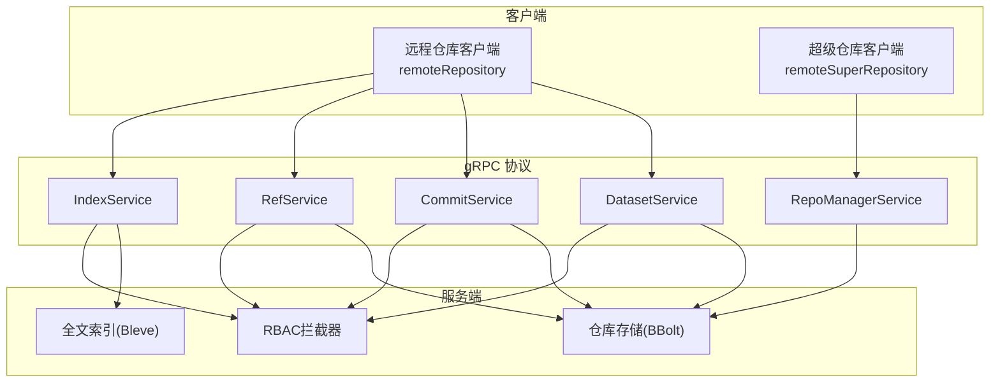
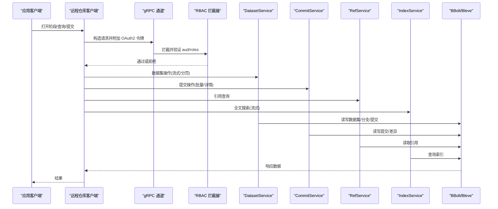
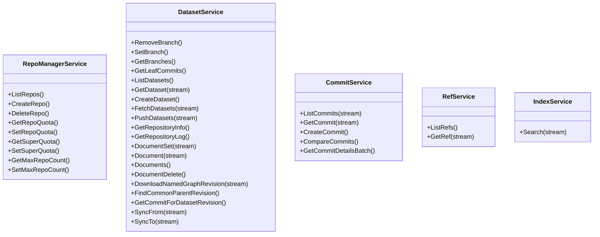
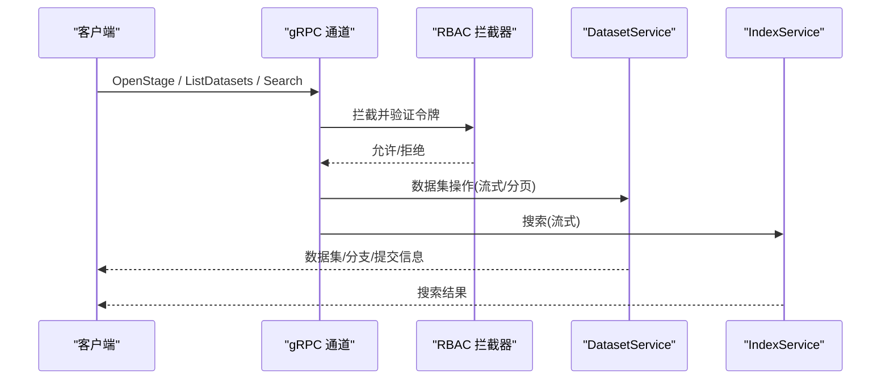
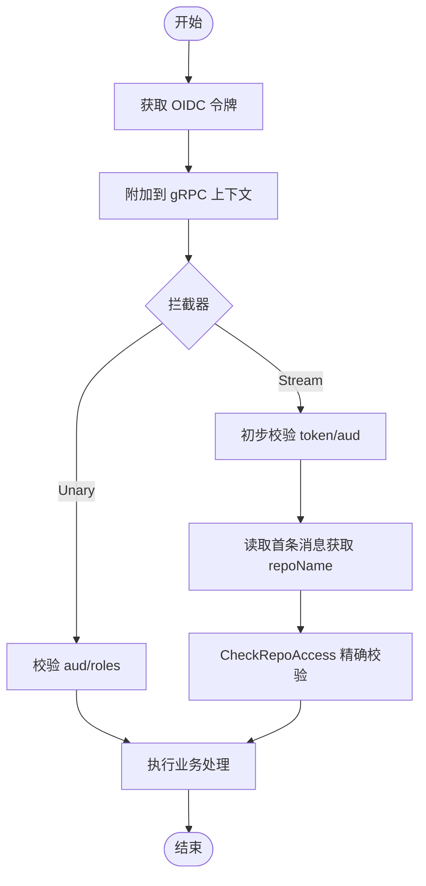
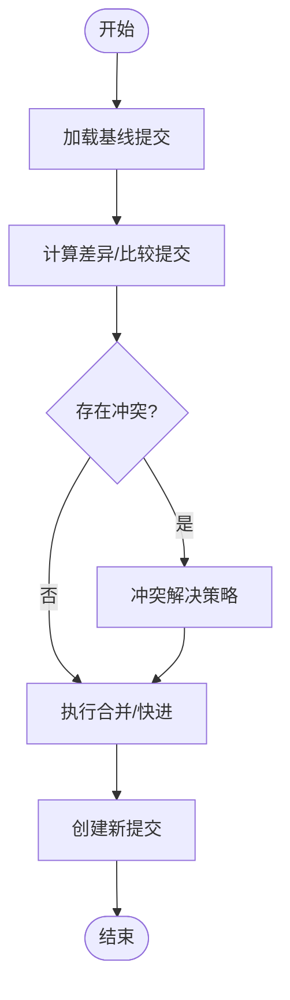
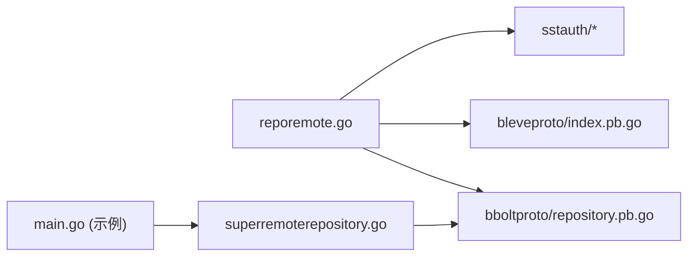

# 分布式部署

<cite>
**本文引用的文件**
- [README.md](file://README.md)
- [repository.proto](file://bboltproto/repository.proto)
- [index.proto](file://bleveproto/index.proto)
- [remote.go (bboltproto)](file://bboltproto/remote.go)
- [remote.go (bleveproto)](file://bleveproto/remote.go)
- [reporemote.go](file://sst/reporemote.go)
- [superremoterepository.go](file://sst/superremoterepository.go)
- [ACCESS_RIGHTS.md](file://sstauth/ACCESS_RIGHTS.md)
- [authoids.go](file://sstauth/authoids.go)
- [main.go (helloworldsuperreporemote)](file://examples/helloworldsuperreporemote/main.go)
- [oidc_provider.go](file://sst_test/testutil/oidc_provider.go)
- [errrecovery.go](file://sst/errrecovery.go)
</cite>

## 目录
1. [简介](#简介)
2. [项目结构](#项目结构)
3. [核心组件](#核心组件)
4. [架构总览](#架构总览)
5. [详细组件分析](#详细组件分析)
6. [依赖关系分析](#依赖关系分析)
7. [性能与调优](#性能与调优)
8. [故障排查指南](#故障排查指南)
9. [结论](#结论)
10. [附录](#附录)

## 简介
本指南面向需要在生产环境部署 SST（Semantic STEP Technology）的工程师，聚焦于 gRPC 服务器架构、网络拓扑、客户端-服务器通信协议、数据同步机制、多节点集群与负载均衡、网络安全（含防火墙与 SSL/TLS）、分布式一致性策略、监控日志与性能调优、以及故障转移、扩缩容与灾难恢复的最佳实践。内容基于仓库中的协议定义、客户端实现、认证授权文档与示例程序进行系统化梳理。

## 项目结构
- 协议层：通过 protobuf 定义 gRPC 服务与消息格式，包含仓库管理、数据集、提交、引用、搜索等能力。
- 客户端层：提供远程仓库与超级仓库的 gRPC 客户端封装，支持分页、流式传输、字段掩码、OAuth2 令牌注入等。
- 安全层：基于 Keycloak OIDC 的鉴权与 RBAC 拦截器，区分单仓库与超级仓库模式，支持流式请求的二次校验。
- 示例与测试：提供最小可运行的服务端启动示例与端到端测试，覆盖 TLS、OIDC、流式搜索、分支操作等场景。

图表来源
- [repository.proto:13-131](file://bboltproto/repository.proto#L13-L131)
- [index.proto:9-21](file://bleveproto/index.proto#L9-L21)
- [reporemote.go:88-285](file://sst/reporemote.go#L88-L285)
- [superremoterepository.go:20-47](file://sst/superremoterepository.go#L20-L47)

章节来源
- [README.md:1-15](file://README.md#L1-L15)

## 核心组件
- 远程仓库客户端（remoteRepository）：封装对 DatasetService、CommitService、RefService、IndexService 的调用，支持分页、流式读取、字段掩码、OAuth2 令牌注入、连接生命周期管理。
- 超级仓库客户端（remoteSuperRepository）：封装 RepoManagerService，用于创建、删除、配额管理等跨仓库操作。
- 协议与服务：
  - RepoManagerService：仓库元数据与配额管理。
  - DatasetService：数据集增删改查、分支管理、拉取/推送、同步（SyncFrom/SyncTo）。
  - CommitService：提交列表、详情、比较、批量获取。
  - RefService：引用（分支/叶子提交）查询。
  - IndexService：全文检索（Bleve），以流式方式返回搜索结果。
- 安全与鉴权：
  - 单仓库模式与超级仓库模式，分别对应不同的 audience 与角色映射。
  - Unary 与 Stream 两种拦截器，确保每 RPC 的鉴权与权限控制。
- 示例与测试：
  - 示例程序演示如何加载 TLS 证书、配置 OIDC、启动 SuperServer。
  - 测试工具提供 Fake OIDC Provider 与带 TLS 的服务端启动方法。

章节来源
- [reporemote.go:88-285](file://sst/reporemote.go#L88-L285)
- [superremoterepository.go:20-47](file://sst/superremoterepository.go#L20-L47)
- [repository.proto:13-131](file://bboltproto/repository.proto#L13-L131)
- [index.proto:9-21](file://bleveproto/index.proto#L9-L21)
- [ACCESS_RIGHTS.md:52-128](file://sstauth/ACCESS_RIGHTS.md#L52-L128)
- [main.go (helloworldsuperreporemote):58-89](file://examples/helloworldsuperreporemote/main.go#L58-L89)
- [oidc_provider.go:167-186](file://sst_test/testutil/oidc_provider.go#L167-L186)

## 架构总览
SST 采用“客户端-服务器”架构，客户端通过 gRPC 访问服务端提供的仓库管理与数据服务。服务端使用 BBolt 作为持久化存储，Bleve 作为全文检索引擎。认证与授权通过 Keycloak OIDC 完成，并在 gRPC 层通过拦截器执行 RBAC 检查。

图表来源
- [reporemote.go:146-207](file://sst/reporemote.go#L146-L207)
- [reporemote.go:296-468](file://sst/reporemote.go#L296-L468)
- [reporemote.go:546-637](file://sst/reporemote.go#L546-L637)
- [repository.proto:88-131](file://bboltproto/repository.proto#L88-L131)
- [index.proto:9-21](file://bleveproto/index.proto#L9-L21)
- [ACCESS_RIGHTS.md:103-128](file://sstauth/ACCESS_RIGHTS.md#L103-L128)

## 详细组件分析

### gRPC 服务与消息模型
- RepoManagerService：提供仓库列表、创建、删除、配额与数量限制等管理能力，适用于超级仓库模式。
- DatasetService：提供数据集与分支管理、拉取/推送、同步（SyncFrom/SyncTo）、文档上传下载、命名图版本下载等。
- CommitService：提供提交列表、详情、比较、批量获取等功能。
- RefService：提供引用（分支/叶子提交）的列表与获取。
- IndexService：提供全文检索，请求与结果通过 JSON 编码在流中传输。

图表来源
- [repository.proto:13-131](file://bboltproto/repository.proto#L13-L131)
- [index.proto:9-21](file://bleveproto/index.proto#L9-L21)

章节来源
- [repository.proto:13-131](file://bboltproto/repository.proto#L13-L131)
- [index.proto:9-21](file://bleveproto/index.proto#L9-L21)

### 客户端-服务器通信与数据同步
- 连接建立：客户端通过 grpc.NewClient 建立到目标地址的连接，并初始化各服务客户端。
- 认证注入：从上下文提取 sstauth.Provider，生成 OAuth2 令牌并通过 PerRPCCredentials 附加到每个 RPC。
- 流式操作：搜索、数据集拉取/推送、同步等使用双向流，提高吞吐与降低内存占用。
- 分页与字段掩码：列表接口支持 page_token 与 FieldMask，减少不必要的数据传输。
- 同步机制：
  - SyncFrom：从源仓库向目标仓库同步数据（客户端发起，服务端流式写入）。
  - SyncTo：从服务端向客户端同步数据（服务端流式输出，客户端接收并落盘）。

图表来源
- [reporemote.go:146-207](file://sst/reporemote.go#L146-L207)
- [reporemote.go:296-468](file://sst/reporemote.go#L296-L468)
- [reporemote.go:546-637](file://sst/reporemote.go#L546-L637)
- [ACCESS_RIGHTS.md:103-128](file://sstauth/ACCESS_RIGHTS.md#L103-L128)

章节来源
- [reporemote.go:88-285](file://sst/reporemote.go#L88-L285)
- [reporemote.go:146-207](file://sst/reporemote.go#L146-L207)
- [reporemote.go:296-468](file://sst/reporemote.go#L296-L468)
- [reporemote.go:546-637](file://sst/reporemote.go#L546-L637)
- [ACCESS_RIGHTS.md:103-128](file://sstauth/ACCESS_RIGHTS.md#L103-L128)

### 认证与授权（Keycloak OIDC + RBAC）
- 认证流程：客户端获取 OIDC 令牌，附加到 gRPC 上下文中；服务端拦截器解析 Bearer Token，校验签名、过期与受众（aud）。
- 授权模型：
  - 单仓库模式：aud 为服务器 ClientID，角色映射至 AccessMode。
  - 超级仓库模式：aud 为 superClientID 或 superClientID#repoName，按仓库维度进行角色校验。
- 流式请求：由于目标仓库名在首条消息中才出现，流式拦截器先做基础校验，再由处理器调用 CheckRepoAccess 完成精确的仓库级权限校验。

图表来源
- [ACCESS_RIGHTS.md:52-128](file://sstauth/ACCESS_RIGHTS.md#L52-L128)
- [ACCESS_RIGHTS.md:173-239](file://sstauth/ACCESS_RIGHTS.md#L173-L239)
- [authoids.go:294-337](file://sstauth/authoids.go#L294-L337)

章节来源
- [ACCESS_RIGHTS.md:52-128](file://sstauth/ACCESS_RIGHTS.md#L52-L128)
- [ACCESS_RIGHTS.md:173-239](file://sstauth/ACCESS_RIGHTS.md#L173-L239)
- [authoids.go:294-337](file://sstauth/authoids.go#L294-L337)

### 多节点集群与负载均衡
- 客户端侧：
  - 可通过多个 gRPC 目标地址轮询或加权选择，结合重试与超时策略提升可用性。
  - 使用连接池与并发控制避免单点过载。
- 服务端侧：
  - 将 SST 服务部署为无状态进程，配合外部负载均衡器（如 Nginx、HAProxy、云 LB）进行流量分发。
  - 后端节点共享同一仓库存储（例如挂载共享文件系统或使用对象存储+一致性层），或通过复制/同步机制保持数据一致。
- 注意：
  - 写路径需考虑冲突检测与合并策略（见下一节）。
  - 读路径可利用只读副本与缓存加速。

[本节为概念性说明，不直接分析具体文件]

### 网络安全与防火墙规则
- TLS：
  - 服务端可加载 X509 证书与私钥启用 TLS。
  - 客户端通过 DialOption 配置传输凭证，确保加密传输。
- 防火墙：
  - 仅开放 gRPC 端口（默认 50051 或自定义），限制来源 IP 白名单。
  - 如需反向代理，仅暴露代理端口，内部服务端口不对外。
- 密钥管理：
  - 证书与私钥应通过安全渠道分发，定期轮换。
  - 使用环境变量或密钥管理服务注入配置。

章节来源
- [main.go (helloworldsuperreporemote):58-89](file://examples/helloworldsuperreporemote/main.go#L58-L89)
- [oidc_provider.go:167-186](file://sst_test/testutil/oidc_provider.go#L167-L186)

### 分布式一致性保证与冲突解决
- 提交模型：
  - 每次提交包含数据集与命名图的变更，支持父提交链与分支指针。
  - CompareCommits 可用于判断提交关系（无关、旧、相同、新）。
- 冲突检测：
  - 通过 FindCommonParentRevision 计算共同祖先，辅助合并策略。
  - CreateCommitRequest 支持标志位（如 forbidDatasetBranchDivergence）控制分支分歧行为。
- 合并策略：
  - 业务层可根据 Compare 结果决定快进、三方合并或拒绝更新。
  - 对于命名图与数据集，建议基于哈希与版本进行幂等写入。

图表来源
- [repository.proto:502-547](file://bboltproto/repository.proto#L502-L547)
- [repository.proto:133-152](file://bboltproto/repository.proto#L133-L152)

章节来源
- [repository.proto:502-547](file://bboltproto/repository.proto#L502-L547)
- [repository.proto:133-152](file://bboltproto/repository.proto#L133-L152)

### 监控指标收集、日志聚合与性能调优
- 指标：
  - 使用 gRPC 内置统计或第三方库采集 QPS、延迟、错误率、连接数等。
  - 关注流式操作的吞吐与背压情况。
- 日志：
  - 统一结构化日志（如 zap），记录关键步骤与错误堆栈。
  - 集中式日志平台（ELK/Loki）聚合分析。
- 调优：
  - 调整 gRPC 最大消息大小、连接池、并发度。
  - 合理设置分页大小与字段掩码，减少冗余数据传输。
  - 对热点数据集与索引进行缓存与预热。

[本节为通用指导，不直接分析具体文件]

### 故障转移、扩容缩容与灾难恢复
- 故障转移：
  - 客户端实现重试与退避，服务端无状态化便于快速替换。
  - 健康检查与自动摘除失效节点。
- 扩容缩容：
  - 水平扩展增加实例，配合负载均衡器动态注册/注销。
  - 垂直扩展提升 CPU/内存以应对高负载。
- 灾难恢复：
  - 定期备份 BBolt 数据与 Bleve 索引。
  - 使用 SyncFrom/SyncTo 进行异地同步与恢复。
  - 演练恢复流程，确保 RTO/RPO 满足要求。

[本节为通用指导，不直接分析具体文件]

## 依赖关系分析
- 客户端依赖：
  - remoteRepository 依赖 bboltproto 与 bleveproto 生成的 gRPC 客户端。
  - 通过 sstauth 注入认证上下文。
- 服务端依赖：
  - 仓库存储（BBolt）与索引（Bleve）。
  - RBAC 拦截器基于 Keycloak OIDC 进行鉴权。
- 协议依赖：
  - repository.proto 与 index.proto 定义服务与消息，生成 Go 代码供两端使用。

图表来源
- [reporemote.go:88-285](file://sst/reporemote.go#L88-L285)
- [superremoterepository.go:20-47](file://sst/superremoterepository.go#L20-L47)
- [repository.proto:13-131](file://bboltproto/repository.proto#L13-L131)
- [index.proto:9-21](file://bleveproto/index.proto#L9-L21)

章节来源
- [reporemote.go:88-285](file://sst/reporemote.go#L88-L285)
- [superremoterepository.go:20-47](file://sst/superremoterepository.go#L20-L47)
- [repository.proto:13-131](file://bboltproto/repository.proto#L13-L131)
- [index.proto:9-21](file://bleveproto/index.proto#L9-L21)

## 性能与调优
- 流式优化：
  - 使用流式 API 进行大数据集拉取与搜索，避免一次性加载。
  - 合理设置缓冲区与批大小。
- 分页与掩码：
  - 使用 page_token 与 FieldMask 减少响应体积。
- 连接复用：
  - 复用 gRPC 连接，避免频繁握手。
- 索引与缓存：
  - 对高频查询结果进行缓存，注意失效策略。
- 资源限制：
  - 设置合理的超时、重试次数与并发上限。

[本节为通用指导，不直接分析具体文件]

## 故障排查指南
- 常见问题：
  - 认证失败：检查 OIDC 配置、令牌有效期与受众匹配。
  - 权限不足：确认角色映射与所需 AccessMode。
  - 连接异常：检查 TLS 证书、防火墙与网络连通性。
- 诊断手段：
  - 启用详细日志，定位错误堆栈。
  - 使用 gRPC 统计与链路追踪分析瓶颈。
- 恢复措施：
  - 重启服务、清理异常连接。
  - 回滚到稳定版本或恢复备份。

章节来源
- [errrecovery.go:59-92](file://sst/errrecovery.go#L59-L92)
- [ACCESS_RIGHTS.md:52-128](file://sstauth/ACCESS_RIGHTS.md#L52-L128)

## 结论
SST 提供了完善的 gRPC 客户端与服务端能力，支持安全的认证授权、高效的数据同步与全文检索。在生产环境中，应结合负载均衡、TLS、RBAC 与监控日志构建高可用、可扩展的分布式系统。通过合理的冲突解决策略与备份恢复机制，确保数据一致性与业务连续性。

[本节为总结性内容，不直接分析具体文件]

## 附录
- 快速启动参考：
  - 示例程序展示了如何加载 TLS 证书、配置 OIDC、启动 SuperServer。
  - 测试工具提供了带 TLS 与 OIDC 的服务端启动方法，便于本地验证。

章节来源
- [main.go (helloworldsuperreporemote):58-89](file://examples/helloworldsuperreporemote/main.go#L58-L89)
- [oidc_provider.go:167-186](file://sst_test/testutil/oidc_provider.go#L167-L186)