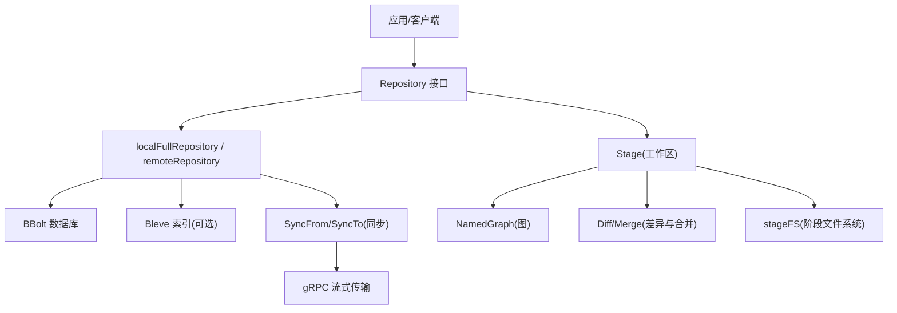
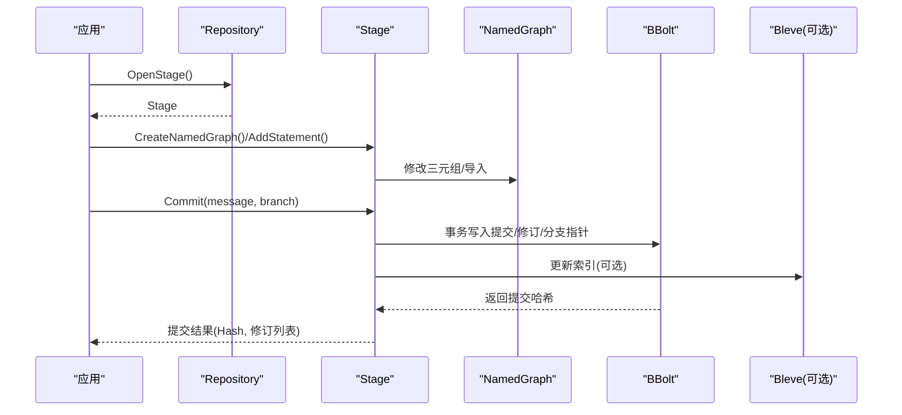
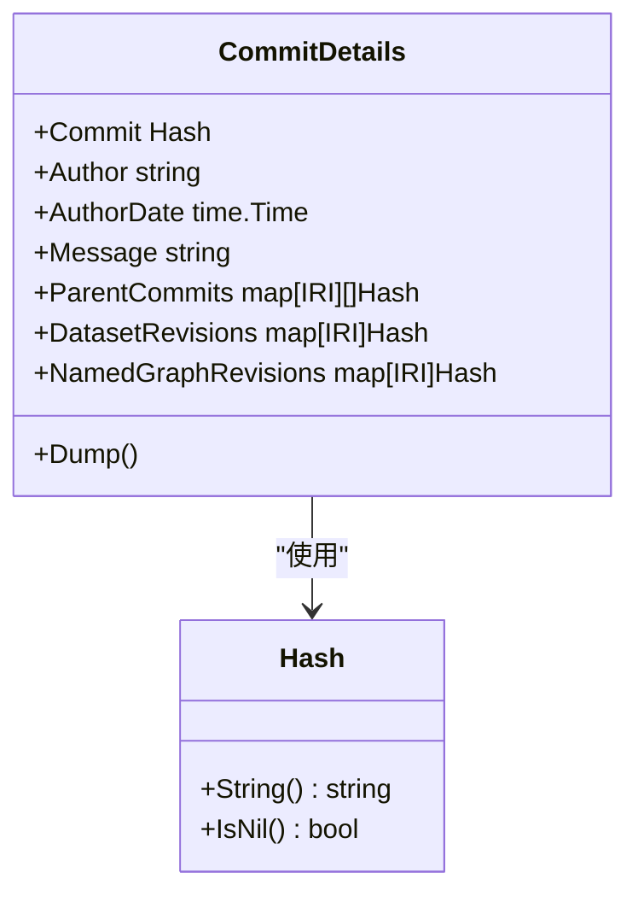
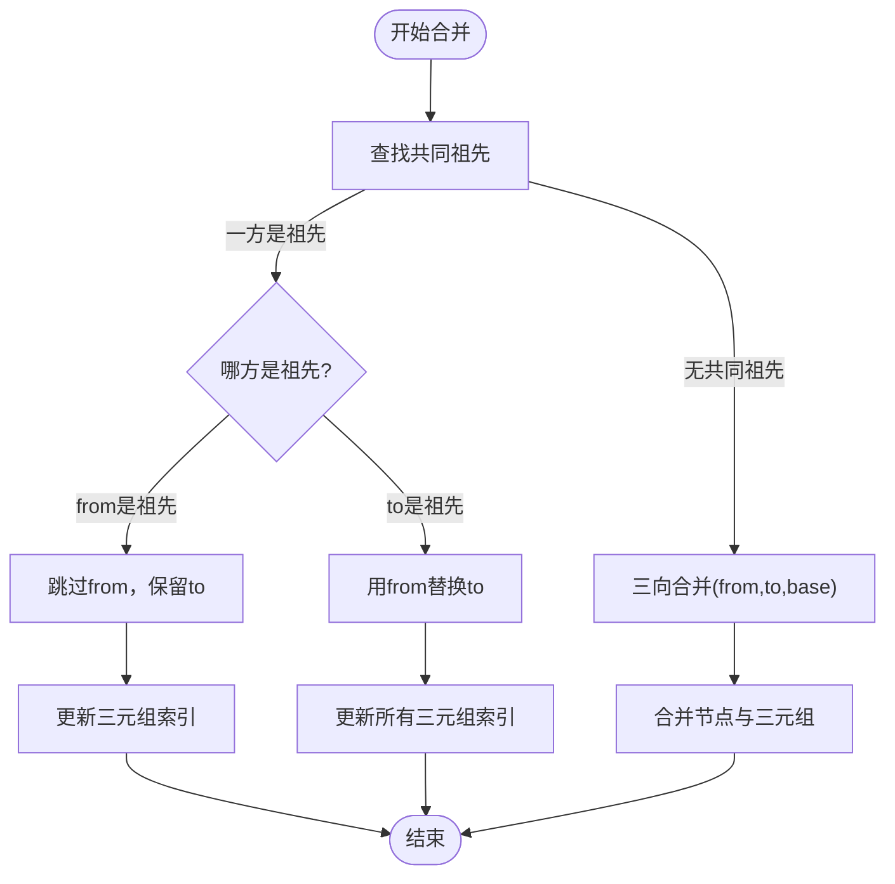
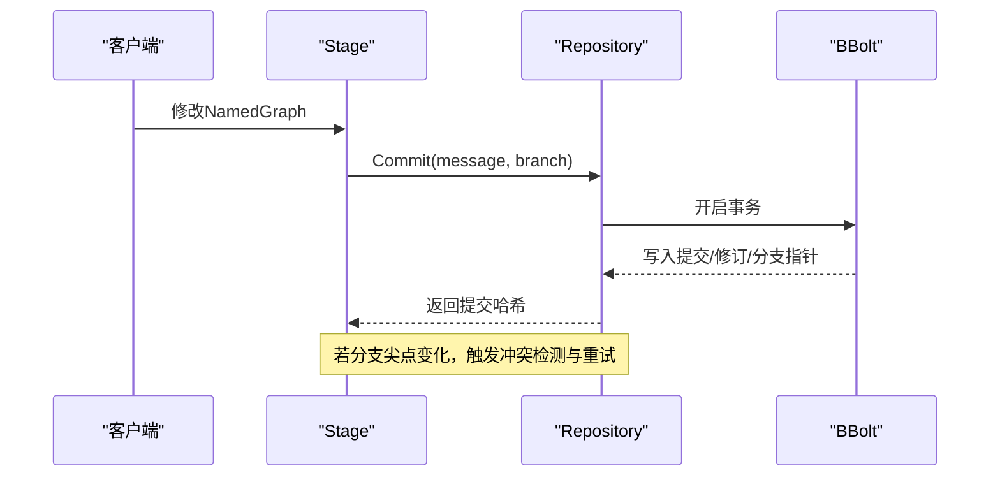
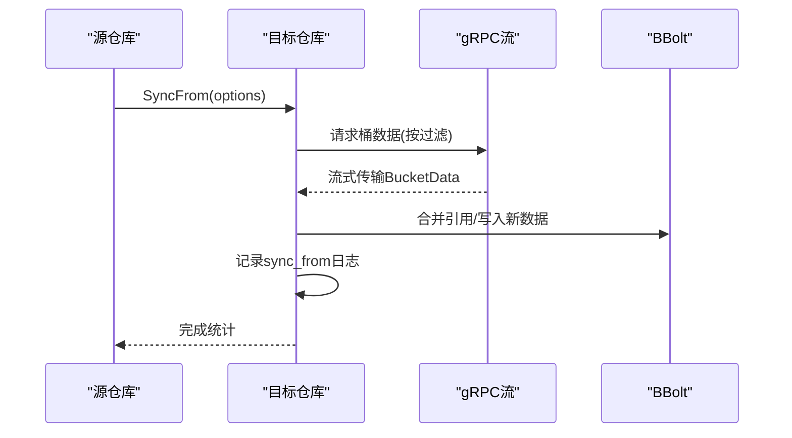
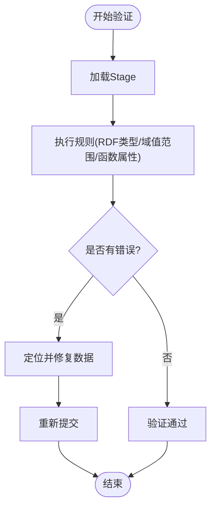
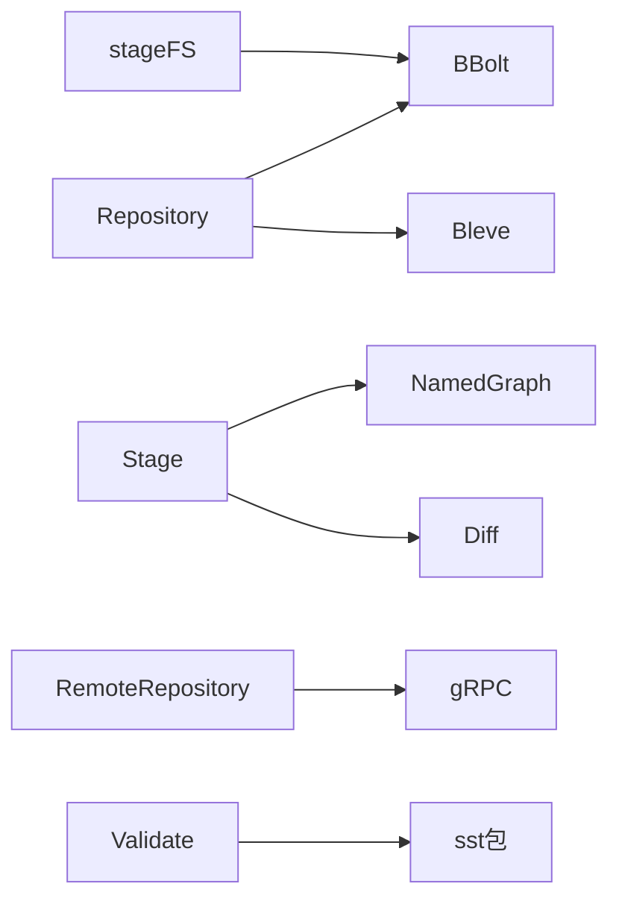

# 数据一致性

<cite>
**本文引用的文件**
- [commit.go](file://sst/commit.go)
- [stage.go](file://sst/stage.go)
- [repository.go](file://sst/repository.go)
- [hash.go](file://sst/hash.go)
- [diff.go](file://sst/diff.go)
- [syncfromlog.go](file://sst/syncfromlog.go)
- [stagefs.go](file://sst/stagefs.go)
- [namedgraph.go](file://sst/namedgraph.go)
- [repolocalfull.go](file://sst/repolocalfull.go)
- [reporemote.go](file://sst/reporemote.go)
- [run.go](file://tools/validate/run.go)
- [validate.go](file://tools/validate/validate.go)
</cite>

## 目录
1. [简介](#简介)
2. [项目结构](#项目结构)
3. [核心组件](#核心组件)
4. [架构总览](#架构总览)
5. [详细组件分析](#详细组件分析)
6. [依赖关系分析](#依赖关系分析)
7. [性能考量](#性能考量)
8. [故障排查指南](#故障排查指南)
9. [结论](#结论)
10. [附录](#附录)

## 简介
本技术文档围绕 SST 分布式数据一致性展开，重点说明：
- 分布式事务与 ACID 特性在 SST 中的实现方式（基于 BBolt 事务、提交哈希、分支与合并）。
- 版本控制机制如何保证一致性（提交哈希、分支指针、共同祖先查找、三向合并）。
- 并发控制策略（乐观锁为主、冲突检测与回退；本地写路径的原子提交）。
- 数据同步算法（增量/全量/双向），以及日志记录与幂等性。
- 一致性级别配置（最终一致性与强一致的权衡）与性能影响。
- 数据完整性验证工具与修复流程。
- 常见一致性问题的诊断方法与解决方案。

## 项目结构
SST 的核心一致性能力由以下模块协同完成：
- 仓库层（Repository）：提供本地/远程仓库抽象，封装 BBolt 存储、Bleve 索引、提交历史、分支管理、同步接口。
- 阶段层（Stage）：内存工作区，承载 NamedGraph 的增删改，支持 MoveAndMerge、LinkToRepository、Commit。
- 图层（NamedGraph）：RDF 命名图的内存表示，维护三元组、导入关系、检出元数据（checkedOutCommits/NGRevisions/DSRevisions）。
- 差异与合并（Diff/Merge）：基于排序遍历计算三元组级差异，支撑三向合并与冲突检测。
- 同步（SyncFrom/SyncTo）：通过 gRPC 流式传输 BBolt 桶数据，实现跨仓库增量/全量同步，并记录 sync_from 日志。
- 持久化与文件系统适配（stageFS）：将 Stage 内容以“键=SHA”的方式写入 BBolt，确保幂等与去重。
- 校验工具（tools/validate）：对 Stage 进行类型、域值范围、函数属性等规则校验，输出报告。

**图表来源**
- [repository.go:34-179](file://sst/repository.go#L34-L179)
- [repolocalfull.go:36-120](file://sst/repolocalfull.go#L36-L120)
- [reporemote.go:88-139](file://sst/reporemote.go#L88-L139)
- [stage.go:53-234](file://sst/stage.go#L53-L234)
- [namedgraph.go:59-108](file://sst/namedgraph.go#L59-L108)
- [diff.go:28-59](file://sst/diff.go#L28-L59)
- [stagefs.go:23-46](file://sst/stagefs.go#L23-L46)

**章节来源**
- [repository.go:34-179](file://sst/repository.go#L34-L179)
- [stage.go:53-234](file://sst/stage.go#L53-L234)
- [namedgraph.go:59-108](file://sst/namedgraph.go#L59-L108)
- [diff.go:28-59](file://sst/diff.go#L28-L59)
- [stagefs.go:23-46](file://sst/stagefs.go#L23-L46)

## 核心组件
- 仓库（Repository）：统一抽象本地/远程仓库，提供 OpenStage、CheckoutCommit、Log、SyncFrom、Document 管理等接口。
- 阶段（Stage）：内存工作区，负责 NamedGraph 的创建、修改、移动与合并，以及 Commit 到仓库。
- 命名图（NamedGraph）：RDF 命名图的内存模型，维护三元组、导入关系、检出元数据（用于三向合并）。
- 提交（Commit）：不可变快照，包含作者、时间、消息、父提交、数据集/命名图修订映射。
- 哈希（Hash）：32 字节 SHA-256，Base58 编码字符串标识，用于命名图/数据集/提交的唯一标识。
- 差异（Diff）：三元组级差异计算，支持节点/属性/集合的差异枚举。
- 同步（SyncFrom/SyncTo）：跨仓库数据同步，支持按数据集/分支过滤，记录 sync_from 日志。
- 阶段文件系统（stageFS）：将 Stage 内容以“键=SHA”的方式落盘，确保幂等与去重。
- 校验工具（Validate）：对 Stage 执行 RDF 类型、域/值范围、函数属性等校验，生成报告。

**章节来源**
- [commit.go:15-63](file://sst/commit.go#L15-L63)
- [hash.go:51-132](file://sst/hash.go#L51-L132)
- [diff.go:28-327](file://sst/diff.go#L28-L327)
- [syncfromlog.go:16-224](file://sst/syncfromlog.go#L16-L224)
- [stagefs.go:23-169](file://sst/stagefs.go#L23-L169)
- [run.go:24-473](file://tools/validate/run.go#L24-L473)
- [validate.go:33-114](file://tools/validate/validate.go#L33-L114)

## 架构总览
SST 的一致性由“提交哈希 + 分支指针 + 三向合并 + 事务落库”构成：
- 每次提交生成不可变 Hash，记录父提交与数据集/命名图修订映射。
- 分支指向最新提交，支持多分支并行开发。
- 合并时查找共同祖先，执行三向合并，自动处理父子关系与冲突。
- 本地写路径使用 BBolt 事务，保证原子性与一致性。
- 远程同步通过 gRPC 流式传输 BBolt 桶数据，目标端合并引用并保持幂等。

**图表来源**
- [repository.go:60-89](file://sst/repository.go#L60-L89)
- [stage.go:121-130](file://sst/stage.go#L121-L130)
- [namedgraph.go:411-503](file://sst/namedgraph.go#L411-L503)
- [repolocalfull.go:54-120](file://sst/repolocalfull.go#L54-L120)

**章节来源**
- [repository.go:60-89](file://sst/repository.go#L60-L89)
- [stage.go:121-130](file://sst/stage.go#L121-L130)
- [namedgraph.go:411-503](file://sst/namedgraph.go#L411-L503)
- [repolocalfull.go:54-120](file://sst/repolocalfull.go#L54-L120)

## 详细组件分析

### 提交与版本控制（ACID 与哈希）
- 提交对象包含作者、时间、消息、父提交映射、数据集/命名图修订映射，作为不可变快照。
- 哈希为 32 字节 SHA-256，Base58 编码，用于唯一标识提交、数据集修订、命名图修订。
- 本地仓库通过 BBolt 事务写入提交、修订、分支指针，保证原子性与一致性。
- 分支指针（refBranchPrefix）指向最新提交；当出现分歧时，源端分支尖点会被记录为 leaf commit，保持可达性。

**图表来源**
- [commit.go:18-63](file://sst/commit.go#L18-L63)
- [hash.go:51-132](file://sst/hash.go#L51-L132)

**章节来源**
- [commit.go:18-63](file://sst/commit.go#L18-L63)
- [hash.go:51-132](file://sst/hash.go#L51-L132)
- [repolocalfull.go:54-120](file://sst/repolocalfull.go#L54-L120)

### 分支合并与冲突检测（三向合并）
- 合并前查找共同祖先（FindCommonParentRevision），若一方是另一方的祖先则直接保留或替换。
- 若无共同祖先或存在分歧，执行三向合并：比较两个分支与共同祖先的差异，生成合并结果。
- 合并过程中记录动作类型（merge_graph、redirect_graph、change_to_local、mark_modified、update_triples、three_way_merge 等），便于审计与调试。

**图表来源**
- [stage.go:468-800](file://sst/stage.go#L468-L800)
- [namedgraph.go:572-622](file://sst/namedgraph.go#L572-L622)

**章节来源**
- [stage.go:468-800](file://sst/stage.go#L468-L800)
- [namedgraph.go:572-622](file://sst/namedgraph.go#L572-L622)

### 并发控制（乐观锁与冲突处理）
- 乐观锁策略：读取当前分支尖点作为父提交，提交时检查是否被其他提交覆盖；若冲突，需重新加载并合并。
- 本地写路径使用 BBolt 事务，保证单次提交的原子性。
- 远程仓库通过状态控制（enter/leave）与 WaitGroup 管理并发访问，避免关闭期间的竞态。
- 合并时通过共同祖先与差异计算减少冲突概率；若仍冲突，记录警告并允许人工介入。

**图表来源**
- [reporemote.go:109-124](file://sst/reporemote.go#L109-L124)
- [repolocalfull.go:54-120](file://sst/repolocalfull.go#L54-L120)
- [stage.go:121-130](file://sst/stage.go#L121-L130)

**章节来源**
- [reporemote.go:109-124](file://sst/reporemote.go#L109-L124)
- [repolocalfull.go:54-120](file://sst/repolocalfull.go#L54-L120)
- [stage.go:121-130](file://sst/stage.go#L121-L130)

### 数据同步算法（增量/全量/双向）
- 增量同步：仅同步新增的数据集修订、命名图修订与提交，避免重复传输。
- 全量同步：当目标端缺失必要数据时，从源端拉取完整桶数据。
- 双向同步：通过 gRPC 流式传输 BBolt 桶数据，目标端合并引用并保持幂等；记录 sync_from 日志以便审计。
- 同步选项支持按数据集 IRIs 与分支过滤，提升效率。

**图表来源**
- [reporemote.go:2007-2039](file://sst/reporemote.go#L2007-L2039)
- [syncfromlog.go:172-224](file://sst/syncfromlog.go#L172-L224)
- [repolocalfull.go:83-120](file://sst/repolocalfull.go#L83-L120)

**章节来源**
- [reporemote.go:2007-2039](file://sst/reporemote.go#L2007-L2039)
- [syncfromlog.go:172-224](file://sst/syncfromlog.go#L172-L224)
- [repolocalfull.go:83-120](file://sst/repolocalfull.go#L83-L120)

### 一致性级别配置与性能权衡
- 最终一致性：默认行为，提交后异步更新索引与同步，延迟可见但吞吐高。
- 强一致性：通过同步等待索引更新与同步完成，降低延迟但增加开销。
- 性能权衡：
  - 本地仓库：BBolt 事务写入快，Bleve 索引更新可异步。
  - 远程仓库：gRPC 流式传输减少带宽，但网络延迟影响一致性。
  - 合并复杂度：三向合并 O(n)，大数据集建议分片或增量同步。

**章节来源**
- [repository.go:91-120](file://sst/repository.go#L91-L120)
- [reporemote.go:146-200](file://sst/reporemote.go#L146-L200)
- [repolocalfull.go:41-52](file://sst/repolocalfull.go#L41-L52)

### 数据完整性验证与修复
- 验证工具支持 RDF 类型、域/值范围、函数属性等规则检查。
- 输出结构化报告（JSON/人类可读），包含错误与警告明细。
- 修复流程：定位问题三元组，修正数据后重新提交；必要时执行三向合并解决冲突。

**图表来源**
- [run.go:441-473](file://tools/validate/run.go#L441-L473)
- [validate.go:57-114](file://tools/validate/validate.go#L57-L114)

**章节来源**
- [run.go:441-473](file://tools/validate/run.go#L441-L473)
- [validate.go:57-114](file://tools/validate/validate.go#L57-L114)

## 依赖关系分析
- Repository 依赖 BBolt 与 Bleve，提供事务与索引能力。
- Stage 依赖 NamedGraph 与 Diff，实现内存操作与差异计算。
- RemoteRepository 依赖 gRPC 客户端，实现跨进程/跨机器同步。
- stageFS 依赖 BBolt，实现幂等存储与去重。
- Validate 依赖 sst 包，对 Stage 进行规则校验。

**图表来源**
- [repository.go:34-179](file://sst/repository.go#L34-L179)
- [stage.go:53-234](file://sst/stage.go#L53-L234)
- [reporemote.go:88-139](file://sst/reporemote.go#L88-L139)
- [stagefs.go:23-46](file://sst/stagefs.go#L23-L46)
- [run.go:24-473](file://tools/validate/run.go#L24-L473)

**章节来源**
- [repository.go:34-179](file://sst/repository.go#L34-L179)
- [stage.go:53-234](file://sst/stage.go#L53-L234)
- [reporemote.go:88-139](file://sst/reporemote.go#L88-L139)
- [stagefs.go:23-46](file://sst/stagefs.go#L23-L46)
- [run.go:24-473](file://tools/validate/run.go#L24-L473)

## 性能考量
- 本地写路径：BBolt 事务写入高效，适合高吞吐场景。
- 索引更新：Bleve 索引可异步更新，避免阻塞提交。
- 同步优化：gRPC 流式传输减少内存占用，支持按数据集/分支过滤。
- 合并复杂度：三向合并 O(n)，大数据集建议分片或增量同步。
- 内存使用：TriplexMode 影响内存占用，默认模式平衡性能与内存。

**章节来源**
- [repolocalfull.go:41-52](file://sst/repolocalfull.go#L41-L52)
- [reporemote.go:146-200](file://sst/reporemote.go#L146-L200)
- [stage.go:33-51](file://sst/stage.go#L33-L51)

## 故障排查指南
- 提交未找到：检查提交哈希是否正确，确认仓库中存在该提交。
- 分支未找到：确认分支名称与大小写，检查分支指针是否存在。
- 数据集未找到：检查数据集 IRI 是否正确，确认已创建并提交。
- 同步失败：检查网络连接、认证令牌、源端/目标端仓库类型兼容性。
- 合并冲突：查看合并报告，手动解决冲突后重新提交。
- 验证失败：根据报告定位问题三元组，修正数据后重新提交。

**章节来源**
- [commit.go:11-13](file://sst/commit.go#L11-L13)
- [repository.go:197-215](file://sst/repository.go#L197-L215)
- [reporemote.go:2007-2039](file://sst/reporemote.go#L2007-L2039)
- [run.go:236-473](file://tools/validate/run.go#L236-L473)

## 结论
SST 通过提交哈希、分支指针、三向合并与 BBolt 事务，提供了强大的分布式数据一致性保障。其设计兼顾了性能与可扩展性，适用于大规模 RDF 数据的版本管理与同步。结合校验工具，可确保数据质量与完整性。在实际应用中，应根据场景选择合适的一致性级别与同步策略，平衡性能与一致性需求。

## 附录
- 术语表：
  - 提交（Commit）：不可变快照，包含父提交与修订映射。
  - 分支（Branch）：指向最新提交的指针。
  - 修订（Revision）：数据集或命名图的特定版本。
  - 三向合并（Three-way Merge）：基于共同祖先的合并算法。
  - 乐观锁（Optimistic Locking）：提交时检测冲突，失败则重试。
  - 增量同步（Incremental Sync）：仅同步新增数据。
  - 全量同步（Full Sync）：同步全部数据。
  - 双向同步（Bidirectional Sync）：两端互相同步，保持幂等。

**章节来源**
- [commit.go:18-63](file://sst/commit.go#L18-L63)
- [repolocalfull.go:54-120](file://sst/repolocalfull.go#L54-L120)
- [reporemote.go:2007-2039](file://sst/reporemote.go#L2007-L2039)