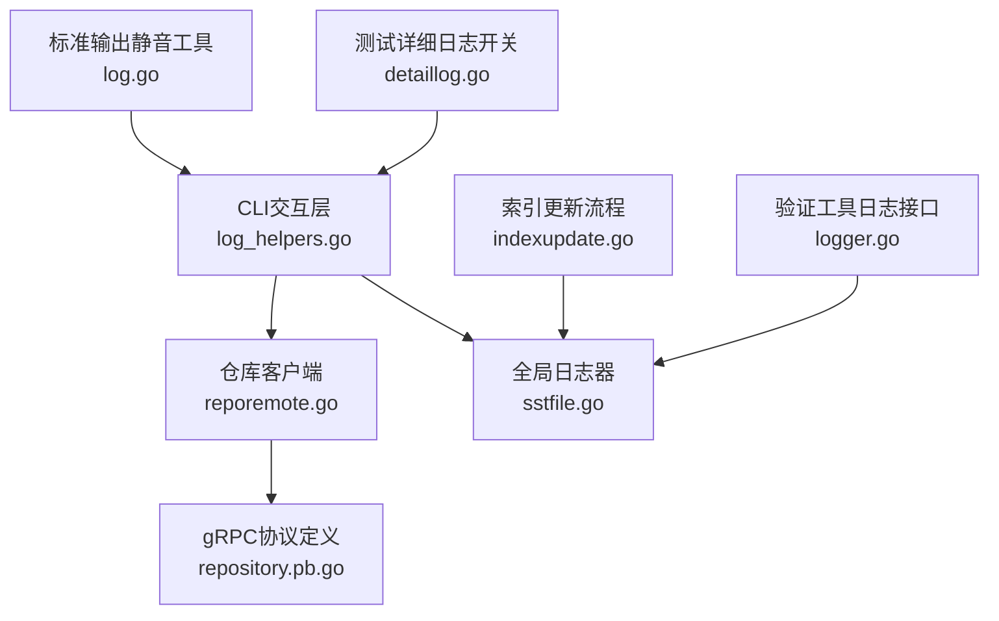
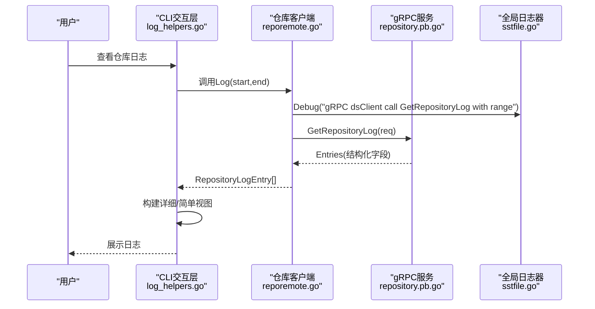
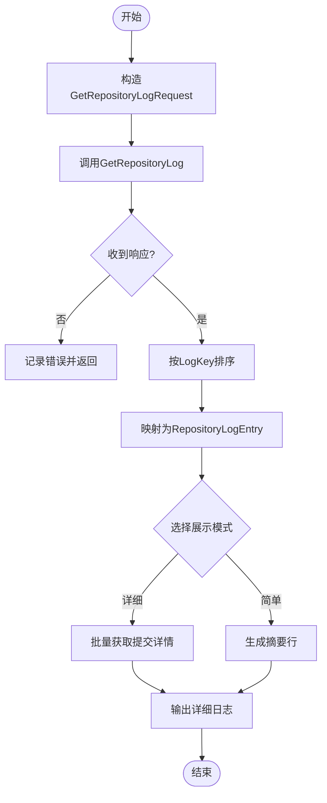
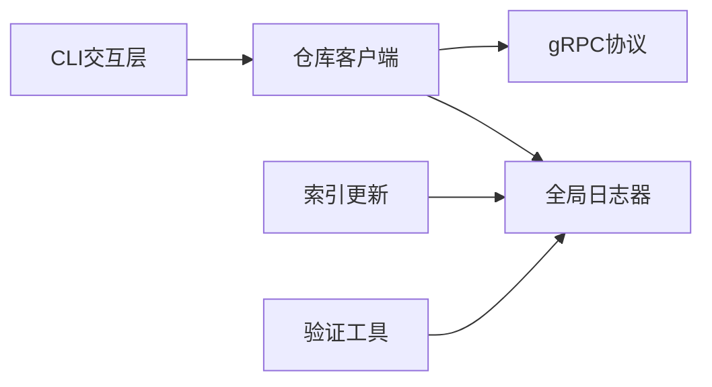

# 监控和日志

<cite>
**本文引用的文件**
- [sstfile.go](file://sst/sstfile.go)
- [log_helpers.go](file://cli/cmd/interactive/log_helpers.go)
- [reporemote.go](file://sst/reporemote.go)
- [repository.pb.go](file://bboltproto/repository.pb.go)
- [indexupdate.go](file://sst/indexupdate.go)
- [stage_handler.go](file://cli/cmd/interactive/stage_handler.go)
- [logger.go](file://tools/validate/logger.go)
- [log.go](file://cli/cmd/utils/log.go)
- [detaillog.go](file://sst_test/testutil/detaillog.go)
</cite>

## 目录
1. [简介](#简介)
2. [项目结构](#项目结构)
3. [核心组件](#核心组件)
4. [架构总览](#架构总览)
5. [详细组件分析](#详细组件分析)
6. [依赖关系分析](#依赖关系分析)
7. [性能考量](#性能考量)
8. [故障诊断指南](#故障诊断指南)
9. [结论](#结论)
10. [附录](#附录)

## 简介
本指南面向SST分布式系统的监控与日志管理，围绕以下目标展开：
- 关键性能指标（QPS、延迟、错误率、资源使用率）的采集与展示方案
- 结构化日志的配置与管理（级别、格式化、轮转策略）
- 分布式追踪的实现（请求链路跟踪、瓶颈识别）
- 监控告警系统配置（阈值、通知渠道、规则）
- 日志聚合与分析工具集成（ELK Stack、Prometheus、Grafana）
- 故障诊断流程与性能调优方法
- 监控仪表板模板与自定义指标定义示例

说明：本仓库提供了统一的日志基础设施（zap）、仓库操作日志（Repository Log）以及CLI交互层对日志的可视化能力。监控与追踪在代码层面未内置Prometheus/Grafana导出器或OpenTelemetry SDK，但可通过外部侧车/旁路方式接入。

## 项目结构
与监控和日志相关的关键位置：
- sst包提供全局日志器GlobalLogger及默认JSON编码器，供全库统一输出结构化日志
- CLI交互层提供仓库操作日志的查询与展示（支持详细视图与摘要视图）
- 远程仓库实现通过gRPC调用获取仓库日志条目，并返回结构化字段
- 索引更新等内部流程包含丰富的Debug/Warn/Error日志点，便于定位问题
- 验证工具模块定义了日志级别与接口抽象，便于扩展不同输出目标

图表来源
- [log_helpers.go:17-177](file://cli/cmd/interactive/log_helpers.go#L17-L177)
- [reporemote.go:1663-1717](file://sst/reporemote.go#L1663-L1717)
- [repository.pb.go:4111-4153](file://bboltproto/repository.pb.go#L4111-L4153)
- [sstfile.go:73-102](file://sst/sstfile.go#L73-L102)
- [indexupdate.go:210-337](file://sst/indexupdate.go#L210-L337)
- [logger.go:11-31](file://tools/validate/logger.go#L11-L31)
- [log.go:15-40](file://cli/cmd/utils/log.go#L15-L40)
- [detaillog.go:13-45](file://sst_test/testutil/detaillog.go#L13-L45)

章节来源
- [sstfile.go:73-102](file://sst/sstfile.go#L73-L102)
- [log_helpers.go:17-177](file://cli/cmd/interactive/log_helpers.go#L17-L177)
- [reporemote.go:1663-1717](file://sst/reporemote.go#L1663-L1717)
- [repository.pb.go:4111-4153](file://bboltproto/repository.pb.go#L4111-L4153)
- [indexupdate.go:210-337](file://sst/indexupdate.go#L210-L337)
- [logger.go:11-31](file://tools/validate/logger.go#L11-L31)
- [log.go:15-40](file://cli/cmd/utils/log.go#L15-L40)
- [detaillog.go:13-45](file://sst_test/testutil/detaillog.go#L13-L45)

## 核心组件
- 全局日志器与级别控制
  - 提供无操作默认日志器，支持注入自定义zap实例、启用默认JSON输出、运行时调整日志级别
  - 适用于所有内部模块的统一可观测性入口
- 仓库操作日志（Repository Log）
  - 通过gRPC接口GetRepositoryLog拉取结构化日志条目，包含类型、时间戳、作者、消息、影响范围等字段
  - CLI层支持“详细”和“简单”两种展示模式，并可批量获取提交详情以增强可读性
- 索引更新与内部流程日志
  - 索引构建、提交、分支切换、同步等路径均记录Warn/Error/Info级日志，便于定位异常
- 验证工具日志抽象
  - 定义日志级别与接口，便于将三元组校验结果输出到不同目标（控制台、文件、远端）
- 标准输出静音与测试详细日志
  - 提供静音stdout能力，便于在自动化场景下减少噪音；测试框架提供条件化详细日志开关

章节来源
- [sstfile.go:73-102](file://sst/sstfile.go#L73-L102)
- [log_helpers.go:17-177](file://cli/cmd/interactive/log_helpers.go#L17-L177)
- [reporemote.go:1663-1717](file://sst/reporemote.go#L1663-L1717)
- [indexupdate.go:210-337](file://sst/indexupdate.go#L210-L337)
- [logger.go:11-31](file://tools/validate/logger.go#L11-L31)
- [log.go:15-40](file://cli/cmd/utils/log.go#L15-L40)
- [detaillog.go:13-45](file://sst_test/testutil/detaillog.go#L13-L45)

## 架构总览
下图展示了从CLI到远程仓库的日志读取流程，以及全局日志器的使用位置。

图表来源
- [log_helpers.go:17-177](file://cli/cmd/interactive/log_helpers.go#L17-L177)
- [reporemote.go:1663-1717](file://sst/reporemote.go#L1663-L1717)
- [repository.pb.go:4111-4153](file://bboltproto/repository.pb.go#L4111-L4153)
- [sstfile.go:73-102](file://sst/sstfile.go#L73-L102)

## 详细组件分析

### 全局日志器与级别控制
- 功能要点
  - 默认无操作日志器，避免未初始化时的空指针风险
  - 支持注入自定义zap实例，便于在生产环境对接集中式日志系统
  - 启用默认JSON编码器输出，便于机器解析与聚合
  - 运行时原子级别控制，支持动态调整日志粒度
- 使用建议
  - 应用启动时设置生产级日志器，并配置输出到文件/网络
  - 通过AtomicLevel在调试阶段提升为Debug，稳定后回退至Info或Warn
  - 结合上下文（如请求ID、用户ID）附加结构化字段，便于链路追踪

章节来源
- [sstfile.go:73-102](file://sst/sstfile.go#L73-L102)

### 仓库操作日志（Repository Log）
- 数据模型
  - 日志条目包含LogKey与Fields键值对，type字段标识事件类型（init、commit、upload_document、download_document、delete_document、set_branch、remove_branch、sync_from等）
  - 其他字段包括author、message、timestamp、hash、size_bytes、branch、dataset、ds_revision、from_repo_url、affected_count等
- 读取流程
  - 客户端构造GetRepositoryLogRequest，可选start/end范围
  - 服务端返回Entries列表，客户端按LogKey排序并转换为内部结构
- CLI展示
  - 详细视图：批量获取提交详情，合并显示作者、消息、时间、分支、数据集版本等
  - 简单视图：仅显示事件类型与关键标识

图表来源
- [reporemote.go:1663-1717](file://sst/reporemote.go#L1663-L1717)
- [log_helpers.go:17-177](file://cli/cmd/interactive/log_helpers.go#L17-L177)
- [repository.pb.go:4111-4153](file://bboltproto/repository.pb.go#L4111-L4153)

章节来源
- [reporemote.go:1663-1717](file://sst/reporemote.go#L1663-L1717)
- [log_helpers.go:17-177](file://cli/cmd/interactive/log_helpers.go#L17-L177)
- [repository.pb.go:4111-4153](file://bboltproto/repository.pb.go#L4111-L4153)

### 索引更新与内部流程日志
- 关键日志点
  - 索引更新失败、中间批次刷新失败、提交后预条件检查失败、分支操作后索引更新失败等
  - 删除数据集索引成功的信息日志
- 用途
  - 快速定位索引不一致、写入失败、权限或资源不足等问题
  - 作为性能调优的切入点（例如批大小、刷新频率）

章节来源
- [indexupdate.go:210-337](file://sst/indexupdate.go#L210-L337)

### 验证工具日志抽象
- 设计要点
  - 定义日志级别（Info、InfoEnter、InfoLeave、Warn、Error）
  - 定义Logger接口，支持针对节点或图级别的日志输出
  - 提供三元组字符串格式化接口，便于统一输出格式
- 扩展方向
  - 可将验证结果输出到文件、数据库或远端日志系统
  - 与全局日志器集成，实现统一的可观测性

章节来源
- [logger.go:11-31](file://tools/validate/logger.go#L11-L31)

### 标准输出静音与测试详细日志
- 标准输出静音
  - 将stdout重定向到/dev/null，屏蔽fmt.Printf等输出，适合自动化脚本
  - 提供恢复原stdout的能力，保证可组合性
- 测试详细日志
  - 通过命令行参数控制是否开启详细日志，便于在CI中按需输出调试信息

章节来源
- [log.go:15-40](file://cli/cmd/utils/log.go#L15-L40)
- [detaillog.go:13-45](file://sst_test/testutil/detaillog.go#L13-L45)

## 依赖关系分析
- 耦合关系
  - CLI交互层依赖仓库客户端进行日志拉取，并通过全局日志器记录过程信息
  - 仓库客户端依赖gRPC协议定义进行序列化/反序列化
  - 索引更新模块依赖全局日志器记录内部状态与异常
  - 验证工具模块通过接口抽象解耦具体日志实现
- 外部依赖
  - zap用于结构化日志
  - gRPC用于远程仓库通信
  - 文件系统/存储后端（由上层服务实现）

图表来源
- [log_helpers.go:17-177](file://cli/cmd/interactive/log_helpers.go#L17-L177)
- [reporemote.go:1663-1717](file://sst/reporemote.go#L1663-L1717)
- [repository.pb.go:4111-4153](file://bboltproto/repository.pb.go#L4111-L4153)
- [indexupdate.go:210-337](file://sst/indexupdate.go#L210-L337)
- [sstfile.go:73-102](file://sst/sstfile.go#L73-L102)

章节来源
- [log_helpers.go:17-177](file://cli/cmd/interactive/log_helpers.go#L17-L177)
- [reporemote.go:1663-1717](file://sst/reporemote.go#L1663-L1717)
- [repository.pb.go:4111-4153](file://bboltproto/repository.pb.go#L4111-L4153)
- [indexupdate.go:210-337](file://sst/indexupdate.go#L210-L337)
- [sstfile.go:73-102](file://sst/sstfile.go#L73-L102)

## 性能考量
- 日志级别与开销
  - 生产环境建议使用Info或Warn级别，避免高频Debug造成I/O压力
  - 利用AtomicLevel在需要时临时提升级别，观察热点路径
- 结构化日志
  - 使用zap的结构化字段而非拼接字符串，降低解析成本并提升可查询性
- 日志轮转
  - 建议在应用外通过日志收集器（如Fluent Bit/Filebeat）配合日志轮转策略（按大小/时间）管理磁盘占用
- 远程日志拉取
  - 合理设置start/end范围，避免一次性拉取过多条目导致内存与带宽压力
- 索引更新
  - 关注批处理大小与刷新频率，结合错误日志定位瓶颈

[本节为通用指导，不直接分析具体文件]

## 故障诊断指南
- 常见问题定位
  - 索引更新失败：检查索引更新相关的Warn/Error日志，确认数据一致性与权限
  - 远程日志拉取失败：检查gRPC调用错误与认证上下文（OAuth token）
  - CLI展示异常：确认日志字段完整性，必要时切换到详细视图并批量获取提交详情
- 诊断步骤
  - 启用默认JSON日志器，确保输出可被聚合系统解析
  - 在关键路径添加上下文（请求ID、用户ID），便于跨服务追踪
  - 使用CLI的日志查看功能，结合时间范围过滤定位问题
- 告警建议
  - 基于错误日志计数与延迟指标设置阈值告警
  - 对索引更新失败、远程调用超时等关键错误设置即时通知

章节来源
- [indexupdate.go:210-337](file://sst/indexupdate.go#L210-L337)
- [reporemote.go:1663-1717](file://sst/reporemote.go#L1663-L1717)
- [log_helpers.go:17-177](file://cli/cmd/interactive/log_helpers.go#L17-L177)
- [sstfile.go:73-102](file://sst/sstfile.go#L73-L102)

## 结论
SST仓库提供了统一的结构化日志基础设施与仓库操作日志能力，结合CLI的可视化展示，可满足日常运维与问题定位需求。对于更全面的监控与追踪，建议通过外部工具（Prometheus、Grafana、ELK、OpenTelemetry）与现有日志体系集成，形成完整的可观测性闭环。

[本节为总结性内容，不直接分析具体文件]

## 附录

### 关键性能指标的采集与展示方案
- QPS
  - 通过外部代理或网关统计每秒请求数，结合仓库操作日志中的事件类型（commit、upload/download等）计算业务QPS
- 延迟
  - 在gRPC调用前后记录时间戳，计算端到端延迟；结合日志中的请求ID进行关联
- 错误率
  - 统计错误日志占比，重点关注索引更新失败、远程调用异常等
- 资源使用率
  - 通过系统监控（CPU、内存、磁盘、网络）与日志中的I/O指标综合评估

[本节为通用指导，不直接分析具体文件]

### 结构化日志的配置与管理
- 日志级别
  - 使用AtomicLevel在运行时调整，生产建议Info/Warn
- 格式化
  - 启用默认JSON编码器，便于机器解析与聚合
- 轮转策略
  - 建议由日志收集器负责轮转，按大小或时间切分，保留策略由合规要求决定

章节来源
- [sstfile.go:73-102](file://sst/sstfile.go#L73-L102)

### 分布式追踪的实现方案
- 请求链路跟踪
  - 在gRPC上下文中注入TraceID，贯穿客户端与服务端，结合日志中的TraceID进行关联
- 性能瓶颈识别
  - 通过分段计时（网络、索引、存储）定位慢点，结合错误日志分析根因

[本节为通用指导，不直接分析具体文件]

### 监控告警系统的配置
- 阈值设置
  - 基于历史基线设置动态阈值，避免误报
- 通知渠道
  - 邮件、短信、IM等多渠道，确保及时触达
- 告警规则
  - 错误率突增、延迟飙升、资源耗尽等关键指标

[本节为通用指导，不直接分析具体文件]

### 日志聚合与分析工具集成
- ELK Stack
  - 使用Filebeat/Fluentd采集JSON日志，Elasticsearch存储，Kibana可视化
- Prometheus与Grafana
  - 通过Exporter暴露指标，Grafana构建仪表板
- 与SST集成
  - 利用全局日志器输出结构化日志，结合外部工具实现统一可观测性

[本节为通用指导，不直接分析具体文件]

### 故障诊断流程与性能调优方法
- 诊断流程
  - 复现问题 -> 收集日志与指标 -> 定位根因 -> 修复验证
- 调优方法
  - 调整日志级别、批处理大小、刷新频率，优化I/O与CPU使用

[本节为通用指导，不直接分析具体文件]

### 监控仪表板模板与自定义指标定义示例
- 仪表板模板
  - QPS趋势、延迟分布、错误率、资源使用率
- 自定义指标
  - 仓库操作次数、索引更新耗时、远程调用成功率

[本节为通用指导，不直接分析具体文件]