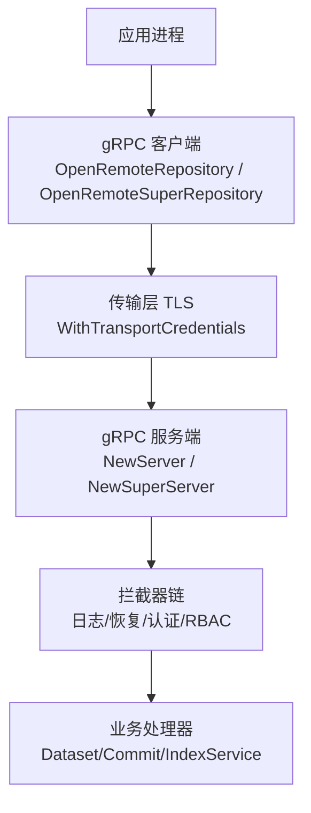
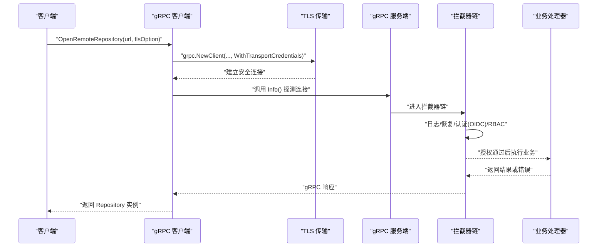
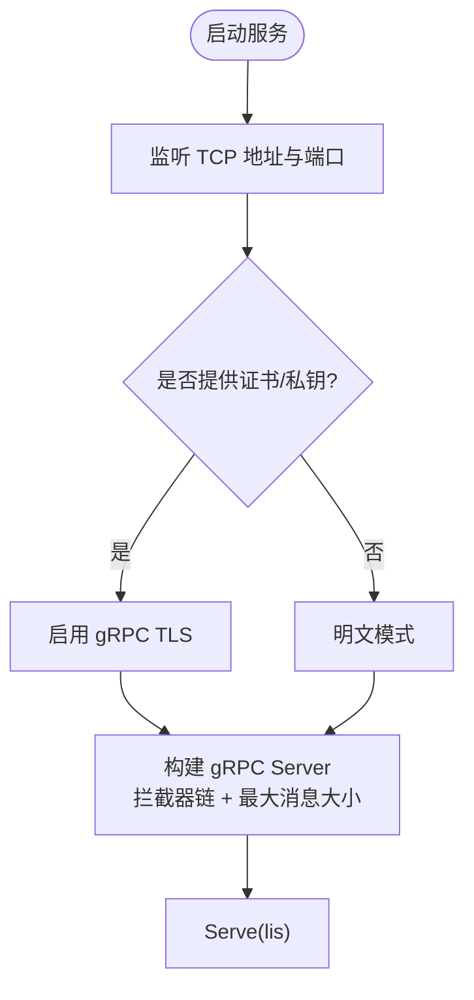
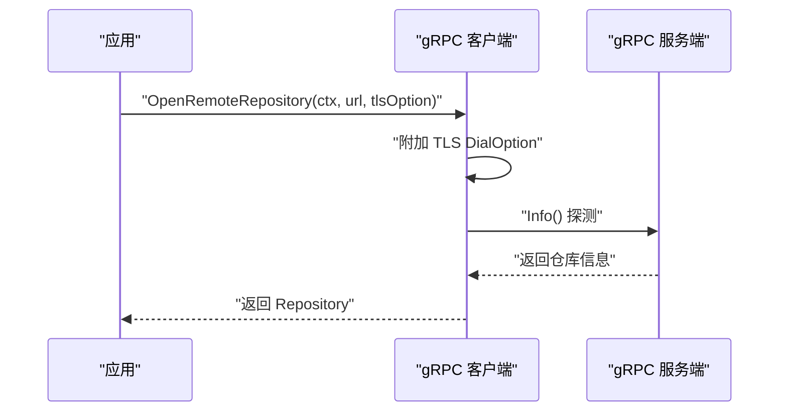
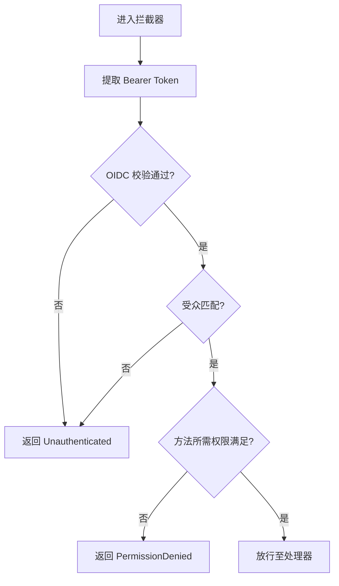
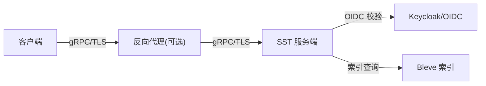

# 网络配置

<cite>
**本文引用的文件**
- [reporemoteapp.go](file://sst/reporemoteapp.go)
- [repository.go](file://sst/repository.go)
- [reporemote.go](file://sst/reporemote.go)
- [superremoterepository.go](file://sst/superremoterepository.go)
- [authoids.go](file://sstauth/authoids.go)
- [ACCESS_RIGHTS.md](file://sstauth/ACCESS_RIGHTS.md)
- [main.go（远程仓库示例）](file://examples/helloworldreporemote/main.go)
- [main.go（超级仓库示例）](file://examples/helloworldsuperreporemote/main.go)
</cite>

## 目录
1. [简介](#简介)
2. [项目结构](#项目结构)
3. [核心组件](#核心组件)
4. [架构总览](#架构总览)
5. [详细组件分析](#详细组件分析)
6. [依赖关系分析](#依赖关系分析)
7. [性能与调优](#性能与调优)
8. [故障排除指南](#故障排除指南)
9. [结论](#结论)
10. [附录：部署模板与最佳实践](#附录部署模板与最佳实践)

## 简介
本指南聚焦于 SST 分布式网络的 gRPC 服务器与客户端配置，覆盖端口监听、TLS 加密与证书、认证与授权（OIDC/RBAC）、连接参数调优（超时、重试、连接池）、反向代理（Nginx/HAProxy）与负载均衡策略、网络安全（IP 白名单、访问控制、流量监控），以及开发/测试/生产环境的网络配置模板与排障方法。内容基于代码库中的服务端实现、客户端拨号流程与安全拦截器进行系统化说明。

## 项目结构
SST 的网络能力由以下关键部分构成：
- 服务端：gRPC 服务构建、拦截器链、TLS 启用、RBAC 校验、最大消息大小限制等。
- 客户端：远程仓库连接建立、OAuth2 Bearer Token 注入、上下文超时控制。
- 安全：OIDC 验证、按方法的最小权限模型、流式 RPC 的二次校验。
- 示例：提供可运行的远程仓库与超级仓库启动入口，便于快速搭建网络拓扑。

图表来源
- [reporemoteapp.go:456-529](file://sst/reporemoteapp.go#L456-L529)
- [repository.go:257-309](file://sst/repository.go#L257-L309)
- [reporemote.go:265-285](file://sst/reporemote.go#L265-L285)

章节来源
- [reporemoteapp.go:295-329](file://sst/reporemoteapp.go#L295-L329)
- [repository.go:240-309](file://sst/repository.go#L240-L309)
- [reporemote.go:265-285](file://sst/reporemote.go#L265-L285)
- [main.go（远程仓库示例）:52-78](file://examples/helloworldreporemote/main.go#L52-L78)
- [main.go（超级仓库示例）:52-78](file://examples/helloworldsuperreporemote/main.go#L52-L78)

## 核心组件
- gRPC 服务端配置与启动
  - 通过 RepositoryServerConfig 配置仓库目录、OIDC Issuer/ClientID、TLS 证书、是否开启 per-repo 鉴权等。
  - newServerWithConfig 组装拦截器链（状态转换、可选日志、恢复、认证、RBAC），设置最大接收消息大小，并可选启用 TLS。
- 客户端连接与认证
  - OpenRemoteRepository/OpenRemoteSuperRepository 使用 grpc.DialOption 传入 TLS 凭证，并从上下文中获取 OAuth2 Token 注入到每个调用。
  - dialRepository 使用 grpc.NewClient 创建通道，构造 Dataset/Commit/Index 客户端。
- 安全与授权
  - 服务端通过 UnaryRBACInterceptor/StreamRBACInterceptor 解析 Bearer Token、校验 OIDC、按方法最小权限放行。
  - 流式 RPC 在处理器内对首个消息进行 RepoName 提取后执行 CheckRepoAccess，完成细粒度授权。

章节来源
- [reporemoteapp.go:456-529](file://sst/reporemoteapp.go#L456-L529)
- [repository.go:257-309](file://sst/repository.go#L257-L309)
- [reporemote.go:265-285](file://sst/reporemote.go#L265-L285)
- [authoids.go:294-337](file://sstauth/authoids.go#L294-L337)
- [authoids.go:409-461](file://sstauth/authoids.go#L409-L461)
- [ACCESS_RIGHTS.md:103-128](file://sstauth/ACCESS_RIGHTS.md#L103-L128)

## 架构总览
下图展示了从客户端发起请求到服务端处理的全链路，包括 TLS、认证、RBAC 与业务处理。

图表来源
- [repository.go:257-309](file://sst/repository.go#L257-L309)
- [reporemote.go:265-285](file://sst/reporemote.go#L265-L285)
- [reporemoteapp.go:456-529](file://sst/reporemoteapp.go#L456-L529)
- [authoids.go:409-461](file://sstauth/authoids.go#L409-L461)

## 详细组件分析

### 服务端监听与 TLS 配置
- 监听地址与端口
  - 示例程序通过 net.Listen("tcp", bindAddress) 绑定地址与端口，默认端口为 5581。
- TLS 证书加载与启用
  - 若提供证书与私钥文件，则加载为 *tls.Certificate，并在 newServerWithConfig 中通过 grpc.Creds(credentials.NewServerTLSFromCert(...)) 启用 TLS。
- 最大消息大小
  - 服务端设置 MaxRecvMsgSize(10MB)，避免大消息被拒绝。

图表来源
- [main.go（远程仓库示例）:52-78](file://examples/helloworldreporemote/main.go#L52-L78)
- [reporemoteapp.go:523-529](file://sst/reporemoteapp.go#L523-L529)

章节来源
- [main.go（远程仓库示例）:52-78](file://examples/helloworldreporemote/main.go#L52-L78)
- [main.go（超级仓库示例）:52-78](file://examples/helloworldsuperreporemote/main.go#L52-L78)
- [reporemoteapp.go:523-529](file://sst/reporemoteapp.go#L523-L529)

### 客户端连接参数与认证注入
- 连接建立
  - OpenRemoteRepository 将 TLS DialOption 加入选项，并通过 grpc.NewClient 建立连接；URL 含 # 片段时走 SuperRepository 路径。
  - dialRepository 封装了通道创建与客户端初始化。
- 认证注入
  - 从上下文获取 AuthProvider，取得 OAuth2 Token，并以 PerRPCCredentials 注入到每次调用。
- 连接有效性探测
  - 打开后立即调用 Info() 以验证连接有效。

图表来源
- [repository.go:257-309](file://sst/repository.go#L257-L309)
- [reporemote.go:265-285](file://sst/reporemote.go#L265-L285)

章节来源
- [repository.go:257-309](file://sst/repository.go#L257-L309)
- [reporemote.go:265-285](file://sst/reporemote.go#L265-L285)

### 认证与授权（OIDC + RBAC）
- 令牌提取与校验
  - 服务端从 gRPC metadata 中提取 Authorization: Bearer <token>，使用 OIDC Verifier 校验签名与过期时间。
- 受众与角色检查
  - 根据 Issuer/ClientID 与 PerRepoAuth 判断受众；按方法映射的最小 AccessMode 进行授权。
- 流式 RPC 的二次校验
  - 流式调用在处理器读取首个消息后，通过 CheckRepoAccess 完成精确的 per-repo 授权。

图表来源
- [authoids.go:294-337](file://sstauth/authoids.go#L294-L337)
- [authoids.go:409-461](file://sstauth/authoids.go#L409-L461)
- [ACCESS_RIGHTS.md:103-128](file://sstauth/ACCESS_RIGHTS.md#L103-L128)

章节来源
- [authoids.go:294-337](file://sstauth/authoids.go#L294-L337)
- [authoids.go:409-461](file://sstauth/authoids.go#L409-L461)
- [ACCESS_RIGHTS.md:103-128](file://sstauth/ACCESS_RIGHTS.md#L103-L128)

### 超级仓库与单仓库模式
- 单仓库模式
  - NewServer 强制关闭 per-repo 鉴权，适用于单一仓库场景。
- 超级仓库模式
  - NewSuperServer 支持 per-repo 鉴权，管理多个子仓库，并提供配额与数量限制接口。

章节来源
- [reporemoteapp.go:328-349](file://sst/reporemoteapp.go#L328-L349)
- [superremoterepository.go:139-176](file://sst/superremoterepository.go#L139-L176)

## 依赖关系分析
- 服务端依赖
  - gRPC 框架、OIDC 验证库、RBAC 拦截器、Bleve 索引服务。
- 客户端依赖
  - gRPC 客户端、OAuth2 凭据注入、上下文超时控制。
- 外部集成点
  - Keycloak/OIDC 提供者用于签发与校验令牌。
  - 可选反向代理（Nginx/HAProxy）用于终止 TLS、负载均衡与健康检查。

图表来源
- [reporemoteapp.go:456-529](file://sst/reporemoteapp.go#L456-L529)
- [repository.go:257-309](file://sst/repository.go#L257-L309)

章节来源
- [reporemoteapp.go:456-529](file://sst/reporemoteapp.go#L456-L529)
- [repository.go:257-309](file://sst/repository.go#L257-L309)

## 性能与调优
- 连接与超时
  - 建议在客户端使用 context.WithTimeout 控制单次调用超时，避免长阻塞。
  - 对于批量或流式操作，合理设置上下文超时与取消逻辑。
- 重试机制
  - 当前代码未内置自动重试；可在上层封装重试策略（指数退避、幂等性保护）。
- 连接池
  - gRPC 内部维护连接池；可通过 DialOption 控制最大空闲连接、KeepAlive 等参数（需结合部署环境调整）。
- 消息大小
  - 服务端已设置最大接收消息大小为 10MB；如需更大负载，请在服务端与代理层同步调整。
- 并发与背压
  - 使用分页 API（如 ListDatasets）避免一次性拉取大量数据；合理设置 PageSize。

[本节为通用指导，不直接分析具体文件]

## 故障排除指南
- 无法建立 TLS 连接
  - 检查服务端是否加载证书与私钥；确认客户端使用的 TLS DialOption 与服务端一致。
- 认证失败（Unauthenticated）
  - 检查 Authorization 头格式是否为 "Bearer <token>"；确认 OIDC Issuer/ClientID 配置正确。
- 权限不足（PermissionDenied）
  - 核对 Token 的受众与角色是否符合方法所需的最小权限；确认 per-repo 模式下受众形如 "<superClientID>#<repoName>"。
- 流式调用异常
  - 确保处理器在读取首个消息后调用 CheckRepoAccess；检查 repoName 是否正确传递。
- 大消息被拒绝
  - 确认服务端 MaxRecvMsgSize 与代理层（如 Nginx/HAProxy）的缓冲限制一致。

章节来源
- [authoids.go:294-337](file://sstauth/authoids.go#L294-L337)
- [authoids.go:409-461](file://sstauth/authoids.go#L409-L461)
- [reporemoteapp.go:523-529](file://sst/reporemoteapp.go#L523-L529)

## 结论
SST 的网络栈以 gRPC 为核心，结合 OIDC 与 RBAC 提供强安全的远程仓库访问能力。通过灵活的 TLS 配置、上下文超时控制与可扩展的反向代理部署，可满足开发、测试与生产环境的多样化需求。建议在生产环境中始终启用 TLS、严格配置 OIDC 受众与角色、并结合代理层实施 IP 白名单与流量监控。

[本节为总结，不直接分析具体文件]

## 附录：部署模板与最佳实践

### 端口与监听
- 默认监听端口：5581（可通过命令行参数修改）。
- 建议：对外暴露端口仅开放必要服务，使用防火墙或安全组限制来源 IP。

章节来源
- [main.go（远程仓库示例）:150-156](file://examples/helloworldreporemote/main.go#L150-L156)
- [main.go（超级仓库示例）:150-156](file://examples/helloworldsuperreporemote/main.go#L150-L156)

### TLS 与证书
- 服务端：提供证书与私钥文件即可启用 TLS。
- 客户端：使用 WithTransportCredentials 传入相同信任链。
- 建议：使用受信任 CA 签发的证书；定期轮换证书；在代理层统一终止 TLS。

章节来源
- [main.go（远程仓库示例）:58-78](file://examples/helloworldreporemote/main.go#L58-L78)
- [reporemoteapp.go:523-529](file://sst/reporemoteapp.go#L523-L529)

### 认证与授权
- 服务端：配置 Issuer 与 ClientID；可选择 per-repo 鉴权。
- 客户端：通过 ContextWithAuthProvider 注入 Token；每个 RPC 自动携带 Bearer Token。
- 建议：最小权限原则；为不同仓库分配独立客户端 ID 与角色。

章节来源
- [ACCESS_RIGHTS.md:173-231](file://sstauth/ACCESS_RIGHTS.md#L173-L231)
- [ACCESS_RIGHTS.md:240-258](file://sstauth/ACCESS_RIGHTS.md#L240-L258)
- [authoids.go:294-337](file://sstauth/authoids.go#L294-L337)

### 反向代理与负载均衡
- Nginx
  - 终止 TLS，转发 gRPC 流量；设置合理的 proxy_read_timeout 与 client_max_body_size。
- HAProxy
  - 配置 gRPC 健康检查与后端权重；启用 HTTP/2 支持。
- 建议：在多副本部署中使用会话亲和或无状态设计；结合指标监控进行弹性扩缩容。

[本节为通用指导，不直接分析具体文件]

### 网络安全
- IP 白名单：在防火墙/安全组层面限制来源 IP。
- 访问控制：严格配置 OIDC 受众与角色；启用 per-repo 鉴权。
- 流量监控：采集 gRPC 请求量、延迟、错误率；设置告警阈值。

[本节为通用指导，不直接分析具体文件]

### 环境模板
- 开发
  - 本地监听 localhost:5581；可选启用 TLS；使用 test://issuer 进行快速调试。
- 测试
  - 使用真实 OIDC Issuer；启用 per-repo 鉴权；配置最小权限角色。
- 生产
  - 强制 TLS；多副本部署；反向代理统一入口；严格 RBAC 与审计日志。

章节来源
- [reporemoteapp.go:474-512](file://sst/reporemoteapp.go#L474-L512)
- [ACCESS_RIGHTS.md:173-231](file://sstauth/ACCESS_RIGHTS.md#L173-L231)