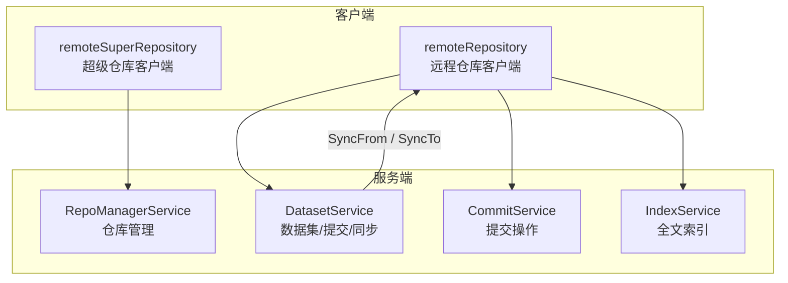
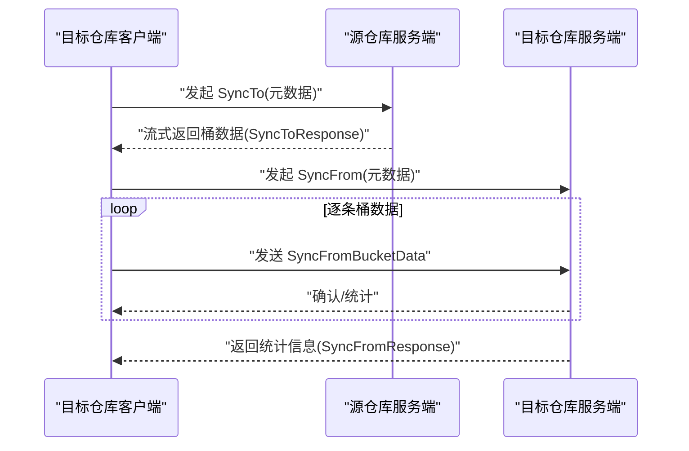
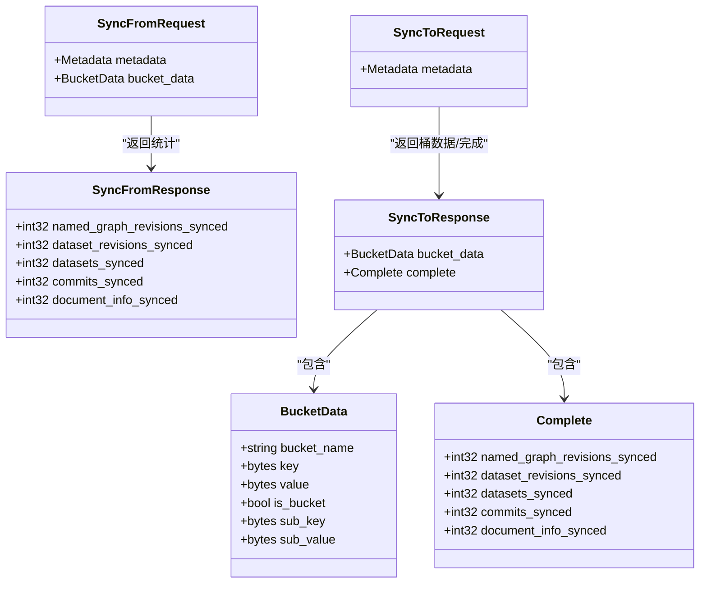
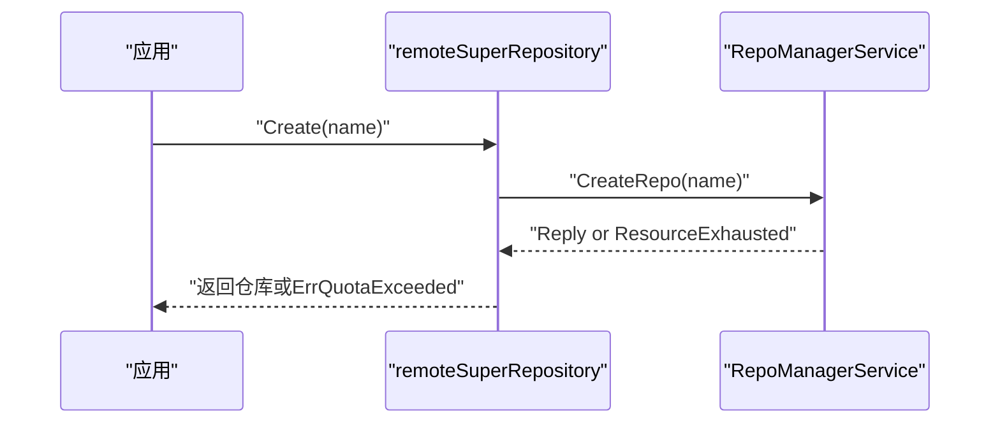
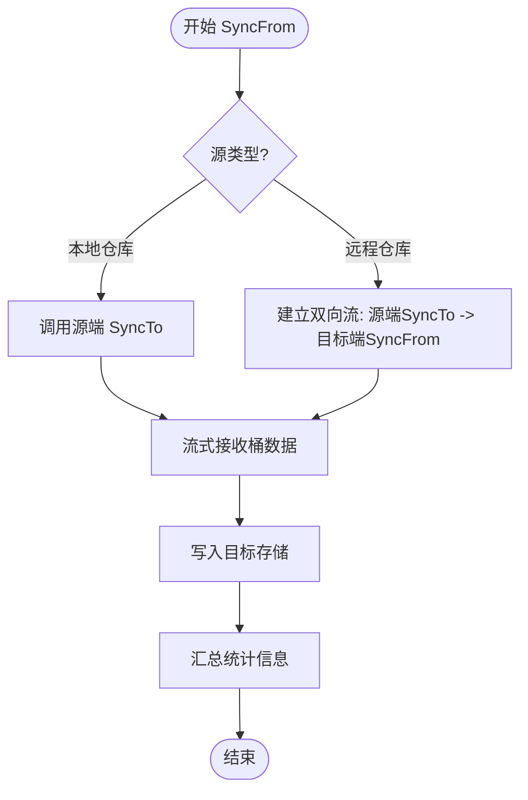
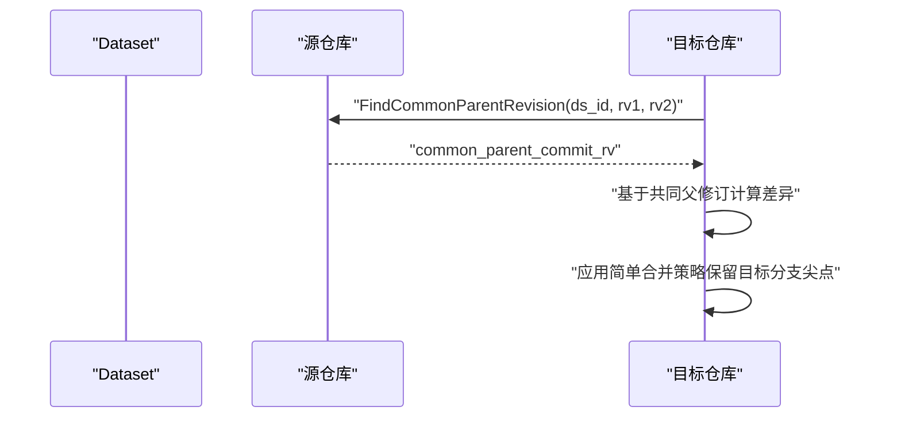
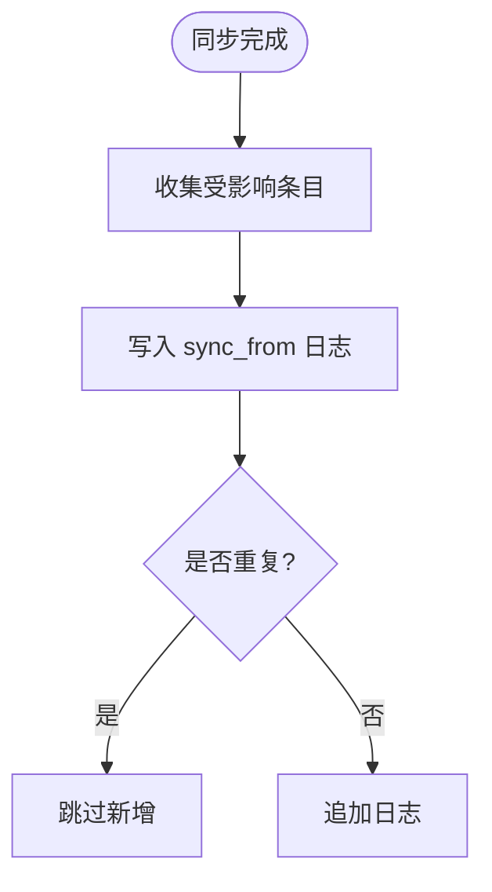
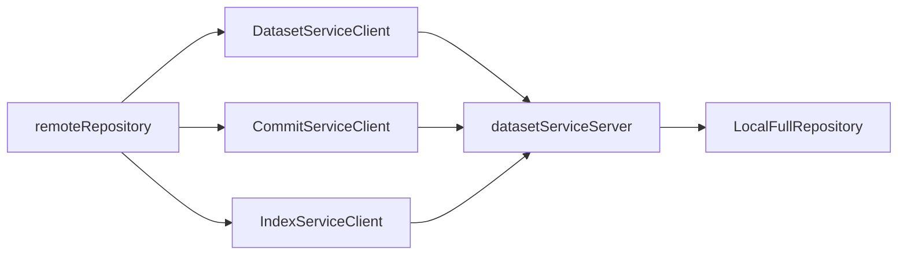
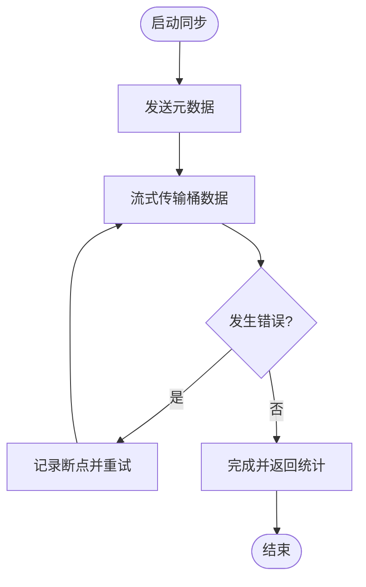

# 数据同步机制

<cite>
**本文引用的文件**
- [repository.proto](file://bboltproto/repository.proto)
- [repository_grpc.pb.go](file://bboltproto/repository_grpc.pb.go)
- [remote.go](file://bboltproto/remote.go)
- [superremoterepository.go](file://sst/superremoterepository.go)
- [reporemote.go](file://sst/reporemote.go)
- [reporemoteds.go](file://sst/reporemoteds.go)
- [syncfromlog.go](file://sst/syncfromlog.go)
- [stagefsremoterepo.go](file://sst/stagefsremoterepo.go)
- [main.go](file://examples/helloworldsuperreporemote/main.go)
</cite>

## 目录
1. [简介](#简介)
2. [项目结构](#项目结构)
3. [核心组件](#核心组件)
4. [架构总览](#架构总览)
5. [详细组件分析](#详细组件分析)
6. [依赖关系分析](#依赖关系分析)
7. [性能与配置调优](#性能与配置调优)
8. [故障恢复与断点续传](#故障恢复与断点续传)
9. [实践示例与最佳实践](#实践示例与最佳实践)
10. [结论](#结论)

## 简介
本文件系统性阐述 SST 超级仓库的数据同步机制，覆盖跨仓库数据同步的核心概念、gRPC 通信协议与数据传输格式、RepositoryManagerService 接口定义、数据一致性保证与冲突解决策略、配置选项与性能调优参数，以及故障恢复与断点续传的实现方案。文档面向不同技术背景的读者，提供从高层到代码级的分层说明，并辅以流程图和时序图帮助理解。

## 项目结构
SST 的远程数据同步由以下关键模块组成：
- gRPC 协议定义与服务实现：位于 bboltproto 包，包含 RepositoryManagerService、DatasetService、CommitService、RefService 等接口与消息定义，以及服务端实现。
- 客户端封装：位于 sst 包，提供 remoteRepository、remoteSuperRepository 等客户端类型，负责发起 gRPC 调用、流式传输处理、认证注入与缓存。
- 同步流程：通过 DatasetService 的 SyncFrom/SyncTo 双向流完成跨仓库数据同步；本地仓库作为数据源时，使用 SyncTo 将桶数据流式推送至目标；远程对远程场景下，目标端通过 SyncFrom 接收并写入本地存储。
- 审计与日志：同步完成后记录 sync_from 日志条目，便于追踪影响范围与来源仓库。

**图示来源**
- [repository.proto:13-131](file://bboltproto/repository.proto#L13-L131)
- [reporemote.go:265-285](file://sst/reporemote.go#L265-L285)
- [superremoterepository.go:26-47](file://sst/superremoterepository.go#L26-L47)

**章节来源**
- [repository.proto:13-131](file://bboltproto/repository.proto#L13-L131)
- [reporemote.go:265-285](file://sst/reporemote.go#L265-L285)
- [superremoterepository.go:26-47](file://sst/superremoterepository.go#L26-L47)

## 核心组件
- 远程超级仓库客户端（remoteSuperRepository）：负责连接远端超级仓库服务，列举、创建、删除仓库，查询配额与最大仓库数量等。
- 远程仓库客户端（remoteRepository）：封装对远端仓库的读写、分支、提交、索引搜索、同步等操作，支持分页、字段掩码、流式传输。
- gRPC 服务（DatasetService/CommitService/RepoManagerService/IndexService）：提供仓库元数据、数据集、提交、文档、同步等能力。
- 同步协议（SyncFrom/SyncTo）：基于流式传输的跨仓库数据同步协议，支持按数据集、分支过滤，返回统计信息。
- 同步日志（sync_from）：在目标仓库中记录同步来源、影响范围等信息，用于审计与回溯。

**章节来源**
- [superremoterepository.go:20-124](file://sst/superremoterepository.go#L20-L124)
- [reporemote.go:88-144](file://sst/reporemote.go#L88-L144)
- [reporemoteds.go:39-132](file://sst/reporemoteds.go#L39-L132)
- [repository.proto:88-131](file://bboltproto/repository.proto#L88-L131)
- [syncfromlog.go:172-224](file://sst/syncfromlog.go#L172-L224)

## 架构总览
SST 的跨仓库数据同步采用“源端拉取 + 目标端写入”的双向流模式：
- 当源为本地仓库时，目标端通过 gRPC 调用源端的 SyncTo，获取桶数据流（ngr/dsr/c/ds/document_info），并在目标端通过 SyncFrom 写入本地存储。
- 当源为远程仓库时，目标端同时建立两条流：从源端拉取 SyncTo 数据，再转发到目标端的 SyncFrom 进行落库。
- 同步完成后，目标端生成 sync_from 日志条目，记录来源仓库 URL、受影响的数据集、分支与修订版本。

**图示来源**
- [repository.proto:669-742](file://bboltproto/repository.proto#L669-L742)
- [reporemote.go:2007-2165](file://sst/reporemote.go#L2007-L2165)
- [reporemoteds.go:407-452](file://sst/reporemoteds.go#L407-L452)

## 详细组件分析

### gRPC 协议与数据传输格式
- RepoManagerService：提供仓库列表、创建、删除、配额与最大仓库数量管理。
- DatasetService：提供数据集、分支、提交、文档、下载命名图修订、查找共同父修订、同步（SyncFrom/SyncTo）等接口。
- CommitService：提供提交列表、详情、批量详情、比较提交等接口。
- RefService：提供引用（分支/叶节点）列表与获取。
- 同步消息：
  - SyncFromRequest：包含元数据（仓库名、数据集ID、分支、来源URL）与桶数据（bucket_name/key/value/is_bucket/sub_key/sub_value）。
  - SyncFromResponse：统计信息（命名图修订、数据集修订、数据集、提交、文档信息同步计数）。
  - SyncToRequest：包含元数据（数据集ID、分支）。
  - SyncToResponse：包含桶数据或完成信号（Complete）。

**图示来源**
- [repository.proto:669-742](file://bboltproto/repository.proto#L669-L742)

**章节来源**
- [repository.proto:13-131](file://bboltproto/repository.proto#L13-L131)
- [repository.proto:669-742](file://bboltproto/repository.proto#L669-L742)

### 远程超级仓库管理器（RepoManagerService）
- 功能：列举仓库、创建/删除仓库、查询/设置仓库配额与超级配额、查询/设置最大仓库数量。
- 客户端实现：remoteSuperRepository 通过 gRPC 调用这些方法，支持 OAuth 认证注入。
- 错误处理：创建仓库时若资源耗尽（ResourceExhausted），转换为 ErrQuotaExceeded 以便上层统一处理。

**图示来源**
- [superremoterepository.go:74-90](file://sst/superremoterepository.go#L74-L90)
- [repository.proto:13-24](file://bboltproto/repository.proto#L13-L24)

**章节来源**
- [superremoterepository.go:26-124](file://sst/superremoterepository.go#L26-L124)
- [repository.proto:13-24](file://bboltproto/repository.proto#L13-L24)

### 远程仓库客户端（remoteRepository）与同步流程
- 同步入口：SyncFrom(ctx, from, options...) 根据源类型分派到本地或远程同步路径。
- 本地源同步：调用源端的 SyncTo 流获取桶数据，再通过目标端的 SyncFrom 流写入目标存储。
- 远程源同步：同时建立两条流，从源端拉取 SyncTo 数据，转发到目标端的 SyncFrom 进行落库。
- 认证与权限：每次 gRPC 调用均尝试从上下文提取 OAuth Token，并附加为 PerRPCCredentials。
- 分页与字段掩码：ListDatasets 等方法支持分页与 FieldMask，减少不必要字段传输。

**图示来源**
- [reporemote.go:2007-2165](file://sst/reporemote.go#L2007-L2165)
- [reporemoteds.go:407-452](file://sst/reporemoteds.go#L407-L452)

**章节来源**
- [reporemote.go:2007-2165](file://sst/reporemote.go#L2007-L2165)
- [reporemoteds.go:407-452](file://sst/reporemoteds.go#L407-L452)

### 数据一致性保证与冲突解决
- 共同父修订：通过 FindCommonParentRevision 计算两个数据集修订的共同父修订，用于差异合并与冲突检测。
- 提交比较：CompareCommits 支持批量比较提交关系（无关、旧于、相同、新于），辅助判断合并策略。
- 分支与叶节点：GetBranches/GetLeafCommits 提供分支与叶节点提交集合，确保引用一致性与可追溯性。
- 简单合并策略：测试表明，简化合并策略会保留目标端现有分支尖点，避免覆盖用户工作。

**图示来源**
- [reporemote.go:679-703](file://sst/reporemote.go#L679-L703)
- [repository.proto:133-142](file://bboltproto/repository.proto#L133-L142)

**章节来源**
- [reporemote.go:679-703](file://sst/reporemote.go#L679-L703)
- [repository.proto:133-142](file://bboltproto/repository.proto#L133-L142)

### 同步日志与审计
- 同步后记录：writeSyncFromLogEntry 在目标仓库中写入 type="sync_from" 的日志条目，包含作者、时间戳、来源仓库 URL、受影响数据集、分支与修订。
- 去重与增量：re-sync 不会重复创建日志条目，因为修订已存在，仅记录一次影响范围。
- 排除源日志：同步过程中不复制源仓库的 commit 日志，目标仓库仅记录自身的 sync_from 日志。

**图示来源**
- [syncfromlog.go:172-224](file://sst/syncfromlog.go#L172-L224)

**章节来源**
- [syncfromlog.go:172-224](file://sst/syncfromlog.go#L172-L224)

### 阶段文件系统与内存写入
- remoteRepoFS：模拟只读文件系统，用于读取命名图修订内容；OpenFile 支持截断写入，Close 时计算哈希并更新映射。
- 用途：在阶段操作中临时构建命名图内容，最终持久化到仓库存储。

**章节来源**
- [stagefsremoterepo.go:16-131](file://sst/stagefsremoterepo.go#L16-L131)

## 依赖关系分析
- 客户端依赖：remoteRepository 依赖 gRPC 客户端（DatasetService/CommitService/IndexService），并通过 sstauth 注入认证。
- 服务端依赖：datasetServiceServer 将 gRPC 请求路由到具体仓库实现，执行权限校验与业务逻辑。
- 协议依赖：所有数据交换遵循 repository.proto 定义的消息结构，确保跨语言与版本兼容性。

**图示来源**
- [reporemote.go:265-285](file://sst/reporemote.go#L265-L285)
- [reporemoteds.go:39-132](file://sst/reporemoteds.go#L39-L132)

**章节来源**
- [reporemote.go:265-285](file://sst/reporemote.go#L265-L285)
- [reporemoteds.go:39-132](file://sst/reporemoteds.go#L39-L132)

## 性能与配置调优
- 分页大小：ListDatasets 默认页大小为 100，最大限制为 1000，可根据网络与内存调整。
- 字段掩码：使用 FieldMask 屏蔽不必要字段（如 UUID/IRI），减少传输开销。
- 流式传输：SyncFrom/SyncTo 使用流式 API，避免一次性加载大数据集到内存。
- 认证开销：OAuth Token 在每次 gRPC 调用前解析并附加，建议复用连接与上下文以减少开销。
- 索引刷新：SetBranch/RemoveBranch 后调用 FlushBleveIndex，确保异步索引更新可见。

**章节来源**
- [reporemoteds.go:670-751](file://sst/reporemoteds.go#L670-L751)
- [reporemoteds.go:568-596](file://sst/reporemoteds.go#L568-L596)
- [reporemote.go:146-207](file://sst/reporemote.go#L146-L207)

## 故障恢复与断点续传
- 幂等性：同步以桶键（key）为单位写入，重复写入同一键不会产生副作用，天然支持断点续传。
- 元数据驱动：SyncFromMetadata 与 SyncToMetadata 支持按数据集 ID 与分支过滤，便于增量同步。
- 统计反馈：SyncFromResponse 与 SyncToComplete 提供同步统计，可用于监控与重试决策。
- 日志追踪：sync_from 日志记录影响范围，便于定位问题与恢复。

**图示来源**
- [repository.proto:669-742](file://bboltproto/repository.proto#L669-L742)

**章节来源**
- [repository.proto:669-742](file://bboltproto/repository.proto#L669-L742)

## 实践示例与最佳实践
- 启动超级仓库服务器：参考示例程序，配置仓库目录、OIDC、TLS 证书等参数，启动 gRPC 服务。
- 客户端连接：使用 OpenRemoteSuperRepository/OpenRemoteRepository 建立连接，注入认证上下文。
- 同步调用：调用 SyncFrom(ctx, source, options...)，支持按数据集与分支过滤。
- 最佳实践：
  - 使用分页与字段掩码优化带宽。
  - 合理设置超时与重试策略。
  - 利用日志与统计信息进行监控与排障。
  - 在敏感环境中启用 TLS 与 OIDC 认证。

**章节来源**
- [main.go:28-115](file://examples/helloworldsuperreporemote/main.go#L28-L115)
- [reporemote.go:2007-2165](file://sst/reporemote.go#L2007-L2165)

## 结论
SST 的跨仓库数据同步机制通过标准化的 gRPC 协议与流式传输，实现了高效、可靠、可审计的数据同步。其设计充分考虑了认证、权限、分页、字段掩码、一致性检查与冲突解决，并提供完善的日志与统计信息。在实际部署中，结合 TLS、OIDC 与合理的性能调优参数，可构建安全高效的分布式数据同步体系。