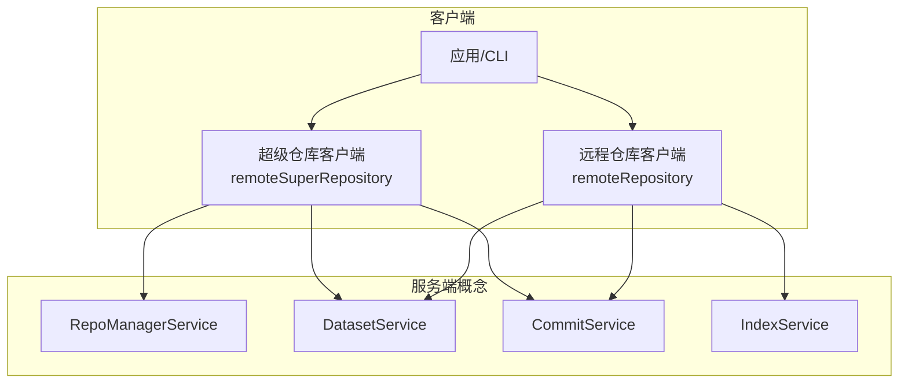
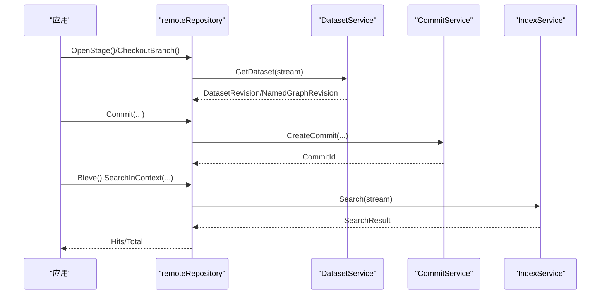
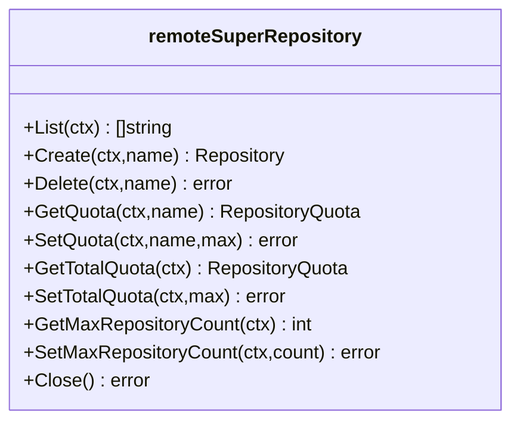
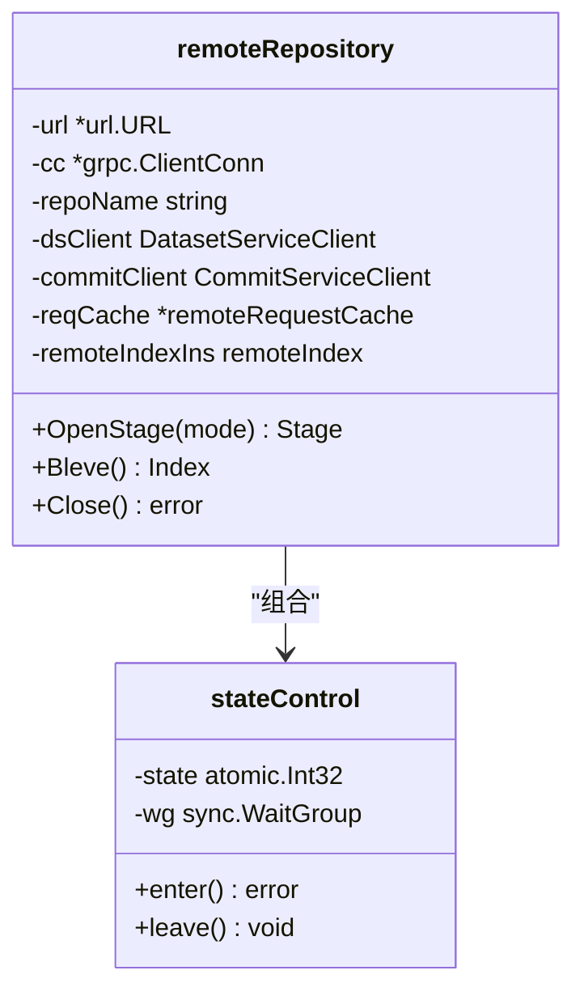
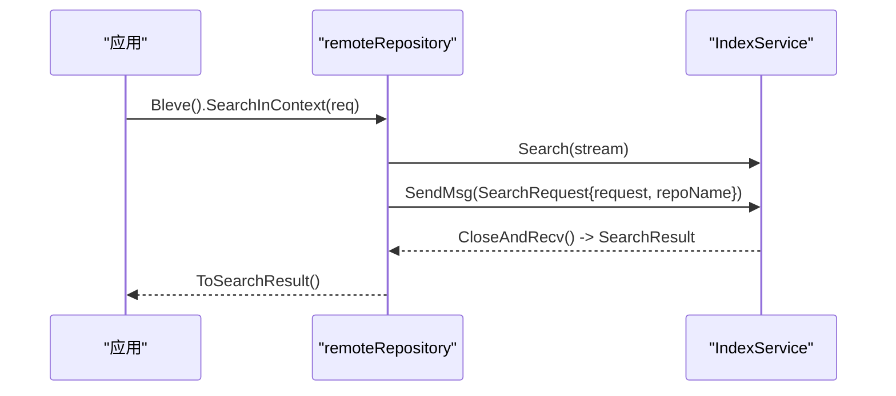
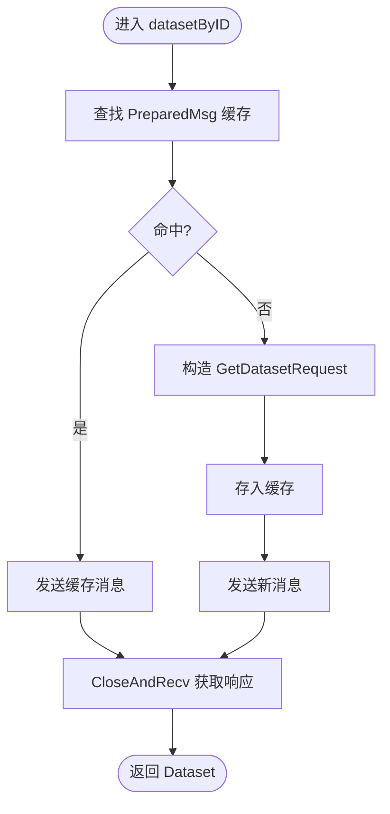
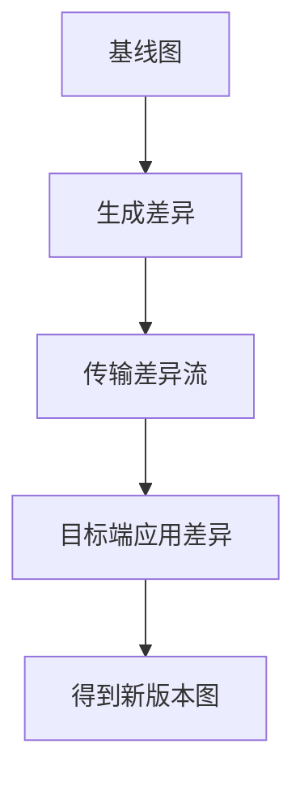
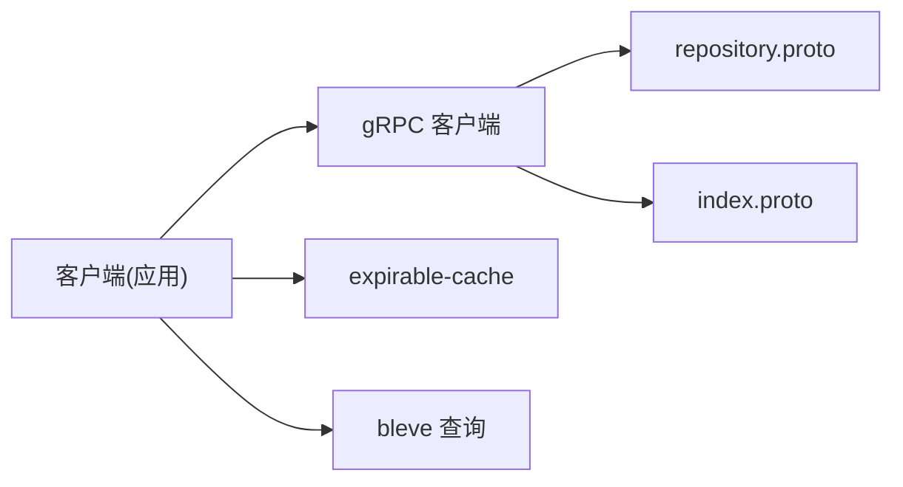

# 水平扩展策略

<cite>
**本文引用的文件**
- [README.md](file://README.md)
- [go.mod](file://go.mod)
- [repository.proto](file://bboltproto/repository.proto)
- [index.proto](file://bleveproto/index.proto)
- [reporemote.go](file://sst/reporemote.go)
- [superremoterepository.go](file://sst/superremoterepository.go)
- [repocacherequest.go](file://sst/repocacherequest.go)
- [sstreaddiff.go](file://sst/sstreaddiff.go)
- [DIFF_FORMAT.md](file://sst_test/DIFF_FORMAT.md)
- [searchInContext_test.go](file://sst_test/searchInContext_test.go)
- [quota_remote_test.go](file://sst_test/quota_remote_test.go)
</cite>

## 目录
1. [简介](#简介)
2. [项目结构](#项目结构)
3. [核心组件](#核心组件)
4. [架构总览](#架构总览)
5. [详细组件分析](#详细组件分析)
6. [依赖关系分析](#依赖关系分析)
7. [性能考量](#性能考量)
8. [故障排查指南](#故障排查指南)
9. [结论](#结论)
10. [附录](#附录)

## 简介
本文件面向SST集群的水平扩展与横向扩容，围绕超级仓库（SuperRepository）的横向扩展架构、负载均衡与服务发现、数据分片与读写分离、索引数据的分布式存储、缓存一致性与会话保持、扩容缩容流程与自动化脚本建议、性能监控指标与容量规划、以及Kubernetes部署配置与资源限制进行系统化说明。内容基于代码库中的gRPC服务定义、客户端实现、远程仓库与超级仓库接口、索引服务协议、请求缓存机制与差异同步协议等实现细节进行归纳与提炼。

## 项目结构
- 顶层模块提供SST核心API与示例、词汇表、默认派生索引映射、命令行工具等。
- sst包为核心运行时：包含本地/远程仓库、数据集、阶段（Stage）、提交、分支、索引封装、请求缓存等。
- bboltproto与bleveproto分别定义仓库管理与索引服务的gRPC协议与消息类型。
- 测试用例覆盖远程仓库读写、配额控制、搜索一致性、差异格式等关键路径。

图表来源
- [reporemote.go:88-144](file://sst/reporemote.go#L88-L144)
- [superremoterepository.go:20-47](file://sst/superremoterepository.go#L20-L47)
- [repository.proto:13-131](file://bboltproto/repository.proto#L13-L131)
- [index.proto:9-11](file://bleveproto/index.proto#L9-L11)

章节来源
- [README.md:1-15](file://README.md#L1-L15)
- [go.mod:1-80](file://go.mod#L1-L80)

## 核心组件
- 远程仓库客户端（remoteRepository）：封装gRPC连接、数据集/提交/引用操作、Bleve搜索代理、请求预编译缓存。
- 超级仓库客户端（remoteSuperRepository）：管理多仓库生命周期、配额与计数上限。
- gRPC服务契约：RepoManagerService、DatasetService、CommitService、IndexService。
- 请求缓存（remoteRequestCache）：对高频流式请求进行PreparedMsg缓存，降低序列化开销。
- 差异与同步：基于二进制差异协议与双向流式拉取/推送，支持增量同步与版本对齐。

章节来源
- [reporemote.go:88-285](file://sst/reporemote.go#L88-L285)
- [superremoterepository.go:20-205](file://sst/superremoterepository.go#L20-L205)
- [repository.proto:13-742](file://bboltproto/repository.proto#L13-L742)
- [index.proto:9-21](file://bleveproto/index.proto#L9-L21)
- [repocacherequest.go:1-42](file://sst/repocacherequest.go#L1-L42)

## 架构总览
SST通过gRPC将“客户端能力”与“服务端存储/索引”解耦。客户端以统一接口访问远程仓库；超级仓库负责跨仓库治理（创建/删除/配额/计数）。搜索由IndexService在远端执行，客户端仅发送查询并接收结果。

图表来源
- [reporemote.go:146-207](file://sst/reporemote.go#L146-L207)
- [reporemote.go:470-536](file://sst/reporemote.go#L470-L536)
- [repository.proto:88-131](file://bboltproto/repository.proto#L88-L131)
- [index.proto:9-21](file://bleveproto/index.proto#L9-L21)

## 详细组件分析

### 超级仓库与多仓库治理
- 功能要点
  - 列出/创建/删除仓库。
  - 设置与读取单仓库配额、总配额、最大仓库数量。
  - 通过gRPC调用RepoManagerService完成治理操作。
- 横向扩展意义
  - 超级仓库作为“元数据中心”，可配合外部服务发现与负载均衡器，将不同仓库路由到不同后端节点，实现按仓库维度的水平扩展。
  - 配额与计数上限为多租户隔离与容量治理提供基础。

图表来源
- [superremoterepository.go:20-205](file://sst/superremoterepository.go#L20-L205)
- [repository.proto:13-65](file://bboltproto/repository.proto#L13-L65)

章节来源
- [superremoterepository.go:20-205](file://sst/superremoterepository.go#L20-L205)
- [repository.proto:13-65](file://bboltproto/repository.proto#L13-L65)
- [quota_remote_test.go:42-102](file://sst_test/quota_remote_test.go#L42-L102)

### 远程仓库客户端与状态机
- 功能要点
  - 维护gRPC连接、仓库名、数据集/提交/引用客户端、远程索引代理、请求缓存。
  - 使用stateControl保证并发安全与优雅关闭。
  - 所有方法在进入时检查状态并登记等待组，退出时释放。
- 横向扩展意义
  - 客户端无状态化，便于在多个Pod中复用同一gRPC连接池；结合外部负载均衡可实现请求级水平扩展。

图表来源
- [reporemote.go:75-139](file://sst/reporemote.go#L75-L139)
- [reporemote.go:88-99](file://sst/reporemote.go#L88-L99)

章节来源
- [reporemote.go:75-139](file://sst/reporemote.go#L75-L139)
- [reporemote.go:655-670](file://sst/reporemote.go#L655-L670)

### 索引服务与搜索
- 功能要点
  - 通过IndexService.Search进行流式搜索，客户端将Bleve请求序列化为字节后发送，服务端返回搜索结果。
  - 支持分页与排序（由上层Bleve请求决定），测试结果验证了分页行为。
- 横向扩展意义
  - 索引计算在服务端完成，客户端仅做查询转发，天然适合按查询负载水平扩展。
  - 可通过外部负载均衡器将不同仓库或不同查询路由到不同索引节点。

图表来源
- [reporemote.go:146-207](file://sst/reporemote.go#L146-L207)
- [index.proto:9-21](file://bleveproto/index.proto#L9-L21)
- [searchInContext_test.go:1409-1436](file://sst_test/searchInContext_test.go#L1409-L1436)

章节来源
- [reporemote.go:146-207](file://sst/reporemote.go#L146-L207)
- [index.proto:9-21](file://bleveproto/index.proto#L9-L21)
- [searchInContext_test.go:1409-1436](file://sst_test/searchInContext_test.go#L1409-L1436)

### 请求缓存与一致性
- 功能要点
  - 对GetDataset等流式请求使用PreparedMsg缓存，减少重复序列化成本。
  - 缓存键包含数据集ID、分支/提交等维度，避免错误命中。
- 横向扩展意义
  - 缓存位于客户端进程内，提升单机吞吐；在多副本场景下，需确保各副本独立缓存，避免共享状态导致不一致。
  - 对于强一致读，应优先走服务端最新数据路径，必要时禁用或缩短缓存TTL。

图表来源
- [reporemote.go:470-536](file://sst/reporemote.go#L470-L536)
- [repocacherequest.go:1-42](file://sst/repocacherequest.go#L1-L42)

章节来源
- [repocacherequest.go:1-42](file://sst/repocacherequest.go#L1-L42)
- [reporemote.go:470-536](file://sst/reporemote.go#L470-L536)

### 差异与同步（增量与版本对齐）
- 功能要点
  - 使用二进制差异格式描述三元组变化，包含相同段、修改段、新增/删除项。
  - 提供SyncFrom/SyncTo双向流式同步，支持按数据集/分支粒度同步。
- 横向扩展意义
  - 差异传输显著降低带宽与存储压力，适合跨节点复制与冷热分层。
  - 结合外部队列或对象存储，可实现异步、断点续传的数据分发。

图表来源
- [sstreaddiff.go:51-80](file://sst/sstreaddiff.go#L51-L80)
- [sstreaddiff.go:366-703](file://sst/sstreaddiff.go#L366-L703)
- [DIFF_FORMAT.md:114-280](file://sst_test/DIFF_FORMAT.md#L114-L280)
- [repository.proto:669-742](file://bboltproto/repository.proto#L669-L742)

章节来源
- [sstreaddiff.go:51-80](file://sst/sstreaddiff.go#L51-L80)
- [sstreaddiff.go:366-703](file://sst/sstreaddiff.go#L366-L703)
- [DIFF_FORMAT.md:114-280](file://sst_test/DIFF_FORMAT.md#L114-L280)
- [repository.proto:669-742](file://bboltproto/repository.proto#L669-L742)

## 依赖关系分析
- 客户端依赖
  - gRPC客户端库用于连接服务端。
  - bleve与bleve_index_api用于构建查询与解析结果。
  - go-pkgz/expirable-cache用于可扩展的过期缓存。
- 服务契约
  - repository.proto定义仓库/数据集/提交/文档/同步等能力。
  - index.proto定义索引搜索能力。
- 横向扩展耦合点
  - 客户端无状态，耦合点集中在gRPC连接与认证上下文。
  - 认证通过OAuth令牌注入到每次调用，便于在网关层做鉴权与路由。

图表来源
- [go.mod:1-80](file://go.mod#L1-L80)
- [repository.proto:13-742](file://bboltproto/repository.proto#L13-L742)
- [index.proto:9-21](file://bleveproto/index.proto#L9-L21)

章节来源
- [go.mod:1-80](file://go.mod#L1-L80)
- [repository.proto:13-742](file://bboltproto/repository.proto#L13-L742)
- [index.proto:9-21](file://bleveproto/index.proto#L9-L21)

## 性能考量
- 网络与序列化
  - 使用PreparedMsg缓存减少重复序列化开销，适合高并发短查询。
  - 流式接口（FetchDatasets/PushDatasets/Search）降低峰值内存占用。
- 索引查询
  - 搜索在服务端执行，客户端只传递查询对象；合理设置分页大小与字段投影可减少网络传输。
- 差异同步
  - 差异协议压缩了变更量，适合跨节点复制；注意在写入密集场景下合并频率与批大小。
- 配额与限流
  - 通过超级仓库配额与最大仓库数限制，防止资源滥用；建议在网关层增加速率限制。

[本节为通用性能讨论，不直接分析具体文件]

## 故障排查指南
- 常见错误与定位
  - 仓库关闭/阶段过期：进入方法时检查状态，若已关闭则快速失败。
  - 数据集未找到：当服务端返回未知错误且消息匹配时，转换为明确错误以便上层处理。
  - 权限不足：认证上下文缺失或权限不足会导致PermissionDenied。
- 差异解析异常
  - 差异格式中“相同段”与“修改头”的编码需严格匹配；若出现解析漂移，通常由写端/读端不一致引起。
- 配额超限
  - 创建仓库或提交时触发配额限制会返回特定错误，需调整配额或清理数据。

章节来源
- [reporemote.go:69-73](file://sst/reporemote.go#L69-L73)
- [reporemote.go:517-527](file://sst/reporemote.go#L517-L527)
- [DIFF_FORMAT.md:262-280](file://sst_test/DIFF_FORMAT.md#L262-L280)
- [quota_remote_test.go:79-102](file://sst_test/quota_remote_test.go#L79-L102)

## 结论
SST通过gRPC将仓库能力抽象为可水平扩展的服务，客户端无状态、可弹性伸缩；超级仓库提供多仓库治理与配额控制；索引搜索与数据同步均通过流式接口实现，具备良好的扩展性。结合外部负载均衡、服务发现与Kubernetes编排，可实现从单点到集群的平滑演进。

[本节为总结性内容，不直接分析具体文件]

## 附录

### 横向扩展架构设计（负载均衡与服务发现）
- 建议方案
  - 在客户端侧使用gRPC连接池，并通过外部负载均衡器（如Ingress/Service Mesh）将请求路由至不同后端实例。
  - 超级仓库可作为“注册中心+配额中心”，对外暴露统一的仓库列表与配额查询接口。
  - 按仓库或按查询维度进行路由：例如将某仓库的所有请求固定路由到一组节点，或将热点查询路由到专用索引节点。
- 服务发现
  - 使用Kubernetes Service/Endpoints或Service Mesh（如Istio）自动发现后端实例。
  - 客户端通过DNS或服务发现SDK动态更新gRPC目标地址。

[本节为概念性设计，不直接分析具体文件]

### 数据分片策略与读写分离
- 分片策略
  - 按仓库维度分片：每个仓库驻留于一个或多个节点，超级仓库负责路由。
  - 按数据集/命名图维度分片：在服务器端实现数据分区，客户端无需感知。
- 读写分离
  - 写路径：CommitService/DocumentSet等写接口指向主节点。
  - 读路径：DatasetService/IndexService等读接口可指向只读副本，提升吞吐。
- 索引数据分布式存储
  - 索引服务集中部署，支持按仓库或全局索引；可通过分片键（如仓库名、数据集ID）进行哈希分片。

[本节为概念性设计，不直接分析具体文件]

### 缓存一致性与会话保持
- 缓存一致性
  - 客户端缓存为进程内缓存，多副本间不共享；强一致读应绕过缓存或设置极短TTL。
  - 写后读：在提交成功后，建议刷新相关缓存或直接走服务端最新数据。
- 会话保持
  - gRPC长连接天然具备会话语义；如需跨请求保持上下文，可在Context中携带用户/租户信息。
  - 网关层可做基于Token的会话绑定，确保同一用户的请求尽量落到同一后端。

[本节为概念性设计，不直接分析具体文件]

### 扩容缩容操作流程与自动化脚本建议
- 扩容
  - 启动新实例并加入服务发现；超级仓库配额与计数保持不变。
  - 逐步将流量切到新实例（金丝雀/蓝绿发布）。
- 缩容
  - 停止接收新请求，等待活跃请求结束；移除实例后更新服务发现。
- 自动化脚本建议
  - 基于Kubernetes HPA根据CPU/内存/自定义指标（如QPS、延迟）自动扩缩容。
  - 使用CI/CD流水线执行滚动更新，并在升级前执行健康检查与冒烟测试。

[本节为通用运维建议，不直接分析具体文件]

### 性能监控指标与容量规划建议
- 关键指标
  - 请求级：QPS、P95/P99延迟、错误率、超时率。
  - 资源级：CPU/内存、磁盘IO、网络带宽、连接数。
  - 业务级：仓库数量、数据集数量、提交频率、索引大小、文档数量。
- 容量规划
  - 以峰值QPS与平均延迟为目标，估算所需实例数与规格。
  - 针对索引与存储分别评估CPU与磁盘需求；预留20%-30%冗余。
  - 定期压测与容量评审，结合配额与限流策略保障稳定性。

[本节为通用指导，不直接分析具体文件]

### Kubernetes部署配置与资源限制（示例）
- Deployment
  - 副本数：初始2-3个，结合HPA动态调整。
  - 资源限制：requests/limits设置CPU与内存，避免抖动。
  - 探针：liveness/readiness探针确保健康度。
- Service/Ingress
  - 使用ClusterIP暴露内部服务；对外通过Ingress或Service Mesh接入。
- ConfigMap/Secret
  - 配置gRPC目标、认证参数、日志级别等。
- HPA
  - 基于CPU/内存/QPS/延迟等指标自动扩缩容。

[本节为通用部署建议，不直接分析具体文件]