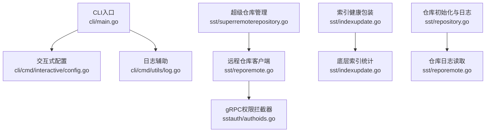
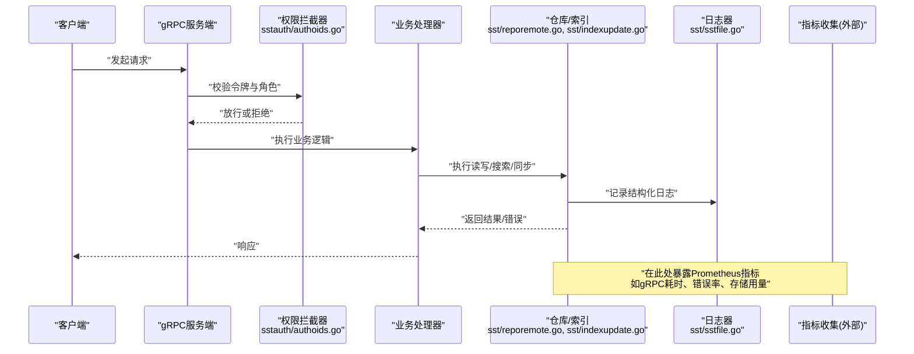
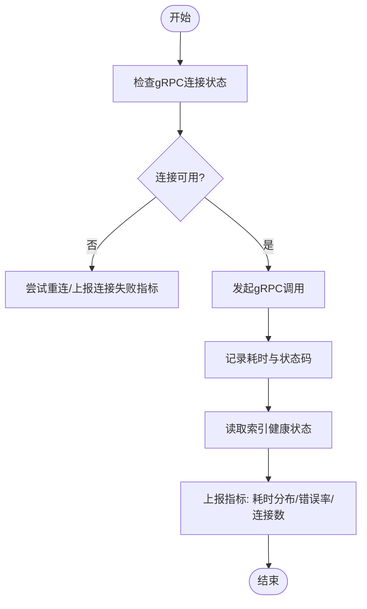
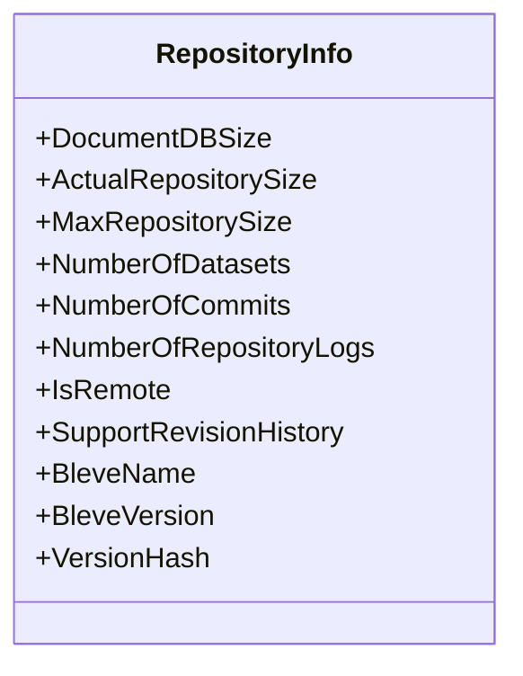
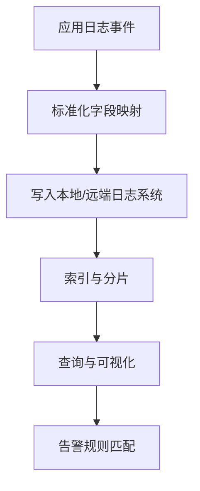
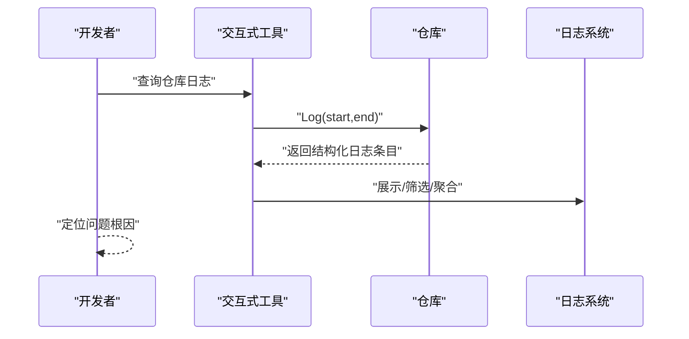
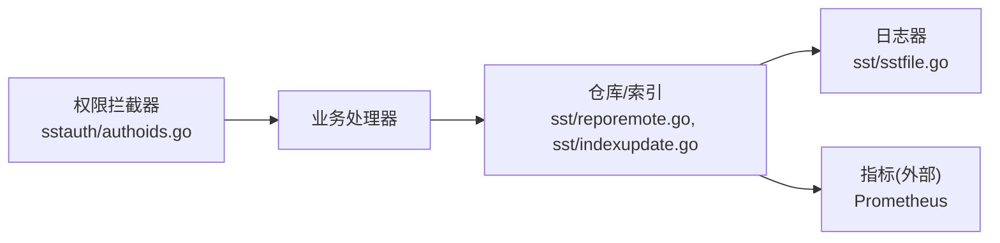

# 监控告警系统

<cite>
**本文引用的文件**
- [reporemote.go](file://sst/reporemote.go)
- [indexupdate.go](file://sst/indexupdate.go)
- [repository.go](file://sst/repository.go)
- [superremoterepository.go](file://sst/superremoterepository.go)
- [log_helpers.go](file://cli/cmd/interactive/log_helpers.go)
- [config.go](file://cli/cmd/interactive/config.go)
- [authoids.go](file://sstauth/authoids.go)
- [ACCESS_RIGHTS.md](file://sstauth/ACCESS_RIGHTS.md)
- [main.go](file://cli/main.go)
- [log.go](file://cli/cmd/utils/log.go)
- [sstreader.go](file://sst/sstreader.go)
- [stage.go](file://sst/stage.go)
</cite>

## 目录
1. [简介](#简介)
2. [项目结构](#项目结构)
3. [核心组件](#核心组件)
4. [架构总览](#架构总览)
5. [详细组件分析](#详细组件分析)
6. [依赖关系分析](#依赖关系分析)
7. [性能考量](#性能考量)
8. [故障诊断指南](#故障诊断指南)
9. [结论](#结论)
10. [附录](#附录)

## 简介
本文件面向SST集群的监控与告警体系，聚焦以下目标：
- 关键性能指标的采集与展示：gRPC连接状态、查询响应时间、存储空间使用率等。
- 日志聚合方案与结构化日志格式：统一日志来源、字段规范、可检索性。
- 告警规则配置与通知渠道：邮件、Slack、Webhook集成思路与落地建议。
- 健康检查端点与状态页面：服务可用性、指标暴露、状态页配置要点。
- 故障诊断工具与调试技巧：基于现有日志与接口能力的排障路径。
- Prometheus监控面板与Grafana仪表板：指标导出、面板示例与最佳实践。

说明：仓库中未包含独立的“监控告警”模块代码，但提供了可用于构建监控告警系统的必要能力（gRPC调用、索引健康、仓库日志、全局日志器、认证拦截器等）。本文在严格依据源码的基础上，给出可落地的监控告警设计方案与实现指引。

## 项目结构
围绕监控告警的关键位置与职责：
- gRPC客户端与服务端交互：远程仓库访问、流式操作、权限校验。
- 索引健康与重试：对底层索引操作的错误记录与健康状态维护。
- 仓库日志：提交、同步等操作的结构化日志，便于聚合与审计。
- 全局日志器：集中式日志输出，便于接入外部日志系统。
- CLI入口与环境：用于调试与交互式验证。

图表来源
- [main.go:13-17](file://cli/main.go#L13-L17)
- [config.go:11-47](file://cli/cmd/interactive/config.go#L11-L47)
- [log.go:15-40](file://cli/cmd/utils/log.go#L15-L40)
- [reporemote.go:1663-1682](file://sst/reporemote.go#L1663-L1682)
- [authoids.go:409-461](file://sstauth/authoids.go#L409-L461)
- [indexupdate.go:673-735](file://sst/indexupdate.go#L673-L735)
- [repository.go:386-454](file://sst/repository.go#L386-L454)
- [superremoterepository.go:172-204](file://sst/superremoterepository.go#L172-L204)

章节来源
- [main.go:13-17](file://cli/main.go#L13-L17)
- [config.go:11-47](file://cli/cmd/interactive/config.go#L11-L47)
- [log.go:15-40](file://cli/cmd/utils/log.go#L15-L40)
- [reporemote.go:1663-1682](file://sst/reporemote.go#L1663-L1682)
- [authoids.go:409-461](file://sstauth/authoids.go#L409-L461)
- [indexupdate.go:673-735](file://sst/indexupdate.go#L673-L735)
- [repository.go:386-454](file://sst/repository.go#L386-L454)
- [superremoterepository.go:172-204](file://sst/superremoterepository.go#L172-L204)

## 核心组件
- gRPC连接与权限控制
  - 通过拦截器进行鉴权与RBAC校验，支持Unary与Streaming两种调用形态。
  - 流式调用在处理器内完成更细粒度的仓库级权限校验。
- 索引健康与重试
  - 对底层索引操作进行错误计数与成功恢复，提供健康状态与最近错误信息。
  - 对可重试错误实施短暂退避后重试，提升稳定性。
- 仓库日志
  - 仓库创建时写入初始日志；提交、同步等操作产生结构化日志条目，支持范围查询。
- 全局日志器
  - 统一的zap日志器，支持调用栈与结构化字段，便于接入日志平台。
- 超级仓库管理
  - 提供配额、最大仓库数量等管理能力，便于容量规划与告警阈值设定。

章节来源
- [ACCESS_RIGHTS.md:103-128](file://sstauth/ACCESS_RIGHTS.md#L103-L128)
- [authoids.go:409-461](file://sstauth/authoids.go#L409-L461)
- [indexupdate.go:673-735](file://sst/indexupdate.go#L673-L735)
- [repository.go:386-454](file://sst/repository.go#L386-L454)
- [sstreader.go:422-1014](file://sst/sstreader.go#L422-L1014)
- [superremoterepository.go:172-204](file://sst/superremoterepository.go#L172-L204)

## 架构总览
下图展示了从请求进入、权限校验、业务处理到指标与日志输出的整体流程，并标注了可用于监控告警的关键点。

图表来源
- [authoids.go:409-461](file://sstauth/authoids.go#L409-L461)
- [reporemote.go:1663-1682](file://sst/reporemote.go#L1663-L1682)
- [indexupdate.go:673-735](file://sst/indexupdate.go#L673-L735)
- [sstreader.go:422-1014](file://sst/sstreader.go#L422-L1014)

## 详细组件分析

### gRPC连接状态与查询响应时间
- 连接状态
  - 远程仓库关闭连接的方法可用于资源释放与连接生命周期管理。
  - 超级仓库管理提供配额与数量限制，有助于容量告警。
- 查询响应时间
  - 可在gRPC拦截器或处理器入口/出口埋点，统计请求耗时、错误率、超时率。
  - 结合索引健康状态，区分后端索引异常导致的慢查询。

图表来源
- [superremoterepository.go:172-204](file://sst/superremoterepository.go#L172-L204)
- [reporemote.go:1663-1682](file://sst/reporemote.go#L1663-L1682)
- [indexupdate.go:673-735](file://sst/indexupdate.go#L673-L735)

章节来源
- [superremoterepository.go:172-204](file://sst/superremoterepository.go#L172-L204)
- [reporemote.go:1663-1682](file://sst/reporemote.go#L1663-L1682)
- [indexupdate.go:673-735](file://sst/indexupdate.go#L673-L735)

### 存储空间使用率
- 仓库信息中包含文档数据库大小、实际仓库大小、最大仓库大小、数据集/提交/日志数量等字段，可作为存储使用率的直接来源。
- 建议在指标层将上述字段转换为百分比与绝对值，设置阈值告警（例如超过80%触发警告）。

图表来源
- [reporemote.go:1645-1660](file://sst/reporemote.go#L1645-L1660)

章节来源
- [reporemote.go:1645-1660](file://sst/reporemote.go#L1645-L1660)

### 日志聚合方案与结构化日志格式
- 日志来源
  - 仓库初始化、提交、同步等操作均会写入结构化日志条目，包含类型、时间戳、作者、消息等字段。
  - 交互式工具可对日志进行分组与详情展开，便于排查。
- 结构化字段建议
  - 通用字段：type、timestamp、author、message、repo_name、dataset_iri、branch、commit_id、log_key。
  - 扩展字段：operation、error_code、duration_ms、bytes_transferred、index_health。
- 聚合策略
  - 将各节点日志统一汇聚至集中式日志系统（如ELK/Loki），按仓库、数据集、分支维度建立索引。
  - 对关键字段建立唯一索引，支持快速检索与聚合分析。

图表来源
- [repository.go:386-454](file://sst/repository.go#L386-L454)
- [log_helpers.go:17-177](file://cli/cmd/interactive/log_helpers.go#L17-L177)

章节来源
- [repository.go:386-454](file://sst/repository.go#L386-L454)
- [log_helpers.go:17-177](file://cli/cmd/interactive/log_helpers.go#L17-L177)

### 告警规则配置与通知渠道
- 指标类告警
  - gRPC连接失败率、超时率、错误码分布。
  - 查询P95/P99延迟超阈值。
  - 存储空间使用率超过阈值（如80%/90%）。
  - 索引健康状态持续不健康（错误计数上升）。
- 日志类告警
  - 特定错误类型出现频率突增。
  - 同步失败、权限拒绝等关键事件。
- 通知渠道
  - 邮件：配置SMTP服务器、收件人列表、模板变量（仓库名、指标值、链接）。
  - Slack：配置Webhook URL、频道、消息格式（含上下文与链接）。
  - Webhook：自定义接收端点，支持签名校验与重试策略。

章节来源
- [indexupdate.go:673-735](file://sst/indexupdate.go#L673-L735)
- [reporemote.go:1645-1660](file://sst/reporemote.go#L1645-L1660)

### 健康检查端点与状态页面
- 健康检查端点建议
  - /healthz：返回服务存活状态（进程、依赖、磁盘空间、索引健康）。
  - /ready：返回服务就绪状态（gRPC连接、数据库、索引可用）。
  - /metrics：暴露Prometheus指标（需集成指标库）。
- 状态页面
  - 聚合各组件状态（gRPC、索引、存储、队列）并以Web形式展示。
  - 提供历史趋势与告警事件时间线。

章节来源
- [reporemote.go:1663-1682](file://sst/reporemote.go#L1663-L1682)
- [indexupdate.go:673-735](file://sst/indexupdate.go#L673-L735)

### 故障诊断工具与调试技巧
- 利用仓库日志
  - 通过Log接口获取指定范围的日志条目，过滤出提交、同步等关键事件。
  - 使用交互式工具的详细视图，批量获取提交详情，定位问题。
- 利用全局日志器
  - 开启调用栈与错误级别日志，捕获异常堆栈与上下文。
- 索引健康
  - 关注健康状态与错误计数，识别可重试错误与瞬时故障。
- 权限与认证
  - 确认拦截器放行条件、令牌有效性、角色与受众匹配。

图表来源
- [log_helpers.go:17-177](file://cli/cmd/interactive/log_helpers.go#L17-L177)
- [reporemote.go:1663-1682](file://sst/reporemote.go#L1663-L1682)

章节来源
- [log_helpers.go:17-177](file://cli/cmd/interactive/log_helpers.go#L17-L177)
- [reporemote.go:1663-1682](file://sst/reporemote.go#L1663-L1682)

### Prometheus监控面板与Grafana仪表板配置示例
- 指标定义建议
  - gRPC：rpc_duration_seconds、rpc_errors_total、rpc_connections_active。
  - 索引：index_health_status、index_error_count、index_last_success_time。
  - 存储：repo_size_bytes、repo_max_bytes、repo_usage_percent。
  - 业务：commit_count_total、sync_from_count_total、log_entries_total。
- 采集与导出
  - 在服务中集成Prometheus客户端，暴露/metrics端点。
  - 配置Prometheus抓取目标与保留策略。
- 面板与告警
  - Grafana面板：概览（延迟分布、错误率、存储使用率）、明细（按仓库/数据集/分支维度）。
  - 告警规则：基于指标阈值与日志关键词组合触发。

章节来源
- [reporemote.go:1645-1660](file://sst/reporemote.go#L1645-L1660)
- [indexupdate.go:673-735](file://sst/indexupdate.go#L673-L735)

## 依赖关系分析
- 组件耦合
  - gRPC权限拦截器与业务处理器解耦，通过上下文传递主体信息。
  - 索引健康包装与底层索引解耦，便于替换与扩展。
  - 仓库日志与存储实现解耦，便于迁移与聚合。
- 外部依赖
  - 日志器（zap）用于结构化日志输出。
  - 指标库（Prometheus客户端）用于指标暴露（需在服务中集成）。
- 潜在循环依赖
  - 当前结构未发现明显循环依赖；建议保持拦截器、处理器、存储层的清晰边界。

图表来源
- [authoids.go:409-461](file://sstauth/authoids.go#L409-L461)
- [reporemote.go:1663-1682](file://sst/reporemote.go#L1663-L1682)
- [indexupdate.go:673-735](file://sst/indexupdate.go#L673-L735)
- [sstreader.go:422-1014](file://sst/sstreader.go#L422-L1014)

章节来源
- [authoids.go:409-461](file://sstauth/authoids.go#L409-L461)
- [reporemote.go:1663-1682](file://sst/reporemote.go#L1663-L1682)
- [indexupdate.go:673-735](file://sst/indexupdate.go#L673-L735)
- [sstreader.go:422-1014](file://sst/sstreader.go#L422-L1014)

## 性能考量
- 连接池与超时
  - 合理设置gRPC连接池大小与超时时间，避免连接耗尽与长尾延迟。
- 重试与退避
  - 对可重试错误实施指数退避，降低雪崩风险。
- 日志与指标开销
  - 控制日志级别与采样率，避免高吞吐下I/O瓶颈。
  - 指标标签选择需谨慎，避免基数爆炸。
- 存储使用率
  - 定期清理过期数据，设置容量上限与自动扩容策略。

## 故障诊断指南
- 常见问题
  - gRPC连接失败：检查网络、证书、权限拦截器配置。
  - 查询慢：查看索引健康状态、错误计数、下游依赖延迟。
  - 存储不足：监控仓库大小与最大值，及时扩容或清理。
  - 日志缺失：确认日志器初始化与输出目标可达。
- 诊断步骤
  - 使用仓库日志接口获取相关时间段内的提交与同步记录。
  - 启用调用栈日志，捕获异常上下文。
  - 检查索引健康状态与错误计数，必要时重启或重建索引。
  - 核对权限与角色配置，确保令牌有效且受众匹配。

章节来源
- [reporemote.go:1663-1682](file://sst/reporemote.go#L1663-L1682)
- [indexupdate.go:673-735](file://sst/indexupdate.go#L673-L735)
- [sstreader.go:422-1014](file://sst/sstreader.go#L422-L1014)

## 结论
本方案基于仓库提供的gRPC、索引健康、仓库日志与全局日志器等能力，构建了完整的监控告警体系。通过指标采集、日志聚合、健康检查与告警规则，可实现对SST集群的全面可观测性与自动化运维。建议在生产环境中逐步落地指标暴露、日志聚合与告警通知，并结合Grafana面板进行可视化监控。

## 附录
- 环境变量与配置
  - CLI入口加载环境配置，便于在不同环境切换。
- 实用工具
  - 标准输出静音与恢复，便于测试与调试。

章节来源
- [main.go:13-17](file://cli/main.go#L13-L17)
- [log.go:15-40](file://cli/cmd/utils/log.go#L15-L40)