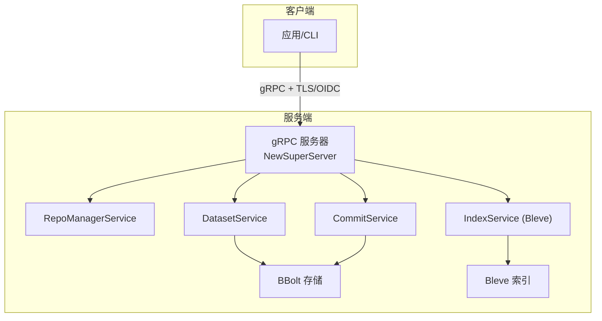
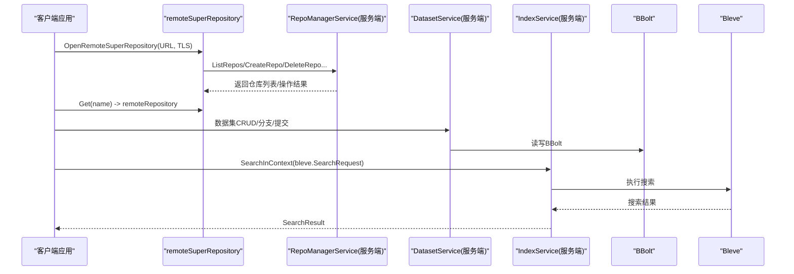
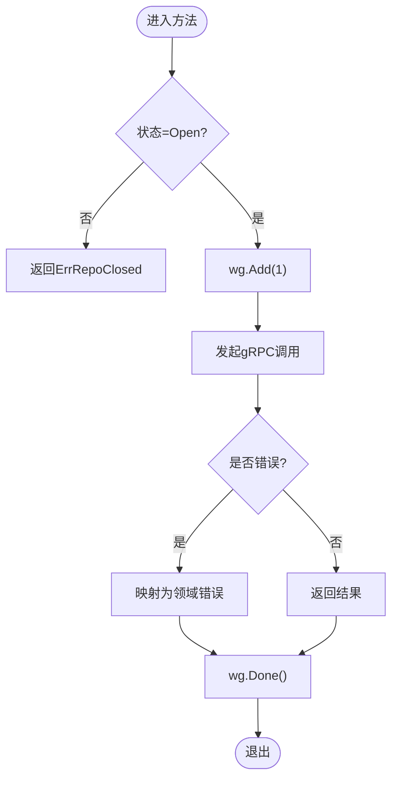
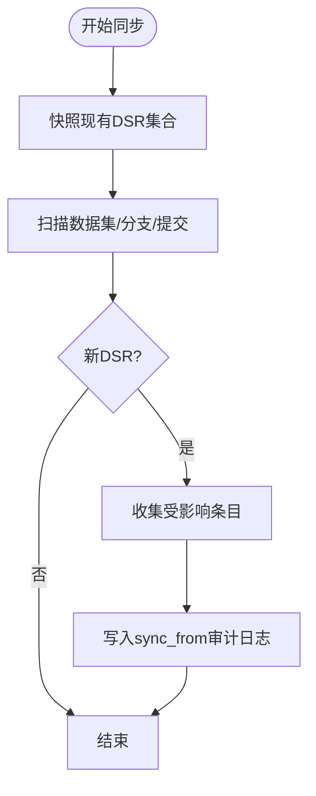
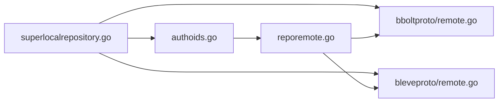

# 集群管理

<cite>
**本文引用的文件**
- [README.md](file://README.md)
- [superlocalrepository.go](file://sst/superlocalrepository.go)
- [superremoterepository.go](file://sst/superremoterepository.go)
- [repository.go](file://sst/repository.go)
- [reporemote.go](file://sst/reporemote.go)
- [syncfromlog.go](file://sst/syncfromlog.go)
- [remote.go（bboltproto）](file://bboltproto/remote.go)
- [remote.go（bleveproto）](file://bleveproto/remote.go)
- [authoids.go](file://sstauth/authoids.go)
- [main.go（示例服务）](file://examples/helloworldsuperreporemote/main.go)
- [bboltdump.go](file://cli/cmd/utils/bboltdump.go)
</cite>

## 目录
1. [简介](#简介)
2. [项目结构](#项目结构)
3. [核心组件](#核心组件)
4. [架构总览](#架构总览)
5. [详细组件分析](#详细组件分析)
6. [依赖关系分析](#依赖关系分析)
7. [性能与扩展性](#性能与扩展性)
8. [故障排查指南](#故障排查指南)
9. [结论](#结论)
10. [附录：运维与部署要点](#附录：运维与部署要点)

## 简介
本文件面向SST多节点集群管理，围绕“超级仓库”概念、跨仓库数据同步、服务发现与注册、水平扩展策略、集群状态与健康检查、监控告警、扩容缩容流程以及灾难恢复预案进行系统化说明。内容基于代码库中的超级仓库实现、gRPC远程访问、索引服务、认证鉴权与日志记录等能力，提供可操作的集群化部署与运维建议。

## 项目结构
- 超级仓库（SuperRepository）：统一管理多个仓库实例，支持本地与远程两种形态，提供创建、删除、配额、列表等操作。
- 仓库接口（Repository）：封装数据集、提交历史、分支、文档、索引等能力，屏蔽本地/远程差异。
- gRPC远程层：通过bboltproto与bleveproto暴露数据集、提交、索引等服务；客户端以流式或批式调用。
- 认证与授权：基于OIDC的Bearer Token校验，按仓库粒度控制读写权限。
- 同步与审计：基于BBolt日志记录同步事件，支持增量同步与影响范围统计。
- 工具与示例：CLI用于调试与测试；示例服务演示如何启动gRPC服务器并配置TLS与OIDC。



**图表来源**
- [superlocalrepository.go:595-668](file://sst/superlocalrepository.go#L595-L668)
- [reporemote.go:264-285](file://sst/reporemote.go#L264-L285)
- [remote.go（bboltproto）:20-23](file://bboltproto/remote.go#L20-L23)
- [remote.go（bleveproto）:17-19](file://bleveproto/remote.go#L17-L19)

**章节来源**
- [README.md:1-15](file://README.md#L1-L15)
- [superlocalrepository.go:28-88](file://sst/superlocalrepository.go#L28-L88)
- [repository.go:34-179](file://sst/repository.go#L34-L179)

## 核心组件
- 超级仓库接口与实现
  - SuperRepository：统一CRUD仓库、配额、列表、索引处理器注册等。
  - localSuperRepository：本地磁盘实现，维护仓库集合、配额持久化、默认仓库自动创建。
  - remoteSuperRepository：远程gRPC客户端，转发管理操作到服务端。
- 仓库抽象
  - Repository：数据集、提交、分支、文档、索引、同步等统一API。
  - localFull/localBasic/localFlat：本地不同能力集的实现。
  - remoteRepository：远程gRPC客户端封装，透传认证上下文。
- 服务与协议
  - bboltproto：数据集、引用、提交、仓库管理等gRPC服务定义与字段掩码工具。
  - bleveproto：搜索请求/结果序列化适配。
- 认证与授权
  - sstauth：从gRPC元数据提取Bearer Token，校验OIDC并注入用户信息；按仓库资源映射角色。
- 同步与审计
  - SyncFrom：跨仓库同步，支持按数据集/分支过滤，记录影响范围与审计日志。

**章节来源**
- [superlocalrepository.go:28-88](file://sst/superlocalrepository.go#L28-L88)
- [superlocalrepository.go:90-188](file://sst/superlocalrepository.go#L90-L188)
- [superremoterepository.go:20-47](file://sst/superremoterepository.go#L20-L47)
- [repository.go:34-179](file://sst/repository.go#L34-L179)
- [reporemote.go:88-144](file://sst/reporemote.go#L88-L144)
- [remote.go（bboltproto）:20-23](file://bboltproto/remote.go#L20-L23)
- [remote.go（bleveproto）:21-39](file://bleveproto/remote.go#L21-L39)
- [authoids.go:73-107](file://sstauth/authoids.go#L73-L107)
- [syncfromlog.go:16-224](file://sst/syncfromlog.go#L16-L224)

## 架构总览
SST集群由一个或多个gRPC服务进程组成，每个进程承载一个SuperRepository（本地目录），对外暴露Dataset/Commit/Index/RepoManager服务。客户端通过OpenRemoteRepository或OpenRemoteSuperRepository连接，使用OIDC令牌进行鉴权，按仓库名（URL fragment）路由到具体仓库。



**图表来源**
- [superremoterepository.go:26-47](file://sst/superremoterepository.go#L26-L47)
- [superlocalrepository.go:595-668](file://sst/superlocalrepository.go#L595-L668)
- [reporemote.go:146-207](file://sst/reporemote.go#L146-L207)
- [reporemote.go:264-285](file://sst/reporemote.go#L264-L285)

## 详细组件分析

### 超级仓库（SuperRepository）
- 职责
  - 管理多个仓库的生命周期（创建、打开、删除、列出）。
  - 配额管理：单仓库配额、总配额、最大仓库数量。
  - 索引处理器注册：为所有子仓库统一注册Bleve派生索引。
  - 远程代理：将管理操作转发至远端RepoManagerService。
- 关键流程
  - 本地：扫描根目录、加载配额JSON、确保default仓库存在。
  - 远程：建立gRPC连接，构造各服务客户端，携带OAuth2令牌。
  - 关闭：优雅停止gRPC服务并关闭所有子仓库。

```mermaid
classDiagram
class SuperRepository {
+URL() string
+Get(ctx,name) Repository
+Create(ctx,name) Repository
+Delete(ctx,name) error
+List(ctx) []string
+RegisterIndexHandler(info) error
+GetQuota(ctx,name) RepositoryQuota
+SetQuota(ctx,name,max) error
+GetTotalQuota(ctx) RepositoryQuota
+SetTotalQuota(ctx,max) error
+GetMaxRepositoryCount(ctx) int
+SetMaxRepositoryCount(ctx,count) error
+Close() error
}
class localSuperRepository {
-rootDir string
-repos map[string]Repository
-known map[string]struct{}
-quotas quotasConfig
-quotaPath string
}
class remoteSuperRepository {
-url *url.URL
-cc *grpc.ClientConn
-mgrClient RepoManagerServiceClient
}
SuperRepository <|.. localSuperRepository
SuperRepository <|.. remoteSuperRepository
```

**图表来源**
- [superlocalrepository.go:28-88](file://sst/superlocalrepository.go#L28-L88)
- [superlocalrepository.go:90-188](file://sst/superlocalrepository.go#L90-L188)
- [superremoterepository.go:20-47](file://sst/superremoterepository.go#L20-L47)

**章节来源**
- [superlocalrepository.go:112-188](file://sst/superlocalrepository.go#L112-L188)
- [superlocalrepository.go:233-331](file://sst/superlocalrepository.go#L233-L331)
- [superlocalrepository.go:389-443](file://sst/superlocalrepository.go#L389-L443)
- [superlocalrepository.go:595-668](file://sst/superlocalrepository.go#L595-L668)
- [superremoterepository.go:61-124](file://sst/superremoterepository.go#L61-L124)

### 仓库接口与远程实现（Repository / remoteRepository）
- 职责
  - 统一数据集、提交、分支、文档、索引、同步等能力。
  - 远程实现通过gRPC调用服务端，携带认证上下文。
- 关键点
  - 状态机：stateClosed/stateOpen/stateClosing，配合WaitGroup保证并发安全关闭。
  - 索引：远程仓库仅暴露SearchInContext，重建索引在服务端完成。
  - 分页：数据集列举采用PageToken分页。
  - 错误处理：将gRPC状态码转换为领域错误（如NotFound、Unknown）。



**图表来源**
- [reporemote.go:75-124](file://sst/reporemote.go#L75-L124)
- [reporemote.go:146-207](file://sst/reporemote.go#L146-L207)
- [reporemote.go:296-347](file://sst/reporemote.go#L296-L347)
- [reporemote.go:655-670](file://sst/reporemote.go#L655-L670)

**章节来源**
- [repository.go:34-179](file://sst/repository.go#L34-L179)
- [reporemote.go:88-144](file://sst/reporemote.go#L88-L144)
- [reporemote.go:243-262](file://sst/reporemote.go#L243-L262)
- [reporemote.go:264-285](file://sst/reporemote.go#L264-L285)

### 跨仓库数据同步（SyncFrom）
- 机制
  - 基于BBolt日志与数据集版本（DSR）快照，识别新增的DSR。
  - 遍历数据集与分支引用，收集受影响条目（数据集IRI、分支、DSR）。
  - 写入审计日志，记录来源仓库、影响数量及明细。
- 适用场景
  - 多节点间增量同步、跨环境数据分发、灾备复制。



**图表来源**
- [syncfromlog.go:22-37](file://sst/syncfromlog.go#L22-L37)
- [syncfromlog.go:55-170](file://sst/syncfromlog.go#L55-L170)
- [syncfromlog.go:172-224](file://sst/syncfromlog.go#L172-L224)

**章节来源**
- [syncfromlog.go:55-170](file://sst/syncfromlog.go#L55-L170)
- [syncfromlog.go:172-224](file://sst/syncfromlog.go#L172-L224)

### 服务发现与服务注册
- 现状
  - 代码未内置服务网格或Kubernetes Service Discovery集成。
  - 通过gRPC目标地址直连，结合OIDC进行身份与权限校验。
- 建议方案
  - Kubernetes Service：以Headless Service暴露gRPC端口，客户端通过DNS解析。
  - 服务网格（如Istio）：利用mTLS与重试/熔断策略增强可靠性。
  - 健康检查：通过Info/Log等轻量接口实现存活/就绪探针。

[本节为概念性说明，不直接分析具体文件]

### 水平扩展策略
- 数据分片
  - 通过SuperRepository对仓库进行逻辑隔离（按业务域/租户命名），天然具备分片能力。
  - 结合外部KV/消息队列实现跨节点路由与负载均衡。
- 读写分离
  - 读路径：Bleve索引查询走远程IndexService，可横向扩展索引服务实例。
  - 写路径：BBolt写入需强一致，通常单主多从；通过同步任务复制到只读副本。
- 缓存一致性
  - 客户端侧：remoteRepository已包含请求级缓存（如GetDataset流复用）。
  - 服务端侧：可在Bleve之上加读缓存（如内存缓存+失效策略），结合版本号/时间戳保证一致性。

[本节为通用策略说明，不直接分析具体文件]

### 集群状态管理与健康检查
- 状态管理
  - 仓库对象内部维护state（Closed/Open/Closing），并发安全。
  - SuperRepository在关闭时等待所有Stage/操作完成，再释放资源。
- 健康检查
  - 通过Repository.Info/Log等接口探测服务可用性。
  - 结合gRPC反射与认证中间件，确保健康检查通过鉴权。

**章节来源**
- [reporemote.go:75-124](file://sst/reporemote.go#L75-L124)
- [reporemote.go:655-670](file://sst/reporemote.go#L655-L670)
- [superlocalrepository.go:670-681](file://sst/superlocalrepository.go#L670-L681)

### 自动故障转移
- 客户端侧
  - 重试与超时：在调用处设置context超时与重试策略（如指数退避）。
  - 多目标切换：当主节点不可用时，切换到备用gRPC目标。
- 服务端侧
  - 无状态计算层（索引/查询）可快速漂移；有状态层（BBolt）需借助外部备份/同步机制。

[本节为通用策略说明，不直接分析具体文件]

### 监控指标、日志聚合与告警
- 指标
  - 仓库规模：NumberOfDatasets、NumberOfCommits、ActualRepositorySize等（RepositoryInfo）。
  - 索引规模：BleveName/BleveVersion、DerivedDBSize。
  - 配额：MaxSizeBytes/ActualSizeBytes（单仓库与总量）。
- 日志
  - 仓库操作日志（commit、branch变更、文档上传/下载、同步等）。
  - 同步审计日志（sync_from）记录来源仓库、影响范围。
- 告警
  - 配额接近上限、同步失败、gRPC错误率上升、索引重建耗时异常等。

**章节来源**
- [repository.go:706-744](file://sst/repository.go#L706-L744)
- [syncfromlog.go:172-224](file://sst/syncfromlog.go#L172-L224)

## 依赖关系分析
- 模块耦合
  - superlocalrepository依赖bboltproto与bleveproto暴露服务。
  - reporemote依赖bboltproto/bleveproto进行数据与索引操作。
  - authoids为gRPC中间件，注入用户信息并校验权限。
- 外部依赖
  - gRPC/TLS/OIDC：通信与认证。
  - BBolt：事务型键值存储。
  - Bleve：全文检索索引。



**图表来源**
- [superlocalrepository.go:595-668](file://sst/superlocalrepository.go#L595-L668)
- [reporemote.go:264-285](file://sst/reporemote.go#L264-L285)
- [remote.go（bboltproto）:20-23](file://bboltproto/remote.go#L20-L23)
- [remote.go（bleveproto）:17-19](file://bleveproto/remote.go#L17-L19)
- [authoids.go:73-107](file://sstauth/authoids.go#L73-L107)

**章节来源**
- [superlocalrepository.go:595-668](file://sst/superlocalrepository.go#L595-L668)
- [reporemote.go:264-285](file://sst/reporemote.go#L264-L285)
- [authoids.go:73-107](file://sstauth/authoids.go#L73-L107)

## 性能与扩展性
- 读路径优化
  - 使用流式SearchInContext减少往返次数。
  - 客户端请求缓存（如GetDataset流复用）降低重复开销。
- 写路径优化
  - BBolt开启NoFreelistSync提升写入吞吐。
  - 批量提交与最小化锁持有时间。
- 可扩展性
  - 通过SuperRepository按仓库分片，结合外部负载均衡器横向扩展。
  - 索引服务独立部署，读写分离，按需扩缩容。

[本节为通用性能讨论，不直接分析具体文件]

## 故障排查指南
- 常见问题
  - 连接失败：检查gRPC目标地址、TLS证书、OIDC签发者配置。
  - 权限不足：确认令牌中资源角色映射是否正确。
  - 配额超限：查看单仓库/总配额与实际大小，必要时调整配额。
  - 同步失败：核对源/目标仓库可达性、网络与权限，检查sync_from日志。
- 诊断工具
  - CLI dump：使用bboltdump查看BBolt桶结构与键值，辅助定位数据问题。
  - 日志：关注gRPC错误码、仓库操作日志与同步审计日志。

**章节来源**
- [authoids.go:73-107](file://sstauth/authoids.go#L73-L107)
- [superlocalrepository.go:389-443](file://sst/superlocalrepository.go#L389-L443)
- [syncfromlog.go:172-224](file://sst/syncfromlog.go#L172-L224)
- [bboltdump.go:51-88](file://cli/cmd/utils/bboltdump.go#L51-L88)

## 结论
SST通过SuperRepository抽象实现了多仓库的统一管理，结合gRPC远程访问、OIDC鉴权与Bleve索引服务，形成可扩展的数据平台。通过仓库级分片、读写分离与客户端缓存，可满足高并发与大规模数据场景。配合完善的日志与审计能力，便于运维监控与故障定位。建议在Kubernetes环境中以服务化方式部署，并结合服务网格与自动化脚本提升可运维性与弹性。

## 附录：运维与部署要点
- 服务启动与配置
  - 使用示例服务启动gRPC服务器，配置仓库目录、OIDC签发者、客户端ID、TLS证书与派生索引信息。
  - 启用gRPC反射便于调试。
- 健康检查
  - 通过Info/Log等接口实现存活/就绪探针。
- 扩容缩容
  - 扩容：新增服务实例，更新服务发现；通过SuperRepository按仓库路由。
  - 缩容：逐步下线实例，确保流量迁移完毕。
- 灾难恢复
  - 定期备份BBolt数据与Bleve索引。
  - 使用SyncFrom进行跨节点数据同步，验证恢复流程。

**章节来源**
- [main.go（示例服务）:45-89](file://examples/helloworldsuperreporemote/main.go#L45-L89)
- [superlocalrepository.go:595-668](file://sst/superlocalrepository.go#L595-L668)
- [syncfromlog.go:172-224](file://sst/syncfromlog.go#L172-L224)