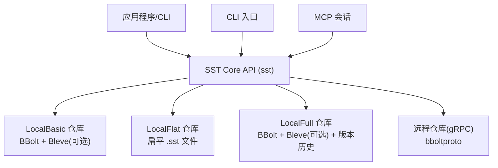
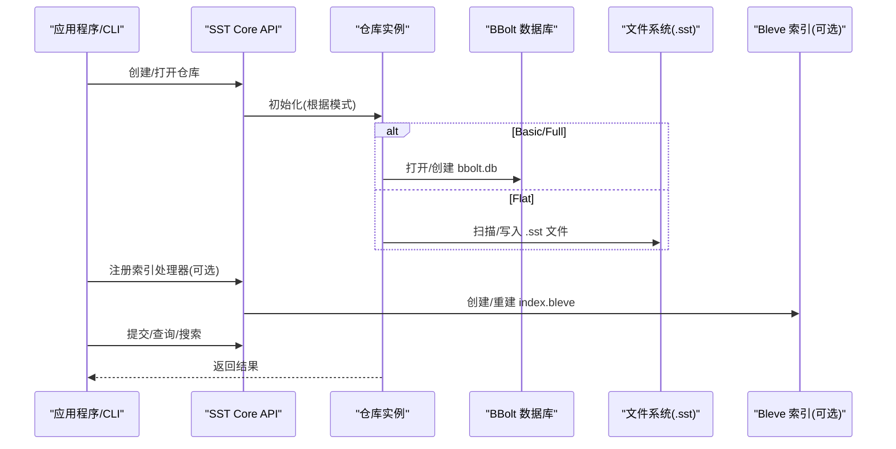
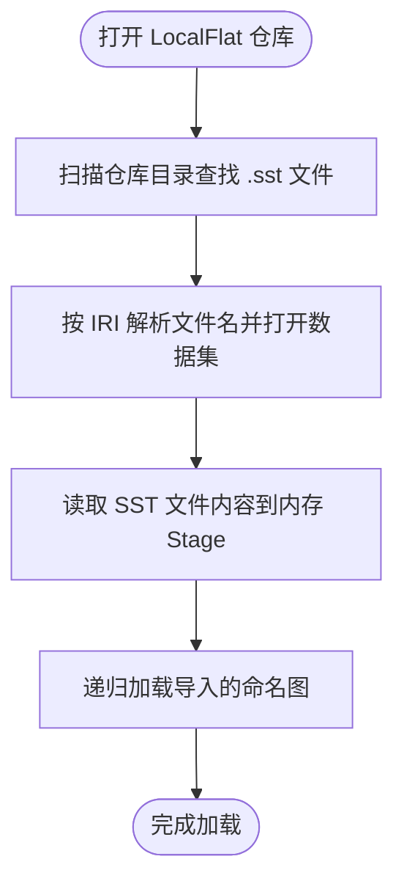
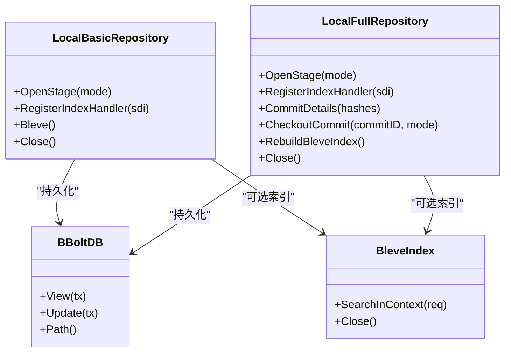
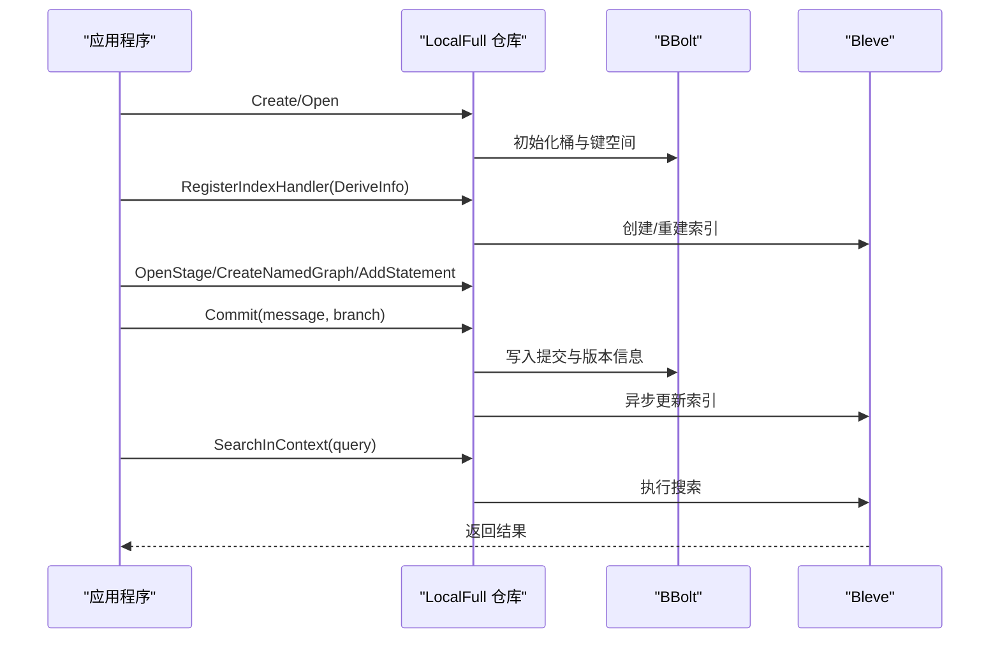
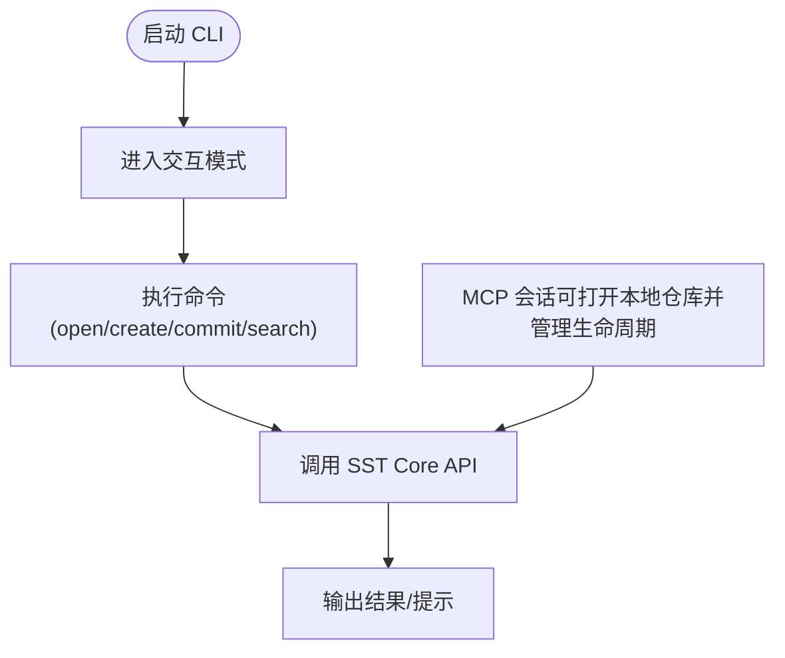
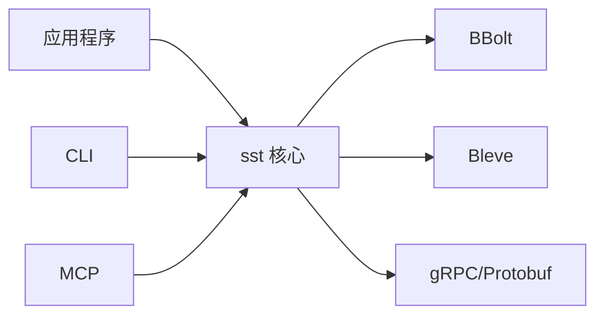

# 单机部署

<cite>
**本文引用的文件**
- [README.md](file://README.md)
- [sst/README.md](file://sst/README.md)
- [repolocalbasic.go](file://sst/repolocalbasic.go)
- [repolocalflat.go](file://sst/repolocalflat.go)
- [repolocalfull.go](file://sst/repolocalfull.go)
- [helloworldrepolocalfull.go](file://examples/helloworldrepolocalfull/repolocalfull.go)
- [helloworldrepolocalfullwithbleve.go](file://examples/helloworldrepolocalfullwithbleve/repolocalfullwithbleve.go)
- [remote.go](file://bboltproto/remote.go)
- [repository.pb.go](file://bboltproto/repository.pb.go)
- [root.go](file://cli/cmd/root.go)
- [session.go](file://mcp/cmd/session.go)
- [ACCESS_RIGHTS.md](file://sstauth/ACCESS_RIGHTS.md)
</cite>

## 目录
1. [简介](#简介)
2. [项目结构](#项目结构)
3. [核心组件](#核心组件)
4. [架构总览](#架构总览)
5. [详细组件分析](#详细组件分析)
6. [依赖分析](#依赖分析)
7. [性能考虑](#性能考虑)
8. [故障排查指南](#故障排查指南)
9. [结论](#结论)
10. [附录](#附录)

## 简介
本指南面向在单机环境下部署和使用 SST（Semantic STEP Technology）的读者，重点说明：
- 本地文件系统、BBolt 数据库与完整存储模式的配置方法
- 不同存储后端（LocalBasic、LocalFlat、LocalFull）的性能特点与适用场景
- 完整的配置文件示例与环境变量设置要点
- 磁盘空间规划、文件权限与目录结构要求
- 从安装到运行的完整流程（依赖、验证、启动）
- 单机环境下的备份恢复策略与常见故障处理方法

SST 基于 RDF/RDFS/OWL 标准，使用 Turtle（*.ttl）作为主要交换格式，并通过类似 Git 的版本控制概念管理数据集与命名图的历史。其核心 API 位于 sst 包，CLI 工具提供交互式操作入口，示例代码展示了典型用法。

**章节来源**
- [README.md:1-15](file://README.md#L1-L15)
- [sst/README.md:1-207](file://sst/README.md#L1-L207)

## 项目结构
仓库包含以下关键部分：
- sst：核心 API，实现三种本地仓库模式（Basic、Flat、Full）以及索引、提交、版本控制等能力
- examples：示例程序，演示如何创建、写入、读取、搜索与导出数据
- cli：命令行工具入口，默认进入交互模式
- bboltproto：客户端与服务端之间的 gRPC 协议定义（用于远程访问 BBolt 存储）
- mcp：会话管理与本地仓库打开示例
- vocabularies：预编译的高层本体映射，便于应用开发

**图示来源**
- [repolocalbasic.go:34-42](file://sst/repolocalbasic.go#L34-L42)
- [repolocalflat.go:28-32](file://sst/repolocalflat.go#L28-L32)
- [repolocalfull.go:220-230](file://sst/repolocalfull.go#L220-L230)
- [remote.go:1-25](file://bboltproto/remote.go#L1-L25)
- [root.go:13-23](file://cli/cmd/root.go#L13-L23)
- [session.go:100-117](file://mcp/cmd/session.go#L100-L117)

**章节来源**
- [README.md:1-15](file://README.md#L1-L15)
- [root.go:13-23](file://cli/cmd/root.go#L13-L23)
- [session.go:100-117](file://mcp/cmd/session.go#L100-L117)

## 核心组件
- LocalBasic 仓库：以 BBolt 为持久化存储，支持可选的 Bleve 全文索引；适合轻量级本地读写与简单检索场景
- LocalFlat 仓库：以扁平目录中的 .sst 文件存储数据；无版本历史，适合简单归档与跨机器拷贝
- LocalFull 仓库：以 BBolt 为持久化存储，具备完整的版本历史、分支、提交、合并等能力；可结合 Bleve 进行全文检索
- CLI：交互式命令入口，便于快速上手与日常操作
- 远程访问：通过 gRPC 协议暴露仓库能力，支持认证与安全传输

**章节来源**
- [repolocalbasic.go:34-42](file://sst/repolocalbasic.go#L34-L42)
- [repolocalflat.go:28-32](file://sst/repolocalflat.go#L28-L32)
- [repolocalfull.go:220-230](file://sst/repolocalfull.go#L220-L230)
- [root.go:13-23](file://cli/cmd/root.go#L13-L23)
- [remote.go:1-25](file://bboltproto/remote.go#L1-L25)

## 架构总览
下图展示单机模式下，应用程序或 CLI 如何通过 SST Core API 选择不同存储后端，并访问 BBolt 与 Bleve 索引。

**图示来源**
- [repolocalbasic.go:67-145](file://sst/repolocalbasic.go#L67-L145)
- [repolocalflat.go:63-108](file://sst/repolocalflat.go#L63-L108)
- [repolocalfull.go:259-341](file://sst/repolocalfull.go#L259-L341)

## 详细组件分析

### 本地文件系统模式（LocalFlat）
- 存储方式：每个数据集对应一个 .sst 文件，文件名由基址 IRI 的 Base64URL 编码构成
- 特性：无版本历史，不支持分支/提交；适合简单归档、便携复制
- 目录结构：仓库根目录下直接存放 .sst 文件
- 性能特点：I/O 简单直接，适合小规模数据与离线分发；大数据量时遍历开销较大

**图示来源**
- [repolocalflat.go:63-108](file://sst/repolocalflat.go#L63-L108)
- [repolocalflat.go:114-152](file://sst/repolocalflat.go#L114-L152)
- [repolocalflat.go:211-235](file://sst/repolocalflat.go#L211-L235)

**章节来源**
- [repolocalflat.go:63-108](file://sst/repolocalflat.go#L63-L108)
- [repolocalflat.go:114-152](file://sst/repolocalflat.go#L114-L152)
- [repolocalflat.go:211-235](file://sst/repolocalflat.go#L211-L235)
- [repolocalflat.go:301-322](file://sst/repolocalflat.go#L301-L322)
- [repolocalflat.go:381-430](file://sst/repolocalflat.go#L381-L430)

### BBolt 数据库模式（LocalBasic / LocalFull）
- 存储方式：使用 BBolt 键值数据库（bbolt.db），将数据集元数据、引用关系、提交信息等组织为桶（Bucket）
- 特性：
  - LocalBasic：基础读写与可选 Bleve 索引，无版本历史
  - LocalFull：完整版本历史、分支、提交、合并；支持 Bleve 全文检索
- 目录结构：仓库根目录下包含 bbolt.db 与可选的 index.bleve 目录
- 性能特点：BBolt 提供高并发读与原子写；Full 模式支持复杂查询与历史回溯

**图示来源**
- [repolocalbasic.go:34-42](file://sst/repolocalbasic.go#L34-L42)
- [repolocalbasic.go:67-145](file://sst/repolocalbasic.go#L67-L145)
- [repolocalfull.go:220-230](file://sst/repolocalfull.go#L220-L230)
- [repolocalfull.go:259-341](file://sst/repolocalfull.go#L259-L341)
- [repolocalfull.go:595-719](file://sst/repolocalfull.go#L595-L719)

**章节来源**
- [repolocalbasic.go:67-145](file://sst/repolocalbasic.go#L67-L145)
- [repolocalbasic.go:418-442](file://sst/repolocalbasic.go#L418-L442)
- [repolocalfull.go:259-341](file://sst/repolocalfull.go#L259-L341)
- [repolocalfull.go:721-732](file://sst/repolocalfull.go#L721-L732)
- [repolocalfull.go:734-761](file://sst/repolocalfull.go#L734-L761)

### 完整存储模式（LocalFull）
- 版本控制：支持 Commit、Branch、Merge；记录作者、时间戳、消息与父提交
- 数据集与命名图：每个数据集包含默认命名图与导入的命名图，形成 Dataset
- 索引：可启用 Bleve 全文检索，支持按字段匹配与上下文搜索
- 信息统计：提供仓库大小、数据集数量、版本数等信息

**图示来源**
- [repolocalfull.go:259-341](file://sst/repolocalfull.go#L259-L341)
- [repolocalfull.go:595-719](file://sst/repolocalfull.go#L595-L719)
- [repolocalfull.go:721-732](file://sst/repolocalfull.go#L721-L732)

**章节来源**
- [repolocalfull.go:259-341](file://sst/repolocalfull.go#L259-L341)
- [repolocalfull.go:595-719](file://sst/repolocalfull.go#L595-L719)
- [repolocalfull.go:721-732](file://sst/repolocalfull.go#L721-L732)

### CLI 与 MCP 会话
- CLI：默认进入交互模式，提供帮助与常用命令
- MCP：提供会话管理，支持打开本地仓库并注册到会话中

**图示来源**
- [root.go:13-23](file://cli/cmd/root.go#L13-L23)
- [session.go:100-117](file://mcp/cmd/session.go#L100-L117)

**章节来源**
- [root.go:13-23](file://cli/cmd/root.go#L13-L23)
- [session.go:100-117](file://mcp/cmd/session.go#L100-L117)

## 依赖分析
- 外部依赖：
  - BBolt：高性能嵌入式键值数据库，用于持久化
  - Bleve：全文搜索引擎，用于索引与检索
  - gRPC/Protobuf：远程访问协议定义（bboltproto）
- 内部依赖：
  - sst 包为核心，封装仓库模式、阶段操作、提交与版本控制
  - examples 提供最小可用示例，便于理解 API 使用
  - cli 与 mcp 提供用户界面与会话管理

**图示来源**
- [repolocalbasic.go:34-42](file://sst/repolocalbasic.go#L34-L42)
- [repolocalflat.go:28-32](file://sst/repolocalflat.go#L28-L32)
- [repolocalfull.go:220-230](file://sst/repolocalfull.go#L220-L230)
- [remote.go:1-25](file://bboltproto/remote.go#L1-L25)
- [repository.pb.go:6402-6426](file://bboltproto/repository.pb.go#L6402-L6426)

**章节来源**
- [remote.go:1-25](file://bboltproto/remote.go#L1-L25)
- [repository.pb.go:6402-6426](file://bboltproto/repository.pb.go#L6402-L6426)

## 性能考虑
- LocalFlat：
  - 优点：结构简单，易于备份与迁移
  - 缺点：大数据量下目录遍历与文件 I/O 开销大；无版本历史
- LocalBasic：
  - 优点：BBolt 提供高效读写；可选 Bleve 提升检索性能
  - 缺点：无版本历史，不适合需要回溯的场景
- LocalFull：
  - 优点：完整版本历史、分支与合并；支持全文检索
  - 缺点：BBolt 与 Bleve 维护成本较高；初始构建索引耗时

建议：
- 小数据、离线分发：优先 LocalFlat
- 需要检索但不需历史：LocalBasic + Bleve
- 需要版本控制与协作：LocalFull + Bleve

[本节为通用指导，不直接分析具体文件]

## 故障排查指南
常见问题与处理：
- 索引损坏或不一致：
  - 重新构建 Bleve 索引（LocalBasic/Full）
  - 参考示例中的重建逻辑
- 权限问题：
  - 确保对仓库目录与文件具有读写权限
  - BBolt 数据库文件需保持独占访问
- 远程连接失败：
  - 检查 gRPC 服务是否启动与端口绑定
  - 确认认证与证书配置正确

参考路径：
- 重建索引：[repolocalbasic.go:234-253](file://sst/repolocalbasic.go#L234-L253)、[repolocalfull.go:438-458](file://sst/repolocalfull.go#L438-L458)
- 关闭资源释放：[repolocalbasic.go:418-442](file://sst/repolocalbasic.go#L418-L442)、[repolocalfull.go:734-761](file://sst/repolocalfull.go#L734-L761)
- 远程协议定义：[remote.go:1-25](file://bboltproto/remote.go#L1-L25)、[repository.pb.go:6402-6426](file://bboltproto/repository.pb.go#L6402-L6426)

**章节来源**
- [repolocalbasic.go:234-253](file://sst/repolocalbasic.go#L234-L253)
- [repolocalbasic.go:418-442](file://sst/repolocalbasic.go#L418-L442)
- [repolocalfull.go:438-458](file://sst/repolocalfull.go#L438-L458)
- [repolocalfull.go:734-761](file://sst/repolocalfull.go#L734-L761)
- [remote.go:1-25](file://bboltproto/remote.go#L1-L25)
- [repository.pb.go:6402-6426](file://bboltproto/repository.pb.go#L6402-L6426)

## 结论
- 单机部署可根据需求选择合适存储模式：LocalFlat 简单便携，LocalBasic 轻量高效，LocalFull 功能完备
- 合理配置 BBolt 与 Bleve，平衡性能与维护成本
- 遵循目录结构与权限要求，确保稳定运行
- 利用 CLI 与示例快速上手，逐步扩展至生产环境

[本节为总结性内容，不直接分析具体文件]

## 附录

### 安装与运行流程
1. 准备 Go 环境与依赖
   - 安装 Go 编译器与必要工具链
   - 拉取仓库并进入项目目录
2. 构建与运行示例
   - 参考示例程序创建仓库、写入数据、提交与导出
   - 使用 CLI 进入交互模式进行操作
3. 验证配置
   - 检查仓库目录结构（bbolt.db、index.bleve、.sst 文件）
   - 验证索引是否可用（搜索测试）

参考路径：
- 示例创建仓库与提交：[helloworldrepolocalfull.go:41-66](file://examples/helloworldrepolocalfull/repolocalfull.go#L41-L66)
- 示例注册索引与搜索：[helloworldrepolocalfullwithbleve.go:44-75](file://examples/helloworldrepolocalfullwithbleve/repolocalfullwithbleve.go#L44-L75)
- CLI 入口：[root.go:13-23](file://cli/cmd/root.go#L13-L23)

**章节来源**
- [helloworldrepolocalfull.go:41-66](file://examples/helloworldrepolocalfull/repolocalfull.go#L41-L66)
- [helloworldrepolocalfullwithbleve.go:44-75](file://examples/helloworldrepolocalfullwithbleve/repolocalfullwithbleve.go#L44-L75)
- [root.go:13-23](file://cli/cmd/root.go#L13-L23)

### 配置与环境变量
- 仓库路径：通过参数指定仓库目录
- 索引处理器：注册 DeriveInfo 以启用 Bleve 索引
- 远程服务：配置绑定地址、OIDC Issuer、ClientID、证书路径等

参考路径：
- 远程服务器配置：[helloworldsuperreporemote/main.go:68-76](file://examples/helloworldsuperreporemote/main.go#L68-L76)
- 远程服务启动：[helloworldsuperreporemote/main.go:97-110](file://examples/helloworldsuperreporemote/main.go#L97-L110)

**章节来源**
- [helloworldsuperreporemote/main.go:68-76](file://examples/helloworldsuperreporemote/main.go#L68-L76)
- [helloworldsuperreporemote/main.go:97-110](file://examples/helloworldsuperreporemote/main.go#L97-L110)

### 磁盘空间规划与目录结构
- LocalBasic/Full：
  - bbolt.db：主数据库文件，随数据增长而增大
  - index.bleve：索引目录，随索引文档数量增长
- LocalFlat：
  - .sst 文件：每个数据集一个文件，总大小为各文件之和
- 权限要求：
  - 对仓库目录与文件具备读写权限
  - 避免多进程同时写入同一数据库文件

参考路径：
- 计算 BBolt 大小：[repolocalbasic.go:729-735](file://sst/repolocalbasic.go#L729-L735)
- 计算 Bleve 大小：[repolocalbasic.go:753-767](file://sst/repolocalbasic.go#L753-L767)
- 计算 .sst 总大小：[repolocalflat.go:436-456](file://sst/repolocalflat.go#L436-L456)

**章节来源**
- [repolocalbasic.go:729-735](file://sst/repolocalbasic.go#L729-L735)
- [repolocalbasic.go:753-767](file://sst/repolocalbasic.go#L753-L767)
- [repolocalflat.go:436-456](file://sst/repolocalflat.go#L436-L456)

### 备份与恢复策略
- LocalFlat：直接复制仓库目录即可备份；恢复时还原目录
- LocalBasic/Full：
  - 停止写入后复制 bbolt.db 与 index.bleve
  - 恢复时替换文件并重启服务
- 增量备份：利用版本历史与提交信息进行选择性恢复

参考路径：
- 版本信息与提交详情：[repolocalfull.go:595-719](file://sst/repolocalfull.go#L595-L719)
- 仓库信息统计：[repolocalbasic.go:660-723](file://sst/repolocalbasic.go#L660-L723)、[repolocalflat.go:381-430](file://sst/repolocalflat.go#L381-L430)

**章节来源**
- [repolocalfull.go:595-719](file://sst/repolocalfull.go#L595-L719)
- [repolocalbasic.go:660-723](file://sst/repolocalbasic.go#L660-L723)
- [repolocalflat.go:381-430](file://sst/repolocalflat.go#L381-L430)

### 权限与访问控制
- 只读访问：适用于查询与导出
- 读写访问：适用于创建、修改、提交等操作
- 远程访问：通过 gRPC 协议与认证机制保障安全

参考路径：
- 访问权限表：[ACCESS_RIGHTS.md:260-312](file://sstauth/ACCESS_RIGHTS.md#L260-L312)

**章节来源**
- [ACCESS_RIGHTS.md:260-312](file://sstauth/ACCESS_RIGHTS.md#L260-L312)