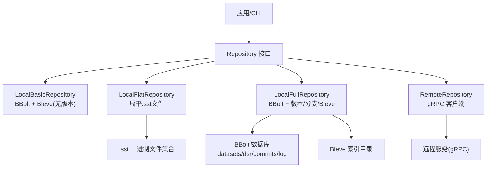
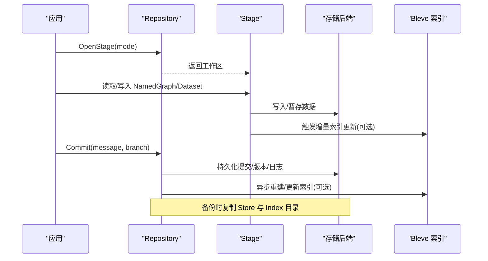
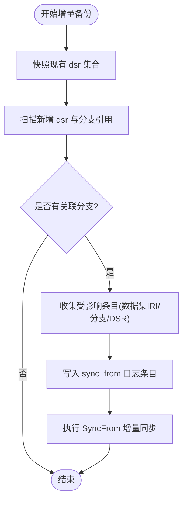
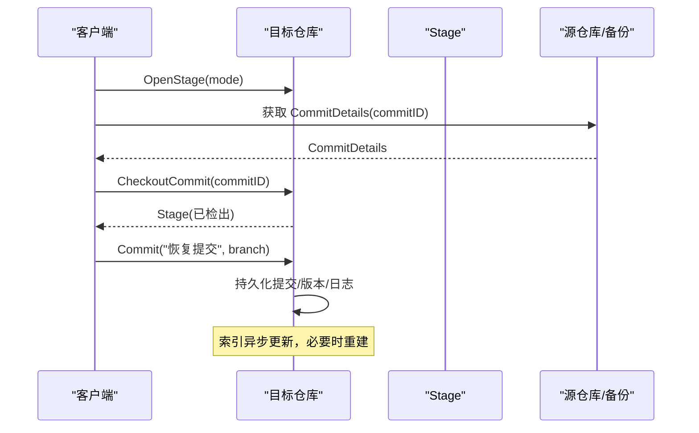
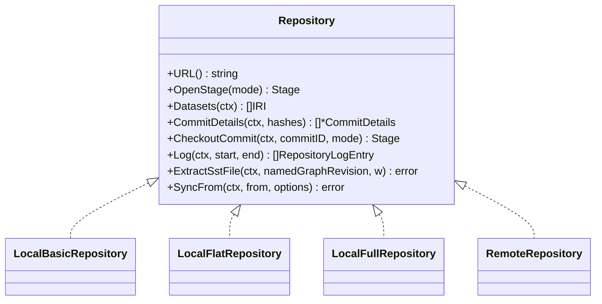

# 备份和恢复

<cite>
**本文引用的文件**
- [repository.go](file://sst/repository.go)
- [repolocalbasic.go](file://sst/repolocalbasic.go)
- [repolocalflat.go](file://sst/repolocalflat.go)
- [repolocalfull.go](file://sst/repolocalfull.go)
- [reporemote.go](file://sst/reporemote.go)
- [syncfromlog.go](file://sst/syncfromlog.go)
- [stagefsremoterepo.go](file://sst/stagefsremoterepo.go)
- [repocheckout.go](file://sst/repocheckout.go)
- [sstfile.go](file://sst/sstfile.go)
- [stagefs.go](file://sst/stagefs.go)
</cite>

## 目录
1. [简介](#简介)
2. [项目结构](#项目结构)
3. [核心组件](#核心组件)
4. [架构总览](#架构总览)
5. [详细组件分析](#详细组件分析)
6. [依赖关系分析](#依赖关系分析)
7. [性能考虑](#性能考虑)
8. [故障排查指南](#故障排查指南)
9. [结论](#结论)
10. [附录](#附录)

## 简介
本指南围绕 SST（Semantic STEP Technology）数据仓库的备份与恢复，系统阐述不同存储后端的数据结构与备份策略，说明增量与全量备份的实现路径，提供自动化脚本与定时任务配置建议，解释数据恢复流程与一致性保证机制，并给出灾难恢复计划、业务连续性保障方案、跨平台迁移与同步最佳实践，以及备份数据的验证与完整性检查方法。

## 项目结构
SST 提供了多种 Repository 实现以适配不同的存储与访问模式：
- LocalBasicRepository：基于 BBolt + Bleve 索引，无数据集版本历史，适合轻量本地场景。
- LocalFlatRepository：扁平文件系统，每个 NamedGraph 独立为 .sst 二进制文件，无事务与版本历史。
- LocalFullRepository：基于 BBolt 的完整本地仓库，支持分支、提交历史、命名图版本、Bleve 索引重建等。
- RemoteRepository：通过 gRPC 远程访问服务端实现的仓库，查询与写入由服务端处理。

图表来源
- [repository.go:34-48](file://sst/repository.go#L34-L48)
- [repolocalbasic.go:34-42](file://sst/repolocalbasic.go#L34-L42)
- [repolocalflat.go:28-32](file://sst/repolocalflat.go#L28-L32)
- [repolocalfull.go:217-230](file://sst/repolocalfull.go#L217-L230)
- [reporemote.go:88-99](file://sst/reporemote.go#L88-L99)

章节来源
- [repository.go:34-48](file://sst/repository.go#L34-L48)

## 核心组件
- Repository 接口：统一抽象了打开阶段、数据集枚举、提交详情、检出、日志、文档管理、同步等能力。
- Stage：工作区，用于加载、修改、合并、提交数据。
- NamedGraph 与 Dataset：数据模型，支持导入、引用、版本化。
- 存储后端：
  - BBolt：持久化键值存储，承载 datasets、dataset revisions、commits、log 等。
  - Bleve：全文检索索引，支持按映射重建与异步更新。
  - 文件系统：扁平 .sst 文件集合，便于直接拷贝备份。
  - gRPC：远程仓库通信协议，封装认证与流式操作。

章节来源
- [repository.go:50-179](file://sst/repository.go#L50-L179)
- [repolocalfull.go:217-230](file://sst/repolocalfull.go#L217-L230)
- [repolocalbasic.go:34-42](file://sst/repolocalbasic.go#L34-L42)
- [repolocalflat.go:28-32](file://sst/repolocalflat.go#L28-L32)
- [reporemote.go:88-99](file://sst/reporemote.go#L88-L99)

## 架构总览
下图展示了备份与恢复在不同后端中的关键路径：
- 全量备份：对 LocalFlat 可直接复制 .sst 文件；对 LocalBasic/Full 可导出 BBolt 文件与 Bleve 目录；对 Remote 可通过 SyncFrom 或 ExtractSstFile 拉取数据。
- 增量备份：利用 LocalFull 的 commit/dataset revision 与 log，结合 SyncFrom 的受影响条目记录，仅同步新增或变更部分。
- 恢复：通过 CheckoutCommit 将指定提交还原到 Stage，再 Commit 到新仓库；或直接导入 .sst 文件至目标仓库。

图表来源
- [repolocalfull.go:244-257](file://sst/repolocalfull.go#L244-L257)
- [repolocalfull.go:417-426](file://sst/repolocalfull.go#L417-L426)
- [repolocalbasic.go:196-222](file://sst/repolocalbasic.go#L196-L222)
- [stagefs.go:156-168](file://sst/stagefs.go#L156-L168)

## 详细组件分析

### 存储后端数据结构与备份策略
- LocalFlatRepository（扁平 .sst 文件）
  - 数据结构：每个 NamedGraph 对应一个 .sst 二进制文件，文件名由 base64URL 编码的 base URL 构成。
  - 备份策略：直接复制整个仓库目录即可实现全量备份；由于无版本历史，无法做细粒度增量。
  - 恢复策略：将 .sst 文件复制到目标仓库目录，使用 OpenLocalFlatRepository 打开并读取。
  - 参考路径
    - [repolocalflat.go:63-86](file://sst/repolocalflat.go#L63-L86)
    - [repolocalflat.go:114-152](file://sst/repolocalflat.go#L114-L152)
    - [repolocalflat.go:301-322](file://sst/repolocalflat.go#L301-L322)
    - [repolocalflat.go:381-430](file://sst/repolocalflat.go#L381-L430)

- LocalBasicRepository（BBolt + Bleve，无版本）
  - 数据结构：BBolt 中维护 repository bucket，Bleve 索引位于 index.bleve 目录。
  - 备份策略：复制 bbolt.db 与 index.bleve 目录；如需只读快照，可在关闭后复制。
  - 恢复策略：将备份文件放回原路径或新路径，OpenLocalRepository 打开；必要时重建 Bleve 索引。
  - 参考路径
    - [repolocalbasic.go:67-145](file://sst/repolocalbasic.go#L67-L145)
    - [repolocalbasic.go:147-222](file://sst/repolocalbasic.go#L147-L222)
    - [repolocalbasic.go:418-442](file://sst/repolocalbasic.go#L418-L442)
    - [repolocalbasic.go:660-723](file://sst/repolocalbasic.go#L660-L723)

- LocalFullRepository（BBolt + Bleve，含版本/分支）
  - 数据结构：BBolt 包含 datasets、dataset revisions(dsr)、commits、log 等桶；Bleve 索引位于 index.bleve。
  - 备份策略：
    - 全量：复制 bbolt.db 与 index.bleve。
    - 增量：利用 commit/dataset revision 与 log，配合 SyncFrom 仅同步受影响条目。
  - 恢复策略：
    - 通过 CheckoutCommit 将指定提交恢复到 Stage，再 Commit 到新仓库。
    - 或使用 SyncFrom 从源仓库增量同步到目标仓库。
  - 参考路径
    - [repolocalfull.go:217-230](file://sst/repolocalfull.go#L217-L230)
    - [repolocalfull.go:595-719](file://sst/repolocalfull.go#L595-L719)
    - [repolocalfull.go:721-732](file://sst/repolocalfull.go#L721-L732)
    - [repolocalfull.go:734-761](file://sst/repolocalfull.go#L734-L761)

- RemoteRepository（gRPC 远程）
  - 数据结构：数据与服务端一致，客户端通过 gRPC 调用获取数据集、提交详情、分支信息等。
  - 备份策略：
    - 使用 SyncFrom 将远程数据同步到本地仓库（LocalFull/LocalBasic）。
    - 使用 ExtractSstFile 导出特定命名图版本为 .sst 流。
  - 恢复策略：在本地仓库执行 CheckoutCommit 或 SyncFrom 恢复。
  - 参考路径
    - [reporemote.go:243-262](file://sst/reporemote.go#L243-L262)
    - [reporemote.go:264-285](file://sst/reporemote.go#L264-L285)
    - [reporemote.go:546-637](file://sst/reporemote.go#L546-L637)
    - [reporemote.go:639-653](file://sst/reporemote.go#L639-L653)

章节来源
- [repolocalflat.go:63-86](file://sst/repolocalflat.go#L63-L86)
- [repolocalbasic.go:67-145](file://sst/repolocalbasic.go#L67-L145)
- [repolocalfull.go:595-719](file://sst/repolocalfull.go#L595-L719)
- [reporemote.go:264-285](file://sst/reporemote.go#L264-L285)

### 增量备份与全量备份实现
- 全量备份
  - LocalFlat：复制仓库目录（所有 .sst 文件）。
  - LocalBasic/Full：复制 bbolt.db 与 index.bleve；对于 Full，也可导出所有 .sst 文件作为归档。
  - Remote：SyncFrom 全量同步到本地仓库，或逐数据集导出 .sst。
- 增量备份
  - 基于 LocalFull 的 commit 与 dataset revision，使用 SyncFrom 的受影响条目收集与日志记录，仅传输新增或变更的数据集与命名图。
  - 参考路径
    - [syncfromlog.go:22-37](file://sst/syncfromlog.go#L22-L37)
    - [syncfromlog.go:55-170](file://sst/syncfromlog.go#L55-L170)
    - [syncfromlog.go:172-224](file://sst/syncfromlog.go#L172-L224)

图表来源
- [syncfromlog.go:22-37](file://sst/syncfromlog.go#L22-L37)
- [syncfromlog.go:55-170](file://sst/syncfromlog.go#L55-L170)
- [syncfromlog.go:172-224](file://sst/syncfromlog.go#L172-L224)

章节来源
- [syncfromlog.go:22-37](file://sst/syncfromlog.go#L22-L37)
- [syncfromlog.go:55-170](file://sst/syncfromlog.go#L55-L170)
- [syncfromlog.go:172-224](file://sst/syncfromlog.go#L172-L224)

### 数据恢复流程与一致性保证
- 恢复流程
  - 选择目标仓库（LocalFull 推荐），打开 Stage。
  - 通过 CheckoutCommit 将指定提交还原到 Stage，再 Commit 到新位置。
  - 或使用 SyncFrom 从源仓库增量同步到目标仓库。
- 一致性保证
  - LocalFull 使用 BBolt 事务与 commit/dataset revision 确保原子性与可追溯性。
  - Bleve 索引在提交后异步更新，避免阻塞主事务；必要时可重建索引。
  - 参考路径
    - [repocheckout.go:10-44](file://sst/repocheckout.go#L10-L44)
    - [repolocalfull.go:721-732](file://sst/repolocalfull.go#L721-L732)
    - [repolocalfull.go:417-426](file://sst/repolocalfull.go#L417-L426)

图表来源
- [repocheckout.go:10-44](file://sst/repocheckout.go#L10-L44)
- [repolocalfull.go:595-719](file://sst/repolocalfull.go#L595-L719)
- [repolocalfull.go:721-732](file://sst/repolocalfull.go#L721-L732)

章节来源
- [repocheckout.go:10-44](file://sst/repocheckout.go#L10-L44)
- [repolocalfull.go:595-719](file://sst/repolocalfull.go#L595-L719)
- [repolocalfull.go:721-732](file://sst/repolocalfull.go#L721-L732)

### 灾难恢复计划与业务连续性保障
- 多副本与异地备份
  - 对 LocalFull/Basic：定期复制 bbolt.db 与 index.bleve 到异地存储。
  - 对 LocalFlat：定期打包 .sst 目录并上传对象存储。
  - 对 Remote：通过 SyncFrom 定期同步到本地灾备仓库。
- 快速恢复
  - 优先恢复 LocalFull 仓库，使用 CheckoutCommit 精确回滚到最近一致点。
  - 若索引损坏，执行 RebuildBleveIndex 重建。
- 业务连续性
  - 读写分离：生产环境使用 RemoteRepository，灾备使用 LocalFull 离线恢复。
  - 限流与重试：SyncFrom 支持分页与错误重试，避免大库同步失败。
- 参考路径
  - [repolocalfull.go:438-458](file://sst/repolocalfull.go#L438-L458)
  - [reporemote.go:296-347](file://sst/reporemote.go#L296-L347)

章节来源
- [repolocalfull.go:438-458](file://sst/repolocalfull.go#L438-L458)
- [reporemote.go:296-347](file://sst/reporemote.go#L296-L347)

### 跨平台迁移与数据同步最佳实践
- 跨平台
  - LocalFlat 的 .sst 文件具有平台无关的二进制格式，可直接拷贝迁移。
  - LocalFull 的 BBolt 文件需在同一操作系统或兼容环境下打开；必要时导出为 .sst 进行跨平台迁移。
- 数据同步
  - 使用 SyncFrom 指定分支与数据集范围，减少不必要传输。
  - 利用受影响条目日志追踪变更，便于审计与回滚。
- 参考路径
  - [repolocalflat.go:507-524](file://sst/repolocalflat.go#L507-L524)
  - [syncfromlog.go:172-224](file://sst/syncfromlog.go#L172-L224)

章节来源
- [repolocalflat.go:507-524](file://sst/repolocalflat.go#L507-L524)
- [syncfromlog.go:172-224](file://sst/syncfromlog.go#L172-L224)

### 备份数据验证与完整性检查
- 校验 .sst 文件
  - 解析 SST 文件头与字典/内容段，确保魔数与结构正确。
  - 参考路径
    - [sstfile.go:12-54](file://sst/sstfile.go#L12-L54)
- 校验 BBolt 与 Bleve
  - 打开 BBolt 数据库并遍历 key 空间，统计数据集数量与大小。
  - 重建 Bleve 索引并比对查询结果。
  - 参考路径
    - [repolocalbasic.go:729-767](file://sst/repolocalbasic.go#L729-L767)
    - [repolocalfull.go:417-426](file://sst/repolocalfull.go#L417-L426)
- 校验提交与版本
  - 通过 CommitDetails 核对提交哈希、作者、时间戳与命名图版本。
  - 参考路径
    - [repolocalfull.go:595-719](file://sst/repolocalfull.go#L595-L719)

章节来源
- [sstfile.go:12-54](file://sst/sstfile.go#L12-L54)
- [repolocalbasic.go:729-767](file://sst/repolocalbasic.go#L729-L767)
- [repolocalfull.go:595-719](file://sst/repolocalfull.go#L595-L719)

## 依赖关系分析
- Repository 接口与各实现之间的耦合度较低，便于替换与扩展。
- LocalFullRepository 依赖 BBolt 与 Bleve，提供强一致性与可回溯性。
- RemoteRepository 依赖 gRPC 客户端与服务端协议，屏蔽底层存储细节。
- StageFS 与 remoteRepoFS 提供统一的文件系统抽象，便于在不同后端间复用逻辑。

图表来源
- [repository.go:50-179](file://sst/repository.go#L50-L179)
- [repolocalbasic.go:34-42](file://sst/repolocalbasic.go#L34-L42)
- [repolocalflat.go:28-32](file://sst/repolocalflat.go#L28-L32)
- [repolocalfull.go:217-230](file://sst/repolocalfull.go#L217-L230)
- [reporemote.go:88-99](file://sst/reporemote.go#L88-L99)

章节来源
- [repository.go:50-179](file://sst/repository.go#L50-L179)

## 性能考虑
- 全量备份
  - LocalFlat 直接复制 .sst 文件，I/O 开销与文件大小成正比。
  - LocalBasic/Full 复制 BBolt 与 Bleve，注意磁盘空间与并发写入影响。
- 增量备份
  - 利用 SyncFrom 的受影响条目收集，减少网络与存储压力。
  - 合理设置分页大小与重试策略，避免长连接超时。
- 索引重建
  - Bleve 重建可能耗时较长，建议在低峰期执行；重建期间搜索不可用。
- 参考路径
  - [repolocalbasic.go:147-222](file://sst/repolocalbasic.go#L147-L222)
  - [repolocalfull.go:417-426](file://sst/repolocalfull.go#L417-L426)
  - [reporemote.go:296-347](file://sst/reporemote.go#L296-L347)

## 故障排查指南
- 常见问题
  - 仓库不存在或路径错误：检查目录与权限。
  - 索引损坏：执行 RebuildBleveIndex 重建。
  - 远程连接失败：检查 gRPC 配置与认证令牌。
- 日志与诊断
  - 启用默认日志或注入自定义 Logger，观察关键步骤。
  - 使用 Info/Log 方法查看仓库统计与提交历史。
- 参考路径
  - [sstfile.go:73-102](file://sst/sstfile.go#L73-L102)
  - [repolocalbasic.go:660-723](file://sst/repolocalbasic.go#L660-L723)
  - [reporemote.go:264-285](file://sst/reporemote.go#L264-L285)

章节来源
- [sstfile.go:73-102](file://sst/sstfile.go#L73-L102)
- [repolocalbasic.go:660-723](file://sst/repolocalbasic.go#L660-L723)
- [reporemote.go:264-285](file://sst/reporemote.go#L264-L285)

## 结论
SST 提供了灵活且强大的备份与恢复能力，覆盖本地与远程多种存储后端。通过组合全量与增量策略、严格的版本控制与索引管理，可实现高可用与可回溯的数据治理。建议在生产环境中采用 LocalFull 作为主仓库，配合异地备份与定期演练，确保业务连续性与数据安全。

## 附录
- 自动化备份脚本建议
  - 定时任务：使用 cron/systemd 定期执行备份命令。
  - 脚本要点：
    - 对 LocalFlat：打包 .sst 目录并上传对象存储。
    - 对 LocalBasic/Full：复制 bbolt.db 与 index.bleve，并校验大小与哈希。
    - 对 Remote：执行 SyncFrom，记录受影响条目与日志。
- 定时任务配置示例（概念性）
  - Linux crontab：每天凌晨执行备份脚本。
  - Windows Task Scheduler：配置每日任务运行 PowerShell 脚本。
- 数据一致性检查
  - 对比源与目标的 CommitDetails、DatasetRevisions 与 NamedGraphRevisions。
  - 对 .sst 文件进行结构校验与哈希比对。

[本节为概念性指导，不直接分析具体文件]