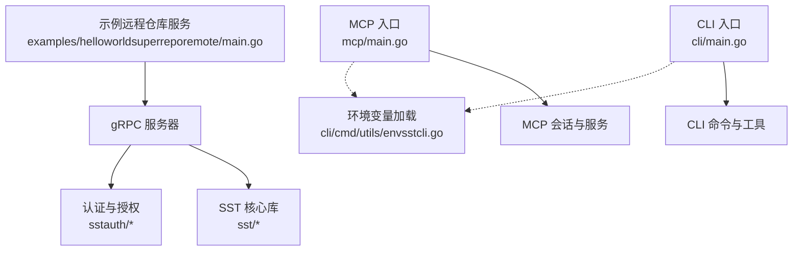
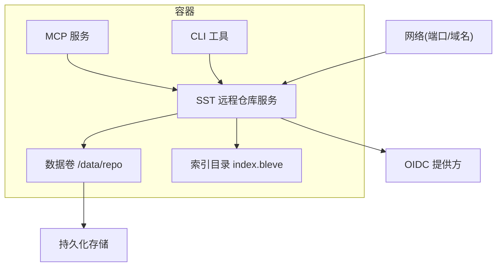
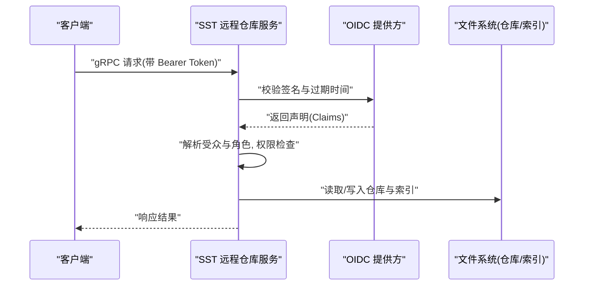
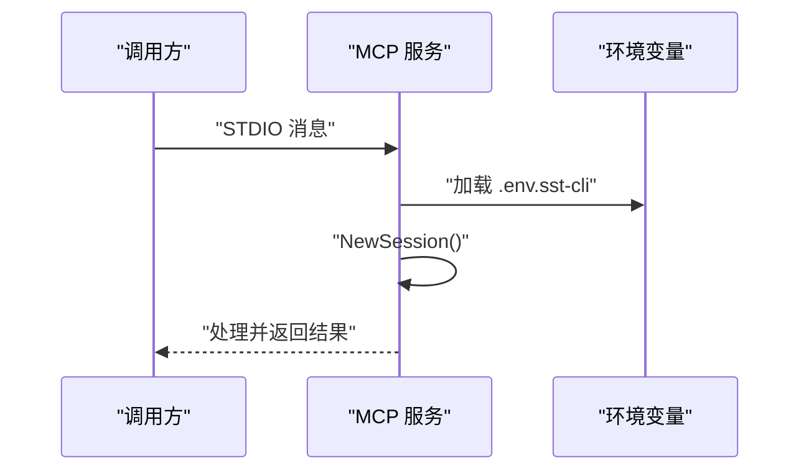
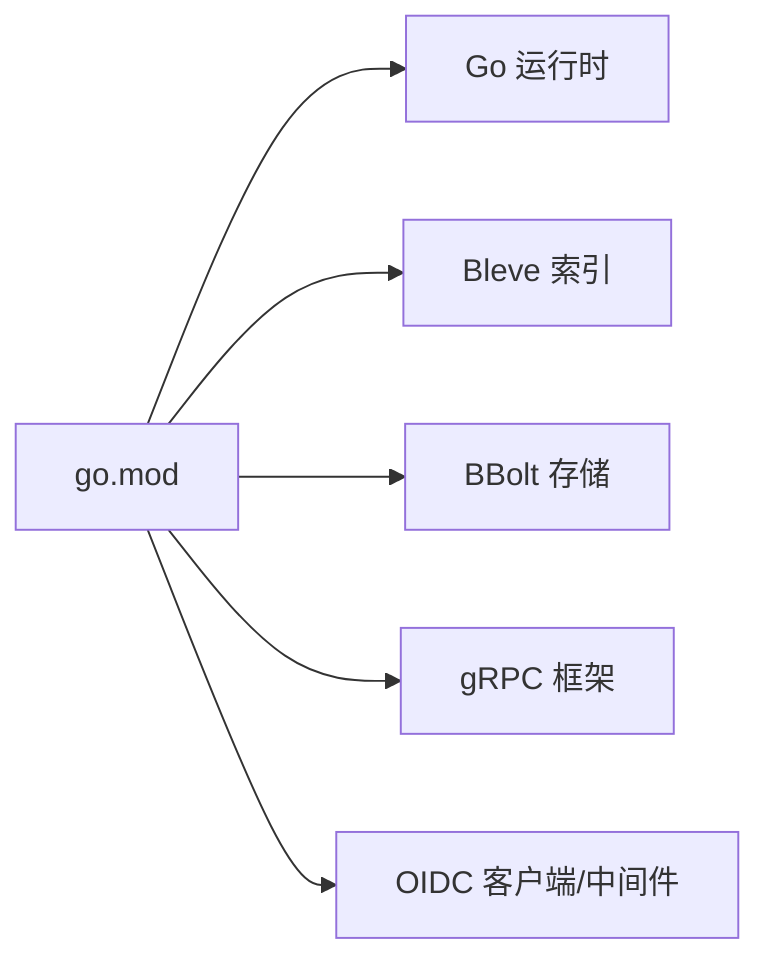

# 容器化部署

<cite>
**本文引用的文件**
- [README.md](file://README.md)
- [go.mod](file://go.mod)
- [cli/main.go](file://cli/main.go)
- [mcp/main.go](file://mcp/main.go)
- [examples/helloworldsuperreporemote/main.go](file://examples/helloworldsuperreporemote/main.go)
- [sst/superremoterepository.go](file://sst/superremoterepository.go)
- [sstauth/ACCESS_RIGHTS.md](file://sstauth/ACCESS_RIGHTS.md)
- [sstauth/authoids.go](file://sstauth/authoids.go)
- [cli/cmd/utils/envsstcli.go](file://cli/cmd/utils/envsstcli.go)
</cite>

## 目录
1. [简介](#简介)
2. [项目结构](#项目结构)
3. [核心组件](#核心组件)
4. [架构总览](#架构总览)
5. [详细组件分析](#详细组件分析)
6. [依赖分析](#依赖分析)
7. [性能考虑](#性能考虑)
8. [故障排查指南](#故障排查指南)
9. [结论](#结论)
10. [附录](#附录)

## 简介
本指南面向将 SST Core 以容器方式部署的生产与开发环境，覆盖镜像构建最佳实践、多阶段构建优化、Docker Compose 与 Kubernetes 编排配置、环境变量与卷挂载、网络与安全（TLS/OIDC）、资源限制与健康检查、自动重启策略、CI/CD 集成与自动化部署、生产安全加固与监控、日志收集与性能分析方法。内容基于仓库中可执行入口、服务端启动逻辑、认证授权机制与环境变量加载实现进行说明，确保建议与代码行为一致。

## 项目结构
SST Core 提供多种可执行入口：
- CLI 工具：用于调试与测试 SST Core 及仓库
- MCP 服务：通过 Model Context Protocol 暴露 SST Core 操作给 AI 客户端
- 示例远程仓库服务器：演示如何启动 SuperRepository gRPC 服务并支持 OIDC/TLS

图表来源
- [cli/main.go:1-18](file://cli/main.go#L1-L18)
- [mcp/main.go:1-33](file://mcp/main.go#L1-L33)
- [examples/helloworldsuperreporemote/main.go:28-115](file://examples/helloworldsuperreporemote/main.go#L28-L115)
- [cli/cmd/utils/envsstcli.go:1-85](file://cli/cmd/utils/envsstcli.go#L1-L85)

章节来源
- [README.md:1-15](file://README.md#L1-L15)
- [cli/main.go:1-18](file://cli/main.go#L1-L18)
- [mcp/main.go:1-33](file://mcp/main.go#L1-L33)
- [examples/helloworldsuperreporemote/main.go:28-115](file://examples/helloworldsuperreporemote/main.go#L28-L115)

## 核心组件
- CLI 工具：加载环境变量后执行命令，适合在容器中作为运维或调试入口
- MCP 服务：标准输入输出模式运行，便于容器内进程通信
- 远程仓库服务：监听 TCP 端口，可选 TLS，使用 OIDC 鉴权，支持优雅停止

关键要点
- 环境变量加载顺序：当前工作目录与用户主目录的 .env.sst-cli，且不会覆盖已存在的环境变量
- 远程仓库服务支持 OIDC Issuer 与 ClientID，并可加载证书对启用 TLS
- 服务启动后监听指定地址，接收中断信号后优雅停止

章节来源
- [cli/cmd/utils/envsstcli.go:12-34](file://cli/cmd/utils/envsstcli.go#L12-L34)
- [examples/helloworldsuperreporemote/main.go:52-115](file://examples/helloworldsuperreporemote/main.go#L52-L115)

## 架构总览
容器化部署通常包含以下层次：
- 应用层：CLI、MCP、远程仓库服务
- 运行时：Go 运行时、Bleve 索引、BBolt 存储
- 外部依赖：OIDC 提供方（Keycloak）、对象存储或持久卷、网络代理/网关
- 编排层：Docker Compose（单机/开发）与 Kubernetes（集群/生产）

图表来源
- [examples/helloworldsuperreporemote/main.go:52-115](file://examples/helloworldsuperreporemote/main.go#L52-L115)
- [mcp/main.go:22-32](file://mcp/main.go#L22-L32)
- [cli/main.go:12-17](file://cli/main.go#L12-L17)

## 详细组件分析

### 远程仓库服务（SuperRepository）
- 监听地址：通过命令行参数绑定 TCP 地址
- TLS：若提供证书与私钥文件，则加载并使用 TLS
- OIDC：配置 Issuer 与 ClientID，启用 RBAC 拦截器进行鉴权
- 优雅停止：监听中断信号，调用 GracefulStopAndClose

图表来源
- [examples/helloworldsuperreporemote/main.go:52-115](file://examples/helloworldsuperreporemote/main.go#L52-L115)
- [sstauth/ACCESS_RIGHTS.md:52-101](file://sstauth/ACCESS_RIGHTS.md#L52-L101)
- [sstauth/authoids.go:294-312](file://sstauth/authoids.go#L294-L312)

章节来源
- [examples/helloworldsuperreporemote/main.go:52-115](file://examples/helloworldsuperreporemote/main.go#L52-L115)
- [sstauth/ACCESS_RIGHTS.md:52-101](file://sstauth/ACCESS_RIGHTS.md#L52-L101)
- [sstauth/authoids.go:294-312](file://sstauth/authoids.go#L294-L312)

### MCP 服务
- 通过标准输入输出运行，适合容器内进程间通信
- 启动时加载环境变量，创建会话并运行

图表来源
- [mcp/main.go:22-32](file://mcp/main.go#L22-L32)
- [cli/cmd/utils/envsstcli.go:12-34](file://cli/cmd/utils/envsstcli.go#L12-L34)

章节来源
- [mcp/main.go:22-32](file://mcp/main.go#L22-L32)
- [cli/cmd/utils/envsstcli.go:12-34](file://cli/cmd/utils/envsstcli.go#L12-L34)

### CLI 工具
- 启动时加载环境变量，随后执行命令
- 适用于容器内的运维任务（如导入导出、验证、同步等）

章节来源
- [cli/main.go:12-17](file://cli/main.go#L12-L17)
- [cli/cmd/utils/envsstcli.go:12-34](file://cli/cmd/utils/envsstcli.go#L12-L34)

## 依赖分析
- Go 版本与模块：go.mod 指定了 Go 版本与依赖，构建镜像时应固定版本以确保可重现性
- 第三方库：包括 Bleve 搜索、BBolt 存储、gRPC、OIDC 相关库等

图表来源
- [go.mod:1-80](file://go.mod#L1-L80)

章节来源
- [go.mod:1-80](file://go.mod#L1-L80)

## 性能考虑
- 索引目录：Bleve 索引目录应置于高性能磁盘或 SSD；必要时在启动前清理重建索引
- 并发与连接：合理设置 gRPC 最大连接数与超时；避免过多长连接导致资源耗尽
- 内存与 CPU：为容器设置合理的 requests/limits，防止被调度器抢占或 OOM
- 存储 I/O：仓库数据与索引分离到不同卷，减少争用；定期压缩与归档历史数据
- 缓存：利用可配置的缓存库提升热点查询性能（如可访问的本地缓存）

[本节为通用性能建议，不直接分析具体文件]

## 故障排查指南
常见问题与定位方法：
- 认证失败：检查 OIDC Issuer、ClientID、Token 的受众与角色是否正确
- 权限不足：确认客户端角色映射到 AccessMode，满足方法所需最低权限
- 服务无法启动：检查绑定地址是否可用、证书路径是否正确、端口是否冲突
- 数据读写异常：检查仓库目录权限、索引目录是否存在且可写、磁盘空间是否充足

```mermaid
flowchart TD
Start(["问题发生"]) --> Auth{"认证/授权检查"}
Auth --> |失败| FixAuth["修正 OIDC 配置/Token"]
Auth --> |成功| Net{"网络/端口检查"}
Net --> |异常| FixNet["释放端口/修正地址"]
Net --> |正常| Disk{"存储/权限检查"}
Disk --> |异常| FixDisk["修复权限/扩容"]
Disk --> |正常| Perf{"性能/资源检查"}
Perf --> |异常| Tune["调整资源限制/优化配置"]
Perf --> |正常| End(["问题解决"])
```

章节来源
- [sstauth/ACCESS_RIGHTS.md:52-101](file://sstauth/ACCESS_RIGHTS.md#L52-L101)
- [sstauth/authoids.go:294-312](file://sstauth/authoids.go#L294-L312)
- [examples/helloworldsuperreporemote/main.go:52-115](file://examples/helloworldsuperreporemote/main.go#L52-L115)

## 结论
SST Core 提供了清晰的容器化部署基础：可执行的 CLI、MCP 服务与远程仓库服务，配合 OIDC/TLS 与优雅停止机制，适合在生产环境中以容器方式运行。通过合理的镜像构建、编排配置、环境变量管理、卷挂载与网络设置，可实现高可用、可扩展与安全的部署方案。结合 CI/CD 流水线与监控告警，可进一步提升交付效率与稳定性。

[本节为总结性内容，不直接分析具体文件]

## 附录

### Docker 镜像构建最佳实践
- 多阶段构建：第一阶段编译二进制，第二阶段仅拷贝运行时依赖与二进制，减小镜像体积
- 固定依赖版本：锁定 go.mod 中的依赖版本，确保构建可重现
- 非 root 用户：以普通用户运行容器，降低安全风险
- 健康检查：提供 HTTP/gRPC 健康端点或脚本，供编排系统探测
- 最小化基础镜像：使用精简的 Go 官方镜像或 distroless 变体

[本节为通用实践建议，不直接分析具体文件]

### 环境变量配置
- CLI/MCP 环境变量文件：.env.sst-cli，支持 KEY=VALUE 格式，注释与空白行忽略，值可加引号
- 加载顺序：当前工作目录优先，其次用户主目录；不会覆盖已存在的环境变量
- 远程认证必需：SST_OIDC_REALM_URL、SST_OIDC_CLIENT_ID、SST_OIDC_CLIENT_SECRET
- 可选：SST_USERNAME、SST_PASSWORD（非交互式登录需同时设置）

章节来源
- [cli/cmd/utils/envsstcli.go:12-34](file://cli/cmd/utils/envsstcli.go#L12-L34)

### 卷挂载与网络连接
- 仓库目录：将宿主机的持久卷挂载到容器内的仓库目录，保证数据持久化
- 索引目录：Bleve 索引目录建议独立挂载，便于备份与迁移
- 网络：对外暴露 gRPC 端口；如需 HTTPS，配置证书并启用 TLS
- 安全：在容器外使用反向代理或 Service Mesh 进行流量治理与加密

章节来源
- [examples/helloworldsuperreporemote/main.go:52-115](file://examples/helloworldsuperreporemote/main.go#L52-L115)

### 资源限制、健康检查与自动重启
- 资源限制：在编排系统中设置 CPU/内存 requests 与 limits，避免资源争用
- 健康检查：实现轻量级健康端点（如返回状态码），供编排系统探测
- 自动重启：配置重启策略（如 Always/OnFailure），确保服务异常时自动恢复

[本节为通用编排建议，不直接分析具体文件]

### CI/CD 流水线集成与自动化部署
- 构建阶段：在多阶段构建中生成二进制与镜像，推送至镜像仓库
- 测试阶段：运行单元测试与集成测试，确保质量
- 部署阶段：更新编排清单（Compose/K8s），滚动发布或蓝绿发布
- 回滚策略：保留历史镜像与配置，支持快速回滚

[本节为通用流程建议，不直接分析具体文件]

### 生产环境安全加固
- 传输安全：启用 TLS，使用受信任的证书颁发机构
- 身份认证：配置 OIDC Issuer 与 ClientID，严格校验受众与角色
- 最小权限：为服务账户分配最小必要角色，遵循零信任原则
- 镜像安全：扫描镜像漏洞，使用白名单镜像源，禁用不必要的包

章节来源
- [examples/helloworldsuperreporemote/main.go:52-115](file://examples/helloworldsuperreporemote/main.go#L52-L115)
- [sstauth/ACCESS_RIGHTS.md:52-101](file://sstauth/ACCESS_RIGHTS.md#L52-L101)

### 监控与日志
- 指标采集：暴露 Prometheus 指标（如请求量、延迟、错误率），接入监控系统
- 日志收集：集中化收集容器日志（stdout/stderr），便于检索与分析
- 告警规则：基于指标阈值与错误率设置告警，及时发现问题
- 性能分析：使用 pprof 等工具进行 CPU/内存分析，定位瓶颈

[本节为通用监控建议，不直接分析具体文件]