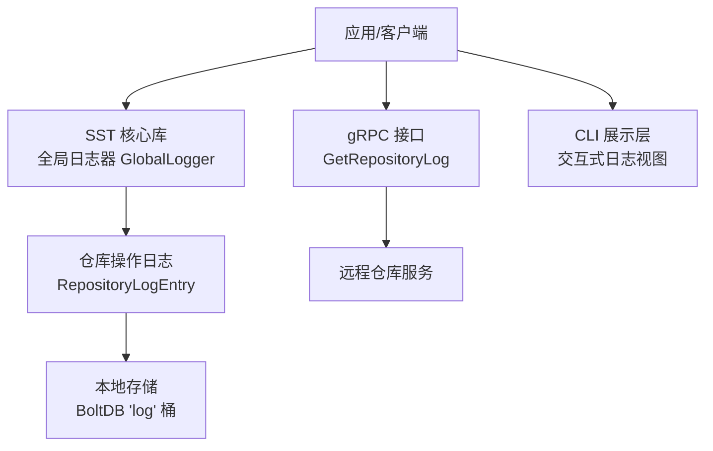
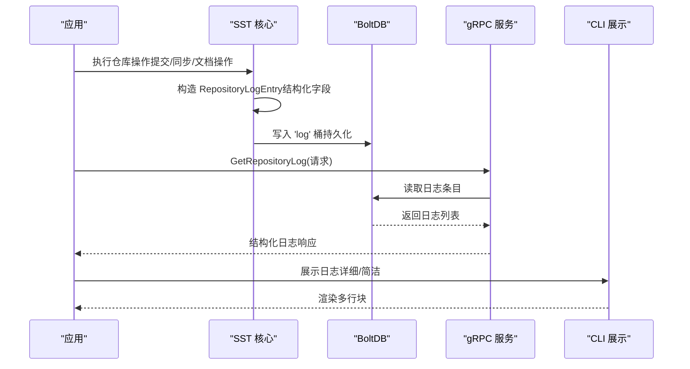
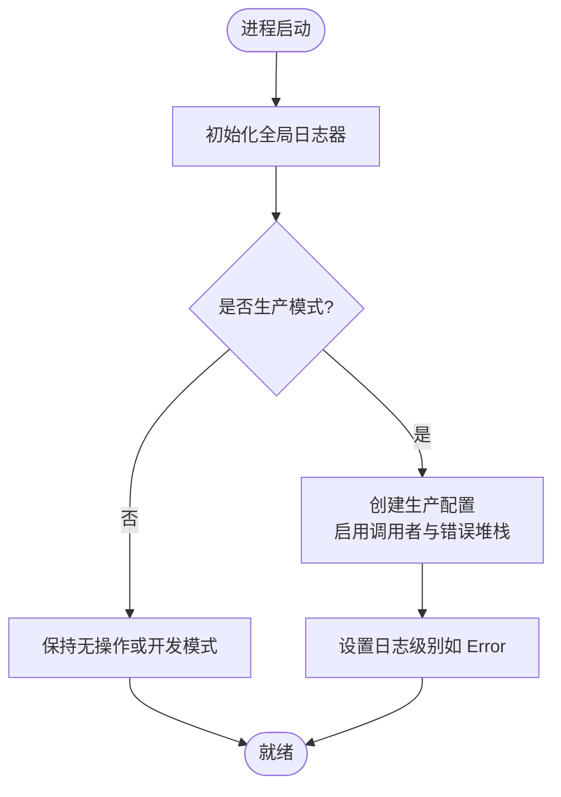
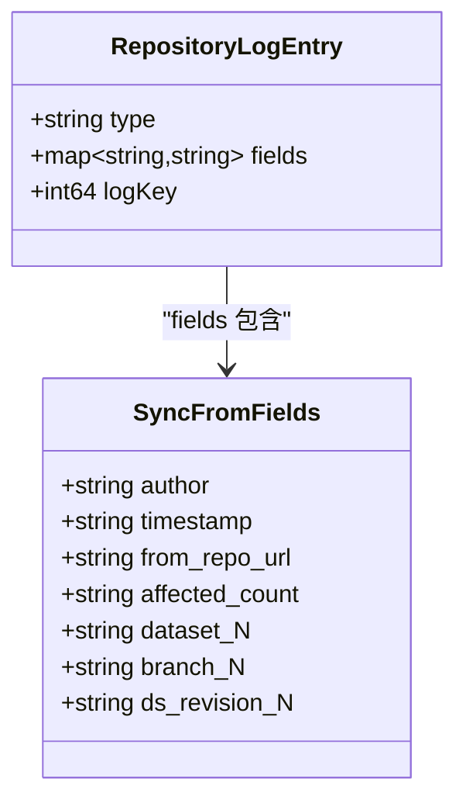
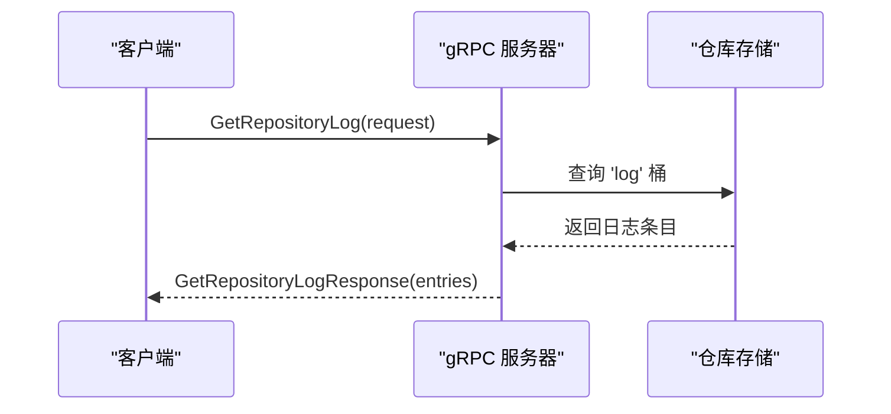
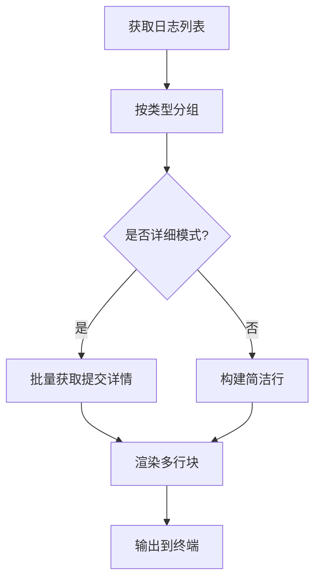
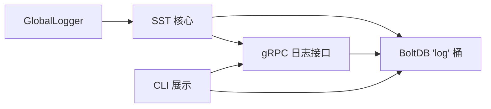

# 监控和日志

<cite>
**本文引用的文件**
- [sstfile.go](file://sst/sstfile.go)
- [stage_handler.go](file://cli/cmd/interactive/stage_handler.go)
- [log_helpers.go](file://cli/cmd/interactive/log_helpers.go)
- [syncfromlog.go](file://sst/syncfromlog.go)
- [repository_grpc.pb.go](file://bboltproto/repository_grpc.pb.go)
- [logger.go](file://tools/validate/logger.go)
- [errrecovery.go](file://sst/errrecovery.go)
- [superremoterepository.go](file://sst/superremoterepository.go)
- [log.go](file://cli/cmd/utils/log.go)
</cite>

## 目录
1. [简介](#简介)
2. [项目结构](#项目结构)
3. [核心组件](#核心组件)
4. [架构总览](#架构总览)
5. [详细组件分析](#详细组件分析)
6. [依赖关系分析](#依赖关系分析)
7. [性能考量](#性能考量)
8. [故障排除指南](#故障排除指南)
9. [结论](#结论)
10. [附录](#附录)

## 简介
本指南面向SST（Semantic STEP）监控与日志系统的配置与使用，覆盖以下主题：
- 内置日志框架的使用方法与日志级别配置
- 关键性能指标的采集与监控告警设置建议
- 与外部监控系统（Prometheus、Grafana）的集成方案
- 结构化日志格式与日志轮转策略
- 错误追踪、性能分析与调试工具使用方法
- 生产环境的日志聚合与分析最佳实践
- 常见问题诊断与故障排除

## 项目结构
SST在代码中提供了统一的日志入口与仓库级操作日志能力，并通过gRPC暴露仓库日志查询接口。CLI交互层负责将结构化日志以人类可读的方式呈现。

图表来源
- [sstfile.go:76-96](file://sst/sstfile.go#L76-L96)
- [syncfromlog.go:172-203](file://sst/syncfromlog.go#L172-L203)
- [repository_grpc.pb.go:468-470](file://bboltproto/repository_grpc.pb.go#L468-L470)
- [log_helpers.go:17-177](file://cli/cmd/interactive/log_helpers.go#L17-L177)

章节来源
- [sstfile.go:76-96](file://sst/sstfile.go#L76-L96)
- [syncfromlog.go:172-203](file://sst/syncfromlog.go#L172-L203)
- [repository_grpc.pb.go:468-470](file://bboltproto/repository_grpc.pb.go#L468-L470)
- [log_helpers.go:17-177](file://cli/cmd/interactive/log_helpers.go#L17-L177)

## 核心组件
- 全局日志器：通过全局变量提供统一日志输出点，支持生产模式配置与调用栈信息。
- 仓库操作日志：记录提交、文档上传/下载/删除、分支变更、同步等事件，字段为键值对的结构化数据。
- gRPC 日志查询：提供获取仓库日志的远程接口，便于集中式收集与展示。
- CLI 日志展示：将结构化日志转换为易读的多行块，支持详细与简洁两种视图。
- 验证器日志：定义日志级别与格式化接口，用于数据校验流程的可观测性。
- 错误恢复与堆栈：捕获panic并附带堆栈信息，便于定位崩溃原因。

章节来源
- [sstfile.go:76-96](file://sst/sstfile.go#L76-L96)
- [syncfromlog.go:172-203](file://sst/syncfromlog.go#L172-L203)
- [repository_grpc.pb.go:468-470](file://bboltproto/repository_grpc.pb.go#L468-L470)
- [log_helpers.go:17-177](file://cli/cmd/interactive/log_helpers.go#L17-L177)
- [logger.go:11-31](file://tools/validate/logger.go#L11-L31)
- [errrecovery.go:15-56](file://sst/errrecovery.go#L15-L56)

## 架构总览
下图展示了从应用调用到日志落盘、再到远程查询与CLI展示的完整链路。

图表来源
- [syncfromlog.go:172-203](file://sst/syncfromlog.go#L172-L203)
- [repository_grpc.pb.go:468-470](file://bboltproto/repository_grpc.pb.go#L468-L470)
- [log_helpers.go:17-177](file://cli/cmd/interactive/log_helpers.go#L17-L177)

## 详细组件分析

### 全局日志器与级别配置
- 全局日志器初始化：默认无操作；可通过配置替换为生产模式，启用调用者信息与错误堆栈。
- CLI 中设置日志级别：示例中将日志级别设置为错误级别，适用于生产环境减少噪音。
- 标准输出静音：提供工具函数将标准输出重定向到空设备，避免干扰交互式界面。

图表来源
- [sstfile.go:76-96](file://sst/sstfile.go#L76-L96)
- [stage_handler.go:376-380](file://cli/cmd/interactive/stage_handler.go#L376-L380)
- [log.go:15-40](file://cli/cmd/utils/log.go#L15-L40)

章节来源
- [sstfile.go:76-96](file://sst/sstfile.go#L76-L96)
- [stage_handler.go:376-380](file://cli/cmd/interactive/stage_handler.go#L376-L380)
- [log.go:15-40](file://cli/cmd/utils/log.go#L15-L40)

### 仓库操作日志（结构化）
- 日志类型：init、commit、upload_document、download_document、delete_document、set_branch、remove_branch、sync_from 等。
- 关键字段：type、author、timestamp、message、hash、mime_type、size_bytes、branch、dataset、ds_revision、from_repo_url、affected_count 等。
- 写入时机：同步完成后根据受影响的数据集与分支生成 sync_from 日志条目。

图表来源
- [syncfromlog.go:172-203](file://sst/syncfromlog.go#L172-L203)
- [log_helpers.go:17-177](file://cli/cmd/interactive/log_helpers.go#L17-L177)

章节来源
- [syncfromlog.go:172-203](file://sst/syncfromlog.go#L172-L203)
- [log_helpers.go:17-177](file://cli/cmd/interactive/log_helpers.go#L17-L177)

### gRPC 日志查询接口
- 接口方法：GetRepositoryLog，返回仓库日志条目列表。
- 用途：供服务端或客户端拉取结构化日志，便于集中式采集与可视化。

图表来源
- [repository_grpc.pb.go:468-470](file://bboltproto/repository_grpc.pb.go#L468-L470)
- [repository_grpc.pb.go:608-610](file://bboltproto/repository_grpc.pb.go#L608-L610)
- [repository_grpc.pb.go:1032-1039](file://bboltproto/repository_grpc.pb.go#L1032-L1039)

章节来源
- [repository_grpc.pb.go:468-470](file://bboltproto/repository_grpc.pb.go#L468-L470)
- [repository_grpc.pb.go:608-610](file://bboltproto/repository_grpc.pb.go#L608-L610)
- [repository_grpc.pb.go:1032-1039](file://bboltproto/repository_grpc.pb.go#L1032-L1039)

### CLI 日志展示（详细与简洁）
- 详细视图：按类型分组显示作者、时间、消息、数据集修订等详细信息。
- 简洁视图：仅显示摘要行，适合快速浏览。
- 批量获取提交详情：对 commit 类型日志进行批量查询，提升展示效率。

图表来源
- [log_helpers.go:17-177](file://cli/cmd/interactive/log_helpers.go#L17-L177)
- [log_helpers.go:179-241](file://cli/cmd/interactive/log_helpers.go#L179-L241)

章节来源
- [log_helpers.go:17-177](file://cli/cmd/interactive/log_helpers.go#L17-L177)
- [log_helpers.go:179-241](file://cli/cmd/interactive/log_helpers.go#L179-L241)

### 验证器日志与级别
- 日志级别：Info、InfoEnter、InfoLeave、Warn、Error。
- 接口：支持对节点或图级别的日志输出，便于校验流程可观测。

章节来源
- [logger.go:11-31](file://tools/validate/logger.go#L11-L31)

### 错误恢复与堆栈
- 捕获 panic 并包装为错误，可选择包含或排除堆栈信息。
- 通过环境变量控制堆栈深度，便于不同场景下的调试需求。

章节来源
- [errrecovery.go:15-56](file://sst/errrecovery.go#L15-L56)
- [errrecovery.go:64-79](file://sst/errrecovery.go#L64-L79)

## 依赖关系分析
- 全局日志器被多处使用，作为统一输出点。
- 仓库操作日志写入依赖于数据库事务与桶结构。
- gRPC 接口与存储层解耦，便于扩展与替换后端。
- CLI 展示层依赖结构化日志字段，保证跨版本兼容性。

图表来源
- [sstfile.go:76-96](file://sst/sstfile.go#L76-L96)
- [syncfromlog.go:172-203](file://sst/syncfromlog.go#L172-L203)
- [repository_grpc.pb.go:468-470](file://bboltproto/repository_grpc.pb.go#L468-L470)
- [log_helpers.go:17-177](file://cli/cmd/interactive/log_helpers.go#L17-L177)

章节来源
- [sstfile.go:76-96](file://sst/sstfile.go#L76-L96)
- [syncfromlog.go:172-203](file://sst/syncfromlog.go#L172-L203)
- [repository_grpc.pb.go:468-470](file://bboltproto/repository_grpc.pb.go#L468-L470)
- [log_helpers.go:17-177](file://cli/cmd/interactive/log_helpers.go#L17-L177)

## 性能考量
- 日志写入采用事务与桶结构，确保一致性与隔离性。
- CLI 对 commit 类型日志进行批量查询，减少多次往返开销。
- 生产环境建议降低日志级别以减少I/O压力。
- 大对象（如文档）相关日志包含 size_bytes 字段，便于容量与吞吐分析。

[本节为通用指导，不直接分析具体文件]

## 故障排除指南
- 无法查看日志：检查 gRPC 接口是否可用，确认 'log' 桶是否存在。
- 日志缺失：确认操作路径是否触发日志写入（如同步后写入 sync_from）。
- 日志过多：调整全局日志级别至 Error，减少非必要输出。
- 崩溃定位：启用包含堆栈的错误恢复，结合 GOTRACEBACK 环境变量控制堆栈深度。
- 标准输出干扰：使用静音工具函数屏蔽不必要的控制台输出。

章节来源
- [syncfromlog.go:172-203](file://sst/syncfromlog.go#L172-L203)
- [errrecovery.go:15-56](file://sst/errrecovery.go#L15-L56)
- [errrecovery.go:64-79](file://sst/errrecovery.go#L64-L79)
- [log.go:15-40](file://cli/cmd/utils/log.go#L15-L40)

## 结论
SST 提供了统一的全局日志器与仓库级结构化操作日志，配合 gRPC 接口与 CLI 展示，形成完整的可观测性基础。生产环境中建议：
- 将日志级别设置为 Error，减少噪音
- 通过 gRPC 拉取日志并接入集中式采集系统
- 基于字段进行指标提取与告警规则设计
- 使用错误恢复与堆栈信息进行问题定位

[本节为总结，不直接分析具体文件]

## 附录

### 内置日志框架使用与级别配置
- 全局日志器：通过全局变量访问，支持生产模式配置与调用者信息。
- CLI 设置级别：示例中将级别设置为 Error，适用于生产环境。
- 标准输出静音：提供工具函数屏蔽标准输出，避免干扰交互界面。

章节来源
- [sstfile.go:76-96](file://sst/sstfile.go#L76-L96)
- [stage_handler.go:376-380](file://cli/cmd/interactive/stage_handler.go#L376-L380)
- [log.go:15-40](file://cli/cmd/utils/log.go#L15-L40)

### 关键性能指标与监控告警建议
- 指标建议：
  - 日志条目数量（按类型分：commit、sync_from、upload/download/delete document）
  - 文档大小分布（size_bytes）
  - 同步影响范围（affected_count、dataset_*、branch_*、ds_revision_*）
- 告警建议：
  - 同步失败或异常增多
  - 文档上传/下载失败率上升
  - 仓库体积增长过快（结合 size_bytes 与频率）

[本节为通用指导，不直接分析具体文件]

### 与 Prometheus/Grafana 集成方案
- 数据采集：通过 gRPC GetRepositoryLog 定期拉取日志条目，解析关键字段。
- 指标导出：将计数类指标（如各类型日志数量、affected_count）暴露给 Prometheus。
- 可视化：在 Grafana 中构建仪表盘，展示趋势、分布与异常。
- 告警：基于阈值与变化率配置告警规则。

[本节为概念性说明，不直接映射到具体代码文件]

### 结构化日志格式与日志轮转策略
- 结构化格式：每条日志包含 type 与 fields 键值对，便于机器解析。
- 轮转策略：建议由上层日志系统（如 journald、filebeat、fluentd）负责轮转与归档。
- 字段规范：保持字段命名稳定，避免破坏下游解析逻辑。

[本节为通用指导，不直接分析具体文件]

### 错误追踪、性能分析与调试工具
- 错误追踪：使用错误恢复包装 panic，并可选择包含堆栈信息。
- 调试开关：通过环境变量控制堆栈深度，适配不同调试场景。
- 性能分析：结合 size_bytes、affected_count 等字段评估负载与影响面。

章节来源
- [errrecovery.go:15-56](file://sst/errrecovery.go#L15-L56)
- [errrecovery.go:64-79](file://sst/errrecovery.go#L64-L79)

### 生产环境日志聚合与分析最佳实践
- 集中采集：通过 gRPC 拉取日志，统一汇聚到日志平台。
- 索引优化：对常用字段（type、author、timestamp、hash）建立索引。
- 安全合规：对敏感字段（如 author）进行脱敏处理。
- 容量规划：根据 size_bytes 与频率预估存储与带宽需求。

[本节为通用指导，不直接分析具体文件]

### 常见问题诊断与故障排除
- 日志不可见：检查 gRPC 接口与存储桶状态。
- 同步未记录：确认同步完成后是否写入 sync_from 日志。
- 输出过多：调整日志级别至 Error。
- 崩溃难以定位：启用包含堆栈的错误恢复，并结合 GOTRACEBACK 控制输出。

章节来源
- [syncfromlog.go:172-203](file://sst/syncfromlog.go#L172-L203)
- [errrecovery.go:15-56](file://sst/errrecovery.go#L15-L56)
- [errrecovery.go:64-79](file://sst/errrecovery.go#L64-L79)