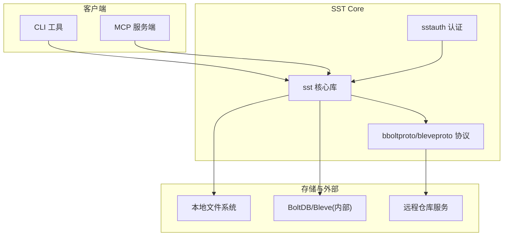
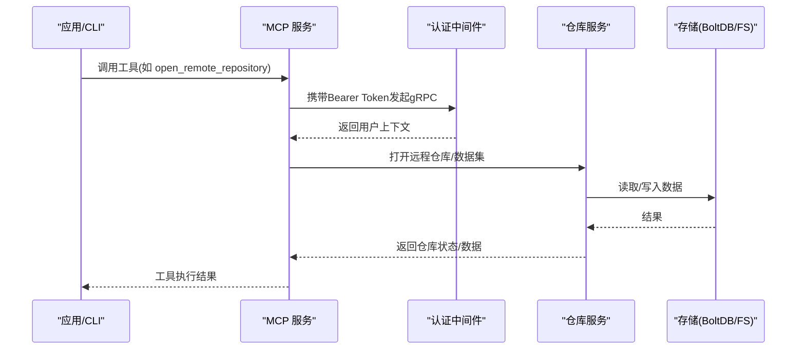
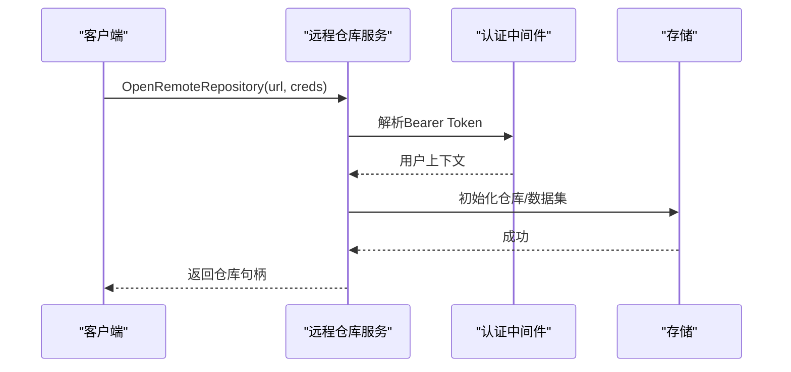
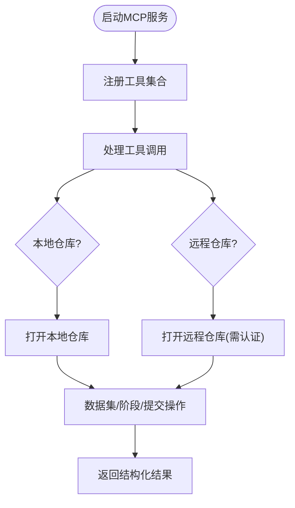
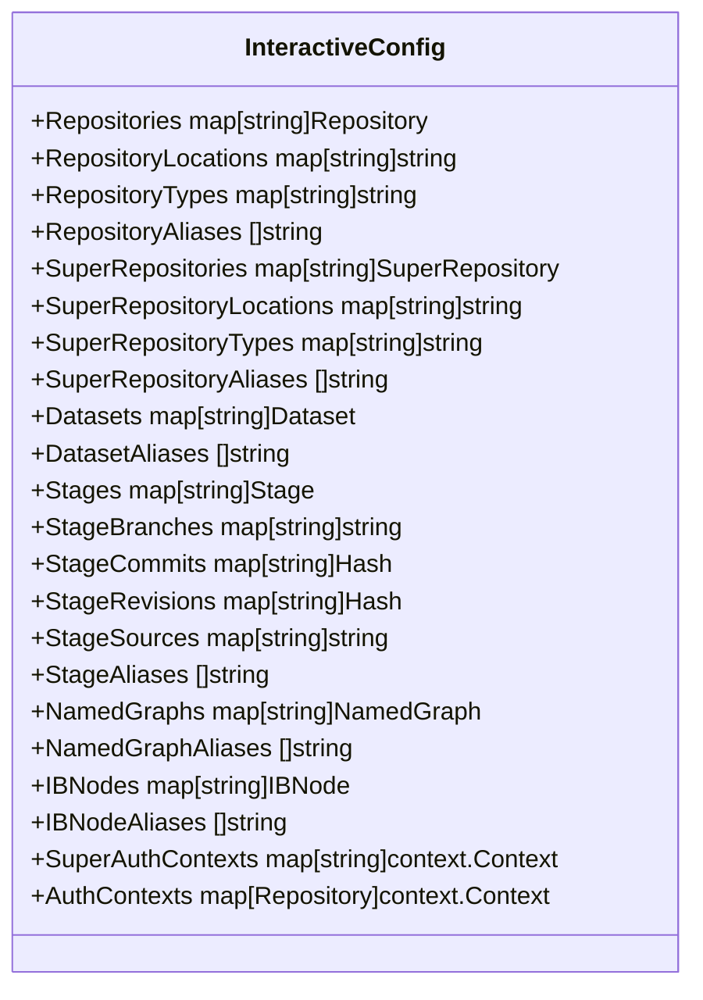
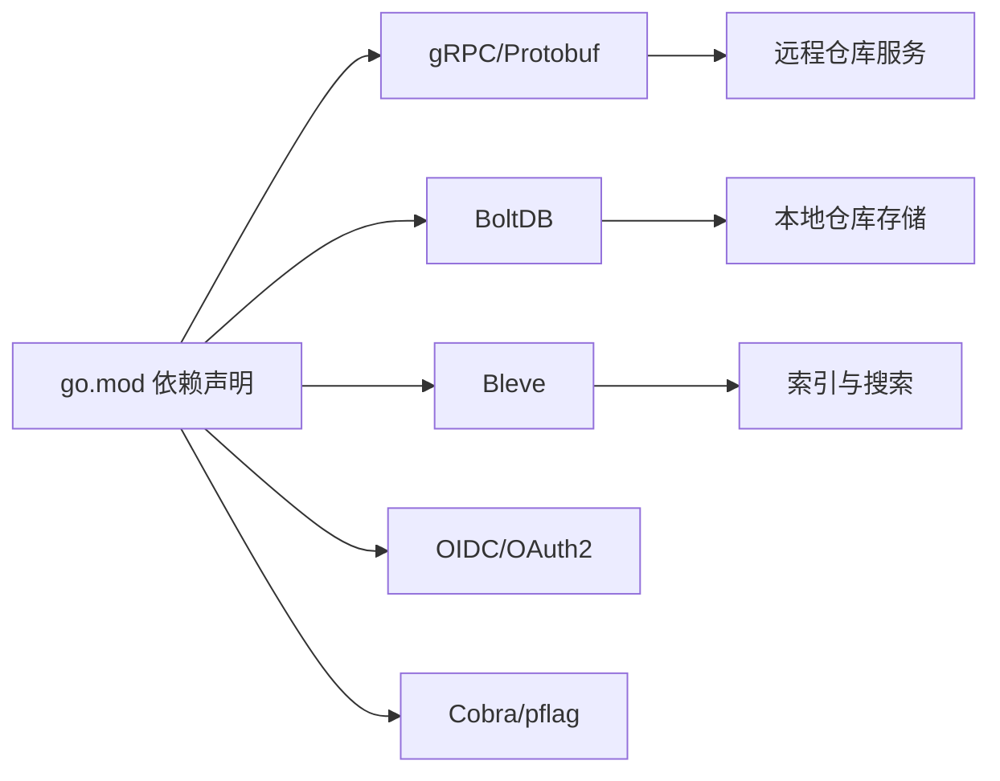

# 部署指南

<cite>
**本文引用的文件**
- [README.md](file://README.md)
- [go.mod](file://go.mod)
- [cli/main.go](file://cli/main.go)
- [mcp/cmd/server.go](file://mcp/cmd/server.go)
- [cli/cmd/interactive/config.go](file://cli/cmd/interactive/config.go)
- [sstauth/authoids.go](file://sstauth/authoids.go)
- [bboltproto/repository.pb.go](file://bboltproto/repository.pb.go)
- [sst_test/remoteRepositoryMultipleCommits_test.go](file://sst_test/remoteRepositoryMultipleCommits_test.go)
</cite>

## 目录
1. [简介](#简介)
2. [项目结构](#项目结构)
3. [核心组件](#核心组件)
4. [架构总览](#架构总览)
5. [详细组件分析](#详细组件分析)
6. [依赖分析](#依赖分析)
7. [性能考虑](#性能考虑)
8. [故障排查指南](#故障排查指南)
9. [结论](#结论)
10. [附录](#附录)

## 简介
本指南面向SST（Semantic STEP Technology）Core的部署与运维，覆盖单机与分布式部署、容器化与Kubernetes编排、负载均衡与高可用、监控告警与日志收集、备份恢复与灾难恢复、自动化脚本与生产最佳实践。SST Core提供本地与远程仓库能力，支持分支、提交历史、数据集版本控制、文档存储以及MCP工具接口，便于在多种环境中集成与扩展。

## 项目结构
SST Core采用模块化组织：
- sst：核心API与数据模型、本地/远程仓库实现、阶段管理与提交机制
- cli：命令行工具入口与交互式会话配置
- mcp：Model Context Protocol服务，暴露仓库/数据集/阶段等工具方法
- sstauth：认证与鉴权中间件（基于gRPC metadata的Bearer Token）
- bboltproto/bleveproto：协议定义与序列化类型（用于远程服务通信与索引）
- examples：示例程序，演示本地/远程读写、超级仓库等用法
- tools：验证、转换、编译器、图形导出等辅助工具
- vocabularies：预编译词汇表，简化上层应用开发

图表来源
- [cli/main.go:1-18](file://cli/main.go#L1-L18)
- [mcp/cmd/server.go:13-563](file://mcp/cmd/server.go#L13-L563)
- [sstauth/authoids.go:73-107](file://sstauth/authoids.go#L73-L107)
- [bboltproto/repository.pb.go:6363-6411](file://bboltproto/repository.pb.go#L6363-L6411)

章节来源
- [README.md:1-15](file://README.md#L1-L15)
- [go.mod:1-80](file://go.mod#L1-L80)

## 核心组件
- 仓库与数据集
  - 本地仓库：直接访问文件系统与内置存储（如BoltDB），适合单机或容器内直连场景
  - 远程仓库：通过gRPC协议与远端服务交互，支持多分支、提交历史、数据集版本控制
- 阶段与提交
  - 阶段（Stage）表示一次工作区快照，支持创建命名图、添加三元组、提交变更并生成不可变哈希
  - 提交（Commit）记录数据集级变更，支持分支指针与合并
- 认证与鉴权
  - 基于gRPC metadata的Bearer Token校验，提取用户信息并注入上下文
- MCP工具集
  - 提供打开本地/远程仓库、列出数据集、分支、提交历史、检出分支/提交、阶段操作、文档上传下载等工具

章节来源
- [mcp/cmd/server.go:13-563](file://mcp/cmd/server.go#L13-L563)
- [sstauth/authoids.go:73-107](file://sstauth/authoids.go#L73-L107)
- [bboltproto/repository.pb.go:6363-6411](file://bboltproto/repository.pb.go#L6363-L6411)

## 架构总览
SST Core既可作为库被应用集成，也可通过CLI/MCP对外提供服务。远程模式通过gRPC暴露仓库管理、数据集、引用、提交等服务；本地模式直接操作文件系统与内置存储。认证层对远程请求进行Token校验，确保访问安全。

图表来源
- [mcp/cmd/server.go:13-563](file://mcp/cmd/server.go#L13-L563)
- [sstauth/authoids.go:73-107](file://sstauth/authoids.go#L73-L107)
- [bboltproto/repository.pb.go:6363-6411](file://bboltproto/repository.pb.go#L6363-L6411)

## 详细组件分析

### 组件A：远程仓库与认证流程
- 远程仓库通过gRPC暴露仓库管理、数据集、引用、提交等服务，客户端使用OpenRemoteRepository连接
- 认证中间件从gRPC metadata中提取Bearer Token，校验后注入用户信息到上下文
- 测试用例展示了远程仓库的打开、阶段创建、提交、分支设置等操作

图表来源
- [sst_test/remoteRepositoryMultipleCommits_test.go:50-71](file://sst_test/remoteRepositoryMultipleCommits_test.go#L50-L71)
- [sst_test/remoteRepositoryMultipleCommits_test.go:682-727](file://sst_test/remoteRepositoryMultipleCommits_test.go#L682-L727)
- [sstauth/authoids.go:73-107](file://sstauth/authoids.go#L73-L107)
- [bboltproto/repository.pb.go:6363-6411](file://bboltproto/repository.pb.go#L6363-L6411)

章节来源
- [sst_test/remoteRepositoryMultipleCommits_test.go:50-71](file://sst_test/remoteRepositoryMultipleCommits_test.go#L50-L71)
- [sst_test/remoteRepositoryMultipleCommits_test.go:682-727](file://sst_test/remoteRepositoryMultipleCommits_test.go#L682-L727)
- [sstauth/authoids.go:73-107](file://sstauth/authoids.go#L73-L107)
- [bboltproto/repository.pb.go:6363-6411](file://bboltproto/repository.pb.go#L6363-L6411)

### 组件B：MCP工具与服务
- MCP服务注册一系列工具，包括打开本地/远程仓库、列出数据集、分支、提交历史、检出分支/提交、阶段操作、文档上传下载等
- 所有工具均返回结构化结果，便于自动化与编排

图表来源
- [mcp/cmd/server.go:13-563](file://mcp/cmd/server.go#L13-L563)

章节来源
- [mcp/cmd/server.go:13-563](file://mcp/cmd/server.go#L13-L563)

### 组件C：CLI与交互式配置
- CLI入口加载环境变量并执行命令
- 交互式配置维护仓库、超级仓库、数据集、阶段、命名图、IBNode等别名映射与认证上下文

图表来源
- [cli/cmd/interactive/config.go:11-73](file://cli/cmd/interactive/config.go#L11-L73)

章节来源
- [cli/main.go:1-18](file://cli/main.go#L1-L18)
- [cli/cmd/interactive/config.go:11-73](file://cli/cmd/interactive/config.go#L11-L73)

## 依赖分析
- 运行时依赖
  - gRPC与Protobuf：用于远程服务通信
  - BoltDB：嵌入式键值存储，用于本地仓库元数据与版本控制
  - Bleve：全文检索索引，支持高效查询
  - OIDC/OAuth2：用于认证令牌校验
  - Cobra/pflag：CLI框架与参数解析
- 模块职责
  - sst：核心API与实现
  - sstauth：认证中间件
  - bboltproto/bleveproto：协议与序列化
  - cli/mcp：对外接口与工具

图表来源
- [go.mod:1-80](file://go.mod#L1-L80)

章节来源
- [go.mod:1-80](file://go.mod#L1-L80)

## 性能考虑
- 本地模式
  - 使用BoltDB作为嵌入式存储，适合单机或小规模部署；注意磁盘I/O与并发写锁
  - 合理划分数据集与命名图，避免单图过大导致查询延迟
- 远程模式
  - 通过gRPC传输，建议启用连接池与超时控制；在高并发场景下增加实例数与水平扩展
  - 结合Bleve索引优化查询性能，定期重建或增量更新索引
- 缓存与批处理
  - 对频繁读的数据集可引入应用层缓存；批量提交减少网络往返
- 资源限制
  - 为进程设置合理的内存与CPU限制，避免GC抖动；监控磁盘空间与索引大小

## 故障排查指南
- 认证失败
  - 检查gRPC metadata中的Bearer Token是否有效；确认Issuer与签名校验配置
  - 参考认证中间件的错误返回码与消息定位问题
- 远程连接异常
  - 检查URL与端口可达性；确认防火墙与安全组策略
  - 查看服务端日志与客户端重试策略
- 提交与合并冲突
  - 使用分支与提交历史定位冲突点；必要时回滚至稳定版本
- 存储与索引问题
  - 检查BoltDB文件完整性与权限；验证Bleve索引一致性
- 常见错误路径
  - 认证错误：Unauthenticated
  - 仓库不存在或权限不足：NotFound/PermissionDenied
  - 数据校验失败：InvalidArgument

章节来源
- [sstauth/authoids.go:73-107](file://sstauth/authoids.go#L73-L107)
- [bboltproto/repository.pb.go:6363-6411](file://bboltproto/repository.pb.go#L6363-L6411)

## 结论
SST Core提供了灵活的本地与远程仓库能力，配合CLI与MCP工具，可在多种环境中快速部署与集成。通过合理的架构选择、负载均衡与高可用设计、完善的监控与日志体系、以及备份恢复策略，可满足生产环境的稳定性与可运维性要求。建议在大规模场景中优先采用远程模式并结合容器化与Kubernetes编排，以实现弹性伸缩与故障自愈。

## 附录

### 部署模式与架构选择
- 单机部署
  - 适用场景：开发、测试、小规模生产
  - 架构：直接运行二进制或容器，本地文件系统+BoltDB
  - 配置要点：数据目录挂载、日志输出、资源限制
- 分布式部署
  - 适用场景：多租户、高并发、跨地域访问
  - 架构：远程仓库服务+负载均衡器+多副本存储
  - 配置要点：gRPC端口、认证Issuer、存储后端、索引节点

### 网络拓扑
- 客户端 -> 负载均衡器 -> 多个SST远程服务实例 -> 共享存储（对象存储/分布式文件系统）
- 认证服务独立部署，统一颁发与校验Token
- 日志与指标集中采集（ELK/时序数据库）

### 容器化与Kubernetes编排
- 镜像构建
  - 使用Go多阶段构建，最小化镜像体积
  - 将配置文件与证书以ConfigMap/Secret挂载
- Pod配置
  - 资源请求与限制（CPU/内存）
  - 健康检查（liveness/readiness探针）
  - 滚动更新与回滚策略
- 服务暴露
  - Ingress/Service暴露gRPC端口
  - 使用NetworkPolicy限制访问源
- 存储
  - 持久卷（PV/PVC）挂载数据目录
  - 定期快照与备份

### 负载均衡与高可用
- 多副本部署，至少3个实例
- 健康检查与自动重启
- 数据库与索引的冗余与同步
- 灰度发布与蓝绿部署

### 监控告警与日志收集
- 指标
  - 请求量、延迟、错误率、GC停顿、磁盘使用
- 日志
  - 结构化JSON日志，包含请求ID、用户、操作、耗时
- 告警
  - 阈值告警（错误率>1%、延迟>500ms）
  - 容量告警（磁盘使用>80%）

### 备份恢复与灾难恢复
- 备份策略
  - 每日全量备份，每小时增量备份
  - 异地容灾复制
- 恢复演练
  - 定期演练RTO/RPO目标
  - 验证数据一致性与可用性

### 实际部署脚本与自动化流程
- 构建与推送镜像
  - CI流水线触发构建，生成镜像并推送到仓库
- 部署到Kubernetes
  - 使用Helm Chart或Kustomize管理配置
  - 应用滚动更新策略
- 数据迁移与索引重建
  - 自动化脚本执行迁移任务，监控进度与错误

### 生产环境运维最佳实践
- 安全
  - 强制HTTPS与TLS，最小权限原则
  - 定期轮换密钥与证书
- 可观测性
  - 统一日志格式与指标采集
  - 建立Dashboard与告警规则
- 变更管理
  - 代码审查与自动化测试
  - 灰度发布与快速回滚
- 容量规划
  - 压测与容量评估
  - 动态扩缩容策略