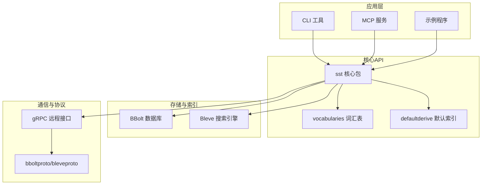
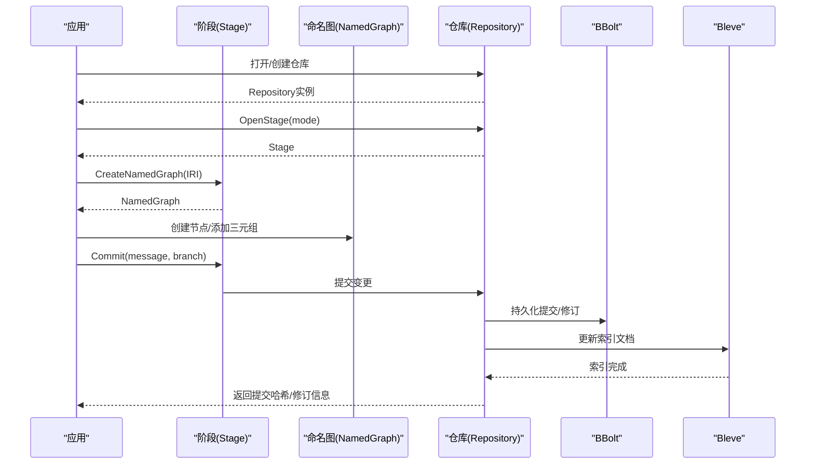
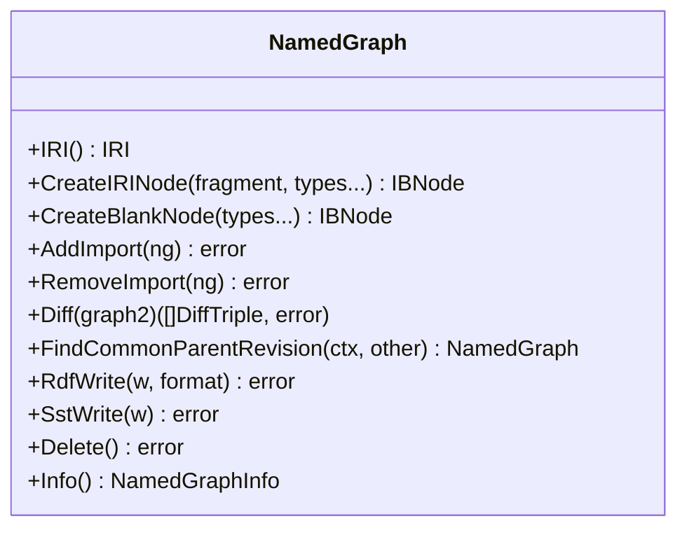
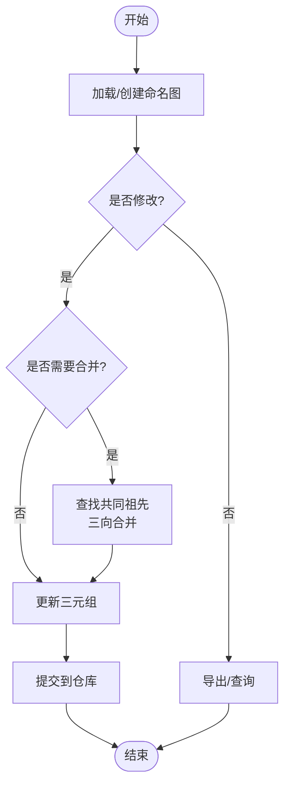
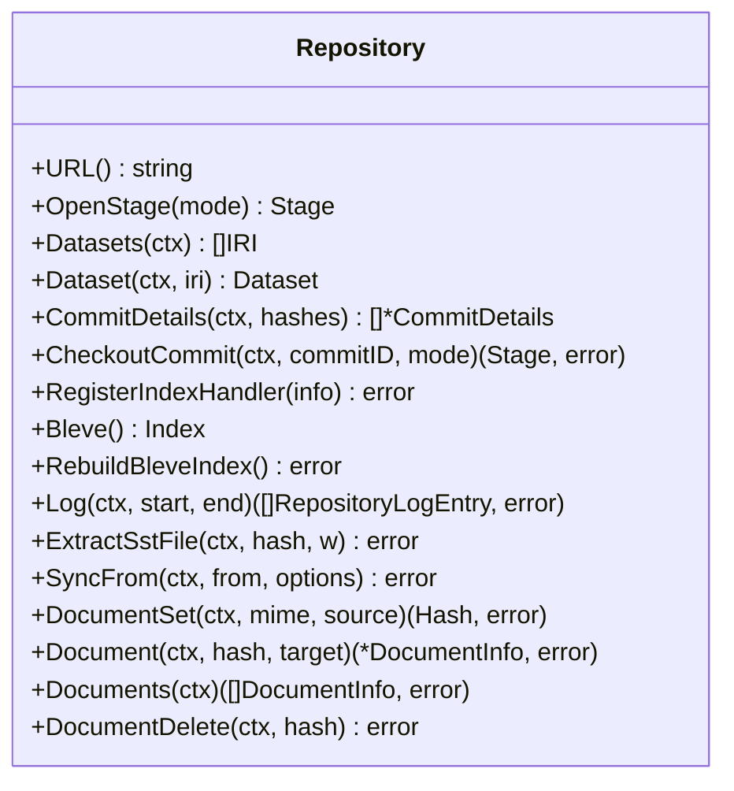
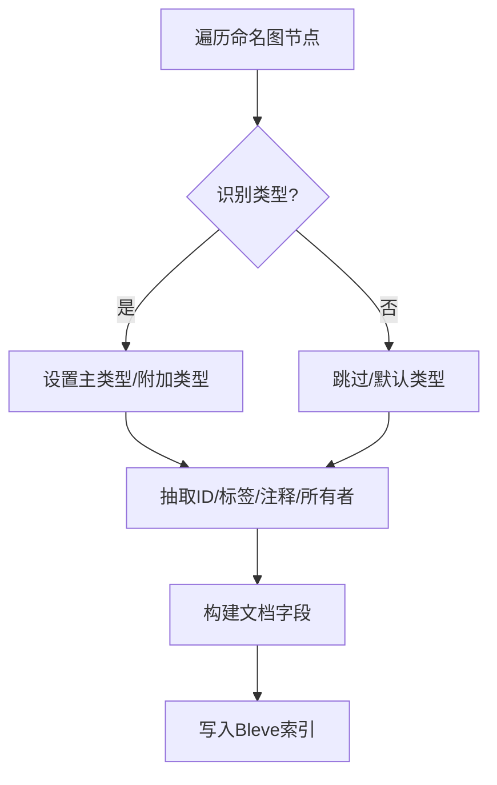
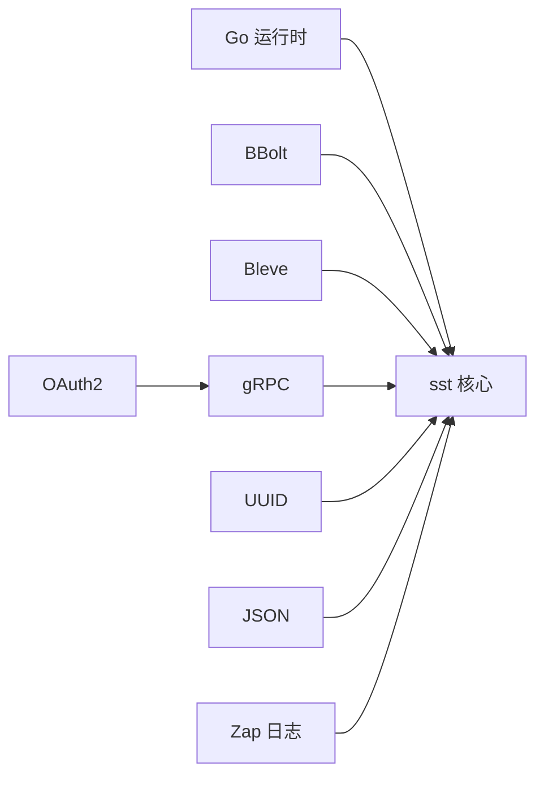

# 项目概述

<cite>
**本文引用的文件**
- [README.md](file://README.md)
- [doc.go](file://doc.go)
- [go.mod](file://go.mod)
- [sst/README.md](file://sst/README.md)
- [sst/types.go](file://sst/types.go)
- [sst/repository.go](file://sst/repository.go)
- [sst/namedgraph.go](file://sst/namedgraph.go)
- [sst/stage.go](file://sst/stage.go)
- [defaultderive/defaultderive.go](file://defaultderive/defaultderive.go)
- [examples/doc.go](file://examples/doc.go)
- [vocabularies/doc.go](file://vocabularies/doc.go)
</cite>

## 目录
1. [简介](#简介)
2. [项目结构](#项目结构)
3. [核心组件](#核心组件)
4. [架构总览](#架构总览)
5. [详细组件分析](#详细组件分析)
6. [依赖关系分析](#依赖关系分析)
7. [性能考量](#性能考量)
8. [故障排查指南](#故障排查指南)
9. [结论](#结论)
10. [附录](#附录)

## 简介
SST Core（Semantic STEP Technology）是一个面向工业产品数据的语义网技术框架，基于W3C的RDF、RDFS与OWL标准，并以Turtle（*.ttl）作为主要交换格式。其目标不是泛用化支持所有RDF用法，而是高效支撑STEP（ISO 10303系列）、油气领域数据（ISO 15926系列）等工业场景的数据建模、版本控制、查询检索与格式转换。

SST将RDF三元组组织为命名图（NamedGraph），并通过仓库（Repository）提供类似Git的版本管理、分支、提交历史；通过Bleve实现全文与结构化索引；通过BBolt进行持久化存储；通过gRPC暴露远程访问能力；并提供CLI、MCP、工具链以及丰富的词汇表与示例。

对于初学者：
- RDF三元组：由“主体-谓词-客体”构成的最小知识单元。
- 命名图：一组三元组的集合，可被导入组合成数据集（Dataset）。
- IRI节点：统一资源标识符，用于唯一标识资源；在SST中，命名图的主体IRI通常由“基IRI + 片段”构成，体现“归属”约定。
- 空白节点：无全局标识的匿名节点，常用于表示集合或临时对象。

对于有经验的开发者：
- SST采用内部优化的二进制三元组结构与规范化排序，便于快速差异计算与内存复用。
- 仓库抽象支持本地/远程、基础/完整等多种形态，并内置权限、配额、日志与同步机制。
- 索引映射可插拔，默认实现针对STEP/LCI/SSO等本体做了字段级优化。

**章节来源**
- [README.md:1-15](file://README.md#L1-L15)
- [sst/README.md:1-109](file://sst/README.md#L1-L109)

## 项目结构
SST Core采用模块化设计，关键目录与职责如下：
- sst：核心API与数据模型，包括命名图、阶段（Stage）、仓库（Repository）、读写器、差异与合并、版本控制等。
- examples：参考示例，展示如何读写SST/TTL、本地/远程仓库、超级仓库等。
- vocabularies：预编译的高层本体（如RDF/RDFS/OWL/XSD/SKOS/SH/LCI/SSO/REp等），以Go变量形式提供早期绑定。
- defaultderive：默认的Bleve索引映射与文档派生逻辑，面向STEP/LCI/SSO等类型做字段抽取与分词策略。
- cli：命令行工具，包含交互式CLI与常用命令。
- mcp：Model Context Protocol服务入口。
- tools：各类工具（编译器、验证器、图形转换等）。
- bboltproto / bleveproto：远程仓库与索引的gRPC协议定义与客户端封装。
- step：STEP相关转换器（P21、AP242 XML等）。

**图表来源**
- [README.md:5-12](file://README.md#L5-L12)
- [go.mod:5-34](file://go.mod#L5-L34)

**章节来源**
- [README.md:5-12](file://README.md#L5-L12)
- [examples/doc.go:1-5](file://examples/doc.go#L1-L5)
- [vocabularies/doc.go:1-6](file://vocabularies/doc.go#L1-L6)

## 核心组件
- 命名图（NamedGraph）：RDF三元组的容器，支持创建IRI/空白节点、添加三元组、导入其他命名图、差异比较、序列化输出等。
- 阶段（Stage）：工作区概念，承载一个或多个命名图及其三元组，支持移动/合并、提交到仓库、导出多种RDF格式。
- 仓库（Repository）：持久化存储与版本控制，支持本地/远程、基础/完整模式，提供数据集、文档、日志、分支、提交、索引重建等功能。
- 索引（Bleve）：默认索引映射从命名图中提取文档字段，支持短语/关键词/数值等字段类型，支持按类型过滤与排序。
- 词汇表（Vocabularies）：将高层本体编译为Go常量/类型，提供早期绑定与类型安全访问。
- 默认索引派生（Default Derive）：将命名图中的实体识别为Part/Organization/Person等文档类型，抽取ID、标签、注释、所有者等字段。

**章节来源**
- [sst/namedgraph.go:110-357](file://sst/namedgraph.go#L110-L357)
- [sst/stage.go:64-234](file://sst/stage.go#L64-L234)
- [sst/repository.go:34-179](file://sst/repository.go#L34-L179)
- [defaultderive/defaultderive.go:127-211](file://defaultderive/defaultderive.go#L127-L211)
- [vocabularies/doc.go:1-6](file://vocabularies/doc.go#L1-L6)

## 架构总览
SST的核心数据流围绕“命名图—阶段—仓库—索引”展开：
- 读取：从TTL/TRiG/SST文件或远程仓库加载为命名图，进入阶段。
- 编辑：在阶段中增删改三元组、移动/合并命名图、维护导入关系。
- 提交：将修改写入仓库，生成提交记录与数据集/命名图修订。
- 索引：根据默认或自定义映射，将命名图内容派生为可搜索文档。
- 查询：通过Bleve执行全文/结构化查询。
- 导出：将命名图/阶段序列化为Turtle/TRiG或SST二进制。

**图表来源**
- [sst/stage.go:121-130](file://sst/stage.go#L121-L130)
- [sst/repository.go:34-179](file://sst/repository.go#L34-L179)
- [defaultderive/defaultderive.go:297-800](file://defaultderive/defaultderive.go#L297-L800)

**章节来源**
- [sst/stage.go:64-234](file://sst/stage.go#L64-L234)
- [sst/repository.go:34-179](file://sst/repository.go#L34-L179)
- [defaultderive/defaultderive.go:127-211](file://defaultderive/defaultderive.go#L127-L211)

## 详细组件分析

### 命名图（NamedGraph）
- 职责：管理三元组、节点（IRI/空白节点）、导入关系、差异比较、序列化。
- 关键点：
  - 每个命名图有一个基IRI，主体IRI由“基IRI + 片段”组成，体现“归属”。
  - 支持直接导入其他命名图（owl:import），形成数据集。
  - 支持Diff与三向合并（FindCommonParentRevision）。
  - 支持RdfWrite（Turtle/TRiG）与SstWrite（二进制）。

**图表来源**
- [sst/namedgraph.go:110-357](file://sst/namedgraph.go#L110-L357)

**章节来源**
- [sst/namedgraph.go:110-357](file://sst/namedgraph.go#L110-L357)

### 阶段（Stage）
- 职责：工作区，承载多个命名图，支持移动/合并、提交、导出、对齐历史。
- 关键点：
  - TriplexMode决定三元组索引方式（subject/predicate/object），影响内存与遍历性能。
  - MoveAndMerge支持跨仓库/同仓库的合并，自动处理父提交与三向合并。
  - AlignHistory允许从RdfRead创建的阶段与已有仓库历史对齐。

**图表来源**
- [sst/stage.go:132-170](file://sst/stage.go#L132-L170)
- [sst/stage.go:468-800](file://sst/stage.go#L468-L800)

**章节来源**
- [sst/stage.go:64-234](file://sst/stage.go#L64-L234)
- [sst/stage.go:468-800](file://sst/stage.go#L468-L800)

### 仓库（Repository）
- 职责：持久化存储、版本控制、查询索引、文档管理、同步。
- 关键点：
  - 支持本地/远程、基础/完整等不同实现。
  - 使用BBolt存储提交、日志、元数据；Bleve构建索引。
  - 提供OpenRemoteRepository/CreateLocalRepository/OpenLocalRepository等工厂方法。
  - 支持RebuildBleveIndex、SyncFrom、DocumentSet/Document等。

**图表来源**
- [sst/repository.go:34-179](file://sst/repository.go#L34-L179)

**章节来源**
- [sst/repository.go:34-179](file://sst/repository.go#L34-L179)

### 默认索引派生（Default Derive）
- 职责：从命名图中提取文档，构建Bleve索引。
- 关键点：
  - 识别实体类型（Part/Organization/Person/RepresentationContext等）。
  - 抽取字段：mainNode、label、comment、id、idOwner、commit信息等。
  - 支持短语/关键词/数值字段映射，支持排序与存储选项。

**图表来源**
- [defaultderive/defaultderive.go:127-211](file://defaultderive/defaultderive.go#L127-L211)
- [defaultderive/defaultderive.go:297-800](file://defaultderive/defaultderive.go#L297-L800)

**章节来源**
- [defaultderive/defaultderive.go:127-211](file://defaultderive/defaultderive.go#L127-L211)
- [defaultderive/defaultderive.go:297-800](file://defaultderive/defaultderive.go#L297-L800)

### 词汇表（Vocabularies）
- 职责：将高层本体（RDF/RDFS/OWL/XSD/SKOS/SH/LCI/SSO/REp等）编译为Go变量，提供早期绑定。
- 价值：编译期类型检查、减少字符串错误、提升可读性与可维护性。

**章节来源**
- [vocabularies/doc.go:1-6](file://vocabularies/doc.go#L1-L6)

### 示例（Examples）
- 职责：提供HelloWorld读写、本地/远程仓库、超级仓库、P21转换等参考实现。
- 价值：帮助初学者快速上手，理解API调用流程。

**章节来源**
- [examples/doc.go:1-5](file://examples/doc.go#L1-L5)

## 依赖关系分析
- 语言与运行时：Go（go.mod指定版本）。
- 存储：BBolt（键值持久化）。
- 索引：Bleve（全文/结构化搜索）。
- 通信：gRPC（远程仓库访问）。
- 认证：OAuth2（通过gRPC中间件）。
- 工具库：UUID、JSON、日志（zap）、缓存等。

**图表来源**
- [go.mod:5-34](file://go.mod#L5-L34)

**章节来源**
- [go.mod:5-34](file://go.mod#L5-L34)

## 性能考量
- 三元组存储：内部采用紧凑结构与规范化排序，利于快速差异计算与内存复用。
- TriplexMode：根据应用场景选择subject/predicate/object三元组索引，平衡内存与遍历性能。
- 索引映射：默认实现针对常见实体类型优化字段映射与分词策略，减少无关字段。
- 批量操作：索引更新与提交过程支持批处理，降低IO开销。
- 远程访问：gRPC连接复用与TLS配置，支持大规模并发。

[本节为通用性能指导，不直接分析具体文件]

## 故障排查指南
- 常见问题：
  - 命名图未找到/已删除：检查Stage生命周期与命名图状态。
  - 仓库不存在/已存在：确认路径与权限。
  - 索引重建失败：检查磁盘空间与权限。
  - 远程连接失败：检查TLS配置与OAuth2令牌。
- 调试建议：
  - 使用Stage.Dump/NamedGraph.PrintTriples输出内部结构。
  - 查看仓库日志（Log）定位提交与同步问题。
  - 使用Bleve查询验证索引字段是否正确。

**章节来源**
- [sst/namedgraph.go:21-40](file://sst/namedgraph.go#L21-L40)
- [sst/stage.go:21-31](file://sst/stage.go#L21-L31)
- [sst/repository.go:197-215](file://sst/repository.go#L197-L215)

## 结论
SST Core为工业产品数据提供了强大的语义网基础设施，结合RDF标准与工程化实践，实现了高效的数据建模、版本控制、查询检索与格式转换。其模块化架构、可扩展的索引映射与丰富的词汇表，使其既能满足初学者快速上手，又能为高级用户提供深度定制能力。

[本节为总结性内容，不直接分析具体文件]

## 附录
- 术语解释：
  - RDF三元组：主体-谓词-客体。
  - 命名图：三元组的集合，可导入组合。
  - IRI节点：统一资源标识符，唯一标识资源。
  - 空白节点：匿名节点，常用于集合或临时对象。
- 技术栈概览：
  - 语言：Go
  - 存储：BBolt
  - 索引：Bleve
  - 通信：gRPC
  - 认证：OAuth2
  - 工具：CLI、MCP、编译器、验证器

[本节为补充信息，不直接分析具体文件]