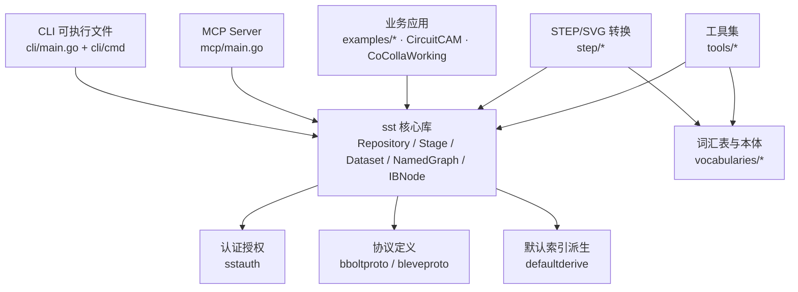
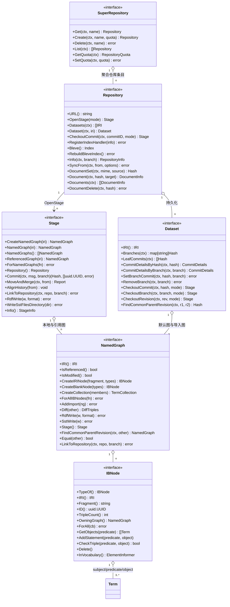
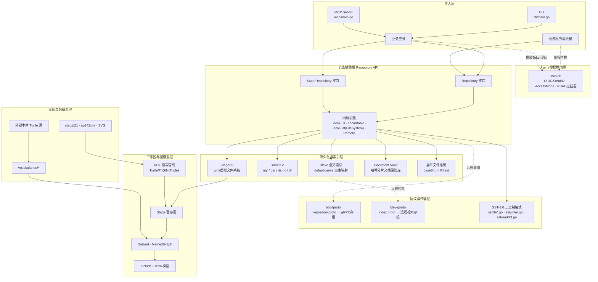
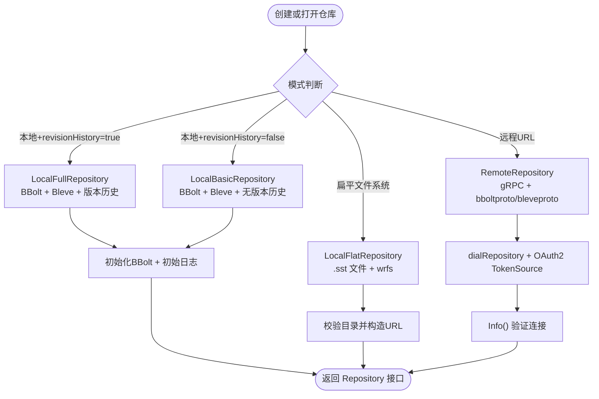
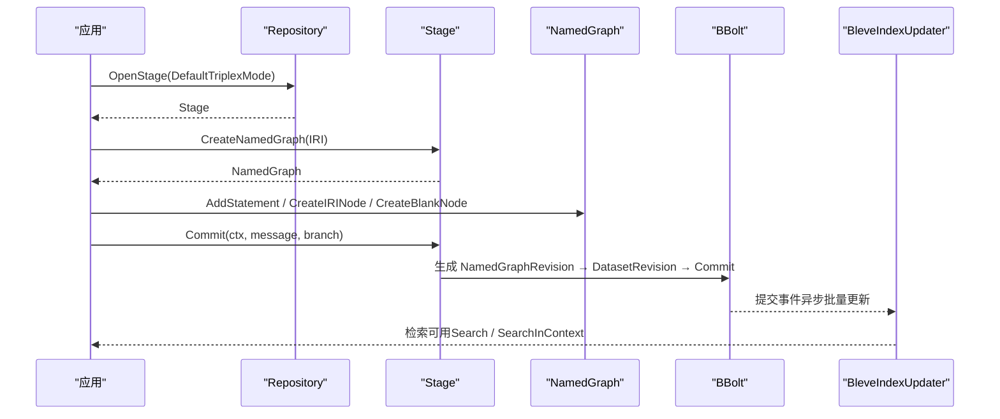
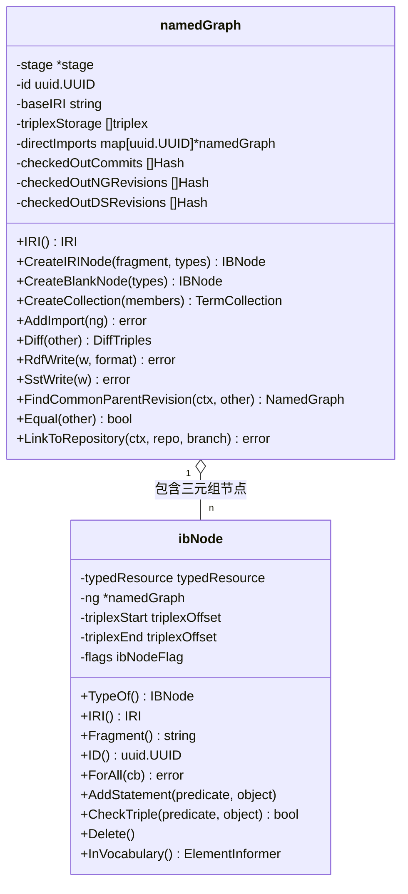
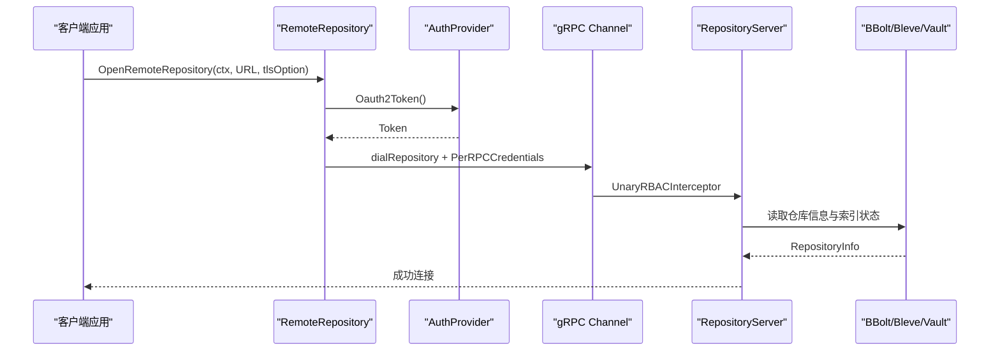
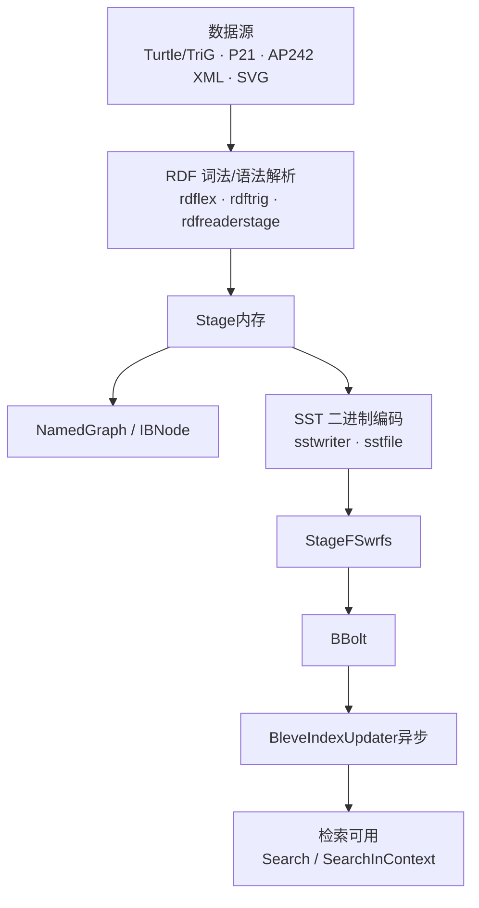
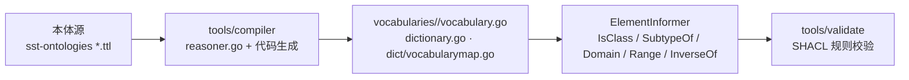
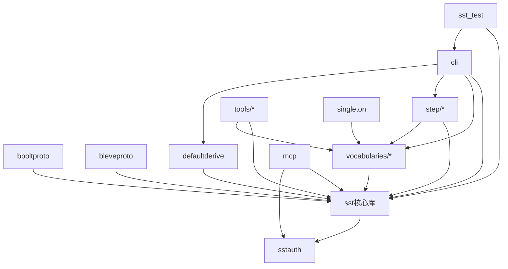

# SST Core系统架构图

<cite>
**本文引用的文件**   
- [README.md](file://README.md)
- [sst-core系统架构图.md](file://docs/sst-core系统架构图.md)
- [doc.go](file://sst/doc.go)
- [repository.go](file://sst/repository.go)
- [stage.go](file://sst/stage.go)
- [dataset.go](file://sst/dataset.go)
- [namedgraph.go](file://sst/namedgraph.go)
- [ibnode.go](file://sst/ibnode.go)
- [main.go](file://cli/main.go)
- [main.go](file://mcp/main.go)
</cite>

## 目录
1. [引言](#引言)
2. [项目结构](#项目结构)
3. [核心组件](#核心组件)
4. [架构总览](#架构总览)
5. [详细组件分析](#详细组件分析)
6. [依赖关系分析](#依赖关系分析)
7. [性能与扩展性](#性能与扩展性)
8. [故障排查指南](#故障排查指南)
9. [结论](#结论)
10. [附录：源码定位速查](#附录源码定位速查)

## 引言
SST Core 是 Semantic STEP Technology 的核心库，提供语义化 STEP 数据的图模型、版本化仓库、RDF 读写、全文检索以及远程 gRPC 访问能力。对外暴露的 API 集中在 `sst` 包，典型使用者通过 `Repository`、`Dataset`、`Stage`、`NamedGraph`、`IBNode` 等接口操作三元组数据；CLI、MCP Server、示例程序与工具链围绕这些接口构建。

本架构图文档从分层架构、对象模型、存储实现、远程通信、数据流、本体管线与周边工具等维度，系统性梳理代码结构与运行流程，帮助开发者快速理解 SST Core 的设计与使用方式。

## 项目结构
仓库采用单 Go Module 多包结构，核心包位于 `sst`，周边入口与工具分别位于 `cli`、`mcp`、`tools`、`step`、`vocabularies`、`defaultderive`、`bboltproto`、`bleveproto`、`sstauth` 等目录。顶层 `README.md` 明确推荐应用开发者主要关注 `sst`、`examples`、`vocabularies`、`defaultderive` 与 CLI 工具。

图表来源
- [README.md:5-12](file://README.md#L5-L12)
- [doc.go:3-5](file://sst/doc.go#L3-L5)

章节来源
- [README.md:1-15](file://README.md#L1-L15)
- [doc.go:1-5](file://sst/doc.go#L1-L5)

## 核心组件
SST Core 的核心抽象围绕“仓库—数据集—暂存区—命名图—节点”展开：

- Repository：仓库接口，封装本地 BBolt/Bleve、扁平文件系统或远程 gRPC 实现，提供 Dataset、Commit、Bleve 索引、文档保险库、同步与配额信息。
- Dataset：数据集接口，表示一个 RDF Dataset 及其修订历史，支持分支、提交详情、检出与三向合并祖先查找。
- Stage：内存工作区，承载多个 NamedGraph，支持创建、引用、合并、提交、对齐历史、导出 RDF/SST。
- NamedGraph：命名图接口，管理 IBNode、导入关系、差异、序列化与版本元数据。
- IBNode：三元组索引节点，统一 IRI、BlankNode、Literal、Collection 等 Term 类型，并提供遍历、增删改、类型判定与词汇表查询。

图表来源
- [repository.go:50-179](file://sst/repository.go#L50-L179)
- [dataset.go:30-94](file://sst/dataset.go#L30-L94)
- [stage.go:74-234](file://sst/stage.go#L74-L234)
- [namedgraph.go:117-356](file://sst/namedgraph.go#L117-L356)
- [ibnode.go:698-800](file://sst/ibnode.go#L698-L800)

章节来源
- [repository.go:34-179](file://sst/repository.go#L34-L179)
- [dataset.go:9-94](file://sst/dataset.go#L9-L94)
- [stage.go:64-234](file://sst/stage.go#L64-L234)
- [namedgraph.go:110-356](file://sst/namedgraph.go#L110-L356)
- [ibnode.go:698-800](file://sst/ibnode.go#L698-L800)

## 架构总览
SST Core 的分层架构强调“接口单一、实现可插拔”，上层应用仅依赖 `Repository`/`SuperRepository` 接口，底层可在本地 BBolt+Bleve、扁平文件系统与远程 gRPC 之间透明切换。

图表来源
- [sst-core系统架构图.md:10-83](file://docs/sst-core系统架构图.md#L10-L83)
- [repository.go:240-309](file://sst/repository.go#L240-L309)
- [main.go](file://cli/main.go)
- [main.go](file://mcp/main.go)

章节来源
- [sst-core系统架构图.md:8-83](file://docs/sst-core系统架构图.md#L8-L83)
- [repository.go:240-309](file://sst/repository.go#L240-L309)
- [main.go](file://cli/main.go)
- [main.go](file://mcp/main.go)

## 详细组件分析

### 仓库接口与实现选择
`Repository` 是 SST Core 对外唯一耦合点，提供 URL、Stage、Dataset、Commit、Bleve 索引、文档保险库、日志、同步与配额信息。本地仓库通过 `CreateLocalRepository` 自动识别 Full/Basic，或通过 `OpenLocalRepository` 检测 BBolt 桶结构选择实现；扁平仓库由 `CreateLocalFlatRepository`/`OpenLocalFlatRepository` 管理；远程仓库通过 `OpenRemoteRepository` 建立 gRPC 连接并注入 OAuth2 Token。

图表来源
- [repository.go:311-423](file://sst/repository.go#L311-L423)
- [repository.go:465-562](file://sst/repository.go#L465-L562)
- [repository.go:579-704](file://sst/repository.go#L579-L704)
- [repository.go:240-309](file://sst/repository.go#L240-L309)

章节来源
- [repository.go:34-179](file://sst/repository.go#L34-L179)
- [repository.go:311-423](file://sst/repository.go#L311-L423)
- [repository.go:465-562](file://sst/repository.go#L465-L562)
- [repository.go:579-704](file://sst/repository.go#L579-L704)
- [repository.go:240-309](file://sst/repository.go#L240-L309)

### 暂存区与工作流
`Stage` 是唯一的写入边界，所有修改先入内存，`Commit` 才产生不可变修订。它维护本地与引用命名图，支持 MoveAndMerge、AlignHistory、LinkToRepository、RDF/SST 导出与统计信息。

图表来源
- [stage.go:121-130](file://sst/stage.go#L121-L130)
- [stage.go:468-800](file://sst/stage.go#L468-L800)
- [namedgraph.go:435-503](file://sst/namedgraph.go#L435-L503)

章节来源
- [stage.go:64-234](file://sst/stage.go#L64-L234)
- [stage.go:468-800](file://sst/stage.go#L468-L800)
- [namedgraph.go:435-503](file://sst/namedgraph.go#L435-L503)

### 命名图与三元组模型
`NamedGraph` 管理 IBNode、导入关系、差异、序列化与版本元数据；`IBNode` 统一 IRI、BlankNode、Literal、Collection 等 Term 类型，并提供遍历、增删改、类型判定与词汇表查询。两者共同构成 SST 的内存图模型。

图表来源
- [namedgraph.go:42-107](file://sst/namedgraph.go#L42-L107)
- [namedgraph.go:117-356](file://sst/namedgraph.go#L117-L356)
- [ibnode.go:634-660](file://sst/ibnode.go#L634-L660)
- [ibnode.go:698-800](file://sst/ibnode.go#L698-L800)

章节来源
- [namedgraph.go:110-356](file://sst/namedgraph.go#L110-L356)
- [ibnode.go:698-800](file://sst/ibnode.go#L698-L800)

### 远程部署与 gRPC 通信
远程仓库通过 `OpenRemoteRepository` 建立 gRPC 连接，从上下文提取 OAuth2 Token 并附加到请求头；服务端通过 OIDC/RBAC 拦截器校验身份，再调用本地仓库实现。协议定义在 `bboltproto/repository.proto` 与 `bleveproto/index.proto`。

图表来源
- [repository.go:240-309](file://sst/repository.go#L240-L309)
- [sst-core系统架构图.md:268-328](file://docs/sst-core系统架构图.md#L268-L328)

章节来源
- [repository.go:240-309](file://sst/repository.go#L240-L309)
- [sst-core系统架构图.md:268-328](file://docs/sst-core系统架构图.md#L268-L328)

### 数据流：导入→编辑→提交→检索
数据从外部格式（Turtle/TriG/P21/AP242 XML/SVG）进入 RDF 解析管线，逐条三元组写入 Stage，Commit 时生成 SST 二进制并落盘 BBolt，同时触发 Bleve 异步索引更新。

图表来源
- [sst-core系统架构图.md:331-355](file://docs/sst-core系统架构图.md#L331-L355)

章节来源
- [sst-core系统架构图.md:331-355](file://docs/sst-core系统架构图.md#L331-L355)

### 本体管线：编译期推理 + 运行期判定
SST Core 将本体推理前移到编译期，生成 Go 变量与判定函数；运行期只做轻量判定与 SHACL 校验，避免运行时推理开销。

图表来源
- [sst-core系统架构图.md:361-387](file://docs/sst-core系统架构图.md#L361-L387)

章节来源
- [sst-core系统架构图.md:361-387](file://docs/sst-core系统架构图.md#L361-L387)

## 依赖关系分析
SST Core 的包依赖遵循单向原则：`sst` 是唯一向外暴露语义能力的核心，其余包均单向依赖它；`bboltproto`/`bleveproto` 被 `sst` 侧的远程实现消费。

图表来源
- [sst-core系统架构图.md:391-428](file://docs/sst-core系统架构图.md#L391-L428)

章节来源
- [sst-core系统架构图.md:391-428](file://docs/sst-core系统架构图.md#L391-L428)

## 性能与扩展性
- 内容寻址存储：NamedGraph/Dataset 修订以 SHA-256 哈希（Base58 编码）为键，天然去重、可 diff、可增量同步。
- 图即文件系统：`StageFS` 用 `wrfs` 接口把 NamedGraph 映射为以 UUID 为路径的虚拟文件，统一 BBolt 与文件后端。
- 推理前移：本体推理在编译期完成并固化为 Go 代码，运行期零推理开销，只做 O(1) 判定与 SHACL 校验。
- 搜索可选可重建：Bleve 索引通过 `defaultderive` 派生，异步批量更新并带健康度监控，不可用时不影响图读写。
- 认证集中在传输层：OIDC/RBAC 以 gRPC 拦截器注入，业务实现不感知身份细节。
- 构建极简：无 Makefile/Dockerfile/CI，全靠 `go build` + `go generate`（protoc / golex / goyacc / 本体编译器）。

章节来源
- [sst-core系统架构图.md:504-516](file://docs/sst-core系统架构图.md#L504-L516)

## 故障排查指南
- 仓库不存在或已存在：检查 `ErrRepositoryDoesNotExist`、`errRepositoryAlreadyExists`。
- 数据集未找到或已存在：检查 `ErrDatasetNotFound`、`ErrDatasetAlreadyExists`。
- 分支未找到或空消息：检查 `ErrBranchNotFound`、`ErrEmptyCommitMessage`。
- 配额超限：检查 `ErrQuotaExceeded`。
- 功能不可用或不支持：检查 `ErrNotAvailable`、`ErrNotSupported`。
- 远程连接失败：确认 OAuth2 Token、TLS 配置与服务器可达性。
- 索引不可用：调用 `RebuildBleveIndex` 重建索引，或检查 `healthAwareIndex` 健康状态。

章节来源
- [repository.go:197-215](file://sst/repository.go#L197-L215)
- [sst-core系统架构图.md:488-500](file://docs/sst-core系统架构图.md#L488-L500)

## 结论
SST Core 以清晰的接口抽象与分层架构，将语义化 STEP 数据的图模型、版本控制、全文检索与远程访问整合在一个可扩展的系统中。开发者可通过 `Repository` 接口无缝切换本地与远程实现，借助 `Stage` 与 `NamedGraph` 进行高效图编辑，并通过 CLI/MCP/示例程序快速上手。未来扩展可围绕新增存储后端、自定义索引映射与更多本体词汇表展开。

## 附录：源码定位速查
- Repository 接口与远程工厂：`sst/repository.go`
- SuperRepository 接口与本地实现：`sst/superlocalrepository.go`
- 本地 full/basic/flat 仓库：`sst/repolocalfull.go` · `sst/repolocalbasic.go` · `sst/repolocalflat.go` · `sst/repolocalflatfilesystem.go`
- 远程仓库客户端：`sst/reporemote.go` · `sst/reporemoteds.go` · `sst/reporemoteref.go` · `sst/reporemotecommit.go`
- 仓库服务端：`sst/reporemoteapp.go` · `sst/superremoterepository.go`
- Stage/Dataset/NamedGraph：`sst/stage.go` · `sst/dataset.go` · `sst/namedgraph.go`
- 提交与差异：`sst/commit.go` · `sst/sstwritediff.go` · `sst/sstreaddiff.go` · `sst/diff.go`
- BBolt 桶结构：`sst/bbolt_structure.go`
- StageFS 虚拟文件系统：`sst/stagefs.go` · `sst/stagefsdatasetsfs.go` · `sst/stagefslocal*.go`
- SST 二进制格式：`sst/sstfile.go` · `sst/sstfilestagefs.go` · `sst/sstfiledeltaspanread.go`
- RDF 解析与序列化：`sst/rdflex.go` · `sst/rdfttl.go` · `sst/rdftrig.go` · `sst/rdfreader*.go` · `sst/rdfwrite*.go`
- Bleve 索引更新：`sst/indexupdate.go` · `defaultderive/`
- 文档保险库：`sst/vault.go` · `sst/DocumentInfo.go`
- 认证授权：`sstauth/auth.go` · `sstauth/authoids.go` · `sstauth/accessmode.go`
- gRPC 协议：`bboltproto/repository.proto` · `bleveproto/index.proto`
- 本体编译器/校验器：`tools/compiler/reasoner.go` · `tools/validate/validate.go`
- STEP 转换：`step/p21/` · `step/ap242xml{import,export}/` · `step/{detailed,simplified}To*/`

章节来源
- [sst-core系统架构图.md:519-540](file://docs/sst-core系统架构图.md#L519-L540)