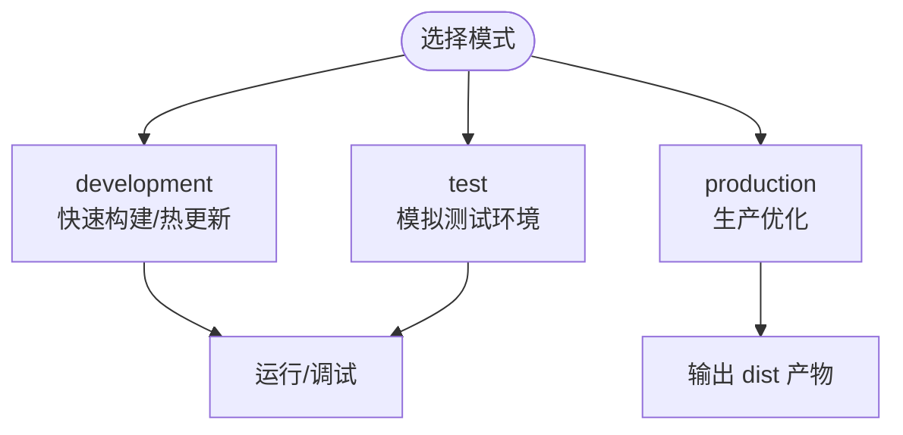
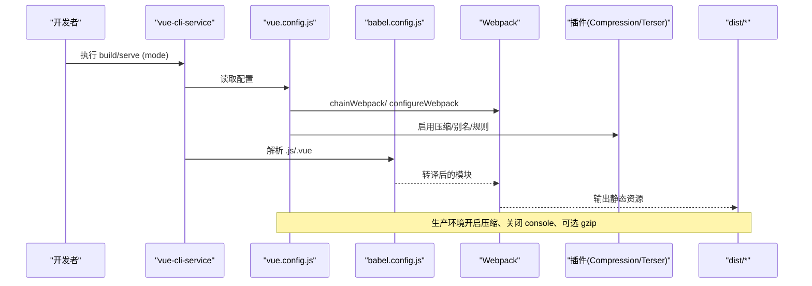

# 一级标题

## 二级标题

### 三级标题

#### 四级标题

##### 五级标题

###### 六级标题

## 需求背景


# 语法参考

## 强调
*这会是 斜体 的文字*
_这会是 斜体 的文字_

**这会是 粗体 的文字**
__这会是 粗体 的文字__

_你也 **组合** 这些符号_

~~这个文字将会被横线删除~~

## 无序列表
- Item 1
- Item 2
  - Item 2a
  - Item 2b

## 有序列表

1. Item 1
1. Item 2
1. Item 3
   1）. Item 3a
   1）. Item 3b


## 任务列表

- [x] @mentions, #refs, [links](), **formatting**, and <del>tags</del> supported
- [x] list syntax required (any unordered or ordered list supported)
- [x] this is a complete item
- [ ] this is an incomplete item


## 表格

| 标题 | 标题 |
|---|---|
| 内容 | 内容 |


## mermaid 流程图


## mermaid 序列图



## 添加图片


## 链接
https://github.com - 自动生成！
[GitHub](https://github.com)链接

## 引用

正如 Kanye West 所说：

> We're living the future so
> the present is our past.

> [!NOTE]
> This is a note blockquote.

> [!WARNING]
> This is a warning blockquote.


## 代码块和行号
```javascript {.line-numbers}
function add(x, y) {
  return x + y
}
```


## 行内代码
我觉得你应该在这里使用
`<addr>` 才对


## 分割线
如下，三个或者更多的

---

连字符

---

星号

---

下划线

