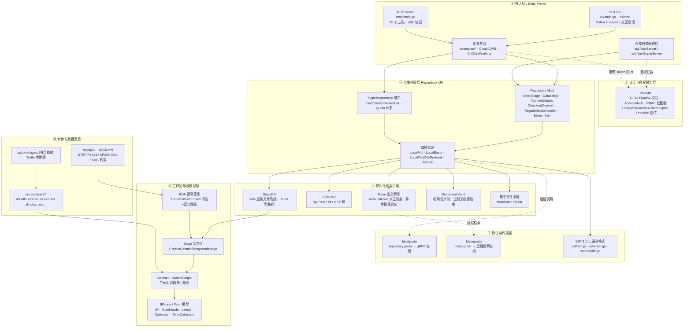
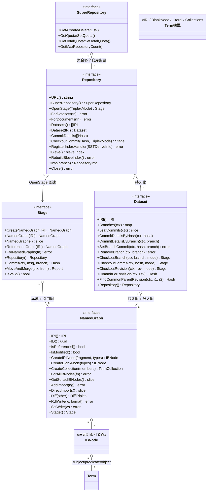
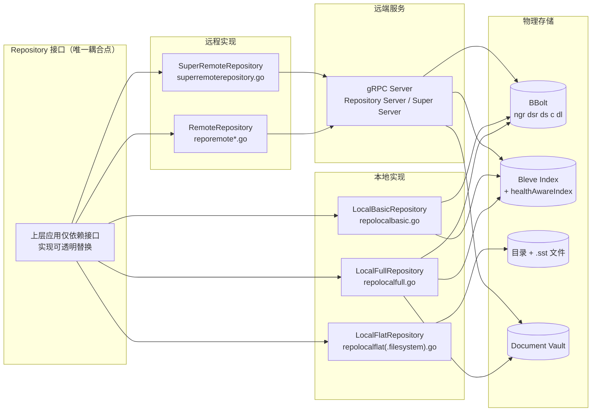
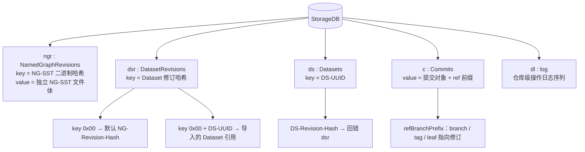
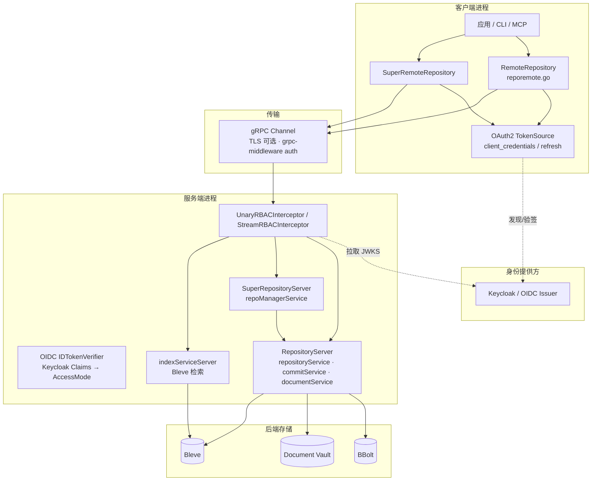
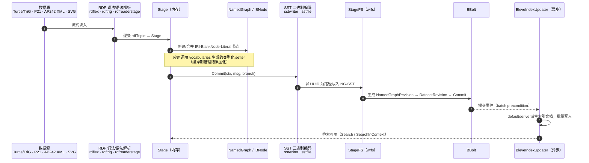
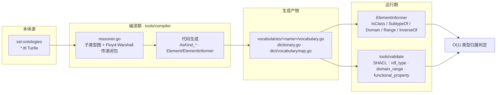
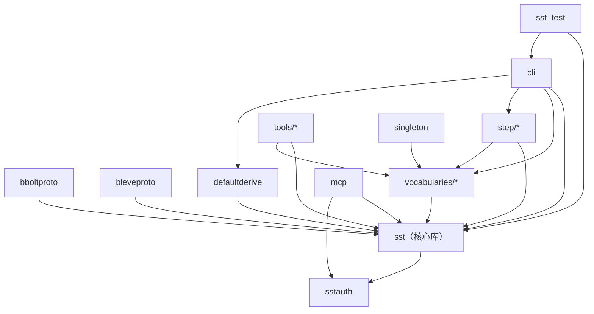
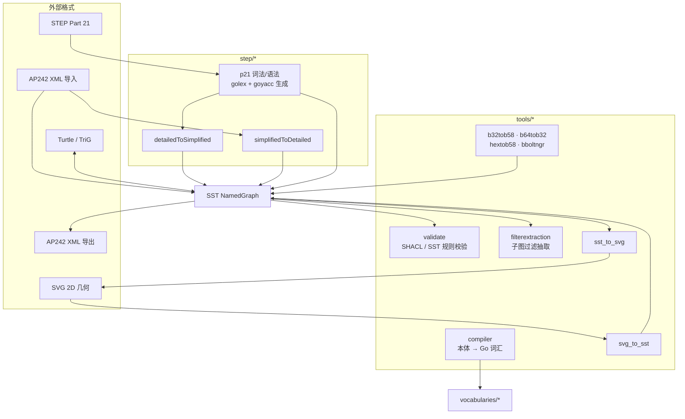
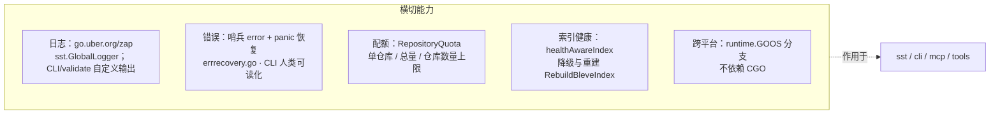

# sst-core 系统架构图

> 模块路径：`github.com/semanticstep/sst-core` ｜ Go 1.25 ｜ 单 Go Module 多包结构
> 本文档基于仓库当前代码结构（`sst/`、`cli/`、`mcp/`、`bboltproto/`、`bleveproto/`、`sstauth/`、`step/`、`tools/`、`vocabularies/`、`defaultderive/`）绘制。

---

## 1. 全景分层架构

---

## 2. 核心对象模型（内存数据结构）

**关键语义约束**

| 概念 | 说明 |
|---|---|
| Dataset 标识 | 由 Dataset IRI 派生的 UUIDv5，仓库内唯一 |
| NamedGraph 状态 | `local`（本 Stage 创建/修改）vs `referenced`（仅被引用未加载） |
| TriplexMode | 三元组/四元组模式，决定 NamedGraph 是否被隐式划分为 sub-graph |
| 版本链 | NamedGraphRevision → DatasetRevision → Commit，三者以 Hash 串联 |

---

## 3. 存储层架构与能力矩阵

| 能力 | LocalFull | LocalBasic | LocalFlat | Remote |
|---|---|---|---|---|
| 底层存储 | BBolt + Bleve | BBolt + Bleve | 文件系统 `.sst` | 服务端 BBolt + Bleve |
| 提交/版本历史 | ✅ | ❌ | ❌ | ✅ |
| Branch / CheckoutCommit | ✅ | ❌ | ❌ | ✅ |
| Diff / 增量同步 | ✅ | 部分 | ✅（文件哈希） | ✅ |
| Bleve 全文检索 | ✅ | ✅ | ❌ `ErrNotAvailable` | ✅（远程客户端） |
| `RegisterIndexHandler` | ✅ | ✅ | ❌ | ❌（部署期决定） |
| 事务 / 并发控制 | `stateControl` | `stateControl` | ❌ | 服务端保证 |
| 认证授权 | n/a | n/a | n/a | OIDC + RBAC |
| 工厂方法 | `OpenLocalRepository`（自动识别） | `OpenLocalRepository`（自动识别） | `CreateLocalFlatRepository` / `OpenLocalFlatRepository` | `OpenRemoteRepository(ctx, URL, tlsOption)`；Super 变体见 `sst/superremoterepository.go` |

> 创建入口统一为 `sst.CreateLocalRepository(repoDir, email, name, revisionHistory bool)`：`revisionHistory=true` 生成 LocalFull，`false` 生成 LocalBasic；`OpenLocalRepository` 则通过检测 bbolt 中是否存在 basic 专用根桶（`rootRepositoryBucketName`，字面值 `repository`，见 `sst/repolocalbasic.go`）自动选择实现类。

### BBolt 桶结构（`sst/bbolt_structure.go`）

---

## 4. 远程部署与 gRPC 通信架构

**协议分层**

| Proto | 服务域 | 生成产物 |
|---|---|---|
| `bboltproto/repository.proto` | 仓库管理、Dataset/Ref/Commit、文档流式传输、双向同步 | `repository.pb.go`、`repository_grpc.pb.go`、`repository.pb.fm.go`（fieldmask） |
| `bleveproto/index.proto` | 远程索引搜索 | `index.pb.go`、`index_grpc.pb.go` |

代码生成命令由 `//go:generate` 驱动：`protoc` + `protoc-gen-go` + `protoc-gen-go-grpc` + `protoc-gen-fieldmask`。

---

## 5. 数据流：导入 → 编辑 → 提交 → 检索

**读取方向**：`Repository.Dataset / CheckoutCommit` → BBolt 取修订 → SST 二进制解码 → Stage/NamedGraph → RDF 写回器（`rdfwrite.go`）→ Turtle/TriG 文本。

---

## 6. 本体管线：编译期推理 + 运行期判定

> SST Core 不做通用运行时推理：类层次推导在编译期完成并固化进 Go 代码；运行期只做轻量判定与约束校验。

---

## 7. 包依赖关系

依赖原则：**所有子包通过 Go import 协作，不存在进程间通信**；`sst` 是唯一向外暴露语义能力的核心，其余包均单向依赖它（`bboltproto`/`bleveproto` 被 `sst` 侧的远程实现消费）。

---

## 8. 周边工具与转换层

---

## 9. 接入层能力对照

| 入口 | 形态 | 主要能力 | 配置来源 |
|---|---|---|---|
| **CLI**（`cli/`，可执行 `sst`） | Cobra 根命令 + readline 交互会话 | `openlocalrepository` / `createlocalrepository` / `openlocalflatrepository` / `openremoterepository` / `open{local,remote}superrepository`；`datasets` `dataset` `openstage` `log` `commitinfo` `commitdiff` `checkoutcommit`；`rdfread` `sstread` `importp21` `importap242xml` `importsvg`；`document{set,get,info,delete}` `documents`；`syncfrom` `clone` `filterextract` `extractsstfile` `dump` `query` `listfield` `superrepository`；`utils` 提供 `.env.sst-cli` 加载、分页、彩色输出、bbolt dump、token 获取 | `.env.sst-cli` + 环境变量 + pflag；版本经 `-ldflags -X` 注入 |
| **MCP Server**（`mcp/`） | Model Context Protocol，stdio | 25 个工具：`status`、`open_local_repository`、`open_remote_repository`、`repository_{close,sync_from,datasets,dataset,open_stage}`、`dataset_{branches,list_commits,commit_details_by_hash,commit_details_by_branch,history,checkout_branch,checkout_commit}`、`stage_{info,named_graphs,validate,trig,commit}`、`repository_document_{set,get,info,delete}` | 远程仓库依赖 `.env.sst-cli` 中的 `SST_OIDC_*` 与 `SST_USERNAME`/`SST_PASSWORD` |
| **库嵌入**（`examples/*`） | Go package import | 直接调用 `sst` API：本地 basic/flat/full 仓库、远程仓库、SuperRepository、P21、PMI 分析 | 代码内联 / 命令行参数 |
| **服务端**（`sst.NewServer` / `sst.NewSuperServer`） | gRPC 进程 | 托管多仓库、配额、索引重建、文档流 | `RepositoryServerConfig`（TLS、issuer、client-id） |

---

## 10. 横切关注点

---

## 11. 架构特征小结

| 特征 | 体现 |
|---|---|
| **接口单一、实现可插拔** | `Repository`/`SuperRepository` 是唯一耦合点，本地 BBolt、扁平文件、远程 gRPC 三者对应用透明等价 |
| **Stage 作为唯一写入边界** | 所有修改先入内存 Stage，`Commit` 才产生不可变修订；未链接仓库的 Stage 可作纯内存/临时暂存 |
| **内容寻址存储** | NamedGraph/Dataset 修订以 SHA-256 哈希（Base58 编码）为键，天然去重、可 diff、可增量同步 |
| **图即文件系统** | `StageFS` 用 `wrfs` 接口把 NamedGraph 映射为以 UUID 为路径的虚拟文件，统一 BBolt 与文件后端 |
| **推理前移** | 本体推理在编译期完成并固化为 Go 代码，运行期零推理开销，只做 O(1) 判定与 SHACL 校验 |
| **搜索可选可重建** | Bleve 索引通过 `defaultderive` 派生，异步批量更新并带健康度监控，不可用时不影响图读写 |
| **认证集中在传输层** | OIDC/RBAC 以 gRPC 拦截器注入，业务实现（`sst` 包内仓库逻辑）不感知身份细节 |
| **构建极简** | 无 Makefile/Dockerfile/CI，全靠 `go build` + `go generate`（protoc / golex / goyacc / 本体编译器） |

---

## 附：源码定位速查

| 关注点 | 文件 |
|---|---|
| Repository 接口与远程工厂 | `sst/repository.go` |
| SuperRepository 接口与本地实现 | `sst/superlocalrepository.go` |
| 本地 full / basic / flat 仓库 | `sst/repolocalfull.go` · `sst/repolocalbasic.go` · `sst/repolocalflat.go`、`sst/repolocalflatfilesystem.go` |
| 远程仓库客户端 | `sst/reporemote.go`、`sst/reporemoteds.go`、`sst/reporemoteref.go`、`sst/reporemotecommit.go` |
| 仓库服务端 | `sst/reporemoteapp.go`、`sst/superremoterepository.go` |
| Stage / Dataset / NamedGraph | `sst/stage.go` · `sst/dataset.go` · `sst/namedgraph.go` |
| 提交与差异 | `sst/commit.go` · `sst/sstwritediff.go` · `sst/sstreaddiff.go` · `sst/diff.go` |
| BBolt 桶结构 | `sst/bbolt_structure.go` |
| StageFS 虚拟文件系统 | `sst/stagefs.go`、`sst/stagefsdatasetsfs.go`、`sst/stagefslocal*.go` |
| SST 二进制格式 | `sst/sstfile.go`、`sst/sstfilestagefs.go`、`sst/sstfiledeltaspanread.go` |
| RDF 解析与序列化 | `sst/rdflex.go`、`sst/rdfttl.go`、`sst/rdftrig.go`、`sst/rdfreader*.go`、`sst/rdfwrite*.go` |
| Bleve 索引更新 | `sst/indexupdate.go`、`defaultderive/` |
| 文档保险库 | `sst/vault.go`、`sst/DocumentInfo.go` |
| 认证授权 | `sstauth/auth.go`、`sstauth/authoids.go`、`sstauth/accessmode.go` |
| gRPC 协议 | `bboltproto/repository.proto`、`bleveproto/index.proto` |
| 本体编译器 / 校验器 | `tools/compiler/reasoner.go`、`tools/validate/validate.go` |
| STEP 转换 | `step/p21/`、`step/ap242xml{import,export}/`、`step/{detailed,simplified}To*/` |
