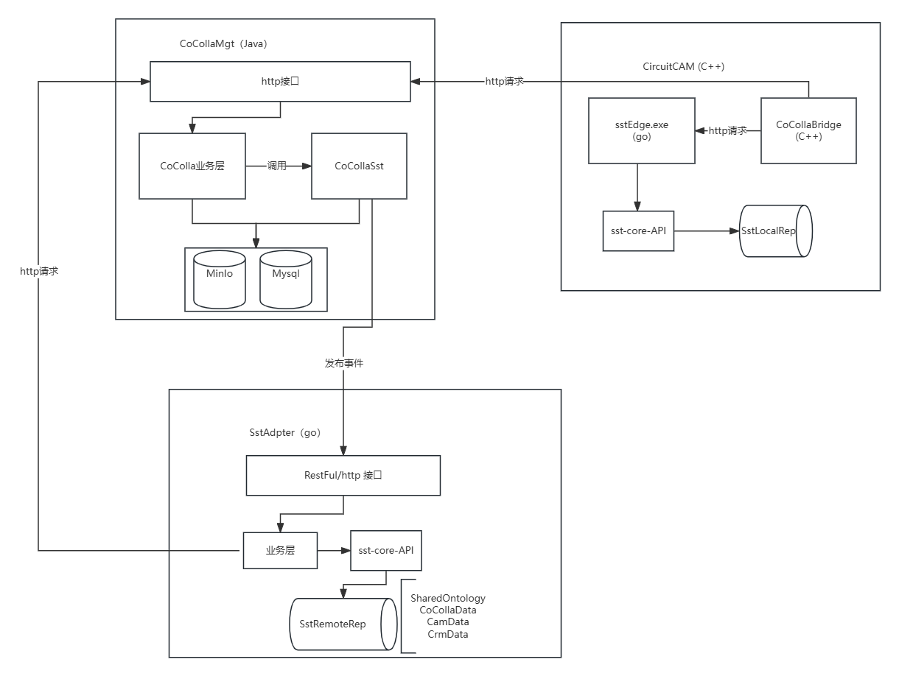
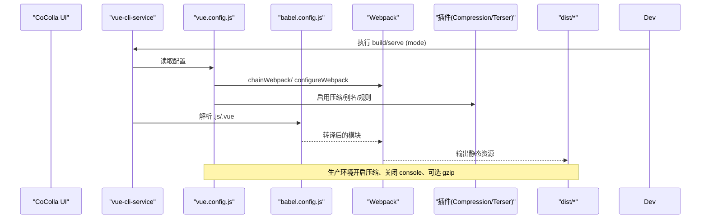

# 基于 SST Core 的 CircuitCAM 与 CoCollaWorking 数据交换技术方案

> 版本：v1.0　　适用范围：CoCollaWorking 管理系统后端（`cocollaMgt`）× CircuitCAM 桌面工程软件（`svn_GeneralCAM\trunk`）× SST Core（`sst_core`）
>
> 本方案回答两个问题：
> 1. CircuitCAM 如何获取 CoCollaWorking 的订单数据，并编辑该订单对应的工程资料、把结果回写到 CoCollaWorking；
> 2. 两侧的**数据存储与数据交换如何统一建立在 sst-core 之上**。

---

## 目录

- [1. 方案概述](#1-方案概述)
- [2. 总体架构](#2-总体架构)
- [3. 数据建模](#3-数据建模)
- [4. 端到端业务流程](#4-端到端业务流程)
- [5. SST Hub 与 Edge Agent 实现](#5-sst-hub-与-edge-agent-实现)
- [6. CircuitCAM（C++）端改造方案](#6-circuitcamc端改造方案)
- [7. CoCollaWorking（Java）端改造方案](#7-collacollaworkingjava端改造方案)
- [8. 同步、并发与一致性](#8-同步并发与一致性)
- [9. 安全与权限](#9-安全与权限)
- [10. 性能与容量规划](#10-性能与容量规划)
- [11. 部署架构](#11-部署架构)
- [12. 实施路线图](#12-实施路线图)
- [13. 风险与对策](#13-风险与对策)
- [附录 A：ccam 本体（Turtle）](#附录-accam-本体turtle)
- [附录 B：Edge Agent REST API 一览](#附录-bedge-agent-rest-api-一览)
- [附录 C：sst-core 关键 API 速查（已核对签名）](#附录-csst-core-关键-api-速查已核对签名)
- [附录 D：CircuitCAM 侧最小可运行片段](#附录-dcircuitcam-侧最小可运行片段)

---

## 1. 方案概述

### 1.1 三个系统的技术画像（调研结论）

| 系统 | 定位 | 技术栈 | 数据形态 | 与本方案相关的关键事实 |
|------|------|--------|----------|----------------------|
| **CoCollaWorking**（`D:\code_sz\cocollaMgt`） | 协同工作/订单管理后台 | Java 8 + Spring Boot + JeecgBoot 3.4.x + MyBatis-Plus + MySQL + MinIO/OSS + Shiro(JWT)，可选 `jeecg-server-cloud` 微服务模式 | 关系表 + 对象存储文件 | 订单主表 `cocolla_order`（`com.cocolla.modules.order.entity.Order`）；工程资料表 `cocolla_order_project_files`（`OrderProjectFiles`：`orderId/fileName/url/seqNo`）；工程回写接口 `POST /order/v2/modifyEngineeringInfo`（`EngineeringUpdateDTO`）；流程阶段枚举 `OrderProcessEnum.IN_ENGINEERING(15)` |
| **CircuitCAM**（`D:\code\svn_GeneralCAM\trunk`） | PCB CAM 工程处理桌面软件 | MFC C++，VS 工具集 **v143**，**Win32(x86)**，Unicode，`stdcpplatest`，动态 MFC；依赖 CodeJock ToolkitPro 19.2、OpenSSL(`libeay32`)、protobuf 29.5、zlib、Boost | **单文件工程 `.cam`** = `BE == Binary EDIF File`（S-表达式二进制，魔数 `BE`…`0x1A`），可选 AES-128-CBC 加密外壳 | 数据模型文法 `Estrugen/CAM.BNF`（`CAM_V0 → levels/configurations/layers/layouts/jobs`）；Step 即 `layout`；已有 **WinINet HTTP 客户端** `CHTMLRequestProcessor`；已有 **批处理引擎** `CJobExecutor` + 140+ `EJobTask`（含 `Import{ImportFromCommandLine}`、`SaveAs`、`ExternalProgram`）；`CCAMStorage::readHeaderOnly()` 可只读文件头 `ScInfo` |
| **SST Core**（`D:\code_sz\sst\sst_core`） | RDF 图仓库 + 版本控制 + 二进制交换格式 | Go 1.25，BBolt + Bleve + gRPC + OIDC，模块名 `github.com/semanticstep/sst-core` | RDF 三元组 / NamedGraph / Dataset / Repository，二进制 `.sst` 与文本 Turtle/TriG | 4 种 Repository 实现 + SuperRepository 多仓容器；`Repository.DocumentSet/Document` 提供**内容寻址的二进制文件库**；`SyncFrom/WithDatasetIRIs` 提供**按数据集的增量同步**；`tools/compiler` 可把 Turtle 本体编译成类型化 Go 词汇包 |

### 1.2 目标拆解

| # | 业务目标 | 技术目标 |
|---|----------|----------|
| G1 | CircuitCAM 中可浏览、检索、选取 CoCollaWorking 的订单（订单号、客户、物料、数量、加工工艺、厚度、批次…） | 订单主数据以 RDF 图形式落在 SST Hub，CAM 端通过本地 Edge Agent 只读订阅 |
| G2 | 工程师在 CircuitCAM 中下载该订单的工程资料（Gerber/ODB++/Excellon/.cam），编辑后保存新版本 | 工程资料 = 图内**元数据节点** + **文件实体**（MinIO 主存 / SST Document 快照，双模式） |
| G3 | 编辑结果回写 CoCollaWorking：更新工程资料清单、加工路径 `manufPath`、下一阶段处理人 | 回写经 SST Commit → CoColla-Sync 监听 → 调用现有 `OrderServiceImpl.updateEngineering` 语义落库 |
| G4 | 存储与交换**统一基于 sst-core** | 所有跨系统数据（订单快照、工程资料清单、变更事件、文件指纹）都以 SST Dataset/NamedGraph/Document 为唯一交换载体；不再新增私有文件格式或中间库表 |
| G5（隐含） | 全过程可追溯：谁在什么时间改了哪个订单的哪份工程资料，能否回到任意历史版本 | 复用 SST 的 Commit / Branch / Diff / Repository.Log |

### 1.3 核心设计原则

1. **不替代关系库**。CoColla 的 MySQL 仍是业务主库（订单状态机、财务、库存、审批流）。SST 定位为**跨系统数据交换层 + 工程资料版本库**。这与 SST 的存储特性（BBolt 单写者、无二级索引、全图序列化开销）相匹配——SST 不适合承载高并发的列表查询与事务型业务。
2. **不改造 CircuitCAM 的工程文件格式**。`.cam` 依旧由 CircuitCAM 自己读写（保真），SST 只承载**订单上下文 + 工程资料清单 + 文件指纹与版本**，避免把 EDIF 树强行 RDF 化带来的信息损失。
3. **桌面端零重依赖**。CircuitCAM 是 32 位 MFC 程序，不引入 Go runtime/cgo/gRPC。跨语言边界统一走 **本机 HTTP/JSON + 独立 64 位 Edge 进程**。
4. **一订单一 Dataset**。这是本方案最重要的建模决策，直接决定后面的按需同步、权限隔离、冲突半径（详见 2.3-D2、3.4）。
5. **可离线**。CAM 工作站常在车间内网/断网环境，Edge Agent 本地持有可提交的仓库副本，网络恢复后增量 `SyncFrom/SyncTo`。

### 1.4 术语对照

| SST 概念 | 本方案中的业务含义 |
|----------|-------------------|
| SuperRepository | SST Hub，一个 gRPC 服务端实例，内含若干业务仓库 |
| Repository（Entry） | 一个业务域：`cocolla-orders` / `cam-projects` / `shared-ontology` |
| Dataset | **一个订单**（默认 NamedGraph = 订单主数据图） |
| NamedGraph | 一个数据切面：`#order` 主数据、`#project` 工程资料、`#camjob` CAM 作业摘要 |
| owl:imports | Dataset 之间的引用（订单图导入工程资料图） |
| Document（Hash） | 一份工程文件二进制（`.cam` / `.tgz` / `.zip`），SHA-256 → Base58 命名 |
| Commit | 一次"工程资料变更"事件 |
| Branch | `master`=已发布；`cam/<工作站ID>`=某台 CAM 电脑的草稿线 |
| Repository.Log | 交换审计流水（供 CoColla 前端"工程履历"页签消费） |

---

## 2. 总体架构

### 2.1 架构图


```
┌─────────────────────────────── 企业内网 / 私有云 ────────────────────────────────┐
│                                                                                │
│  ┌──────────────────────┐         ┌──────────────────────────────────────┐     │
│  │  CoCollaWorking      │         │            SSTRemoteRep (Go)              │     │
│  │  Spring Boot         │         │  sst.NewSuperServer()                │     │
│  │  ┌────────────────┐  │         │  ┌────────────────────────────────┐  │     │
│  │  │ order module   │  │  REST   │  │ SuperRepository                │  │     │
│  │  │  cocolla_order │◄─┼────────►│  │  ├─ SharedOntology  (RO)      │  │     │
│  │  │  cocolla_order_│  │  (内部) │  │  ├─ CocollaData    ← 一订单一Dataset
│  │  │  project_files │  │         │  │  └─ CAMData               │  │     │
│  │  └───────┬────────┘  │         │  └────────────────────────────────┘  │     │
│  │          │           │         │  BBolt + Bleve + Documents(vault)    │     │
│  │  ┌───────▼────────┐  │         │  gRPC :5581 (TLS) + OIDC             │     │
│  │  │ MySQL │ MinIO  │  │         └───────────▲──────────────┬───────────┘     │
│  │  └────────────────┘  │                     │ SyncFrom/SyncTo (gRPC 流)      │
│  └──────────▲───────────┘                     │                                 │
│             │ ①发布订单快照 / ④回写落库        │ ②拉取订单  ③提交工程变更        │
│             │                                 │                                 │
│  ┌──────────┴───────────┐         ┌───────────┴──────────────────────────┐      │
│  │  SstAdapter (Go)   │         │  CAM 工作站                            │      │
│  │  sst-core as library │         │ ┌──────────────┐  ┌────────────────┐  │      │
│  │  ├ 订单变更 → Commit │         │ │ CircuitCAM   │─►│ sst-edge.exe   │  │      │
│  │  ├ SST 新 Commit →   │  HTTP   │ │ (MFC x86)    │  │ (Go, 64bit)    │  │      │
│  │  │   updateEngineering│◄───────►│ │ SstBridge    │  │ LocalFullRepo  │  │      │
│  │  ├ Document → MinIO  │  REST   │ │ + WinINet    │  │ + 本地文件缓存 │  │      │
│  │  └ REST :8090        │         │ └──────────────┘  └────────────────┘  │      │
│  └──────────────────────┘         │  HTTP 127.0.0.1:37310 / IPC 循环同步 │      │
│                                   └──────────────────────────────────────┘      │
│  ┌──────────────────────┐   ┌────────────────┐   ┌──────────────────────┐       │
│  │ Keycloak (OIDC)      │   │ 监控/日志       │   │ 运维 CLI (sst CLI)   │       │
│  └──────────────────────┘   └────────────────┘   └──────────────────────┘       │
└────────────────────────────────────────────────────────────────────────────────┘
```

### 2.2 组件清单

| 组件 | 语言/形态 | 部署位置 | 职责 | 是否新增 |
|------|-----------|----------|------|----------|
| **SSTRemoteRep** | Go 进程，引入 `sst-core`，`sst.NewSuperServer()` | 服务器 1 台（容器/裸机） | SuperRepository 服务端；版本存储、全文检索、Document 库、gRPC 同步 | 新增（薄封装） |
| **SstAdapter** | Go 服务，引入 `sst-core` | 与 CoColla 同网段 | MySQL ⇄ SST 双向适配器；对 CoCollaWorking(Java) 暴露 REST； 对 SST 是 gRPC 客户端 | 新增 |
| **Edge Agent（`SstEdge.exe`）** | Go 单文件可执行程序 | 每台 CAM 工作站 | 本地 `LocalFullRepository` 副本 + HTTP/JSON 服务 + 定时/触发同步 + 文件缓存目录 | 新增 |
| **SstBridge（CircuitCAM 模块）** | C++ 类库 | CircuitCAM.exe 内 | 调 Edge Agent HTTP；订单浏览对话框；保存钩子；批量导入导出编排 | 新增目录 `CircuitCAM\SstBridge\` |
| **CocollaSst 模块** | Java | `cocolla-module-biz` 内 | 订单事件发布、工程版本查询、回写落库适配 | 新增包 |
| **CocollaWorking 本体** | Turtle + 生成的 Go 词汇包 | Git + SST `shared-ontology` | 统一语义契约 | 新增 |
| Keycloak | 现成中间件 | 服务器 | OIDC，为 CoColla-Sync / Edge 发 token | 建议新增（可后期） |

### 2.3 关键设计决策（ADR 摘要）

#### 不把 SST 当查询库用

CAM 端"按客户/日期/状态筛订单"这类列表查询**仍由 CoColla REST 提供**（MySQL 强项），SST 只负责"给定订单的完整交换上下文"。
若确需在 Edge 侧离线检索，用 SST 自带的 `repo.Bleve()`（Bleve 全文索引）做**模糊搜索**，不做聚合统计。


#### CircuitCAM 通过 **本机 Edge Agent + HTTP/JSON** 接入，而不是直接链接 sst-core

| 备选 | 说明 | 结论 |
|------|------|------|
| A. cgo `c-shared` 生成 DLL 供 MFC 链接 | 需要维护 C ABI、Go runtime 生命周期、x64/Win32 ABI 一致 | ❌ CircuitCAM 全部工程为 **Win32(x86)**（`CircuitCam.vcxproj` 的 `TargetMachine=MachineX86`，sln 的 x64 配置全部映射回 Win32），把 BBolt/Bleve 塞进 32 位进程风险高，且崩溃会带走主程序 |
| B. CircuitCAM 直连 SST Hub 的 gRPC | C++ 需引入 gRPC + protobuf 全栈 | ❌ 无 HTTP/2 客户端可用（现有仅 WinINet），且无法离线 |
| C. **Edge Agent 边车进程 + 127.0.0.1 HTTP/JSON** | C++ 只发 HTTP；Go 侧承担全部 SST 复杂度 | ✅ **采用**。复用 CircuitCAM 现成的 `CHTMLRequestProcessor`（`CircuitCAM\HTMLRequestProcessor.h`），零新增第三方依赖，进程隔离，天然支持离线缓存 |
| D. 共享目录 + 文件交换 | 用 `LocalFlatRepository` 的 `.sst` 文件目录 | ✅ 保留为**离线兜底**（见 4.5），不作为主通道 |


#### **工程文件双模式存储**（元数据永远在图里，二进制二选一或两者都有）(TO DO:)

| 模式 | 二进制位置 | 适用 |
|------|-----------|------|
| **M 模式（默认）** | MinIO（沿用现有 `jeecg.minio` / `OssBootUtil`），SST 图里只存 `fileName / minioUrl / checksum / size / mime` | 与 CoColla 现有前端零冲突；SST 保持轻量 |
| **F 模式（版本快照）** | SST Document（`Repository.DocumentSet`），图里存 `documentHash` | `.cam` 等**关键交付物**的逐版本快照，实现"任意历史版本可回放 + 离线可用" |

判定规则：`cocolla_order_project_files` 中由 **CAM 侧回写** 的 `.cam` / `.cam-pkg` / `.cam-ft` 强制 F 模式；客户上传的原始 Gerber/ODB++ 用 M 模式（体积大、已由 MinIO 承载）。

> 说明：`Repository.DocumentSet(ctx, mimeType, *bufio.Reader)` 以流式写入，内容寻址返回 `Hash`，重复上传同一内容天然幂等；`Document(ctx, hash, nil)` 可只取 `DocumentInfo`（`Hash/MIMEType/Author/Timestamp/Size`）判断本地缓存是否命中。


#### CoColla 侧**事件驱动发布 + 游标监听回写** (TO DO:)

- 发布：在订单创建/状态流转处（`OrderServiceImpl`）发 Spring 应用事件，CoColla-Sync 消费并 `Commit` 到 SST；
- 回写：CoColla-Sync 用 `Repository.Log(ctx, start, end)` 的**单调 logKey 游标**增量拉取新提交，避免全仓扫描；
- 幂等：SST commit hash 作为外部幂等键，CoColla 侧记录 `sst_commit_id`（新增列或新表 `cocolla_order_sst_link`）。


#### **一个订单一 Dataset**  (TO DO:)

SST 的 Dataset 由"默认 NamedGraph 的 IRI"标识，UUID 由 IRI 派生。把订单建模为 Dataset 后：

- `Repository.SyncFrom(ctx, hub, sst.WithDatasetIRIs(orderIRI))` 可**只同步这一张订单**到某台 CAM 工作站，实现按需下发与最小权限；
- 冲突半径 = 单个订单，`Dataset.FindCommonParentRevision` 只在订单内做三方合并；
- 订单归档 = 移动分支指针，历史仍可 `CheckoutCommit` 回放；
- 权限可映射到 `SuperRepository.SetQuota(ctx, name, maxSizeBytes)` + RBAC。

代价：Dataset 数量 = 订单数量（一年数万）。SST 的 Dataset 只是 BBolt 里的若干 key，不构成性能问题；但需要**按年份/客户切分 Repository Entry**（见 3.4）以避免单仓库过大。

#### D5：分支策略

```
master                      ← CoColla 认可的"当前有效版本"
  ├── cam/WKS-A012          ← 12 号 CAM 电脑的草稿线（离线也在这条线上提交）
  ├── cam/WKS-A007          ← 另一台电脑
  └── archive/2025          ← 已归档订单
```

Edge 侧始终在 `cam/<workstationId>` 上提交；合并到 `master` 由 CoColla-Sync 在**人工确认或自动校验通过后**执行 `Dataset.SetBranchCommit(ctx, commit, "master")`。

#### D6：本体用 `tools/compiler` 编译为 Go 词汇包（早绑定）

`tools/compiler` 会把 Turtle 本体连同 OWL 微型推理器的类包含闭包生成为 `vocabularies/ccam/vocabulary.go`，运行期获得 `ElementInfo`、`AsKind_*` 与 domain/range 元数据，并可被 `tools/validate` 的 SHACL 式校验（`rdf_type` / `domain_range` / `functional_property`）消费。相比散落的 `sst.IRI("http://...")` 字符串，可杜绝拼写漂移——**跨团队契约必须由类型保证**。

---

## 3. 数据建模

### 3.1 命名空间与 IRI 规范

| 前缀 | IRI 基 | 用途 |
|------|--------|------|
| `ccam:` | `http://ontology.cocolla.net/ccam#` | 领域本体（订单/工程资料/CAM 作业） |
| `d:` | `https://data.cocolla.com/` | 实例数据根 |
| `doc:` | `https://data.cocolla.com/doc/` | 文件实体（Document）节点 |
| `wks:` | `https://data.cocolla.com/workstation/` | CAM 工作站 |
| `ssm:` | sst-core `vocabularies/ssmeta` | SST 元数据 |
| `rdf:/rdfs:/owl:/xsd:` | 标准 | 复用 sst-core 内置 `vocabularies/{rdf,rdfs,owl,xsd}` |

实例 IRI 规则（**必须可逆推**，便于排障）：

```
订单 Dataset（默认 NamedGraph）：
  https://data.cocolla.com/order/{orderCode}#order
    例： https://data.cocolla.com/order/ORD20260112-0037#order

工程资料图（被 #order 以 owl:imports 引用）：
  https://data.cocolla.com/order/{orderCode}#project

CAM 作业摘要图：
  https://data.cocolla.com/order/{orderCode}#camjob

文件实体节点：
  https://data.cocolla.com/doc/{sha256_base58}#{fileName}

工作站节点：
  https://data.cocolla.com/workstation/WKS-A012#self
```

> 注意：SST 中 NamedGraph IRI 的 `#` 之前部分是 base URI，`LocalFlatRepository` 与 `Stage.WriteSstFilesDirectory` 会以 base URI 的 base64-url 形式作为文件名，因此 `{orderCode}` 只允许 `[A-Za-z0-9_-]`，`orderCode` 为空或含中文时必须先做安全编码。

### 3.2 本体核心概念

```
ccam:Order ─────────────────────────────────── 订单（Dataset 默认图的主体）
  ├ ccam:orderCode            xsd:string      ← cocolla_order.order_code
  ├ ccam:customer             → ccam:Customer
  ├ ccam:material             → ccam:Material
  ├ ccam:manufQuantity        xsd:int         ← manuf_quantity
  ├ ccam:batchNumber          xsd:string      ← batch_number
  ├ ccam:manufTechnology      xsd:string      ← manuf_technology（字典 processingTechnology）
  ├ ccam:manufMaterials       xsd:string      ← manuf_materials（字典 material）
  ├ ccam:thickness            xsd:string      ← thickness
  ├ ccam:manufPath            xsd:decimal     ← manuf_path（CAM 回写的核心字段）
  ├ ccam:pricingMethod        xsd:string
  ├ ccam:orderStatus          xsd:int         ← status_v2
  ├ ccam:orderProcess         xsd:int         ← process（15=工程中，19=工程完毕）
  ├ ccam:imported             → owl:Thing     ← owl:imports 到 #project / #camjob
  └ ccam:hasProjectFile       → ccam:ProjectFile  (0..n)

ccam:Customer / ccam:Material / ccam:Contact
ccam:ProjectFile
  ├ ccam:fileName      xsd:string
  ├ ccam:checksum      xsd:string   （sha256:… → 与 SST Document Hash 同源）
  ├ ccam:fileSize      xsd:long
  ├ ccam:mimeType      xsd:string
  ├ ccam:seqNo         xsd:int
  ├ ccam:storageMode   xsd:string   （MINIO | SST_DOCUMENT）
  ├ ccam:minioUrl      xsd:string
  ├ ccam:documentHash  xsd:string   （F 模式：SST Document 的 Base58 Hash）
  ├ ccam:fileCategory  → ccam:Category   （1=客户资料 2=工程资料 3=成品资料，对齐 FileTypeEnum）
  └ ccam:updatedBy / ccam:updatedAt

ccam:CamJob         ← 一次 .cam 工程文件的语义摘要（不是全量图元）
  ├ ccam:jobName / ccam:camFormatVersion
  ├ ccam:scSerialNumber / ccam:scOrganization / ccam:scUser / ccam:scTemplate   ← 取自 .cam 的 ScInfo 头
  ├ ccam:stampYear..Second
  ├ ccam:stepCount / ccam:layerCount / ccam:netCount
  └ ccam:hasStep → ccam:CamStep (0..n)

ccam:CamStep        ← 对应 CAM.BNF 的 layout（CircuitCAM 里"Step"）
  ├ ccam:stepName    （"Main" 为主 Step）
  ├ ccam:stepKind    （A=Step / F=Footprint / P=Package / G=GMC …）
  ├ ccam:outlineX / ccam:outlineY   xsd:double
  └ ccam:hasLayer → ccam:CamLayer

ccam:CamLayer       ← designLevel / derivedLevel
  ├ ccam:layerName
  ├ ccam:layerType   （LT_SIGNAL / LT_SOLDERMASK / LT_SILKSCREEN / LT_DRILL / LT_ROUT / LT_CONTOUR …）
  ├ ccam:drillMinTool / ccam:drillMaxTool   （LT_DRILL 的两个整数参数）
  └ ccam:objectCount xsd:int

ccam:EngineeringTask  ← 回写动作的业务语义
  ├ ccam:taskType    （PROJECT_FILE_UPDATE | MANUF_PATH_UPDATE | NEXT_STEP_ASSIGN）
  ├ ccam:baseCommit  xsd:string   ← 乐观并发控制：本次修改基于哪个 commit
  ├ ccam:operator    → lci:Individual   ← 对应 CoColla 的 nextStepUser / 用户 id
  └ ccam:nextStepUserId xsd:string

ccam:SyncEvent      ← 交换流水（供审计/排障）
  ├ ccam:sourceSystem （COCOLLA | CIRCUITCAM | EDGE）
  ├ ccam:workstationId / ccam:commitId / ccam:occurredAt
```

完整 Turtle 见 [附录 A](#附录-accam-本体turtle)。

### 3.3 本体的工程化落地

```bash
# 1) 编写本体
vim ontologies/ccam.ttl

# 2) 编译为类型化 Go 词汇包（含 OWL 微型推理器生成的 AsKind_* 闭包）
cd sst_core
go run ./tools/compiler          # 输出 vocabularies/ccam/vocabulary.go + dict 注册表

# 3) CoColla-Sync / SST Hub / Edge 统一 import
#    import "github.com/semanticstep/sst-core/vocabularies/ccam"
#    import _ "github.com/semanticstep/sst-core/vocabularies/dict"   // 必须，初始化全局词汇表

# 4) 提交前做 SHACL 式校验（rdf_type / domain_range / functional_property）
go run ./tools/validate ...
```

> `vocabularies/ccam` 建议**放在 sst_core 同仓的 `vocabularies/` 下**（与 `lci`、`eed` 一致），由 `sst-ontologies` 仓库或本仓 `ontologies/` 目录生成，三个 Go 组件共享同一份二进制契约。

### 3.4 Repository / Dataset / NamedGraph 划分

```
SuperRepository "cocolla-hub"                        (SST Hub, gRPC :5581)
├── Repository "shared-ontology"        只读发布
│   └── Dataset  http://ontology.cocolla.net/ccam#ontology     ← ccam 本体三元组（TBox）
│
├── Repository "cocolla-orders-2026"    按年份切分
│   ├── Dataset  https://data.cocolla.com/order/ORD20260112-0037#order     (ABox)
│   │     └ owl:imports → ...#project , ...#camjob
│   ├── Dataset  https://data.cocolla.com/order/ORD20260112-0038#order
│   └── ...
│
├── Repository "cam-deliverables-2026"  F 模式文件快照 + CamJob 图
│   └── Documents: <sha256 base58> × N      (.cam / .zip / .pdf)
│
└── Repository "exchange-audit"         仅 SyncEvent 图，供运维排查
```

**为什么把 CamJob/Deliverables 与订单分仓？**
- 生命周期不同：订单图小、变更频繁；交付物大、写入稀少；分仓后可对 `cam-deliverables-*` 单独设配额与备份策略。
- Edge 侧可只订阅 `cocolla-orders-YYYY`（轻量），需要文件时才拉 deliverables。

### 3.5 一个订单的完整 TriG 快照（示例）

```trig
@prefix ccam: <http://ontology.cocolla.net/ccam#> .
@prefix d:    <https://data.cocolla.com/> .
@prefix rdf:  <http://www.w3.org/1999/02/22-rdf-syntax-ns#> .
@prefix rdfs: <http://www.w3.org/2000/01/rdf-schema#> .
@prefix xsd:  <http://www.w3.org/2001/XMLSchema#> .
@prefix owl:  <http://www.w3.org/2002/07/owl#> .

<https://data.cocolla.com/order/ORD20260112-0037#order> {
  d:order/ORD20260112-0037
      a ccam:Order ;
      ccam:orderCode      "ORD20260112-0037" ;
      ccam:customer       d:customer/C10086 ;
      ccam:material       d:material/M2051 ;
      ccam:manufQuantity  1200 ;
      ccam:batchNumber    "B2601-014" ;
      ccam:manufTechnology "激光直接成型" ;
      ccam:thickness      "1.6" ;
      ccam:manufPath      "45.32" ;
      ccam:orderStatus    3 ;
      ccam:orderProcess   15 ;
      ccam:hasProjectFile d:doc/3xTwQm…#top.gbr ,
                          d:doc/7Yh2Kp…#JOB_0037.cam ;
      owl:imports <https://data.cocolla.com/order/ORD20260112-0037#project> ,
                  <https://data.cocolla.com/order/ORD20260112-0037#camjob> .

  d:customer/C10086  a ccam:Customer ; rdfs:label "深圳市××电子科技" .
  d:material/M2051   a ccam:Material  ; rdfs:label "FR-4 4层板" ;
                     ccam:materialCode "PCB-4L-FR4" .
}

<https://data.cocolla.com/order/ORD20260112-0037#project> {
  d:doc/7Yh2Kp…#JOB_0037.cam
      a ccam:ProjectFile ;
      ccam:fileName     "JOB_0037.cam" ;
      ccam:checksum     "sha256:7Yh2Kp…" ;
      ccam:fileSize     8342112 ;
      ccam:mimeType     "application/x-circuitcam-job" ;
      ccam:seqNo        1 ;
      ccam:fileCategory ccam:CategoryProject ;
      ccam:storageMode  "SST_DOCUMENT" ;
      ccam:documentHash "7Yh2Kp…" ;
      ccam:updatedBy    d:workstation/WKS-A012#operator/u1001 ;
      ccam:updatedAt    "2026-01-13T09:42:11+08:00"^^xsd:dateTime .
}

<https://data.cocolla.com/order/ORD20260112-0037#camjob> {
  d:order/ORD20260112-0037#job1
      a ccam:CamJob ;
      ccam:jobName "JOB_0037" ;
      ccam:scOrganization "DCT" ;
      ccam:scUser         "engineer_zhang" ;
      ccam:scTemplate     "Default_Pro.cat" ;
      ccam:stepCount 1 ; ccam:layerCount 9 ; ccam:netCount 1423 ;
      ccam:hasStep d:order/ORD20260112-0037#Main .

  d:order/ORD20260112-0037#Main
      a ccam:CamStep ;
      ccam:stepName "Main" ; ccam:stepKind "A" ;
      ccam:outlineX 210.5 ; ccam:outlineY 160.0 ;
      ccam:hasLayer d:order/ORD20260112-0037#L1 .

  d:order/ORD20260112-0037#L1
      a ccam:CamLayer ;
      ccam:layerName "GTL" ; ccam:layerType "LT_SIGNAL" ; ccam:objectCount 8821 .
}
```

---

## 4. 端到端业务流程

### 4.1 流程 A：订单下发（CoColla → SST Hub → CircuitCAM）

## mermaid 序列图



```
CoColla UI        OrderServiceImpl       CoColla-Sync          SST Hub           sst-edge.exe        CircuitCAM
    │  新建/提交订单      │                     │                  │                  │                │
    ├───────────────────►│                     │                  │                  │                │
    │                    ├ publish(OrderEvent) │                  │                  │                │
    │                    ├────────────────────►│                  │                  │                │
    │                    │                     │ OpenStage + CreateNamedGraph(#order)│                │
    │                    │                     ├─────────────────►│                  │                │
    │                    │                     │ stage.Commit(msg, "master")         │                │
    │                    │                     ├─────────────────►│ BBolt + Bleve    │                │
    │                    │                     │                  │◄── 定时/事件 SyncFrom(WithDatasetIRIs)
    │                    │                     │                  │◄─────────────────┤                │
    │                    │                     │                  │                  │ 本地副本就绪    │
    │  ……工程师点击「从 CoColla 取单」………………………………………………………………………………………►├───────────────►│
    │                    │                     │                  │  GET /v1/orders  │                │
    │                    │                     │                  │                  │◄───────────────┤
    │                    │                     │                  │                  │  订单卡片列表   │
    │                    │                     │                  │                  ├───────────────►│
```

要点：
1. CoColla 只写 SST，**不直接给 CAM 推数据**——所有交换都落在 SST 图上，满足 G4；
2. Edge 到 Hub 是**拉模式**（`SyncFrom`），CAM 工作站可完全在车间防火墙后；
3. 需要即时下发时，CoColla-Sync 额外调用 Edge 的 `POST /v1/admin/pull` 触发一次同步（推式唤醒、拉式取数）。

### 4.2 流程 B：检出工程资料到 CircuitCAM

`POST /v1/orders/{orderCode}/checkout` → Edge 执行：

```go
// sst-edge: checkout 一个订单到本地工作目录
func (e *edge) Checkout(ctx context.Context, orderCode, workstationID string) (*CheckoutResult, error) {
	orderIRI := sst.IRI(dOrder(orderCode) + "#order")

	// 1) 保证本地副本已包含该 Dataset（增量、按需）
	if err := e.local.SyncFrom(ctx, e.hub,
		sst.WithBranch("master"),
		sst.WithDatasetIRIs(orderIRI),
	); err != nil {
		return nil, fmt.Errorf("sync dataset %s: %w", orderCode, err)
	}

	// 2) 检出订单 Dataset 的 master 版本到 Stage（自动带上 owl:imports 的 #project / #camjob）
	ds, err := e.local.Dataset(ctx, orderIRI)
	if err != nil {
		return nil, err
	}
	st, err := ds.CheckoutBranch(ctx, "master", sst.DefaultTriplexMode)
	if err != nil {
		return nil, err
	}
	defer st.Close()

	// 3) 记录 base commit —— 回写时用于乐观并发检测
	cd, err := ds.CommitDetailsByBranch(ctx, "master")
	if err != nil {
		return nil, err
	}
	baseCommit := cd.Hash.String()

	// 4) 解析工程资料清单，把二进制拉到本地工作目录（MinIO 直连 或 SST Document）
	ng := st.NamedGraph(orderIRI)
	files, err := e.collectProjectFiles(ctx, st, ng)      // 遍历 ccam:hasProjectFile
	if err != nil {
		return nil, err
	}
	workDir := filepath.Join(e.workRoot, orderCode)
	for _, f := range files {
		if err := e.fetchBinary(ctx, f, workDir); err != nil {  // F 模式: e.deliverables.Document(ctx, hash, file)
			return nil, err
		}
	}

	// 5) 导出订单主数据 JSON，供 CircuitCAM 的"订单信息"面板显示
	profile, err := e.orderProfile(st, orderIRI)
	if err != nil {
		return nil, err
	}
	return &CheckoutResult{OrderCode: orderCode, BaseCommit: baseCommit,
		WorkDir: workDir, Files: files, Profile: profile}, nil
}
```

F 模式取文件（内容寻址 + 本地缓存命中判断）：

```go
func (e *edge) fetchBinary(ctx context.Context, f ProjectFile, dir string) error {
	dst := filepath.Join(dir, f.FileName)
	if _, err := os.Stat(dst); err == nil && f.Checksum != "" && e.matchChecksum(dst, f.Checksum) {
		return nil                                   // 缓存命中
	}
	if f.StorageMode != "SST_DOCUMENT" {
		return e.httpGetToFile(ctx, f.MinioUrl, dst)  // M 模式：直接下 MinIO
	}
	repo, err := e.hubRepoFor("cam-deliverables-" + f.Year)
	if err != nil {
		return err
	}
	h, err := sst.ParseHash(f.DocumentHash)           // Base58 → Hash
	if err != nil {
		return err
	}
	out, err := os.Create(dst)
	if err != nil {
		return err
	}
	defer out.Close()
	info, err := repo.Document(ctx, h, out)           // 流式取回
	if err != nil {
		return err
	}
	e.log.Debug("document fetched",
		zap.String("hash", info.Hash.String()), zap.Int64("size", info.Size))
	return nil
}
```

### 4.3 流程 C：工程资料回写（CircuitCAM → Edge → Hub）

工程师在 CircuitCAM 里保存 `.cam` 后，`SstBridge` 触发 `POST /v1/orders/{code}/push`：

```go
func (e *edge) Push(ctx context.Context, req *PushRequest) (*PushResponse, error) {
	orderIRI := sst.IRI(dOrder(req.OrderCode) + "#order")

	ds, err := e.local.Dataset(ctx, orderIRI)
	if err != nil {
		return nil, err
	}

	// ① 乐观并发：本地草稿必须基于 hub 上仍然有效的 master
	hubDS, err := e.hub.Dataset(ctx, orderIRI)
	if err != nil {
		return nil, err
	}
	hubTip, err := hubDS.Branches(ctx)
	if err != nil {
		return nil, err
	}
	if cur := hubTip["master"]; cur.String() != req.BaseCommit {
		return nil, &ConflictError{Base: req.BaseCommit, Current: cur.String()}
	}

	// ② 在草稿分支上检出 Stage
	st, err := ds.CheckoutBranch(ctx, "cam/"+req.WorkstationID, sst.DefaultTriplexMode)
	if err != nil {
		return nil, err
	}
	defer st.Close()
	ng := st.NamedGraph(orderIRI)

	// ③ 新文件写入 SST Document（内容寻址，天然幂等）
	for _, up := range req.Files {
		f, err := os.Open(up.LocalPath)
		if err != nil {
			return nil, err
		}
		h, err := e.deliverables.DocumentSet(ctx, up.MIMEType, bufio.NewReader(f))
		f.Close()
		if err != nil {
			return nil, err
		}
		up.DocumentHash = h.String()
		up.Checksum = "sha256:" + h.String()
	}

	// ④ 重写 #project 子图：先删旧节点，再写新事实
	proj := st.NamedGraph(sst.IRI(dOrder(req.OrderCode) + "#project"))
	if proj == nil {
		proj = st.CreateNamedGraph(sst.IRI(dOrder(req.OrderCode) + "#project"))
	}
	e.rewriteProjectFiles(proj, ng, req)      // AddStatement / AddStatementAlt

	// ⑤ 写回业务字段（加工路径 / 下一阶段处理人）
	if req.ManufPath != "" {
		order := ng.IRINode(dOrder(req.OrderCode))
		order.AddStatement(ccam.ManufPath, sst.String(req.ManufPath))
	}

	// ⑥ 提交到草稿分支
	newCommit, _, err := st.Commit(ctx,
		fmt.Sprintf("[CAM] %s 更新工程资料 %d 个 (base=%s)",
			req.WorkstationID, len(req.Files), short(req.BaseCommit)),
		"cam/"+req.WorkstationID)
	if err != nil {
		return nil, err
	}

	// ⑦ 上行同步到 Hub（gRPC 双向流）
	if err := e.hub.SyncFrom(ctx, e.local,
		sst.WithBranch("cam/"+req.WorkstationID),
		sst.WithDatasetIRIs(orderIRI),
	); err != nil {
		return nil, fmt.Errorf("push to hub: %w", err)
	}

	// ⑧ 晋升到 master（校验通过则自动，否则留待人工）
	if req.AutoPromote {
		if err := hubDS.SetBranchCommit(ctx, newCommit, "master"); err != nil {
			return nil, err
		}
	}
	return &PushResponse{Commit: newCommit.String(), Promoted: req.AutoPromote}, nil
}
```

### 4.4 流程 D：SST → CoColla 落库（保证现有页面立即可见）

CoColla-Sync 的 watch 循环：

```go
func (s *syncer) watchLoop(ctx context.Context) {
	cur := s.loadCursor()                     // 上次处理到的 logKey
	for {
		entries, err := s.hubRepo.Log(ctx, nil, neg(pageSize))
		if err != nil { time.Sleep(backoff()); continue }
		for _, en := range entries {
			if en.LogKey <= cur { continue }
			if en.Type != "commit" { s.saveCursor(en.LogKey); continue }
			for _, dsIRI := range en.DatasetIRIs() {
				if err := s.applyOrderCommit(ctx, en, dsIRI); err != nil {
					s.log.Error("apply failed", zap.Error(err), zap.String("ds", dsIRI.String()))
					s.enqueueRetry(en.LogKey, dsIRI)
					continue
				}
			}
			s.saveCursor(en.LogKey)
		}
	}
}

func (s *syncer) applyOrderCommit(ctx context.Context, en sst.RepositoryLogEntry, dsIRI sst.IRI) error {
	// 1) 取出该 commit 的图内容
	st, err := s.hubRepo.CheckoutCommit(ctx, en.CommitID, sst.DefaultTriplexMode)
	if err != nil { return err }
	defer st.Close()

	// 2) 组装成 CoColla 的 EngineeringUpdateDTO 语义
	dto := s.buildEngineeringUpdate(st, dsIRI)

	// 3) F 模式文件导出到 MinIO，回填 url —— 保证现有前端零改造可见
	for i := range dto.ProjectFiles {
		if dto.ProjectFiles[i].DocumentHash == "" { continue }
		var buf bytes.Buffer
		if _, err := s.deliverables.Document(ctx, hash(dto.ProjectFiles[i].DocumentHash), &buf); err != nil {
			return err
		}
		dto.ProjectFiles[i].Url = s.uploadToMinio(ctx, dto.ProjectFiles[i].FileName, buf.Bytes())
	}

	// 4) 调用 CoColla 既有接口（幂等键 = commit hash）
	return s.cocolla.UpdateEngineering(ctx, dto, en.CommitID.String())
}
```

CoColla 侧只需给 `EngineeringUpdateDTO` **增加一个可空的 `idempotencyKey` 字段**，`OrderServiceImpl.updateEngineering` 开头判重即可，其余业务校验（阶段必须为 `IN_ENGINEERING(15)`、`manufPath > 0`、`checkOrderStatus`）**完全复用现有实现**。

### 4.5 流程 E：离线与文件交换兜底

| 场景 | 处理 |
|------|------|
| CAM 工作站与 Hub 断连 | Edge 继续在 `cam/<wks>` 分支提交到本地 BBolt；恢复后 `SyncFrom(hub)` + 反向 `hubRepo.SyncFrom(edge)` |
| 完全没有网络的车间 | Edge 定期把指定订单 `stage.WriteSstFilesDirectory(os.DirFS(shareDir))` 导出为 `.sst` 目录，U 盘/共享盘搬运；接收方用 `sst.OpenLocalFlatRepository(dir)` 只读消费 |
| 单文件手工交付 | `repo.ExtractSstFile(ctx, ngRevisionHash, w)` 导出某个 NamedGraph 的单个版本，对方用 `sst.SstRead(bufio.NewReader(f), sst.DefaultTriplexMode)` 读入 |
| 与非 SST 系统（ERP/MES）互转 | `stage.RdfWrite(w, sst.RdfFormatTriG)` 导出标准 TriG；反向 `sst.RdfRead(r, sst.RdfFormatTurtle, sst.StrictHandler, sst.DefaultTriplexMode)` |

---

## 5. SST Hub 与 Edge Agent 实现

### 5.1 SST Hub（服务端）

```go
// cmd/sst-hub/main.go
package main

import (
	"crypto/tls"
	"log"
	"net"

	"github.com/semanticstep/sst-core/defaultderive"
	"github.com/semanticstep/sst-core/sst"
	_ "github.com/semanticstep/sst-core/vocabularies/dict"
	flag "github.com/spf13/pflag"
)

func main() {
	var bind, repoDir, issuer, clientID, certFile, keyFile string
	var verbose bool
	flag.StringVar(&bind, "bind", "0.0.0.0:5581", "gRPC bind address")
	flag.StringVarP(&repoDir, "dir", "d", "/data/sst-hub", "SuperRepository root folder")
	flag.StringVar(&issuer, "issuer", "https://keycloak.corp/realms/cocolla", "OIDC issuer")
	flag.StringVar(&clientID, "client-id", "cocolla-exchange", "OIDC client ID")
	flag.StringVar(&certFile, "cert", "", "TLS certificate file")
	flag.StringVar(&keyFile, "key", "", "TLS key file")
	flag.BoolVarP(&verbose, "verbose", "v", false, "verbose log")
	flag.Parse()

	var serverCert *tls.Certificate
	if certFile != "" {
		c, err := tls.LoadX509KeyPair(certFile, keyFile)
		if err != nil {
			log.Fatalf("load TLS: %v", err)
		}
		serverCert = &c
	}

	cfg := sst.RepositoryServerConfig{
		RepoDir:     repoDir,
		Issuer:      issuer,
		ClientID:    clientID,
		ServerCert:  serverCert,
		Verbose:     verbose,
		DeriveInfo:  defaultderive.DeriveInfo(), // Bleve 索引派生器
		PerRepoAuth: true,                       // 每个 Repository 独立 Keycloak client
	}

	s, err := sst.NewSuperServer(&cfg)
	if err != nil {
		log.Fatalf("new super server: %v", err)
	}
	lis, err := net.Listen("tcp", bind)
	if err != nil {
		log.Fatalf("listen: %v", err)
	}
	log.Printf("SST Hub serving on %s (repo=%s)", bind, repoDir)
	log.Fatal(s.Serve(lis))
}
```

初始化仓库与配额（一次性运维脚本，可走 CLI 或 Go 程序）：

```go
sr, err := sst.OpenRemoteSuperRepository(ctx, "hub.corp:5581", creds)
for _, name := range []string{"shared-ontology", "cocolla-orders-2026", "cam-deliverables-2026", "exchange-audit"} {
	if _, err := sr.Create(ctx, name); err != nil && !errors.Is(err, sst.ErrDatasetAlreadyExists) {
		return err
	}
}
_ = sr.SetQuota(ctx, "cam-deliverables-2026", 200<<30) // 200 GiB
_ = sr.SetMaxRepositoryCount(ctx, 200)
```

### 5.2 Edge Agent（工作站边车）

```go
// 内部结构
type edge struct {
	cfg          Config
	local        sst.Repository          // LocalFullRepository: %LOCALAPPDATA%\CoCollaCAM\sst
	hub          sst.Repository          // RemoteRepository（经 SuperRepository.Get）
	deliverables sst.Repository          // 交付物仓库句柄（可为空，按需打开）
	bleve        bleve.Index             // local.Bleve()，供离线模糊搜索
	cache        *lru.Cache              // fileName+checksum → 本地路径
}

func newEdge(ctx context.Context, cfg Config) (*edge, error) {
	local, err := sst.OpenLocalRepository(cfg.LocalDir, cfg.UserEmail, cfg.UserName)
	if errors.Is(err, sst.ErrRepositoryDoesNotExist) {
		local, err = sst.CreateLocalRepository(cfg.LocalDir, cfg.UserEmail, cfg.UserName, true)
	}
	if err != nil {
		return nil, err
	}
	sr, err := sst.OpenRemoteSuperRepository(ctx, cfg.HubAddr, cfg.dialOption())
	if err != nil {
		return nil, err
	}
	hub, err := sr.Get(ctx, cfg.OrdersRepo)
	if err != nil {
		return nil, err
	}
	return &edge{cfg: cfg, local: local, hub: hub}, nil
}
```

**HTTP 服务契约（供 C++ 调用，全部 JSON over 127.0.0.1:37310）**

| 方法 | 路径 | 说明 |
|------|------|------|
| GET | `/v1/health` | 存活 + Hub 连接状态 + 待同步数量 |
| POST | `/v1/auth/token` | 用 CoColla 会话票据换 OIDC token（Edge 不落盘密码） |
| GET | `/v1/orders/{code}` | 订单主数据 profile（含图 TriG 原文） |
| POST | `/v1/orders/{code}/checkout` | 检出到本地工作目录，返回 `workDir` + `baseCommit` + 文件清单 |
| POST | `/v1/orders/{code}/push` | 提交工程资料变更（见 4.3） |
| GET | `/v1/orders/{code}/history` | 提交列表（commit/author/time/message/affected graphs） |
| GET | `/v1/orders/{code}/diff?from=&to=` | 两个 commit 之间的三元组级差异 |
| GET | `/v1/files/{hash}?target=` | 下载 Document 到指定路径 |
| POST | `/v1/admin/pull` | 立即从 Hub 增量同步 |
| WS/SSE | `/v1/events` | 同步状态、下载进度、错误上报 |

完整字段与错误码见 [附录 B](#附录-bedge-agent-rest-api-一览)。

**关键实现细节**

1. **自启与守护**：随 CircuitCAM 安装（Inno Setup `Setup.Inno` 增加服务项），注册为 Windows 服务或计划任务；监听 `127.0.0.1` 随机高位端口，端口写入 `%LOCALAPPDATA%\CoCollaCAM\edge.json`，CircuitCAM 启动时读取。
2. **认证**：Edge 不保存用户密码。CircuitCAM 登录 CoColla 成功后把 JWT 交给 Edge（`POST /v1/auth/token`），Edge 用它向 Keycloak 换取 SST 的 OAuth2 token，经 `sstauth.ContextWithAuthProvider` 注入到每次调用的 `context`。
3. **同步节流**：默认 30 s 轮询 + `POST /v1/admin/pull` 唤醒；单次 `SyncFrom` 限定 `WithBranch("master")` + 只包含"我关注/派给我的订单"的 `WithDatasetIRIs(...)`。
4. **磁盘配额**：Edge 维护 LRU 文件缓存，超过 `cacheQuotaMB` 时清理 30 天未访问的 `.cam`，SST 图数据不删（本地只是副本）。
5. **崩溃隔离**：Edge 挂掉不影响 CircuitCAM 编辑本地文件，`/v1/health` 失败时 UI 黄条提示并可一键重启。

---

## 6. CircuitCAM（C++）端改造方案

### 6.1 新增模块 `CircuitCAM\SstBridge\`

```
CircuitCAM\SstBridge\
├── SstEdgeClient.h/.cpp        // HTTP/JSON 客户端，封装 WinINet
├── SstJson.h/.cpp              // 轻量 JSON（复用已有 cJSON 或引入 nlohmann/json 单头文件）
├── SstSettings.h/.cpp          // CXMLObjStateKeeper 派生，持久化 edgeUrl / workstationId 等
├── SstOrderBrowserDlg.h/.cpp   // 订单浏览/选取/检出对话框（ToolkitPro CXTPReportControl 列表）
├── SstJobSyncWatcher.h/.cpp    // 保存后自动 push；监听 Edge 事件
├── SstOrderInfoPane.h/.cpp     // 停靠面板：当前订单 profile / 工程履历 / 差异
└── SstTaskScheduler.h/.cpp     // 无人值守批量导入导出编排
```

全部为**新增文件**，对既有代码只插入 3 处挂钩（见 6.3），把回归风险压到最低。

### 6.2 HTTP 客户端：复用 `CHTMLRequestProcessor`

CircuitCAM 已有基于 MFC `CInternetSession` 的 `CHTMLRequestProcessor`（`CircuitCAM\HTMLRequestProcessor.h`，支持 `upload(url, request, response)`、状态码、重定向、证书忽略标志）。`CSstEdgeClient` 直接以组合方式复用它，**不新增任何第三方网络库**：

```cpp
// SstEdgeClient.h
class CSstEdgeClient {
public:
    HRESULT health(SstHealth* pOut);
    HRESULT fetchOrder(const CString& orderCode, CString* pJson);
    HRESULT checkout(const CString& orderCode, SstCheckoutResult* pOut);
    HRESULT push(const CString& orderCode, const CString& baseCommit,
                 const std::vector<SstUploadFile>& files,
                 const CString& manufPath, CString* pNewCommit);
    HRESULT history(const CString& orderCode, CString* pJson);
    HRESULT downloadDoc(const CString& hash, const CString& localPath);

private:
    CString m_base;              // http://127.0.0.1:37310
    HRESULT postJson(const CString& path, const CString& body, CString& resp);
    HRESULT getJson (const CString& path,                    CString& resp);
    static CString workstationId();   // 机器名 + 注册表安装 GUID，稳定可追踪
};
```

实现要点：
- 所有调用在 `CWinThread` 工作线程中执行（沿用 `HTMLRequestThread.cpp` 的线程模型），UI 线程只收 `WM_SST_*` 自定义消息；
- 超时：连接 3 s / 接收 60 s / 大文件下载 15 min；
- 失败分类返回码：`E_SST_EDGE_DOWN`、`E_SST_UNAUTHORIZED`、`E_SST_CONFLICT(409)`、`E_SST_OFFLINE_PENDING`，供 UI 差异化提示；
- 请求头固定带 `X-Cocolla-Token`、`X-Workstation-Id`、`X-Client-Version`（`CVersion` 已有版本号）。

### 6.3 挂接点（精确到类与方法）

| # | 挂接位置 | 现有代码事实 | 改造动作 |
|---|----------|--------------|----------|
| 1 | 主菜单 / 工具栏 | `MainFrm.h`、`CircuitCam.rc`、`MenuStates.h` | 新增「CoColla 协同」菜单组：取单 / 检出工程资料 / 提交变更 / 工程履历 / 同步状态 |
| 2 | 新建工程 | `CNewJobCreator`（`NewJobCreator.h`），默认模板取 `AppSettings().m_pDirs->defaultCATFile` | 允许「从订单模板新建」：检出时把订单推荐模板（`ScTemplate`）作为 `/CAT` 参数 |
| 3 | 保存后钩子 | `CCircuitCamDoc::Serialize(CArchive&)` → `CCAMStorage::serialize`；`GetFile()` 用 `CMirrorFile`（`CircuitCamDoc.cpp:937-947`） | 在 `OnSaveDocument`/`DoFileSave` 成功返回后调用 `CSstJobSyncWatcher::onJobSaved(GetPathName())`；**只在 Save 成功、文件已关闭后触发**，避免读到半成品 |
| 4 | 打开文件钩子 | `CCircuitCamDoc::OnOpenDocument`；`CAMCmdLine::hasUnknownFiles()` | 若路径位于 Edge 的 `workRoot`，自动关联订单上下文（读同目录 `order.json`） |
| 5 | 配置持久化 | `CAppSettings : CXMLObjStateKeeper`（`AppSettings.h`），`Settings.cpp:232-248` 定义 `Ape_Templates/New_Templates/Libraries/Frames` | 新增 `SstSettings` 节：`edgeUrl / hubAddr / ordersRepo / autoPush / pollSeconds / cacheQuotaMB`；沿用 `%APPDATA%\GeneralCAM\settings<variant>.xml` |
| 6 | 服务器地址硬编码 | `Version/CVersion.h:14-36` 的 `CAM_SERVER_*` 是**编译期宏** | 交换服务地址**必须走配置**，不复用该宏体系；否则每换一个客户都要重编 |
| 7 | 功能门控 | `Variants.h::CVariantBase::isImportEnabled()` | 增加 `bool sstEnabled`，Viewer 变体禁用取单/提交 |
| 8 | 许可与身份 | `LicenseDataManager`（`HostID`/MAC）、CoColla JWT | 提交人身份以 CoColla 登录用户为准，`HostID` 仅作为 `workstationId` 组成部分 |

### 6.4 无人值守批量导入/导出（利用现有 Batch 引擎）

CircuitCAM 的批处理体系可直接被 Edge 编排：

```
# Edge 下载完订单资料后，拉起 CAM 做自动导入 + 出图，全程无需人工
echo <gerber.zip> <order.json> | GeneralCAM.exe /script "CoCollaIngest"
```

- 命令行：`CCAMCmdLine`（`CAMCmdLine.h`）支持 `/script <name>`、`/CAT <file>`、`/ShowView`、`NoSplash`；带无扩展名参数文件时会执行名为 `Default` 的脚本（`CircuitCam.cpp:752-764`）。
- 执行入口：`CCircuitCamDoc::OnRunInitScript()` → `CJobExecutor::run(m_initScript, S_jobsBatch)`，`m_externalStart = true`。
- 任务：`CTaskImport`（`Batch.h:2574`）支持 `EFileGetType::CmdLine` + `ERecognizeType::Auto`，即可无人值守识别导入 Gerber/Excellon/ODB++/DXF/Barco/SiebMeyer/HPGL/IEC1182/Pick&Place/EDIF 等 15 种格式；`CTaskSaveAs`（`Batch.h:2550`）+ `OUT_JOB::EType`（`OUT_JOB.h:37-58`）负责出图。
- **限制**：`/script` 仍会创建完整 GUI（窗口最小化 `SW_SHOWMINNOACTIVE`），**不存在真正的 headless 模式**。因此批量编排必须跑在有交互桌面的工作站（不能用 Windows 服务账号 Session 0），Edge 需以「交互式计划任务」方式拉起 CAM。此点列为已知约束（R4）。

### 6.5 工程元数据抽取（生成 `#camjob` 图）

不解析整棵 EDIF 树，只用现成的**文件头快读**：

```cpp
// CAMStorage.cpp:654-682 的 readHeaderOnly() 只读到 ScInfo 为止
// CAM.BNF:388-414  ScInfo ::= ScSerialNumber? ScEnablingNumber? ScOrganization?
//                        ScLocation? ScUser? timeStamp? ScTemplate? comment?
SstCamSummary CSstJobExtractor::summarize(const CString& camPath)
{
    CCAMStorage storage;
    SstCamSummary s;
    // 1) 只读头：拿到序列号/组织/用户/时间戳/模板名（毫秒级，不加载图元）
    // 2) 若需要 stepCount/layerCount/netCount，再用完整 read() 并遍历
    //    S_CAM_V0 → levels / layouts / nets（CAM.BNF:1-8, 242-249, 294-310）
    // 3) 输出为 JSON 交给 Edge，Edge 落进 #camjob NamedGraph
    return s;
}
```

分层策略：
- **每次保存都做**：`readHeaderOnly` 级别的轻摘要（文件名、大小、SHA-256、ScInfo 字段）；
- **检出/首次入库时做**：完整摘要（Step 数、Layer 清单及 `levelType`、钻孔层 `LT_DRILL(min,max)`、网络数、外形尺寸）；
- **可选**：由 `Estrugen/CAM.BNF` 驱动把 layout 结构映射为 RDF（阶段 P4，非必须，用于跨订单图层复用分析）。

> 加密文件处理：当 `Globals::GetVariants().encrypt()` 为真时 `.cam` 带 `CCAM File` + AES-128-CBC 外壳（`CAMBase/CAMFile.cpp`）。**SST 存的是加密原文字节流**，不做解密——文件头 `readHeaderOnly()` 需经 `CCAMFile<CFile>` 包装读取；Edge 只把它当不透明 BLOB。

### 6.6 UI 交互设计

**「CoColla 取单」对话框**（`CSstOrderBrowserDlg`，基于 `CXTPReportControl`）

```
┌─ CoColla 协同工作 ──────────────────────────────────────────┐
│ 过滤器: [客户 ▼] [状态: 工程中 ▼] [订单号 ____] [🔍]        │
│ ┌────────────┬──────────┬──────────┬────────┬────────────┐ │
│ │ 订单号      │ 客户      │ 物料      │ 数量    │ 阶段        │ │
│ │ ORD2601…0037│ 深圳××电子│ FR-4 4层 │ 1200   │ 工程中(15)  │ │
│ │ ORD2601…0038│ …        │ …        │ …      │ …          │ │
│ └────────────┴──────────┴──────────┴────────┴────────────┘ │
│  ☑ 下载工程资料到  [ %LOCALAPPDATA%\CoCollaCAM\ORD2601…0037] │
│  ☑ 新建时套用订单推荐模板                                    │
│              [检出并新建工程]   [仅下载资料]   [取消]         │
└─────────────────────────────────────────────────────────────┘
```

**「提交变更」对话框**：列出待提交文件（新增/修改/删除 + 大小 + SHA-256 前 8 位）、`manufPath` 输入框（必填且 > 0，与 CoColla 校验一致）、下一阶段处理人下拉（来源 `/process/v2/getNextStepInfo`）、变更说明、冲突预检结果。

**「工程履历」面板**：commit 树 + 每次提交的作者/时间/说明 + 影响的 NamedGraph + 文件级差异（`+ / -`），底层直接来自 Edge `/v1/orders/{code}/history` 与 `/diff`。

---

## 7. CoCollaWorking（Java）端改造方案

### 7.1 新增包 `com.cocolla.modules.sst`

```
com/cocolla/modules/sst/
├── controller/SstExchangeController.java   // /sst/**  给前端与 CoColla-Sync 用
├── service/ISstExchangeService.java
├── service/impl/SstExchangeServiceImpl.java
├── client/SstSyncClient.java               // RestTemplate/OkHttp → CoColla-Sync :8090
├── event/OrderChangedEvent.java            // 复用 stencil 模块已有的 event/listener 模式
├── listener/OrderSstPublishListener.java   // @TransactionalEventListener(AFTER_COMMIT)
├── entity/OrderSstLink.java                // 订单 ↔ commit 幂等映射
├── mapper/OrderSstLinkMapper.java
└── vo/{SstOrderProfileVO, SstCommitVO, SstDiffVO}.java
```

> 事件机制参照 `cocolla-stencil-module-biz` 已存在的 `com.cocolla.stencil.event` + `event.listener` 结构，保持工程一致性。

### 7.2 数据流与既有代码的接缝

| 方向 | 触发点（现有代码） | 动作 |
|------|-------------------|------|
| **发布** | `OrderServiceImpl.save/submit/…`（写 `cocolla_order` 后） | `ApplicationEventPublisher.publishEvent(new OrderChangedEvent(orderCode, ...))` → Listener 在事务提交后异步调 `SstSyncClient.publishOrder(orderCode)`，由 CoColla-Sync 组装 RDF 并 `Commit` 到 `cocolla-orders-YYYY` |
| **发布** | `OrderServiceImpl.saveCustomerFiles/saveProjectFiles/saveFinishedProductFiles`（文件清单变化，`FileTypeEnum.PROJECT=2`） | 同上，事件类型 `FILES_CHANGED`，CoColla-Sync 只更新 `#project` 图 |
| **回写** | CoColla-Sync → `POST /sst/v1/engineering/apply` | `SstExchangeServiceImpl` 校验 `idempotencyKey` → 转成 `EngineeringUpdateDTO` → 调 **现有** `orderService.updateEngineering(dto)` |
| **查询** | 前端「工程版本」页签 → `GET /sst/v1/order/{code}/history`、`/diff` | 直接透传 Edge/Hub 的 commit 与 diff |

### 7.3 对现有代码的**最小侵入清单**

1. `EngineeringUpdateDTO` 新增可选字段 `idempotencyKey`（String）；
2. `OrderServiceImpl.updateEngineering` 开头加 3 行判重（命中则直接 return），其余逻辑不动；
3. `OrderServiceImpl` 在 `updateById` 之后发布 `OrderChangedEvent`（AFTER_COMMIT，异步，失败只记日志不影响主流程）；
4. 新增表 `cocolla_order_sst_link(order_id, order_code, dataset_iri, commit_id, direction, applied_at)`；
5. `application.yml` 增加 `cocolla.sst.enabled / base-url / api-token / orders-repo-prefix`；
6. Shiro 放行 `/sst/v1/engineering/apply` 的内部服务账号（或加入 `jeecg` 的 `@InnerAuth` 体系）。

**不需要改的**：`cocolla_order` 表结构、`OrderProjectFiles` 实体、MinIO 上传下载、订单状态机、审批流、报价/对账/发货全部模块 —— 零影响。

### 7.4 文件落地策略（保证现有前端直接可见）

```
CAM 提交 .cam  →  SST Document (F 模式, 版本快照)
                     │
                     └─ CoColla-Sync 取出 → MinioUtil.upload() → 返回相对 url
                                                     │
                                                     └─ 写入 cocolla_order_project_files.url
                                                          （前端 getOrderProjectFiles 直接可用）
```

- MinIO 对象名规范：`sst/{orderCode}/{commitShort}/{fileName}`，与既有上传路径隔离，便于按订单批量清理；
- `OrderProjectFiles` 增加两列（可选增强）：`checksum`、`sst_commit_id`，用于前端展示「版本」标签；不加列也能工作，只是无法在页面上标注来源 commit。

### 7.5 状态机对齐

SST 侧不承载订单状态流转，但必须**遵守** CoColla 的阶段约束：

- CoColla-Sync 在 `apply` 前检查 `order.process == IN_ENGINEERING(15)`，否则拒绝并回滚分支指针（防止订单已进入生产还被改工程）；
- Edge `Push` 时若订单阶段已不是 15，Hub 返回 `409 ORDER_STAGE_LOCKED`，CAM UI 明确提示「订单已转生产，工程资料锁定」；
- 「工程完毕」由 CoColla 侧人工在 `/process/v2/submitProduction` 触发（现有 `submitPuction` 已校验 `manufPath > 0`），本方案让 `manufPath` 从 CAM 自动回写，减少一次人工录入。

---

## 8. 同步、并发与一致性

### 8.1 四条同步通道

| 通道 | 方向 | 机制 | 触发 |
|------|------|------|------|
| C1 业务发布 | CoColla MySQL → Hub | Adapter 直接 `stage.Commit()` | 订单事件，准实时 |
| C2 下行分发 | Hub → Edge | `edge.local.SyncFrom(ctx, hub, WithBranch("master"), WithDatasetIRIs(...))` | 30 s 轮询 + 推式唤醒 |
| C3 上行回写 | Edge → Hub | `hub.SyncFrom(ctx, edge.local, WithBranch("cam/<wks>"), WithDatasetIRIs(orderIRI))` | 用户点「提交」/ 保存钩子 |
| C4 落库 | Hub → CoColla MySQL | `Repository.Log` 游标 + `CheckoutCommit` | watch 循环 |

`SyncFrom` 的传输内容是 BBolt bucket 增量 + NamedGraphRevision + DatasetRevision + Commit + DocumentInfo（见 `reporemoteds.go` 的 `streamBucketsToClient` / `streamNamedGraphRevisionsToClient` / `streamDatasetRevisionsToClient` / `streamCommitsToClient` / `streamDocumentInfoToClient`），基于 Hash 比对，**重复同步幂等**。

### 8.2 冲突场景与处置

| 场景 | 检测手段 | 处置 |
|------|----------|------|
| 两台电脑同时改同一订单 | Push 前比 `req.BaseCommit` 与 Hub `master` tip | 后者得到 `409 CONFLICT`，UI 提示 |
| 同一电脑离线改了多次 | Edge 本地 `cam/<wks>` 上多个 commit | 上行时快进合并（无分叉），自动 |
| Hub `master` 已前进（CoColla 侧也改了） | `Dataset.FindCommonParentRevision(ctx, localTip, hubTip)` 返回共同祖先 | 走人工：导出双方 TriG + diff，工程师选边；或 `stage.MoveAndMerge(ctx, from)` 做自动合并 |
| 需要「保留历史但替换内容」 | `Stage.AlignHistory(from)` | 用于整单重导场景（如客户重发资料） |
| 文件同名不同内容 | 内容寻址 `checksum` 不同 → 两个不同 Document 节点 | 保留两者，`seqNo` + `updatedAt` 定序；不覆盖 |
| 订单已转生产后被修改 | Hub pre-commit 校验 `ccam:orderProcess == 15` | 直接拒绝提交 |

> `Stage.MoveAndMerge` 的语义（见 `stage.go`）：若目标 NamedGraph 不存在则原样接受；存在且有共同祖先则取较新者；无共同祖先则做并集合并。因此**自动合并只用于“追加型”变更**（新增文件、改 manufPath）；**删除型变更必须人工确认**（Edge 侧把 `deletions > 0` 的 push 强制标为需审核）。

### 8.3 一致性等级

| 数据 | 一致性 | 说明 |
|------|--------|------|
| 订单主数据（CoColla → SST） | 最终一致，目标延迟 < 5 s | 事件驱动 + 失败重试队列 |
| 工程资料清单（CAM → CoColla） | 最终一致，目标延迟 < 10 s | C3+C4 |
| 工程文件二进制 | 强序：先 Document 后图，Commit 失败则 Document 成为无引用垃圾 | 每日 `Documents()` 扫描 + 延迟 7 天回收 |
| 业务状态机（订单阶段/金额） | **以 CoColla 为单一真相** | SST 只携带副本用于展示，不回写状态 |

### 8.4 审计

- **写入审计**：每次 `Commit` 自带 author（来自 OIDC subject）+ timestamp + message，`Repository.Log` / `Dataset.CommitDetailsByBranch` 可查；
- **同步审计**：`SyncFrom` 自动记录同步日志（含影响的数据集列表），`exchange-audit` 仓库额外写 `ccam:SyncEvent` 图节点；
- **业务视图**：CoColla 前端「工程履历」= `GET /sst/v1/order/{code}/history`，示例：

```
[2026-01-12 18:03] cocolla-sync  : 发布订单 ORD20260112-0037（新建）      c1f4…a9
[2026-01-13 09:42] eng_zhang@WKS-A012 : [CAM] 更新工程资料 2 个 (base=c1f4) 7be2…3d
[2026-01-13 09:42] cocolla-sync  : 回写落库，新增 2 个工程文件、manufPath=45.32
[2026-01-13 10:15] eng_li@WKS-A007    : [CAM] 删改钻孔层参数                      0a91…bc
```

---

## 9. 安全与权限

### 9.1 认证链

```
CircuitCAM ──CoColla JWT──► sst-edge ──client_credentials/refresh──► Keycloak
                                                                    │
                                              OAuth2 Access Token    ▼
                         CoColla-Sync / sst-edge ──gRPC metadata──► SST Hub
                                                                    │ 校验 issuer/audience
                                                                    ▼
                                                        sstauth.AccessMode 判权
```

SST Hub 侧已内置方法→最低权限映射（`reporemoteapp.go::repositoryMethodRoles`）：

| 操作 | 所需 `AccessMode` |
|------|------------------|
| `ListRepos` / `CreateRepo` / `DeleteRepo` / `SetRepoQuota` | `SuperAdmin` |
| `ListDatasets` / `GetDataset` / `GetBranches` / `Document` / `SyncTo` / `Search` | `ReadOnly` |
| `CreateDataset` / `SetBranch` / `PushDatasets` / `DocumentSet` / `SyncFrom` / `CreateCommit` | `ReadWrite` |
| `RemoveBranch` / `DocumentDelete` | `ReadWrite`（高风险，建议额外应应用层限制） |

### 9.2 角色矩阵

| 角色 | shared-ontology | cocolla-orders-YYYY | cam-deliverables-YYYY | 典型主体 |
|------|-----------------|---------------------|------------------------|----------|
| CoColla-Sync（发布） | RO | RW | RO | 服务账号 `svc-cocolla-sync` |
| CoColla-Sync（回写） | RO | RO | RW（写 Document） | 服务账号 `svc-cam-ingest` |
| CAM 工程师（Edge） | RO | RW（仅分配给自己的 Dataset） | RW | `cam-<wksId>` 客户端 |
| 审计/查询 | RO | RO | RO | `svc-audit` |
| 运维 | Admin | Admin | Admin | 人工，仅堡垒机 |

启用 `RepositoryServerConfig.PerRepoAuth = true` 后，每个 Repository 可绑定独立的 Keycloak client，实现**仓库级隔离**；叠加 `SuperRepository.SetQuota()` 做容量隔离。

### 9.3 传输与存储

- Hub 监听 `TLS`（`ServerCert *tls.Certificate`），内网至少 mTLS；Edge↔CircuitCAM 只绑定 `127.0.0.1`，不对外;
- Edge 本地仓库目录开启 NTFS ACL（仅当前用户），并建议 BitLocker；
- `.cam` 自身的 AES-128-CBC 外壳（`CAMFile.cpp`）与 SST 存储层叠加，**不削弱现有保密性**；`fileDecoder` 类工具不得随客户端发布；
- Document 内容寻址天然防篡改；如需存证，将 `commit hash` 回写 CoColla 供法务引用。

---

## 10. 性能与容量规划

### 10.1 已知结构性瓶颈与规避

| 瓶颈（来自 sst_core 存储层分析结论） | 影响 | 本方案的规避 |
|------|------|------------|
| BBolt **单写者锁**，写串化 | 高并发写吞吐下降 | 写入集中在 CoColla-Sync（串行）与 Edge（单机低并发）；不让 N 台 CAM 直接写 Hub |
| NamedGraph **全图序列化/反序列化 O(n)** | 大图 checkout/commit 耗时随图大小线性增长 | 一订单一 Dataset；一个订单图控制在 **≤ 2000 三元组**；图层/网络明细**不进图**，只存汇总计数 |
| **无二级索引**，非主键查询靠全扫 | 属性反查昂贵 | 列表/多条件筛选全部留在 MySQL；SST 只按 IRI 直达（`Dataset(IRI)` / `IRINode()`） |
| **内存全驻留**（Stage 将图读入内存） | 单 Dataset 过大会顶爆内存 | 限制单订单图 ≤ 2 MB；文件本体走 Document 流式，不驻留 |
| Bleve 索引**异步更新** | 刚提交的数据未必立即可搜 | 不依赖 Bleve 做业务判断，仅作模糊搜索；UI 提示“索引滞后” |

### 10.2 目标性能

| 操作 | 目标 P95 | 备注 |
|------|---------|------|
| Edge `GET /v1/orders/{code}` | < 30 ms | 本地副本 |
| Edge `checkout`（含 3 个文件、共 30 MB） | < 3 s | 局域网，含 SHA-256 |
| Edge `push`（单订单，3 文件） | < 5 s | 含上行同步与晋升 |
| CoColla 列表页（MySQL） | 不变 | 与 SST 解耦 |
| Hub `SyncFrom` 首次全量（1 万订单） | < 10 min | 建议分批 `WithDatasetIRIs` |
| Hub 增量同步（单订单变更） | < 500 ms | |

### 10.3 容量估算（示例：年产 5 万订单）

| 项 | 单均 | 年量 | 存储 |
|----|------|------|------|
| `#order` 图 | ~120 三元组 | 600 万 | ~1.2 GB（BBolt，含历史） |
| `#project` 图 | ~40 三元组 | 200 万 | ~0.3 GB |
| `#camjob` 图 | ~60 三元组 | 300 万 | ~0.5 GB |
| Commit 元数据 | ~10 次/单 | 50 万 | ~0.2 GB |
| F 模式 `.cam` Document | 8 MB × 3 版本 | 15 万个 | **~1.2 TB** → 单独仓库 + 独立磁盘 + 配额 |
| Bleve 索引 | — | — | ~0.5 × 图数据 |

> 结论：**图数据很小，文件很大**。因此仓库切分、磁盘分离、备份策略均围绕 `cam-deliverables-*` 设计；图数据可全量每日备份，文件库只做增量备份 + 定期冷存归档。

---

## 11. 部署架构

### 11.1 拓扑与端口

```
                        ┌── 443 ──► CoColla 前端 (nginx)
应化区 ├── 8080 ──► cocolla-mgt (Spring Boot)
        ├── 3306 ──► MySQL
        ├── 9000 ──► MinIO
        ├── 8090 ──► CoColla-Sync (Go)          ──gRPC──► 5581 SST Hub
        └── 8443 ──► Keycloak

车间区  └─ 每台 CAM 电脑：
             37310 ── sst-edge.exe（仅 127.0.0.1）
             工作目录 %LOCALAPPDATA%\CoCollaCAM\{cache,work,sst}
             与 Hub 单向出网（EDGE 主动 gRPC 客户端，不开入站端口）
```

### 11.2 docker-compose 片段

```yaml
services:
  sst-hub:
    image: cocolla/sst-hub:1.0
    command: ["-dir=/data/hub", "-bind=0.0.0.0:5581",
              "-issuer=https://keycloak.corp/realms/cocolla",
              "-client-id=cocolla-exchange",
              "-cert=/certs/hub.crt", "-key=/certs/hub.key", "-v"]
    volumes:
      - sst-hub-data:/data/hub           # BBolt + Bleve + vault，必须持久卷
      - ./certs:/certs:ro
    ports: ["5581:5581"]
    deploy: { resources: { limits: { memory: 8G } } }
    restart: unless-stopped

  cocolla-sync:
    image: cocolla/cocolla-sync:1.0
    environment:
      COCOLLA_API: "http://cocolla-mgt:8080/jeecg-boot"
      COCOLLA_API_TOKEN: "${SST_INTERNAL_TOKEN}"
      SST_HUB: "sst-hub:5581"
      MINIO_ENDPOINT: "http://minio:9000"
      KEYCLOAK_TOKEN_URL: "https://keycloak.corp/realms/cocolla/protocol/openid-connect/token"
    depends_on: [sst-hub]
    ports: ["8090:8090"]
    restart: unless-stopped

volumes:
  sst-hub-data: {}
```

### 11.3 运维要点

| 项 | 手段 |
|----|------|
| 健康检查 | Hub：gRPC health + `Repository.Info(ctx, "master")`；Edge：`/v1/health` |
| 备份 | 图数据：每日 `tar` 仓库目录（BBolt 支持热备份）；文件库：增量对象同步 |
| 校验 | 定期 `sst.RdfRead` 回环 + `tools/validate` 跑 domain/range 与 functional_property |
| 索引修复 | `Repository.RebuildBleveIndex()`（仅 LocalFull/LocalBasic 支持，Remote 返回 `ErrNotSupported`，在服务端执行） |
| 人工排障 | `sst` CLI（`cli/`）交互模式：打开仓库/列数据集/checkout/commit/文档操作/TTL-TriG 导出 |
| 版本升级 | 本体变更走 Git + `shared-ontology` 新 commit；旧订单图保持旧谓词，适配器做双向映射 |

---

## 12. 实施路线图

| 阶段 | 内容 | 工期 | 交付物 | 验收标准 |
|------|------|------|--------|----------|
| **P0 基础** | 本体定稿 + 词汇包生成；SST Hub 上线；Edge 骨架（health/echo） | 2 周 | `ontologies/ccam.ttl`、`vocabularies/ccam`、`sst-hub:1.0`、`sst-edge:0.1` | Hub gRPC 可连；本体过 `tools/validate` |
| **P1 订单下发（只读）** | CoColla-Sync 发布；Edge checkout + 文件下载；CircuitCAM 取单对话框 + 订单面板 | 3 周 | `cocolla-sync:1.0`、`SstBridge:0.5` | 在 CAM 上选单→本地看到与 CoColla 一致的工程资料 |
| **P2 工程回写** | Document 上传；`#project` 重写；乐观并发；C4 落库到 `updateEngineering`；MinIO 回写 | 3 周 | `SstBridge:1.0`、CoColla `com.cocolla.modules.sst` | 改 `.cam` 后 10 s 内在 CoColla 页面看到新文件与 `manufPath`；并发冲突可复现可提示 |
| **P3 版本与离线** | 分支晋升、历史/diff UI、断线缓存与重放、离线 flat 文件兑底 | 3 周 | 工程履历面板、离线模式 | 断网 30 min 作业，恢复后自动同步且无数据丢失 |
| **P4 增强（可选）** | 批量导入导出编排；CAM 图层结构 RDF 化；MCP 接入 AI 辅助 | 4 周 | `SstTaskScheduler`、`cam-layout` 本体 | `/script CoCollaIngest` 无人值守跑通 |
| **P5 上线** | 压测、备份演练、权限审计、培训 | 2 周 | 运维手册 | 1 万订单图数据同步 P95 < 500 ms |

合计约 **16 周**（不含 P4），关键路径为 P1（跨语言接口定稿）与 P2（并发与状态机对齐）。

---

## 13. 风险与对策

| # | 风险 | 等级 | 对策 |
|---|------|------|------|
| R1 | 把 SST 误用为业务查询库，导致列表页变慢 | 高 | D7 原则写入接口规范；CoColla 列表查询禁止走 SST；代码审查检查单 |
| R2 | 单订单图因图层明细膨胀，触发全图序列化开销 | 高 | 图内只存汇总计数；`#camjob` 与 `#order` 拆为不同 NamedGraph；CI 加“单 Dataset 三元组数 < 5000”断言 |
| R3 | `.cam` 二进制进入 BBolt 导致仓库暴涨 | 中高 | F 模式仅限关键交付物；`cam-deliverables-*` 独立磁盘 + `SetQuota` 硬限；超期转对象存储并删本地 Document |
| R4 | CircuitCAM 无真 headless，批量作业依赖交互会话 | 中 | 用计划任务以登录用户身份跑；自动化场景限定在专用工作站；不把 headless 作为验收项 |
| R5 | CircuitCAM 为 Win32，未来依赖升级受限 | 中 | 本方案不进 C++ 进程，仅依赖 HTTP，32/64 位解耦 |
| R6 | 网络中断期间两台电脑改同一订单 | 中 | `baseCommit` 乐观锁 + 409；删除类变更强制人工；提供 TriG 对比导出 |
| R7 | 订单状态与 SST 图不一致（回写失败） | 中 | 幂等键 + 重试队列 + 对定时任务（每小时比对 `manufPath`/文件数）+ 告警 |
| R8 | 本体演进导致旧数据不兼容 | 中 | 本体版本化 commit；适配器双向映射；`shared-ontology` 保留历史版本 |
| R9 | Keycloak 引入增加运维复杂度 | 低 | P1 可先用内网 mTLS + 服务账号，P2 再引入 OIDC（`Issuer`/`ClientID` 为空即关闭强校验） |
| R10 | CAM 工程师误提交到 master | 低 | Edge 只能写 `cam/<wks>` 分支；晋升仅由 CoColla-Sync 执行 |

---

## 附录 A：ccam 本体（Turtle）

```turtle
# ontologies/ccam.ttl
@prefix ccam: <http://ontology.cocolla.net/ccam#> .
@prefix owl:  <http://www.w3.org/2002/07/owl#> .
@prefix rdf:  <http://www.w3.org/1999/02/22-rdf-syntax-ns#> .
@prefix rdfs: <http://www.w3.org/2000/01/rdf-schema#> .
@prefix xsd:  <http://www.w3.org/2001/XMLSchema#> .
@prefix lci:  <http://ontology.semanticstep.net/lci#> .

<http://ontology.cocolla.net/ccam> a owl:Ontology ;
    rdfs:label "CoColla × CircuitCAM 数据交换本体"@zh ,
               "CoColla-CircuitCAM exchange ontology"@en ;
    owl:versionInfo "1.0.0" .

# ---------- 类 ----------
ccam:Order        a owl:Class ; rdfs:subClassOf lci:Thing ;
    rdfs:label "订单"@zh .
ccam:Customer     a owl:Class ; rdfs:subClassOf lci:Organization .
ccam:Material     a owl:Class ; rdfs:subClassOf lci:Thing .
ccam:ProjectFile  a owl:Class ; rdfs:subClassOf lci:Document ;
    rdfs:label "工程资料文件"@zh .
ccam:CamJob       a owl:Class ; rdfs:label "CAM 工程作业"@zh .
ccam:CamStep      a owl:Class ; rdfs:label "Step（layout）"@zh .
ccam:CamLayer     a owl:Class ; rdfs:label "图层（level）"@zh .
ccam:EngineeringTask a owl:Class .
ccam:SyncEvent    a owl:Class .

ccam:CategoryCustomer     a ccam:FileCategory ; rdfs:label "客户资料"@zh .  # FileTypeEnum=1
ccam:CategoryProject      a ccam:FileCategory ; rdfs:label "工程资料"@zh .  # FileTypeEnum=2
ccam:CategoryFinishedProd a ccam:FileCategory ; rdfs:label "成品资料"@zh .  # FileTypeEnum=3

# ---------- 对象属性 ----------
ccam:customer        a owl:ObjectProperty ; rdfs:domain ccam:Order ; rdfs:range ccam:Customer .
ccam:material        a owl:ObjectProperty ; rdfs:domain ccam:Order ; rdfs:range ccam:Material .
ccam:hasProjectFile  a owl:ObjectProperty ; rdfs:domain ccam:Order ; rdfs:range ccam:ProjectFile .
ccam:hasJob          a owl:ObjectProperty ; rdfs:domain ccam:Order ; rdfs:range ccam:CamJob .
ccam:hasStep         a owl:ObjectProperty ; rdfs:domain ccam:CamJob ; rdfs:range ccam:CamStep .
ccam:hasLayer        a owl:ObjectProperty ; rdfs:domain ccam:CamStep ; rdfs:range ccam:CamLayer .
ccam:fileCategory    a owl:ObjectProperty ; rdfs:domain ccam:ProjectFile ; rdfs:range ccam:FileCategory .
ccam:operator        a owl:ObjectProperty ; rdfs:domain ccam:EngineeringTask ; rdfs:range lci:Individual .

# ---------- 数据属性（函数性属性 → validate 可检重复赋值）----------
ccam:orderCode       a owl:DatatypeProperty , owl:FunctionalProperty ; rdfs:domain ccam:Order ; rdfs:range xsd:string .
ccam:manufQuantity   a owl:DatatypeProperty , owl:FunctionalProperty ; rdfs:domain ccam:Order ; rdfs:range xsd:int .
ccam:manufPath       a owl:DatatypeProperty , owl:FunctionalProperty ; rdfs:domain ccam:Order ; rdfs:range xsd:string .
ccam:batchNumber     a owl:DatatypeProperty , owl:FunctionalProperty ; rdfs:domain ccam:Order ; rdfs:range xsd:string .
ccam:orderProcess    a owl:DatatypeProperty , owl:FunctionalProperty ; rdfs:domain ccam:Order ; rdfs:range xsd:int .
ccam:fileName        a owl:DatatypeProperty , owl:FunctionalProperty ; rdfs:domain ccam:ProjectFile ; rdfs:range xsd:string .
ccam:checksum        a owl:DatatypeProperty , owl:FunctionalProperty ; rdfs:domain ccam:ProjectFile ; rdfs:range xsd:string .
ccam:documentHash    a owl:DatatypeProperty , owl:FunctionalProperty ; rdfs:domain ccam:ProjectFile ; rdfs:range xsd:string .
ccam:minioUrl        a owl:DatatypeProperty , owl:FunctionalProperty ; rdfs:domain ccam:ProjectFile ; rdfs:range xsd:string .
ccam:storageMode     a owl:DatatypeProperty , owl:FunctionalProperty ; rdfs:domain ccam:ProjectFile ; rdfs:range xsd:string .
ccam:baseCommit      a owl:DatatypeProperty , owl:FunctionalProperty ; rdfs:domain ccam:EngineeringTask ; rdfs:range xsd:string .
ccam:layerType       a owl:DatatypeProperty , owl:FunctionalProperty ; rdfs:domain ccam:CamLayer ; rdfs:range xsd:string .
```

---

## 附录 B：Edge Agent REST API 一览

基地址：`http://127.0.0.1:37310`；统一响应包裹：

```json
{ "ok": true,  "data": { }, "traceId": "01HF..." }
{ "ok": false, "error": { "code": "CONFLICT", "message": "base commit 已过期",
                          "detail": { "base": "c1f4..", "current": "9be2.." } } }
```

| Method | Path | 请求体关键字段 | 响应关键字段 |
|--------|------|----------------|----------------|
| GET | `/v1/health` | — | `version`,`hubConnected`,`pendingPush`,`pendingPull`,`diskFreeMB` |
| POST | `/v1/auth/token` | `cocollaJwt` | `expiresIn`,`subject`,`roles[]` |
| GET | `/v1/orders?q=&status=&customer=&page=&size=` | — | `items[]{orderCode,customerName,materialName,manufQuantity,process,updatedAt}` |
| GET | `/v1/orders/{code}` | — | `profile` + `trig`（图原文） |
| POST | `/v1/orders/{code}/checkout` | `workstationId`,`withFiles:bool` | `workDir`,`baseCommit`,`files[]{name,size,checksum,storageMode,localPath}` |
| POST | `/v1/orders/{code}/push` | `workstationId`,`baseCommit`,`files[]{localPath,fileName,mime,op:[ADD,UPDATE,DELETE]}`,`manufPath`,`nextStepUserId`,`message`,`autoPromote` | `commit`,`promoted` |
| GET | `/v1/orders/{code}/history?limit=` | — | `commits[]{hash,author,timestamp,message,graphs[]}` |
| GET | `/v1/orders/{code}/diff?from=&to=` | — | `added[]`,`removed[]`（三元组文本） |
| GET | `/v1/files/{hash}` | Header `X-Target-Path` | 二进制流 / `202 Accepted` |
| POST | `/v1/admin/pull` | `orderCodes[]?` | `synced`,`elapsedMs` |
| GET | `/v1/events` (SSE) | — | `sync.progress`,`file.downloaded`,`push.conflict` |

错误码：`EDGE_DOWN`(客户端) / `UNAUTHORIZED(401)` / `FORBIDDEN(403)` / `ORDER_NOT_FOUND(404)` / `CONFLICT(409)` / `ORDER_STAGE_LOCKED(409)` / `QUOTA_EXCEEDED(429)` / `HUB_UNAVAILABLE(503)`。

---

## 附录 C：sst-core 关键 API 速查（已核对签名）

| API | 签名要点 | 用途 |
|-----|---------|------|
| `sst.NewSuperServer(c *RepositoryServerConfig)` | 返回 `*SuperRepositoryServer`，`.Serve(lis)` / `.GracefulStopAndClose()` | 启动 Hub |
| `sst.RepositoryServerConfig{RepoDir, Issuer, ClientID, ServerCert *tls.Certificate, Verbose, DeriveInfo *SSTDeriveInfo, PerRepoAuth}` | — | 服务端配置 |
| `sst.OpenRemoteSuperRepository(ctx, URL, tlsOption grpc.DialOption)` | → `SuperRepository` | 客户端入口 |
| `SuperRepository.Get/Create/Delete/List(ctx, name)` | → `Repository` | 仓库管理 |
| `SuperRepository.SetQuota(ctx, name, maxSizeBytes int64)` / `SetMaxRepositoryCount` | — | 容量隔离 |
| `sst.OpenRemoteRepository(ctx, URL, tlsOption)` | URL 形如 `host:port#repoName` | 单仓直连 |
| `sst.CreateLocalRepository(dir, email, name, revisionHistory bool)` / `OpenLocalRepository(dir, email, name)` | 无历史用 `revisionHistory=false` | Edge 本地副本 |
| `sst.CreateLocalFlatRepository(dir)` / `OpenLocalFlatRepository(dir)` | 每 Dataset 一个 `.sst` 文件，不支持 Bleve/Commit | 离线兑底 |
| `repo.OpenStage(sst.DefaultTriplexMode) Stage` | — | 工作区 |
| `stage.CreateNamedGraph(sst.IRI(...)) NamedGraph` | — | 建图 |
| `ng.CreateIRINode(fragment string, types ...Term) IBNode` | 还有 `CreateBlankNode(types ...Term)` | 建节点 |
| `node.AddStatement(pred Node, obj Term)` | **重复三元组会 panic** | 写三元组 |
| `node.AddStatementAlt(pred, obj) error` | 重复时返回 error，**适配器代码优先用这个** | 安全写入 |
| `node.CheckTriple(pred, obj) bool` | — | 幂等检查 |
| `stage.Commit(ctx, message, branchName) (Hash, []uuid.UUID, error)` | `branchName=""` 不改分支指针；`sst.DefaultBranch` = `master` | 提交 |
| `repo.Dataset(ctx, iri) (Dataset, error)` / `ForDatasets` / `Datasets` | — | 取数据集 |
| `ds.CheckoutBranch(ctx, name, mode) (Stage, error)` / `CheckoutCommit` / `CheckoutRevision` | 自动带 `owl:imports` 图 | 检出 |
| `ds.Branches(ctx) map[string]Hash` / `SetBranchCommit(ctx, commit, branch)` / `RemoveBranch` | — | 分支控制 |
| `ds.CommitDetailsByBranch/ByHash` / `ds.FindCommonParentRevision(ctx, r1, r2)` | — | 冲突与历史 |
| `repo.SyncFrom(ctx, from Repository, opts ...SyncOption) error` | `sst.WithBranch("master")`、`sst.WithDatasetIRIs(iri...)` | 增量同步 |
| `repo.DocumentSet(ctx, mime string, source *bufio.Reader) (Hash, error)` | 内容寻址 | 存文件 |
| `repo.Document(ctx, hash Hash, target io.Writer) (*DocumentInfo, error)` | `target=nil` 只取元信息 | 取文件 |
| `repo.Documents(ctx)` / `DocumentDelete(ctx, hash)` / `ForDocuments` | `DocumentInfo{Hash,MIMEType,Author,Timestamp,Size}` | 文档清单/清理 |
| `repo.ExtractSstFile(ctx, ngRevision Hash, w io.Writer) error` | — | 单版本导出 |
| `stage.WriteSstFilesDirectory(stageDir fs.FS) error` | 文件名为 base IRI 的 base64-url | 目录交换 |
| `sst.SstRead(*bufio.Reader, TriplexMode) (NamedGraph, error)` | — | 读 `.sst` |
| `sst.RdfRead(*bufio.Reader, RdfFormat, readErrorHandler, TriplexMode) (Stage, error)` | `sst.StrictHandler` / `sst.RecoverHandler` | 读 TTL/TriG |
| `stage.RdfWrite(w, sst.RdfFormatTriG)` / `ng.RdfWrite(w, sst.RdfFormatTurtle)` | Stage 多图只能用 TriG | 导出 |
| `stage.MoveAndMerge(ctx, from Stage)` / `stage.AlignHistory(from Stage)` / `stage.LinkToRepository(ctx, repo, branch)` | — | 合并与重导 |
| `repo.Log(ctx, start, end *int) ([]RepositoryLogEntry, error)` | `end` 为负表示取 N 条 | 审计游标 |
| `repo.Info(ctx, branchName) (RepositoryInfo, error)` / `repo.Bleve() bleve.Index` / `repo.RebuildBleveIndex()` | 后两者 Remote 不支持/Flat 不可用 | 监控与检索 |
| 字面量 | `sst.String` `sst.Int` `sst.Long` `sst.Double` `sst.Float` `sst.Boolean` `sst.Integer`，及 `sst.LangStringOf(val, lang)` / `sst.TypedStringOf(val, node)` | 写值 |
| 内置词汇 | `vocabularies/{rdf,rdfs,owl,xsd,skos,sh,lci,eed,sso,ssmeta,…}` | 复用上位本体 |
| `tools/compiler` | `go run ./tools/compiler`（**不能单文件 `go run compiler.go`**） | 本体→Go 词汇包 |
| `tools/validate` | `rdf_type` / `domain_range` / `functional_property` | 提交前校验 |
| `defaultderive.DeriveInfo()` | 默认 Bleve 索引派生器 | 服务端索引 |

---

## 附录 D：CircuitCAM 侧最小可运行片段

```cpp
// SstBridge/SstEdgeClient.cpp —— 基于现有 WinINet 封装，不引入新依赖
HRESULT CSstEdgeClient::checkout(const CString& orderCode, SstCheckoutResult* pOut)
{
    CString body = FormatJson(
        _T("{\"workstationId\":\"%s\",\"withFiles\":true}"), workstationId());

    CString resp;
    HRESULT hr = postJson(_T("/v1/orders/") + orderCode + _T("/checkout"), body, resp);
    if (hr == E_SST_EDGE_DOWN)                     // 尝试拉起源进程一次
        if (SUCCEEDED(launchEdgeIfStopped()))
            hr = postJson(_T("/v1/orders/") + orderCode + _T("/checkout"), body, resp);
    if (FAILED(hr)) return hr;

    return pOut->parse(resp);        // workDir / baseCommit / files[]
}

// CircuitCamDoc.cpp —— 仅插入 5 行
HRESULT CCircuitCamDoc::OnSaveDocument(LPCTSTR lpszPathName)
{
    BOOL bSaved = CDocument::OnSaveDocument(lpszPathName);
    if (bSaved && AppSettings().sst().autoPush())
        CSstJobSyncWatcher::instance().onJobSaved(lpszPathName);   // 后台线程，不阻塞 UI
    return bSaved;
}
```

Edge 侧把订单 profile 写成 `order.json` 放在 `.cam` 同目录，CircuitCAM 打开文件时（`OnOpenDocument`）读取它即可恢复订单上下文——**约定优于配置，不引入任何额外状态存储**。

---

*本文档所有 sst-core API 签名均已校对 `sst/repository.go`、`sst/stage.go`、`sst/dataset.go`、`sst/superlocalrepository.go`、`sst/reporemoteapp.go`、`sst/literals.go`、`examples/helloworldsuperreporemote/`；CoColla 侧均校对 `Order.java`、`OrderProjectFiles.java`、`EngineeringUpdateDTO.java`、`OrderServiceImpl.java`、`OrderController.java`、`FileTypeEnum.java`、`OrderProcessEnum.java`、`MinioConfig.java`；CircuitCAM 侧均校对 `CAMStorage.cpp`、`CircuitCamDoc.cpp`、`CAMCmdLine.h`、`Batch.h`、`OUT_JOB.h`、`Import/CAM_APE.h`、`Estrugen/CAM.BNF`、`HTMLRequestProcessor.h`、`Settings.cpp`、`CVersion.h`。*
